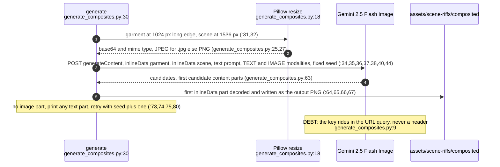
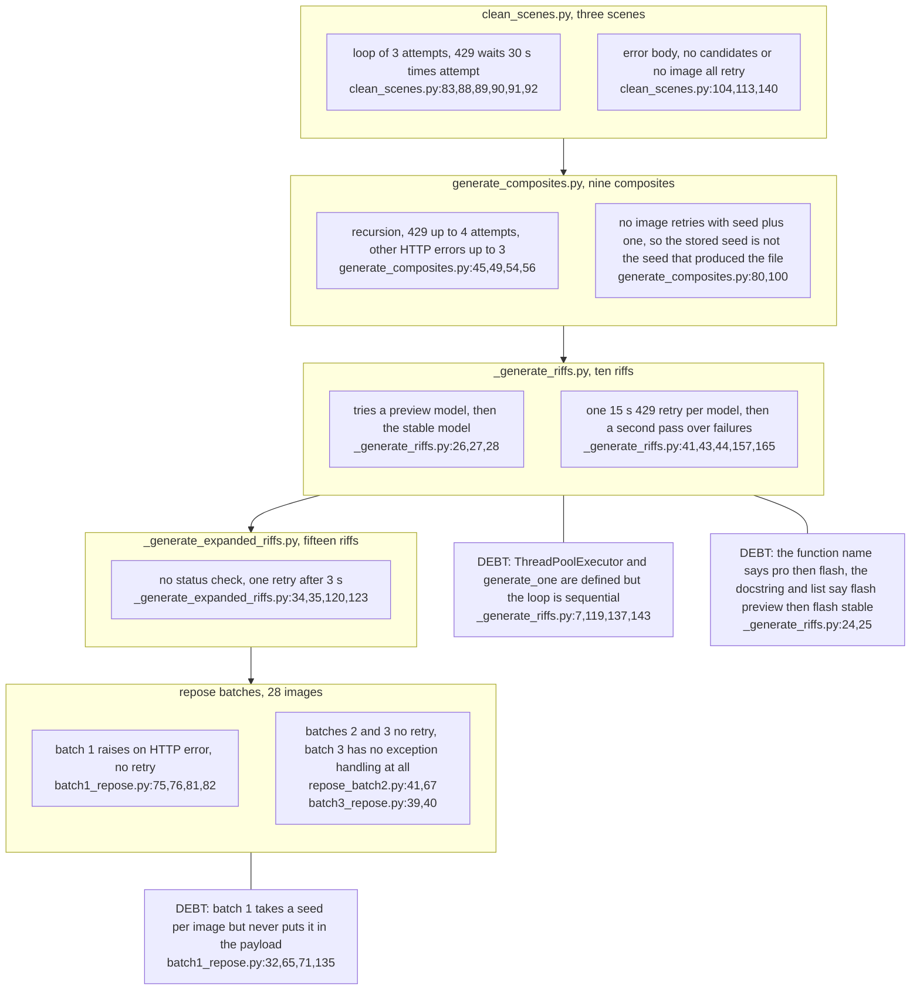
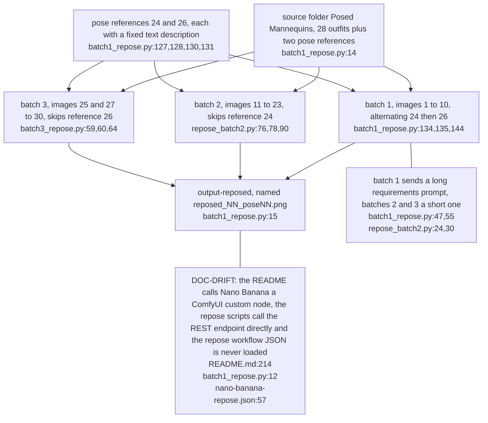

## TH-03.1 One generateContent call, the shape every image script shares

**What it shows.** Scene cleaning, composites, riffs and repose all build this one-or-two-image request and save the first image part.

## TH-03.2 Retry and fallback, script by script

**What it shows.** Five scripts, five different retry policies; none shares a helper, so behaviour under rate limiting differs per phase.

## TH-03.3 Mannequin repose, how thirty source images were split

**What it shows.** The 28 outputs are three hand-partitioned batches with two different prompts; the ComfyUI repose workflow is documentation of an equivalent graph, not the path that ran.
