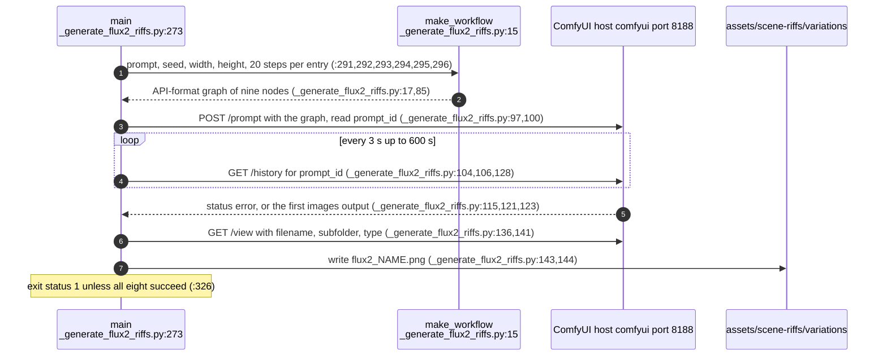
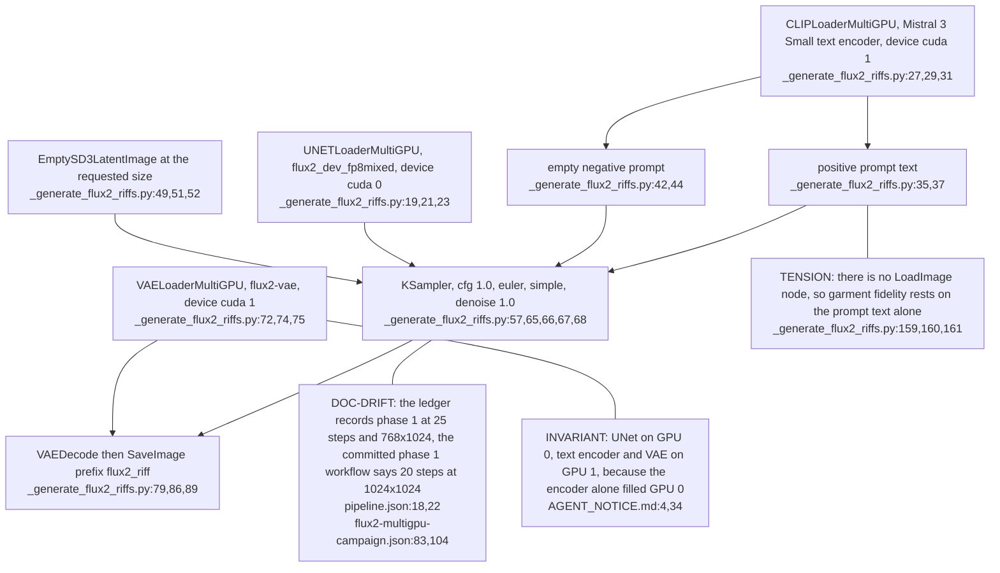
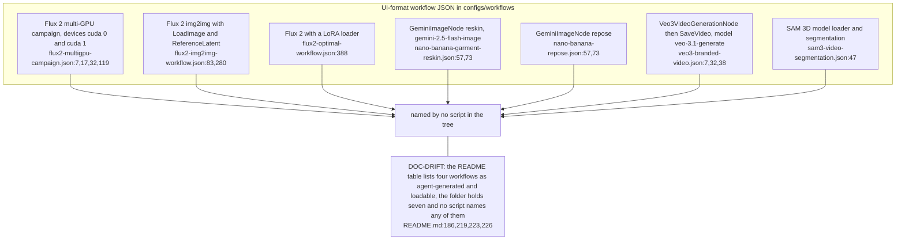

## TH-04.1 Submit, poll and download one Flux 2 image

**What it shows.** The only script that drives ComfyUI posts an API-format graph it builds itself and polls history; it never loads a committed workflow file.

## TH-04.2 The graph it builds and where each model sits

**What it shows.** The two-GPU split is fixed in the graph by device name, not negotiated by ComfyUI at run time.

## TH-04.3 Committed workflow files and what uses them

**What it shows.** The workflow files are artefacts for a human to open in ComfyUI; the scripts that produced assets used REST calls or a self-built graph instead.
