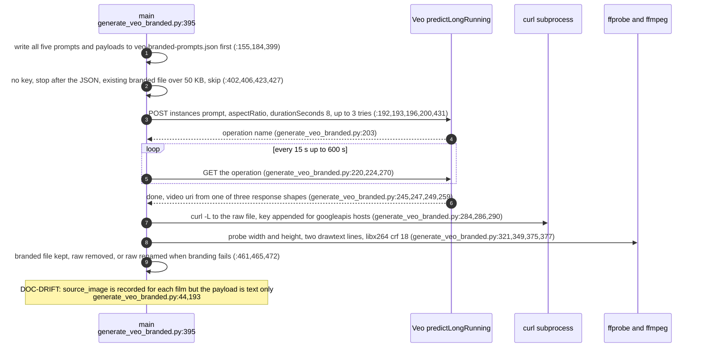
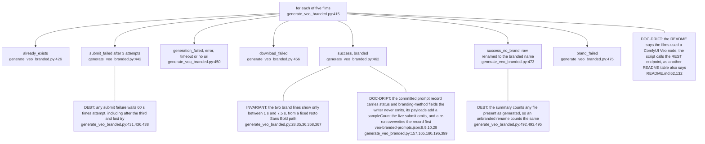
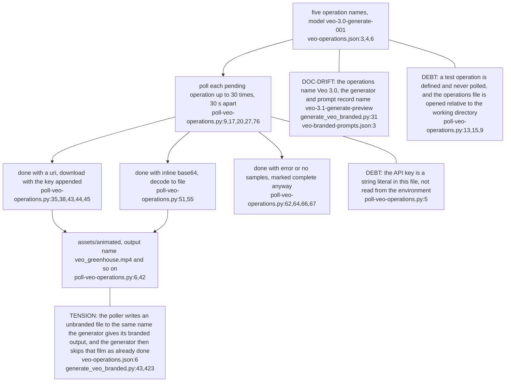
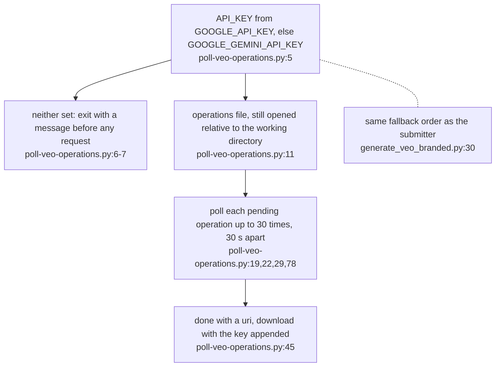

## TH-05.1 One film from prompt to branded MP4

**What it shows.** Every film is text to video; the riff image named as its source never reaches the API, and branding is an ffmpeg overlay afterwards.

## TH-05.2 Outcomes a film can end in

**What it shows.** A brand failure still yields a file under the branded name, and the summary does not distinguish it.

## TH-05.3 The separate poller and its operation list

> **Superseded** by TH-05.4 at 27262fa (frozen at e795254).

**What it shows.** A second, older Veo path exists beside the generator; which of the two produced the committed films is not recorded in code.

## TH-05.4 The poller's key, read from the environment

- **What it shows:** the frozen TH-05.3 recorded the key as a string literal in the poller. Since 27262fa it is read from the environment, with the submitter's fallback, and a missing key stops the script. The rest of TH-05.3 (model name drift, the unbranded-output tension, the unpolled test operation) is unchanged at this revision.
- **Why it is this way:** PR #1 (27262fa); the replaced key was already invalid (tested 2026-11-23), so the fix closes the pattern rather than a live credential.
