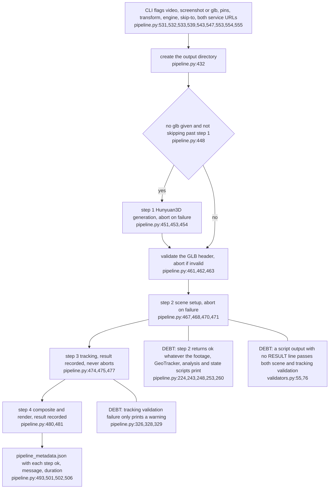
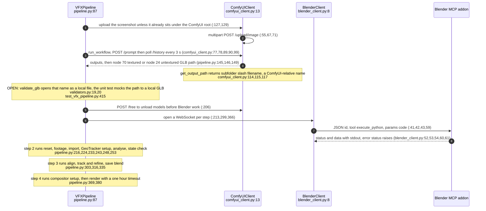
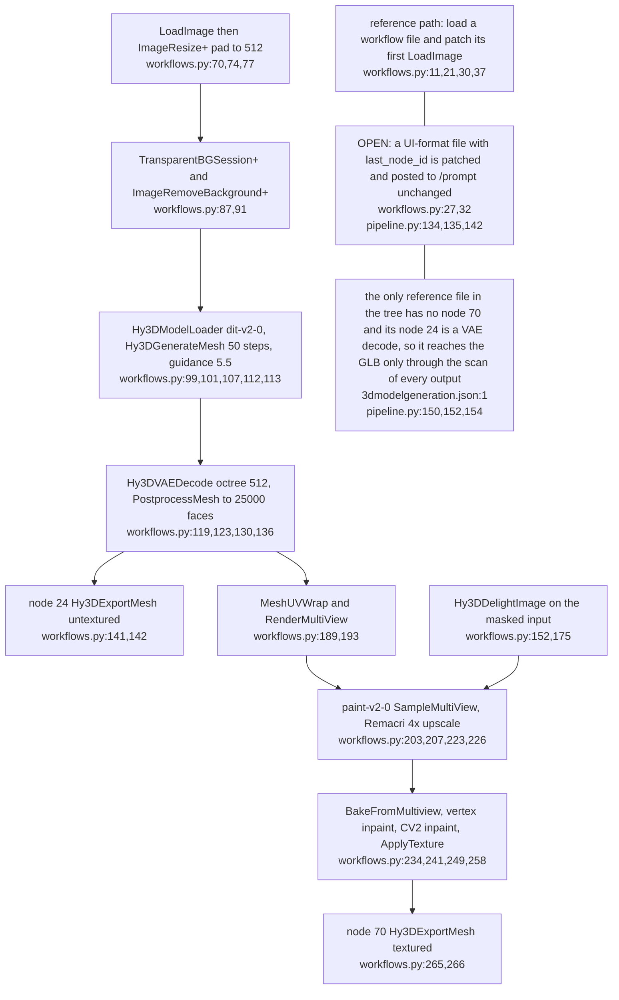
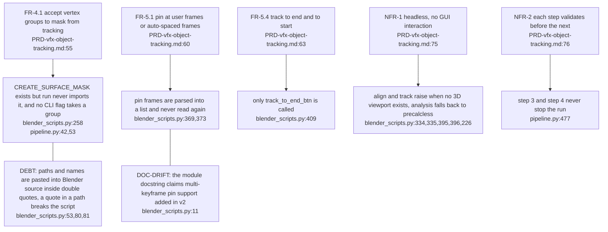

## TH-06.1 What run does, step by step

**What it shows.** Only step 1, the GLB check and step 2's reset and import can stop a run; tracking and render outcomes are recorded, not enforced.

## TH-06.2 The two clients and the Blender script sequence

**What it shows.** Each Blender step is Python source sent as one `execute_python` call; results come back only as printed stdout that the validators parse.

## TH-06.3 The Hunyuan3D v2 graph built when no reference workflow is given

**What it shows.** Step 1 prefers node 70 then node 24 and falls back to the first `.glb` or `.gltf` output from any node.

## TH-06.4 What the PRD asks for against what the code does

**What it shows.** Five PRD requirements are unmet or contradicted in code, each marked against the line that decides it.
