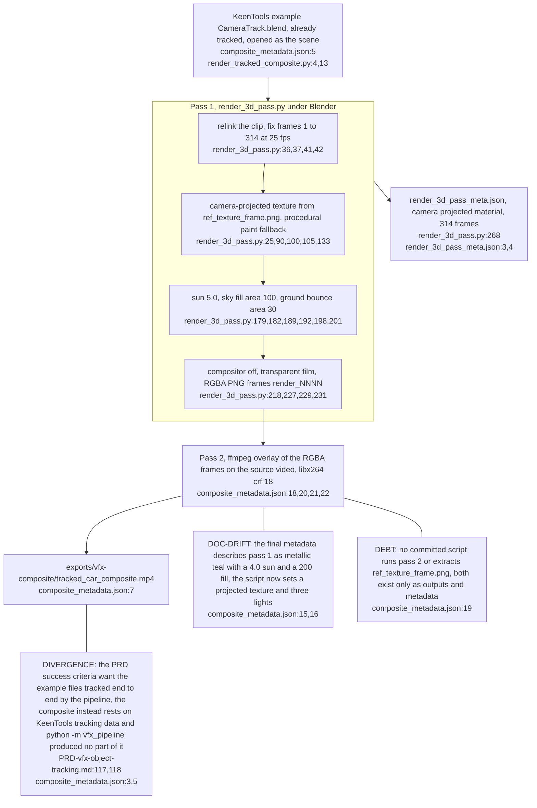
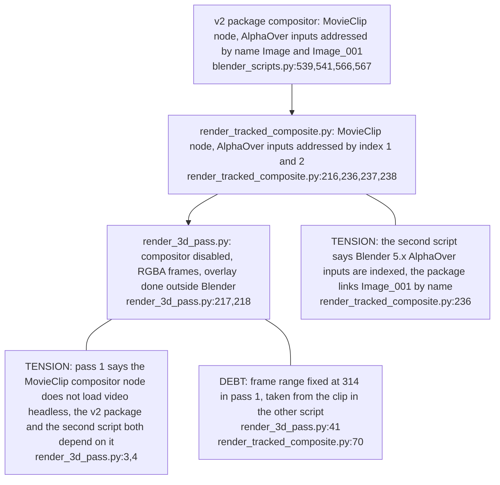
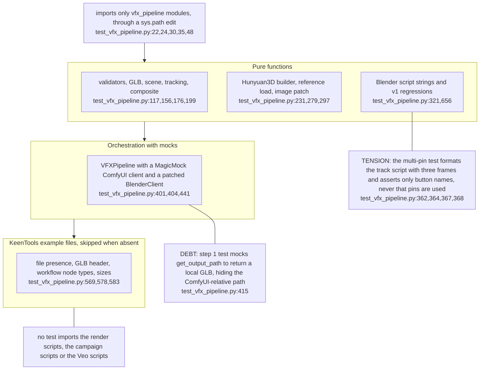

## TH-07.1 How tracked_car_composite.mp4 was made

**What it shows.** The committed VFX output is a two-pass render of the vendor's pre-tracked example scene, made outside the v2 pipeline package.

## TH-07.2 Three compositor approaches that disagree

**What it shows.** The approach that worked, a transparent 3D pass overlaid by ffmpeg, was never folded back into the package's step 4.

## TH-07.3 What the test suite covers

**What it shows.** Coverage stops at the package boundary; every script that produced a committed asset is untested.
