## For developers

The graph side of the server is a tree of actix actors under `GraphServiceSupervisor`, the one live supervision path since ADR-2045 removed the generic supervisor (VC-02.4 to VC-02.7). It starts four children in a fixed order, routes every graph, physics and client message to the right one (VC-02.3) and restarts a failed child with backoff or escalates. The position path is GPU to `ForceComputeActor` to the supervisor to `ClientCoordinatorActor`, never through the physics orchestrator (ADR-2141, VC-02.12). A node interaction carries its holder, so only the connection that took a node can release it (VC-02.12). At 809a859aa `ProtectedSettingsActor` is gone from the tree (VC-02.1).

## For the business

These are the server's internal workers for the graph, physics and connected viewers, and the rules for restarting one that fails. A failed worker is restarted a bounded number of times and then escalated, rather than being retried forever. Moving a node now stays smooth when two people grab the same node: one person letting go no longer stops the layout while the other is still dragging.

## VC-02.1 Supervision-tree topology — AppState::new boot order
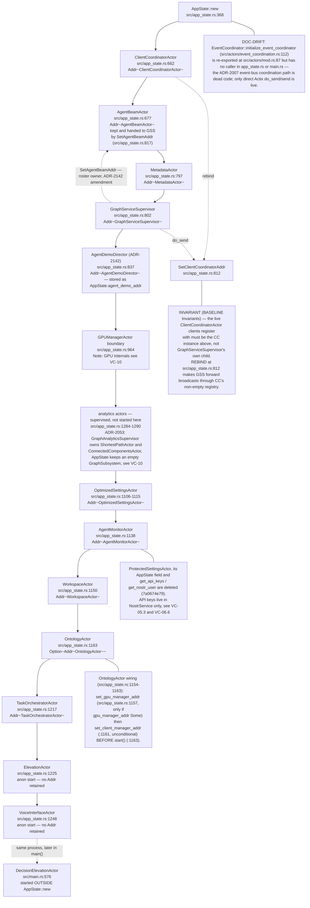

## VC-02.2 GraphServiceSupervisor::initialize_actors — child start order and wiring
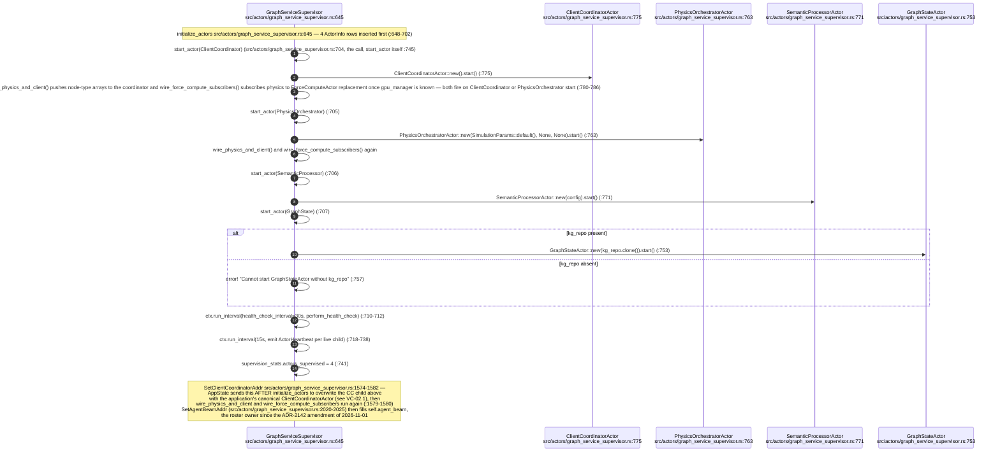

## VC-02.3 GraphServiceSupervisor message routing table
```mermaid
flowchart LR
    subgraph SUP["GraphServiceSupervisor handlers — grep impl Handler< src/actors/graph_service_supervisor.rs"]
        H1["SupervisorMessage graph_service_supervisor.rs:1436"]
        H2["ActorHeartbeat graph_service_supervisor.rs:1444"]
        H3["GetSupervisorStatus graph_service_supervisor.rs:1459"]
        H4["RestartActor graph_service_supervisor.rs:1467"]
        H5["RestartAllActors graph_service_supervisor.rs:1476"]
        H6["RESOLVED ADR-2045 (2026-09-05)<br/>SetParentSupervisor handler removed<br/>with src/actors/supervisor.rs, see VC-02.7"]
        H7["msgs::GetGraphData graph_service_supervisor.rs:1490"]
        H8["NotifyGraphUpdated graph_service_supervisor.rs:1525"]
        H9["SetClientCoordinatorAddr graph_service_supervisor.rs:1574"]
        H10["msgs::ReloadGraphFromDatabase graph_service_supervisor.rs:1585"]
        H11["msgs::ComputeShortestPaths graph_service_supervisor.rs:1689"]
        H12["msgs::UpdateGraphData graph_service_supervisor.rs:1715"]
        H13["msgs::AddNodesFromMetadata graph_service_supervisor.rs:1745"]
        H14["msgs::StartSimulation graph_service_supervisor.rs:1771"]
        H15["msgs::SimulationStep graph_service_supervisor.rs:1788"]
        H16["msgs::GetBotsGraphData graph_service_supervisor.rs:1815"]
        H17["msgs::UpdateSimulationParams graph_service_supervisor.rs:1840"]
        H18["msgs::ForceResumePhysics graph_service_supervisor.rs:1868"]
        H19["msgs::InitializeGPUConnection graph_service_supervisor.rs:1897"]
        H20["msgs::SetAppGpuComputeAddr graph_service_supervisor.rs:2000"]
        H21["msgs::UpdateBotsGraph graph_service_supervisor.rs:2031"]
        H29["msgs::UpdateChainPayments graph_service_supervisor.rs:2043"]
        H30["SetAgentBeamAddr graph_service_supervisor.rs:2020"]
        H22["msgs::UpdateNodePositions graph_service_supervisor.rs:2058"]
        H23["msgs::NodeInteractionMessage graph_service_supervisor.rs:2067"]
        H24["msgs::GetGraphStateActor graph_service_supervisor.rs:2135"]
        H25["msgs::GetPhysicsOrchestratorActor graph_service_supervisor.rs:2144"]
        H26["msgs::GetNodeTypeArrays graph_service_supervisor.rs:2159"]
        H27["msgs::GetNodeIdMapping graph_service_supervisor.rs:2181"]
        H28["msgs::AddEdge graph_service_supervisor.rs:2203"]
    end
    GS["self.graph_state (GraphStateActor)"]
    PH["self.physics (PhysicsOrchestratorActor)"]
    CL["self.client (ClientCoordinatorActor)"]
    GM["self.gpu_manager (GPUManagerActor) — boundary, see VC-10"]
    SELF["self (in-place state)"]
    AB["self.agent_beam (AgentBeamActor) — real-agent roster owner,<br/>ADR-2142 amendment 2026-11-01, see VC-02.20"]

    H7 --> GS
    H10 --> GS
    H11 --> GS
    H12 --> GS
    H13 --> GS
    H16 --> AB
    H21 --> AB
    H29 --> AB
    H30 -->|"self.agent_beam = msg.addr"| SELF
    H26 --> GS
    H27 --> GS
    H28 --> GS
    H22 -->|"publish_positions"| GS
    H22 -->|"one PublishPositions, ADR-2141"| CL
    H14 --> PH
    H15 --> PH
    H17 --> PH
    H18 --> PH
    H23 --> PH
    H25 --> PH
    H19 -->|"query GetForceComputeActor, InitializeGPU"| GM
    H19 -->|"StoreGPUComputeAddress"| PH
    H1 --> SELF
    H2 --> SELF
    H3 --> SELF
    H4 --> SELF
    H5 --> SELF
    H8 --> SELF
    H9 -->|"self.client = msg.addr, rewire"| CL
    H20 --> SELF
    H24 --> SELF

    N1["H12/H13/H28 also call notify_graph_updated (debounced graphUpdated broadcast) before forwarding<br/>H24/H26/H27 default-value fallback when the target child is None (never propagate an error to caller)<br/>H22 UpdateNodePositions no longer reaches PhysicsOrchestratorActor: publish_positions (graph_service_supervisor.rs:612) sends PublishPositions to the client coordinator and forwards the original UpdateNodePositions to GraphStateActor<br/>which mutates its Arc~GraphData~ in-place (graph_state_actor.rs:807-808), so a later GetGraphData poll (H7) returns the GPU-computed layout<br/>notify_graph_updated (called by H12/H13/H28) now also pushes node-type arrays to the coordinator before its debounce (graph_service_supervisor.rs:555-560, push_node_type_arrays :1542)"]
    H12 --- N1
```

## VC-02.4 GraphServiceSupervisor restart and backoff lifecycle — the one live supervision path
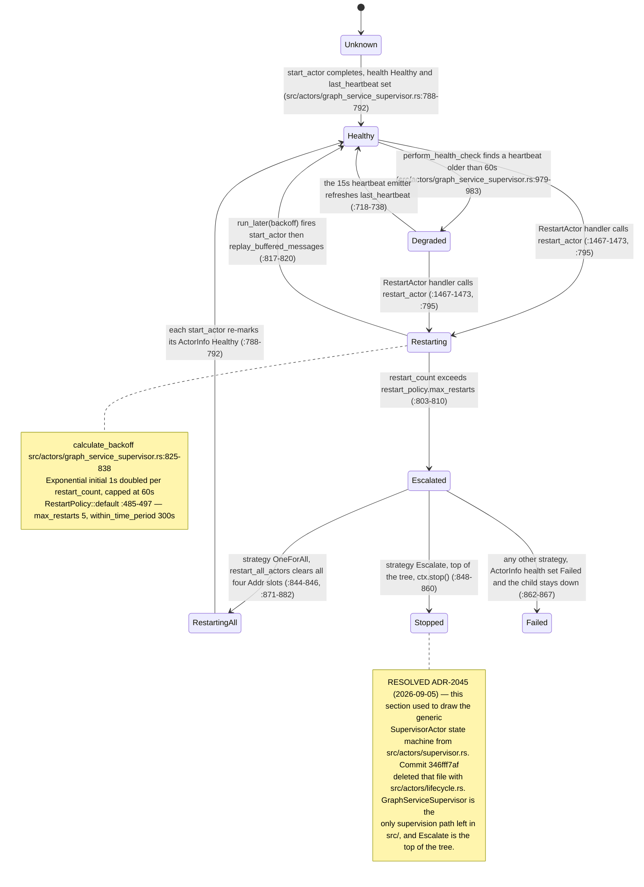

## VC-02.5 GraphServiceSupervisor restart sequence — RestartActor to replay or escalate
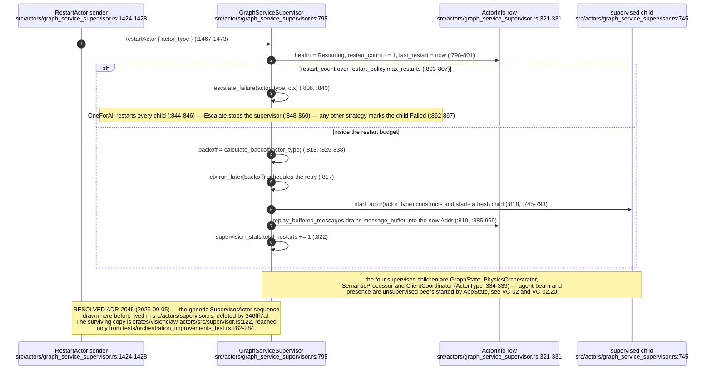

## VC-02.6 Drain and shutdown — GraphServiceSupervisor stop and the test-only crate drain
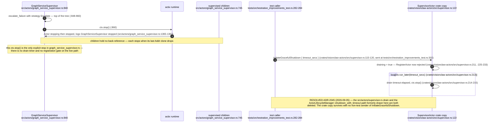

## VC-02.7 RESOLVED ADR-2045 — the removed supervision machinery and its survivor
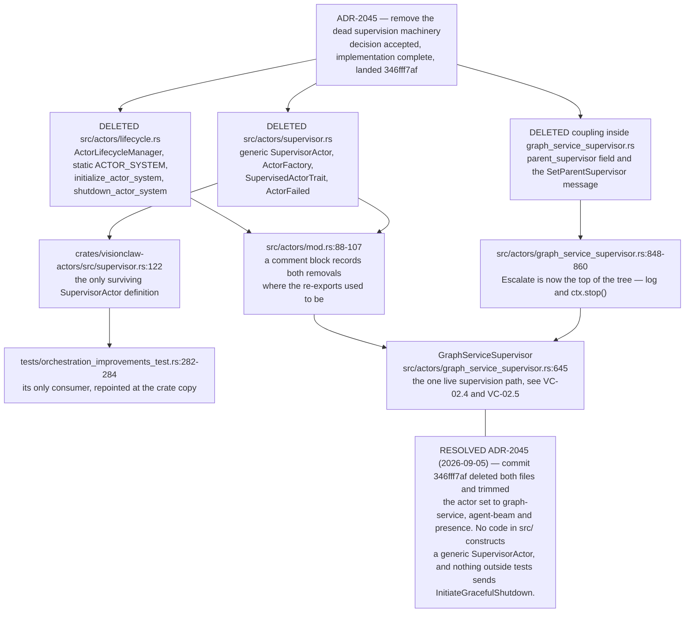

## VC-02.9 Message catalogue — client_messages, graph_messages, broadcast_messages
```mermaid
classDiagram
    class ClientCoordinatorActor {
      <<actor>>
      src/actors/client_coordinator_actor.rs
    }
    class RegisterClient {
      +ClientRecipients recipients
      result() Result~usize,String~
    }
    class ClientRecipients {
      +Recipient~SendToClientBinary~ binary
      +Recipient~SendToClientText~ text
      +Recipient~SendInitialGraphLoad~ initial_load
    }
    class UnregisterClient {
      +usize client_id
    }
    class BroadcastMessage {
      +String message
    }
    class GraphServiceSupervisor {
      <<actor>>
    }
    class GetGraphData {
      result() Result~Arc,String~
    }
    class UpdateGraphData {
      +Arc~ServiceGraphData~ graph_data
      result() Result~(),String~
    }
    class UpdateNodePositions {
      +List~u32,BinaryNodeData~ positions
      +Option~MessageId~ correlation_id
      result() Result~(),String~
    }
    class AddNodesFromMetadata {
      +MetadataStore metadata
      result() Result~(),String~
    }
    class AddEdge {
      +Edge edge
      result() Result~(),String~
    }
    class NodeInteractionMessage {
      +u32 node_id
      +u64 holder
      +NodeInteractionType interaction_type
      +Option~List~f32~~ position
      result() Result~(),VisionClawError~
    }
    RegisterClient *-- ClientRecipients
    ClientCoordinatorActor ..> RegisterClient
    ClientCoordinatorActor ..> UnregisterClient
    ClientCoordinatorActor ..> BroadcastMessage
    GraphServiceSupervisor ..> GetGraphData
    GraphServiceSupervisor ..> UpdateGraphData
    GraphServiceSupervisor ..> UpdateNodePositions
    GraphServiceSupervisor ..> AddNodesFromMetadata
    GraphServiceSupervisor ..> AddEdge
    GraphServiceSupervisor ..> NodeInteractionMessage
    note for GetGraphData "src/actors/messages/ — RegisterClient/UnregisterClient/BroadcastMessage\nowned by client_coordinator_actor.rs consumer; Result types confirmed from\nHandler impls at graph_service_supervisor.rs:1490,1715,2058,1745,2203,2067"
```

## VC-02.10 Message catalogue — supervision and heartbeat messages
```mermaid
classDiagram
    class GraphServiceSupervisor {
      <<actor>>
    }
    class SupervisorMessage {
      <<enum>>
      UpdateGraphData
      ReloadGraphFromDatabase
      StartSimulation
      StopSimulation
      SimulationStep
      UpdateSimulationParams
      UpdateNodePositions
      BroadcastMessage
      result() Result~(),VisionClawError~
    }
    class ActorHeartbeat {
      +ActorType actor_type
      +Instant timestamp
      +ActorHealth health
      +Option~ActorStats~ stats
    }
    class GetSupervisorStatus {
      result() SupervisorStatus
    }
    class RestartActor {
      +ActorType actor_type
      result() Result~(),VisionClawError~
    }
    class RestartAllActors {
      result() Result~(),VisionClawError~
    }
    class SetParentSupervisor {
      +Addr~SupervisorActor~ parent
    }
    class SetClientCoordinatorAddr {
      +Addr~ClientCoordinatorActor~ addr
    }
    class NotifyGraphUpdated {
      +str reason
    }
    class ActorFailed {
      +String actor_name
      +VisionClawError error
    }
    GraphServiceSupervisor ..> SupervisorMessage
    GraphServiceSupervisor ..> ActorHeartbeat
    GraphServiceSupervisor ..> GetSupervisorStatus
    GraphServiceSupervisor ..> RestartActor
    GraphServiceSupervisor ..> RestartAllActors
    GraphServiceSupervisor ..> SetClientCoordinatorAddr
    GraphServiceSupervisor ..> NotifyGraphUpdated
    note for SetClientCoordinatorAddr "src/actors/graph_service_supervisor.rs:1574-1582 —\nfield and handler both confirmed by direct read.\nRESOLVED ADR-2045 (2026-09-05) — SetParentSupervisor and ActorFailed\nwere removed from this actor with src/actors/supervisor.rs, see VC-02.7"
```

## VC-02.12 PhysicsOrchestratorActor — handled messages and the position path (ADR-2141)
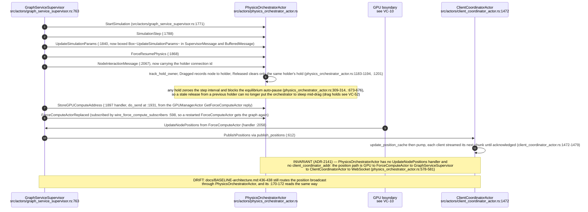

**Drift (BASELINE-architecture.md vs code):** `docs/BASELINE-architecture.md:436-438` and `:170-172` name `PhysicsOrchestratorActor` as the hop between `ForceComputeActor` and `ClientCoordinatorActor`; `src/actors/graph_service_supervisor.rs:2058-2064` hands `UpdateNodePositions` to `publish_positions` (`:612`), which sends `PublishPositions` straight to the coordinator, and the orchestrator has no handler for it (`src/actors/physics_orchestrator_actor.rs:578-581`).

## VC-02.15 SemanticProcessorActor and OptimizedSettingsActor — message surfaces
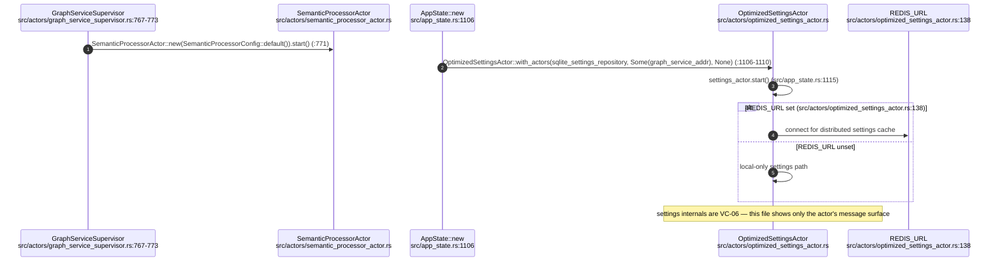

## VC-02.18 ElevationActor (+ elevation_voice.rs) and DecisionElevationActor
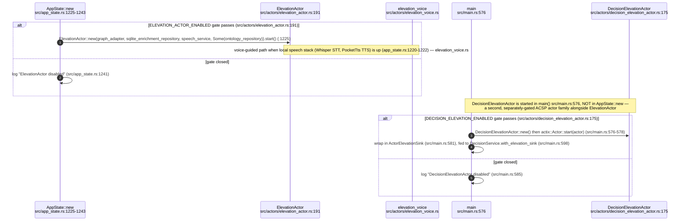

## VC-02.19 VoiceInterfaceActor (+ voice_commands.rs) and MultiMcpVisualizationActor
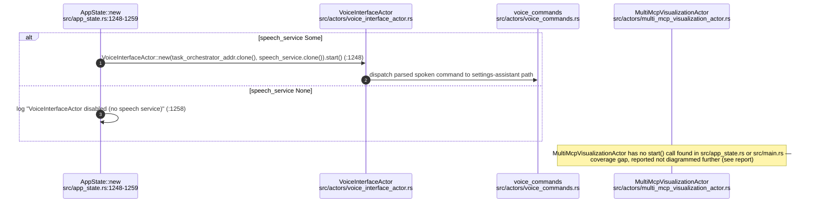

## VC-02.20 AgentMonitorActor and AgentBeamActor — message surfaces
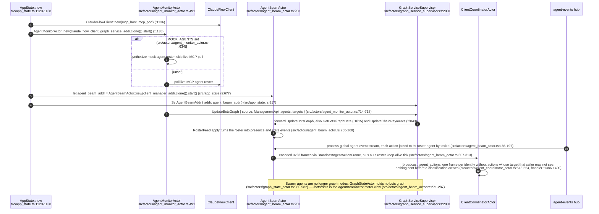

**Drift (RESOLVED in this restamp, 2026-11-02):** at 8692b12 this file routed `GetBotsGraphData`, `UpdateBotsGraph` and `UpdateChainPayments` to `GraphStateActor` and drew `AgentBeamActor` with no retained address. At 86cdd7635 all three go to `AgentBeamActor` (`src/actors/graph_service_supervisor.rs:1815`, `:2031`, `:2043`), registered by `SetAgentBeamAddr` (`src/app_state.rs:817`), and `GraphStateActor` holds no bots graph (`src/actors/graph_state_actor.rs:980-982`).
