## VC-03.1 REST request end-to-end — nginx to handler, real middleware order
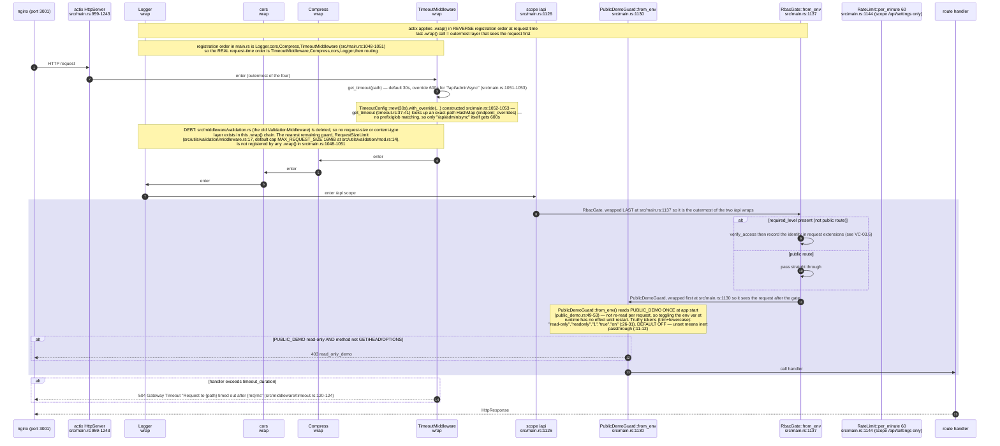

## VC-03.2 WebSocket upgrade lifecycle — every upgrade route, how each carrier is attributed
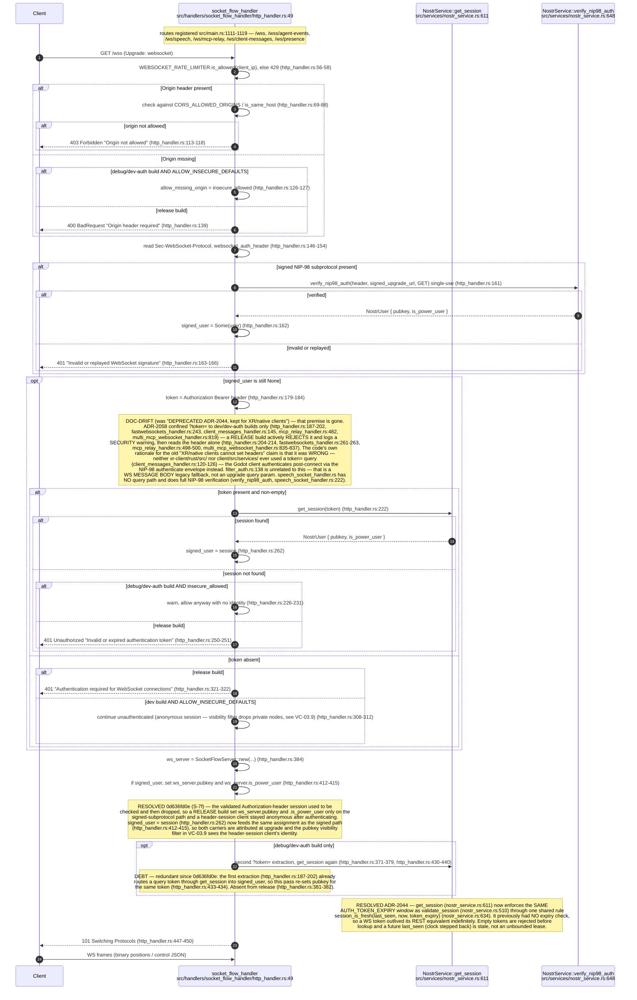

## VC-03.3 `AuthenticatedUser` extractor — settings API dual-auth
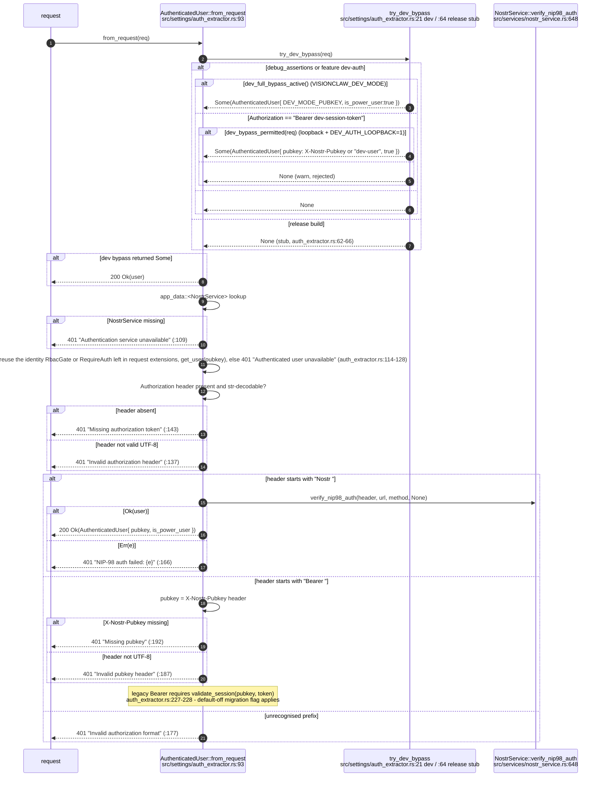

## VC-03.4 NIP-98 verification (kind 27235) — fixed order, single-use replay claim
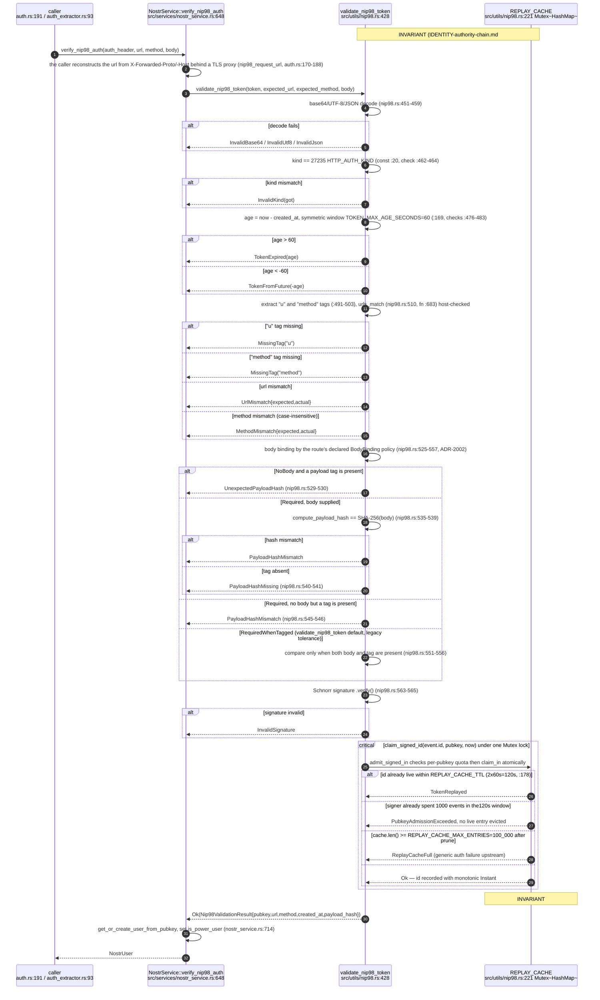

## VC-03.5 Session-bearer realm (ADR-2009) — NIP-98 signing vs opaque session token
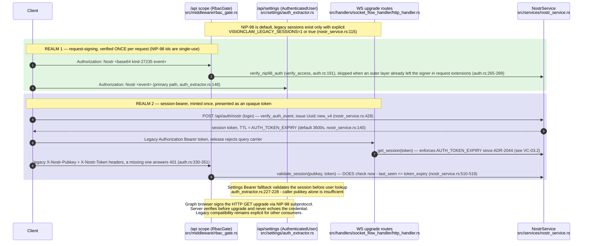

## VC-03.6 `RbacGate` decision sequence — env flags, allowlist, method classification
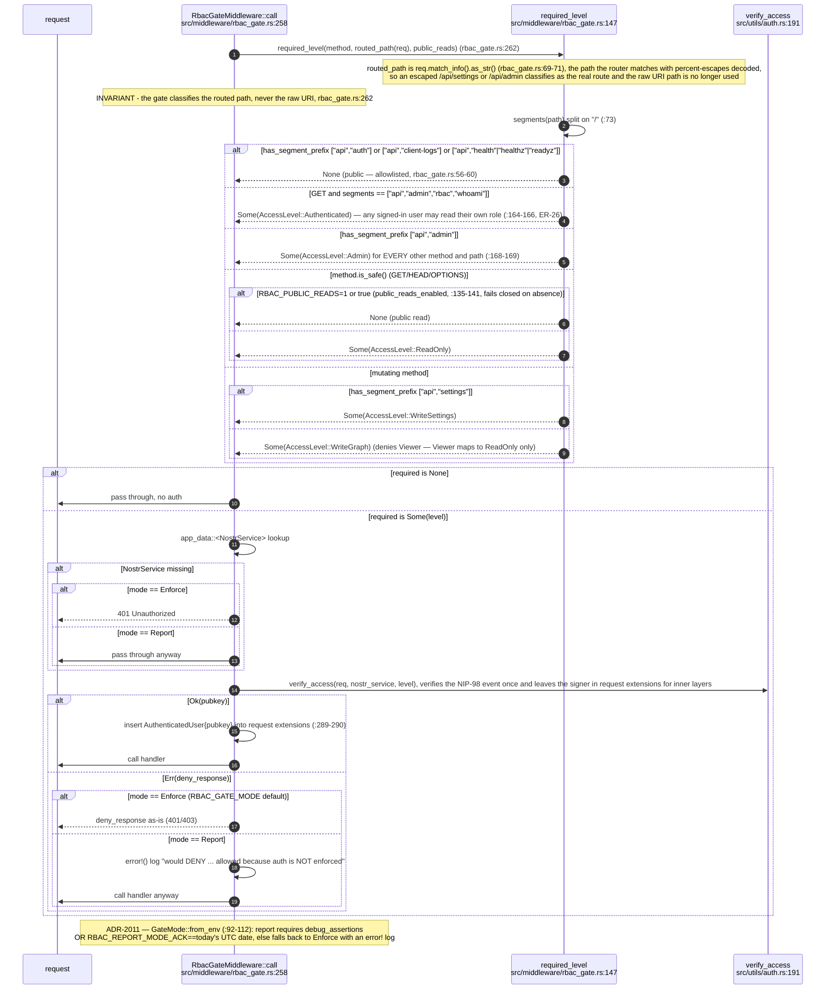

## VC-03.7 Role lattice — Owner > Admin > Editor > Viewer, default-role resolution
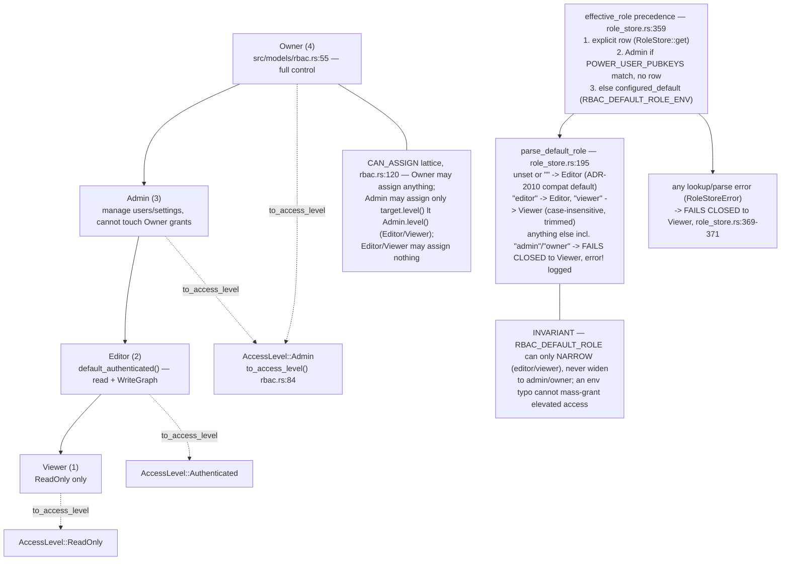

## VC-03.8 `role_store` atomic mutations (ADR-2010) — grant/revoke/transfer
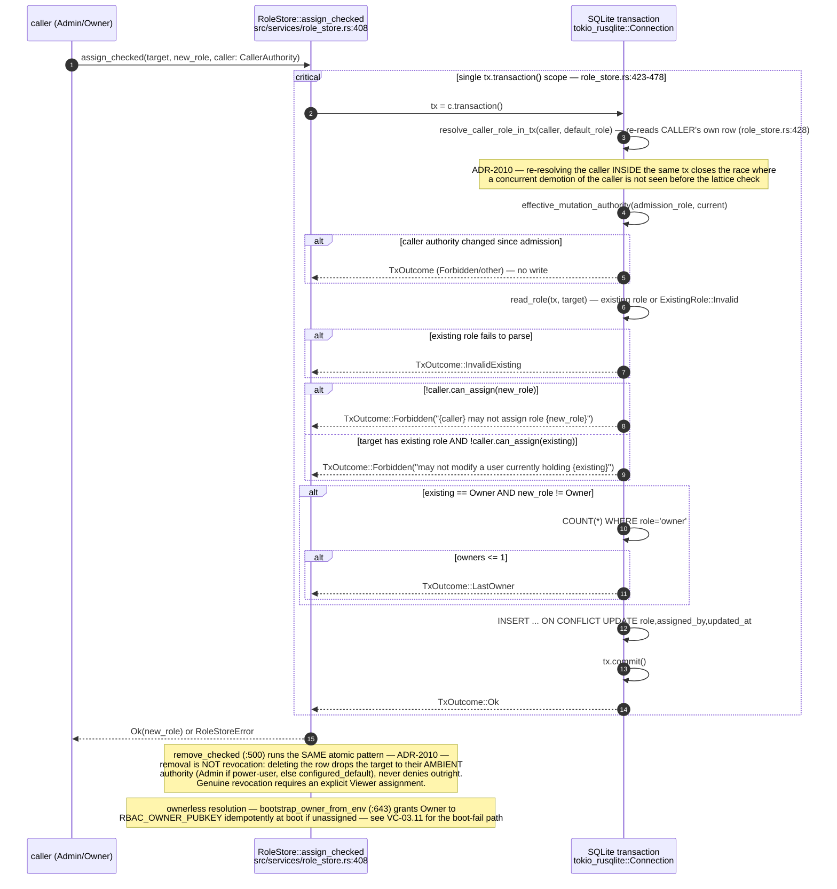

## VC-03.9 `PUBKEY_VISIBILITY_FILTER` — per-client entitlement on the position stream and the initial load
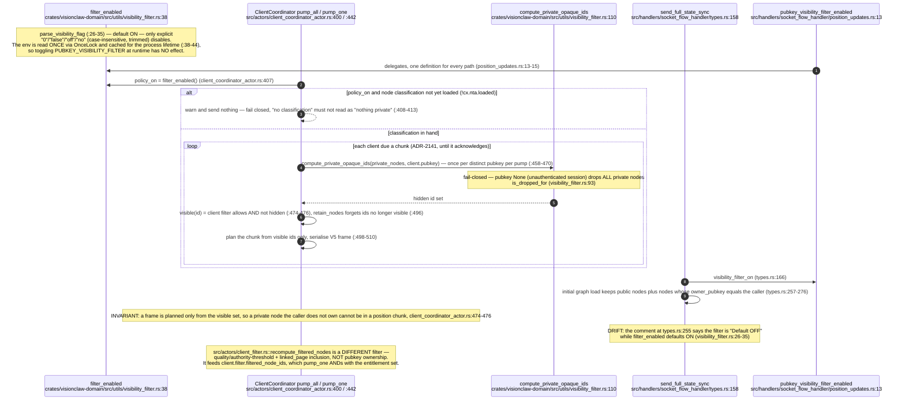

## VC-03.11 Dev bypass triple gate (ADR-2012 / ADR-2039) — nested conditions
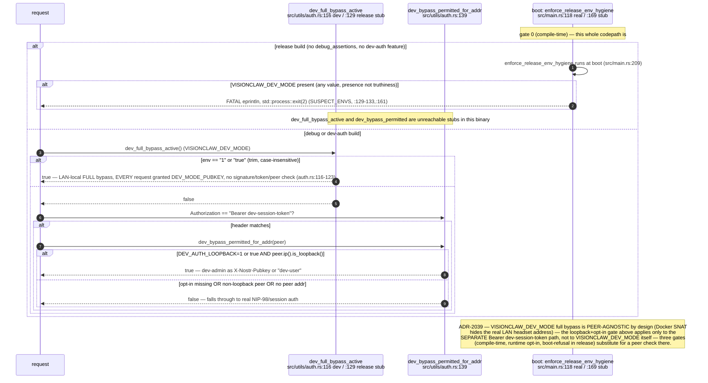

## VC-03.12 `RateLimit` middleware — sliding window per identifier
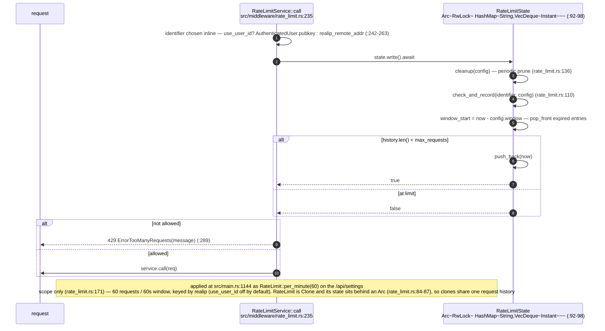

## VC-03.15 Identity authority chain end-to-end — Nostr key to role
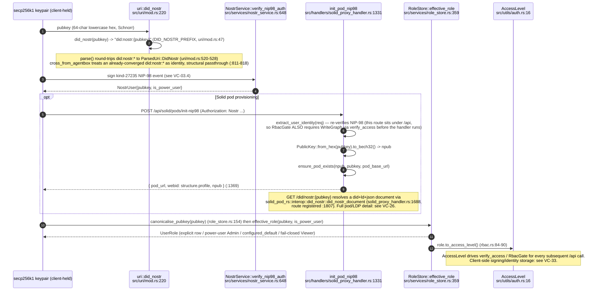

## VC-03.16 ADR-2013 federation-delegation boundary — NOT implemented
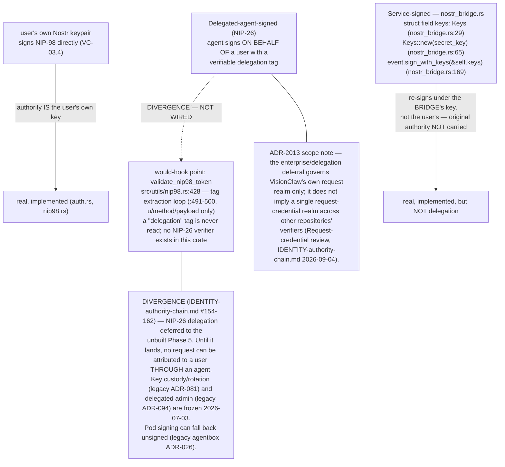

2026-09-07 closeout: `settings/auth_extractor.rs` reuses the server-side
middleware identity extension. The NIP-98 token is consumed once within the
request; a new request presenting the same token still fails. The regression
test checks both outcomes and preserves the authenticated user's privilege bit.

## VC-03.17 Signed browser upgrade and legacy-session sunset

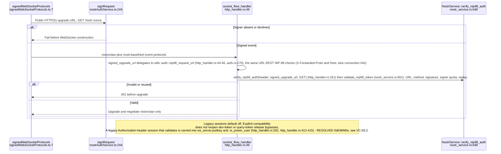
