## VC-04.1 api_handler graph — read path (data, paginated, positions, fold, relations, expand, pattern)
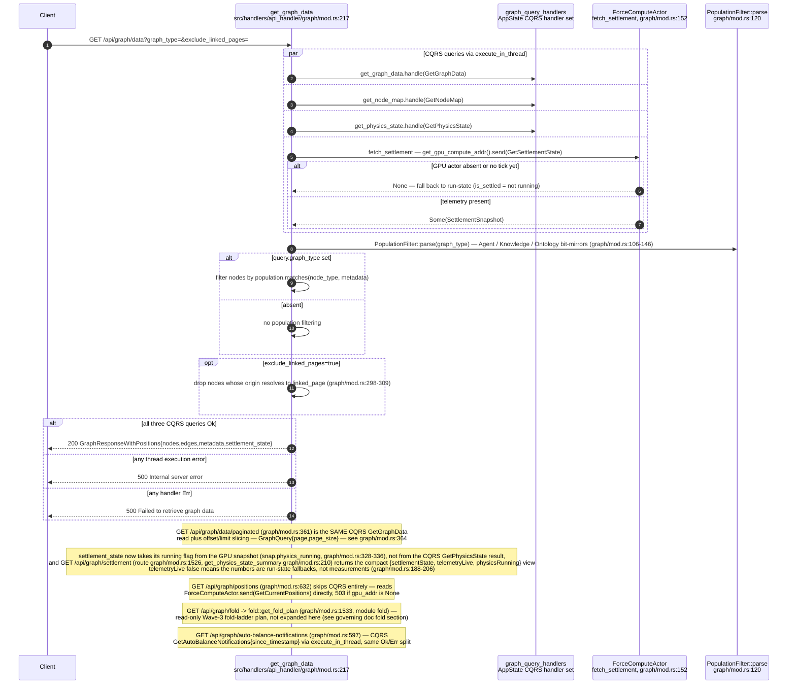

## VC-04.2 api_handler graph — node/{id} relations, expand, pattern-query (RateLimit 120/min)
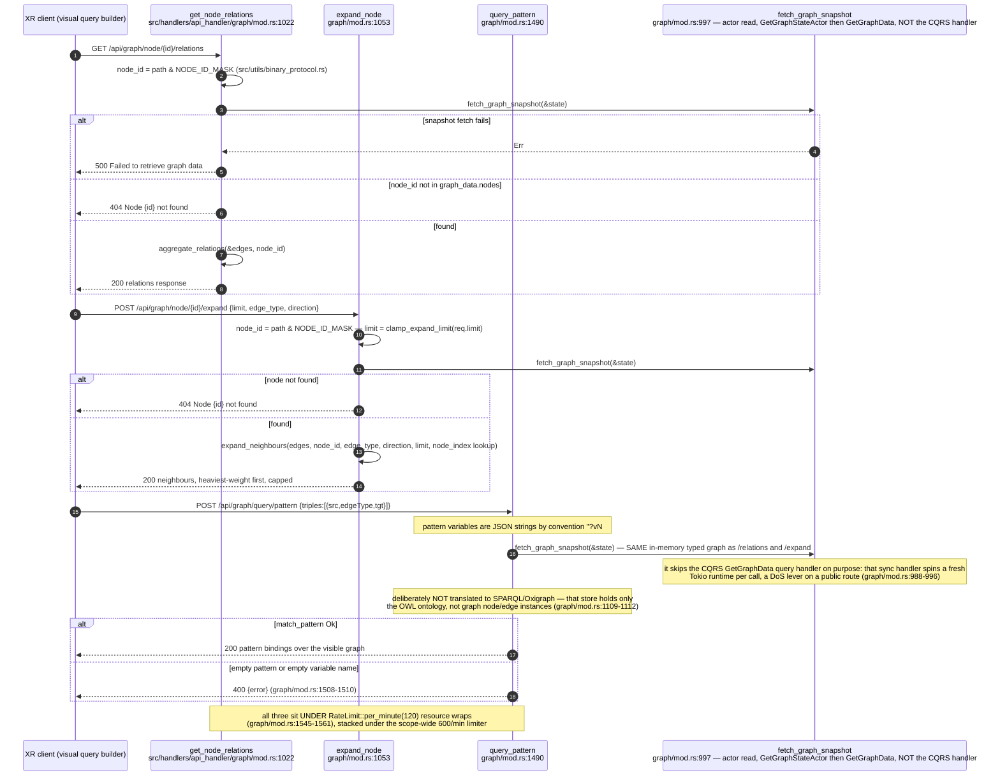

## VC-04.3 api_handler graph — update (power_user bulk reload) and refresh (authenticated read-back)
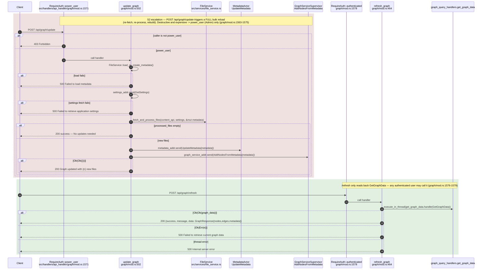

**Drift (RESOLVED, graph_state_handler removed in project commit 061d8cbf8):** this topic used to draw a second `/api/graph` family, `graph_state_handler` (nine routes: GET `/state`, GET `/statistics`, POST `/nodes`, GET, PUT and DELETE `/nodes/{id}`, POST `/edges`, PUT `/edges/{id}`, POST `/positions/batch`). Each handler ran a hexser CQRS handler over `state.graph_adapter`, the Oxigraph graph repository, directly, with no `GraphServiceSupervisor` message and so no actor notify, a third write path beside the actor path and the `graph_query_handlers` read path. The family never ran: `graph::config` registers `web::scope("/graph")` first (`src/handlers/api_handler/mod.rs:113`, comment at `src/handlers/api_handler/graph/mod.rs:1519`), actix claims the prefix for that first scope and answers 404 for every route of a later same-prefix scope, and none of the nine paths exists in the first. A same-order actix test confirmed 200 for the first scope and 404 for the second. The module, its `pub mod` and `.configure(...)` registrations and `tests/graph_state_integration.rs` were deleted. The surviving `/api/graph` surface is the single scope drawn in VC-04.1 to VC-04.3: `/settlement`, `/data`, `/data/paginated`, `/positions`, `/fold`, `/auto-balance-notifications`, `/node/{id}/relations`, `/node/{id}/expand`, `/query/pattern`, `/update`, `/refresh` (`src/handlers/api_handler/graph/mod.rs:1523`).

## VC-04.4 `files` scope — process/get_content/refresh_graph/update_graph
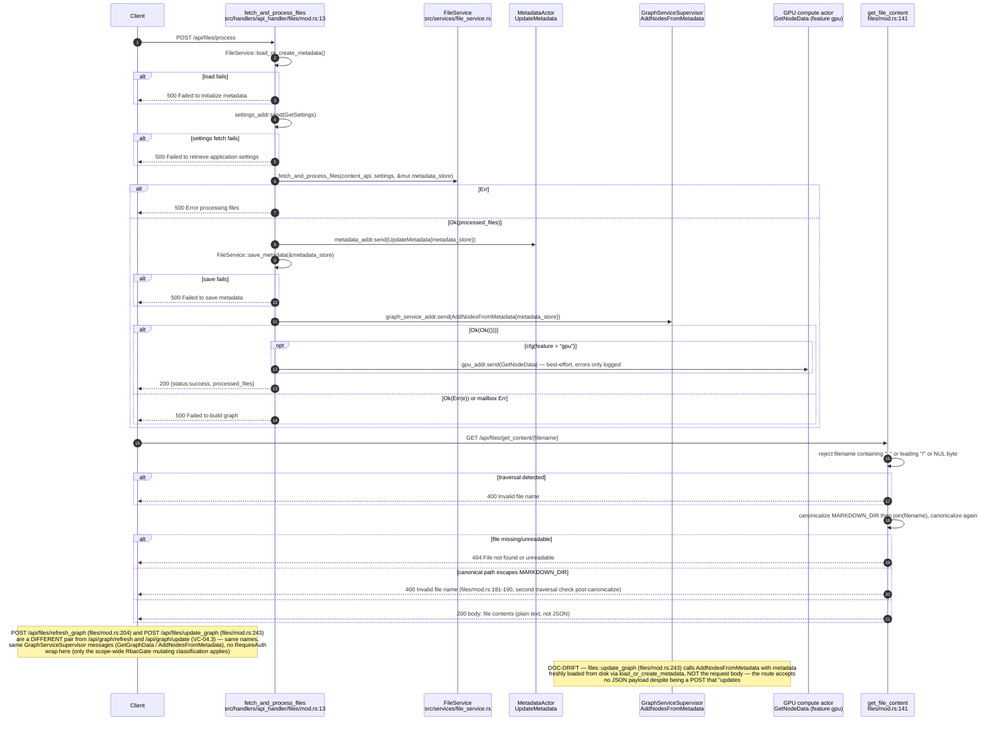

## VC-04.5 `bots` scope — data, initialize-swarm, spawn-agent-hybrid, submit/interrupt/status/remove task
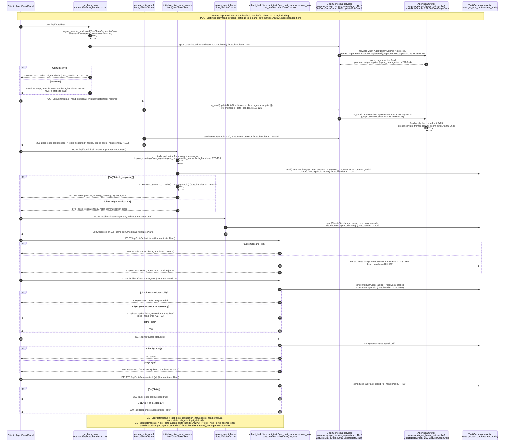

**Drift (RESOLVED at 86cdd7635):** the `BOTS_GRAPH` static fallback store this panel used to draw is gone. `GET /api/bots/data` and the REST roster write both go through `GraphServiceSupervisor` to `AgentBeamActor` (ADR-2142 amendment, project commit `15acb9219`): the write is fire-and-forget and the read answers with an empty view on any error (`src/handlers/bots_handler.rs:117-125`, `:148-151`).

## VC-04.6 `analytics` scope — GPU-touching compute triggers and telemetry reads
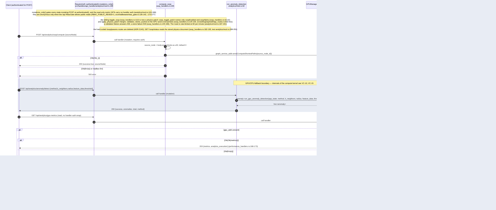

**Drift:** the comment at `src/handlers/api_handler/analytics/performance_handlers.rs:154-158` promises the per-kernel counters on every response, including failure branches. The mailbox-error and no-GPU branches return 503 through `service_unavailable!` without them (`src/handlers/api_handler/analytics/performance_handlers.rs:184-193`). Close it by attaching `analytics_execution` to both 503 bodies, or by narrowing the comment.

## VC-04.7 `ontology-physics` and `semantic-forces` — constraint application and the read-only semantic-forces views
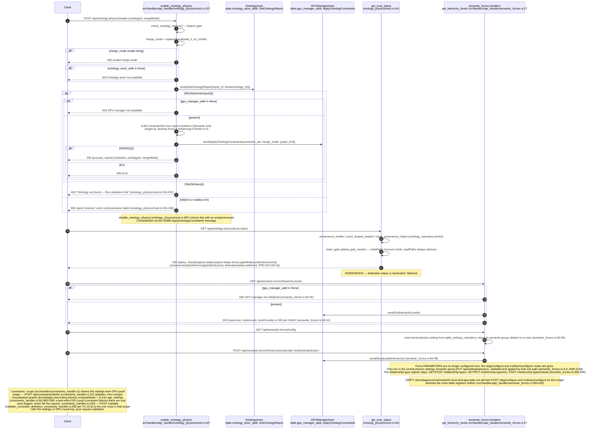

## VC-04.8 `ragflow` scope — external HTTP boundary (RAGFlow API)
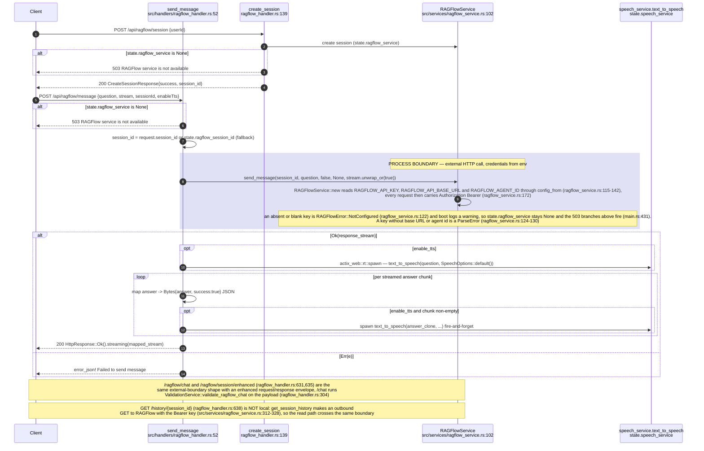

## VC-04.11 `graph-export` scope — rate limit, serialization, shared-link lifecycle
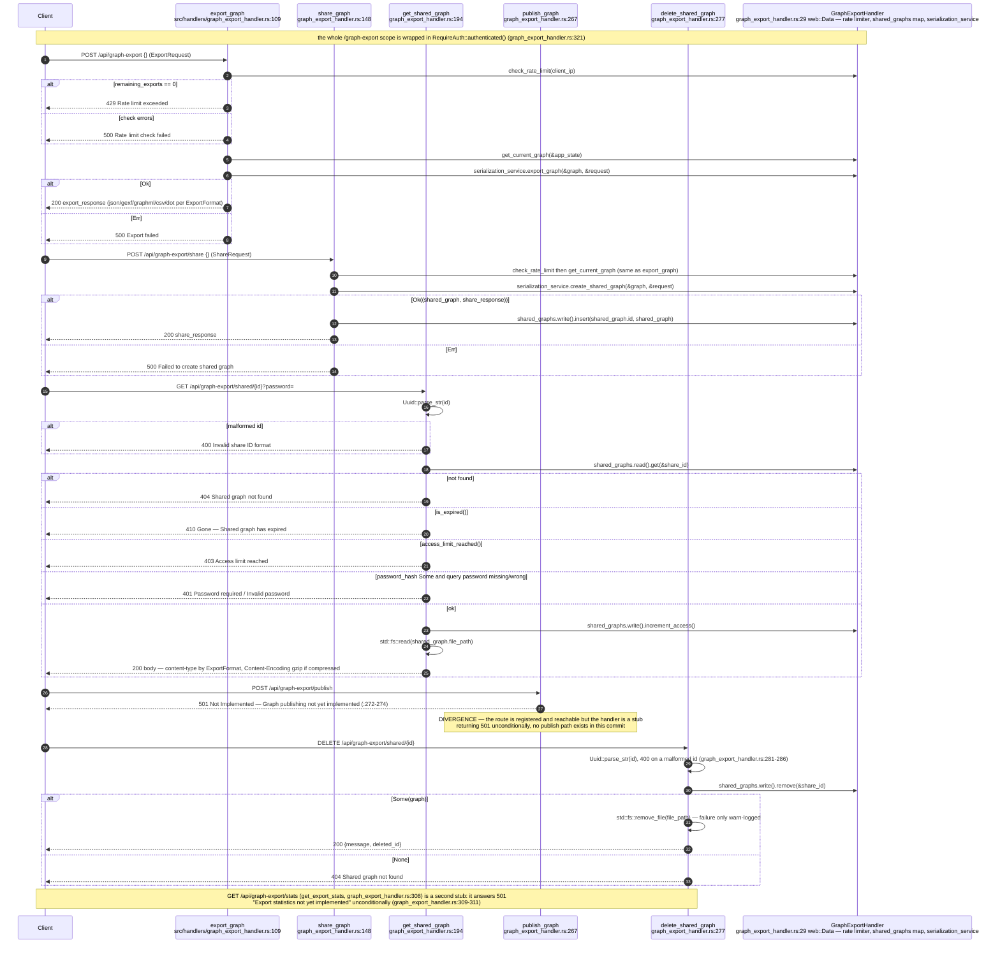

**Tension:** `configure_routes` builds a fresh `GraphExportHandler` on every call (`src/handlers/graph_export_handler.rs:315`), and that handler owns its `shared_graphs` map and rate-limit map as fresh `Arc`s (`src/handlers/graph_export_handler.rs:38-45`). `configure_routes` runs inside the `HttpServer::new` factory (`src/main.rs:972`, `:1196`), which actix calls once per worker, and the server runs four workers (`src/main.rs:1265`). Each worker therefore holds its own share map and its own export budget: a share created on one worker answers 404 on the other three, and the 20-per-hour limit is per worker, not per client. Source tracing only; not exercised at runtime. Close it by building the handler once outside the factory and cloning the `web::Data` into each worker, as `semantic_handler.rs` does for its limiter (`src/handlers/semantic_handler.rs:264-282`).

## VC-04.12 `layout` scope — mode/radial/zones/reset; the mode is the stored physics.layoutMode (ADR-2140)
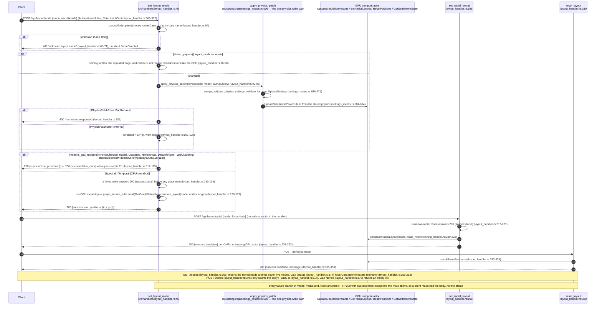

**Drift (RESOLVED at 86cdd7635):** this panel used to draw `set_layout_mode` sending `SetLayoutMode` straight to the GPU actor. The mode is now one stored field, `physics.layoutMode`, written through `apply_physics_patch` like `PUT /api/settings/physics` (`src/handlers/layout_handler.rs:13-22`, `:92-98`; project commits `58b05852d`, `db3ab82fa`).

**Tension:** `set_radial_layout` (`src/handlers/layout_handler.rs:198-201`) and `reset_layout` (`src/handlers/layout_handler.rs:330`) take no `AuthenticatedUser`, while `set_layout_mode` does (`src/handlers/layout_handler.rs:46`). They still sit under the `/api` RbacGate, which demands `WriteGraph` for any POST (`src/middleware/rbac_gate.rs:179-189`), so the difference is only in the handler's own posture.

## VC-04.13 `physics` scope — port/adapter hop, PhysicsService to ActixPhysicsAdapter to PhysicsOrchestratorActor
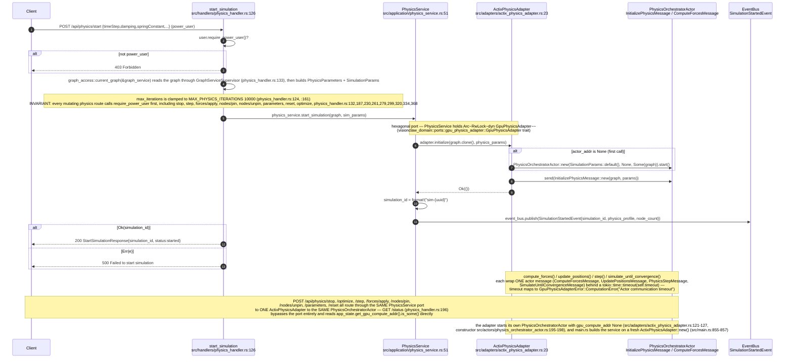

**Tension:** the `/api/physics` port drives a private `PhysicsOrchestratorActor` that has no GPU compute address (`src/adapters/actix_physics_adapter.rs:121-127`, `src/actors/physics_orchestrator_actor.rs:195-198`, `src/main.rs:855`). The comment in `layout_handler.rs` relies on this ("reachable but harmless … nothing they send reaches the device", `src/handlers/layout_handler.rs:79-84`). So `/api/physics/start` and `/parameters` return success and publish `SimulationStartedEvent` without changing the simulation the clients see, which runs in the GPU actors behind `apply_physics_patch` (VC-04.12). Source tracing only. Close it by routing the port to the live GPU actors or retiring the mutating `/api/physics` routes.

## VC-04.14 `kpi` scope — compute-on-read, agent-event volume tap, SQLite lineage
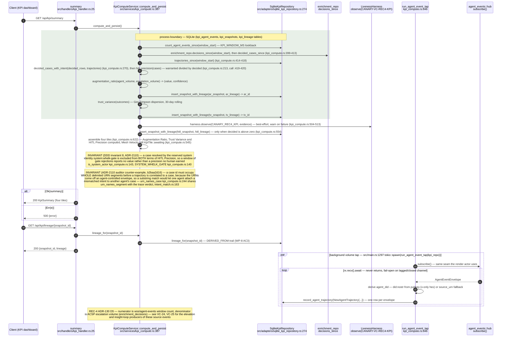

## VC-04.16 `consolidated_health` — unified_health_check, physics probe, MCP relay controls
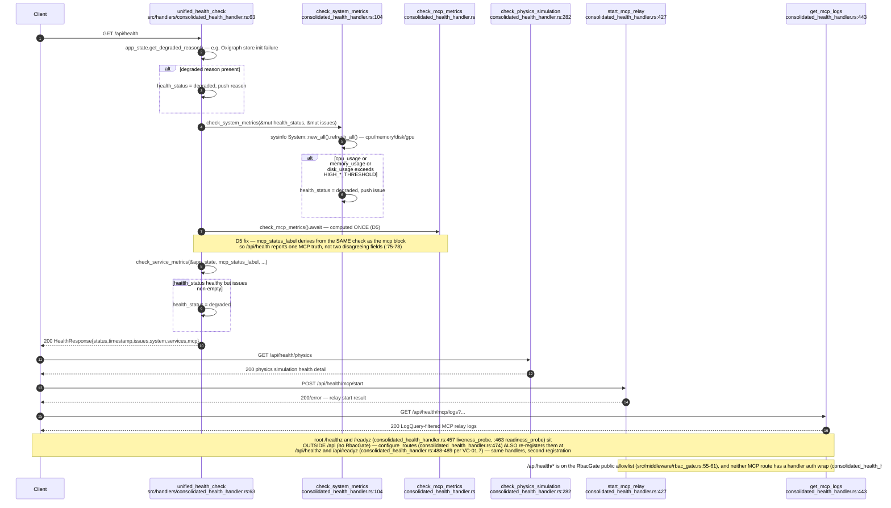

**Tension:** `POST /api/health/mcp/start` and `GET /api/health/mcp/logs` are reachable without any credential. The whole `api/health` prefix is public in the RbacGate (`src/middleware/rbac_gate.rs:55-61`, `:154-159`), and the routes carry no `RequireAuth` (`src/handlers/consolidated_health_handler.rs:479-483`). The start route runs `docker exec -d multi-agent-container … npm run mcp:start` when the relay is not running (`src/services/mcp_relay_manager.rs:171-187`), then blocks its actix worker thread for two seconds with `std::thread::sleep` (`src/services/mcp_relay_manager.rs:194`). The logs route returns the tail of `/tmp/mcp-server.log` (`src/services/mcp_relay_manager.rs:210-219`). An anonymous caller can therefore start a process in another container, read its log, and stall one of the four workers per request. Source tracing only; the `PublicDemoGuard` refuses mutating methods only when `PUBLIC_DEMO=read-only` (`src/main.rs:1127-1130`). Close it by moving the two MCP routes under an authenticated scope, or off `/api/health`.

## VC-04.17 `canary` scope (`liveness_harness_handler`) — X-Agent-Key gate, register/observe/status
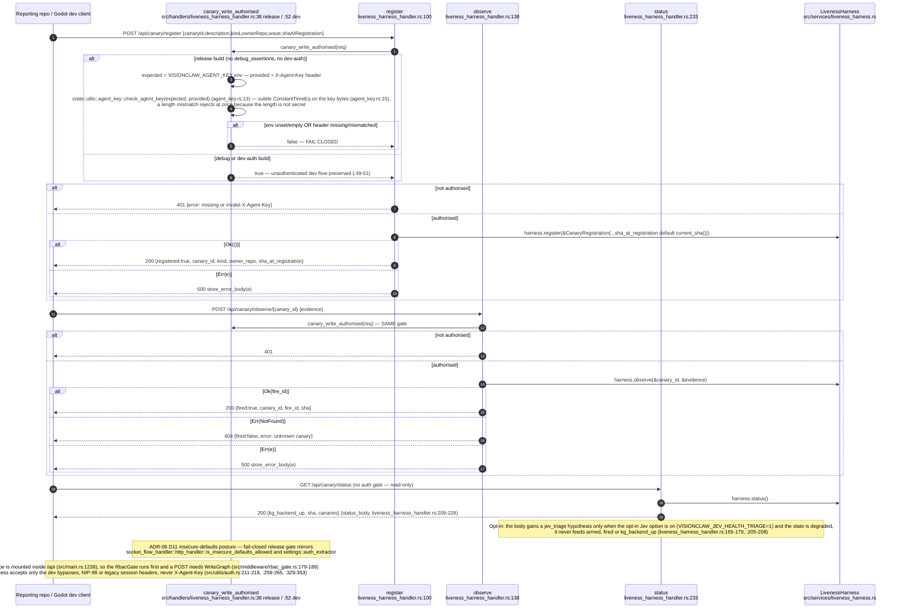

**Tension:** a release-build reporting repo that sends only `X-Agent-Key` never reaches `canary_write_authorised`. The `/api` RbacGate classifies `POST /api/canary/*` as a mutation needing `WriteGraph` (`src/middleware/rbac_gate.rs:179-189`) and resolves identity through `verify_access`, which has no `X-Agent-Key` path (`src/utils/auth.rs:191-195`, `:259-265`, `:329-353`), so the write is refused with 401 at the gate. The panel's handler-level gate is correct, but in release it sits behind a second credential the caller may not hold. Dev builds with `VISIONCLAW_DEV_MODE=1` grant every request (`src/utils/auth.rs:211-218`), which hides this. Source tracing only. Close it by allowlisting the canary write routes in the gate and keeping the `X-Agent-Key` check, or by documenting that a canary writer must also present NIP-98.

## VC-04.18 `GET /api/trace` — REC-11 unified provenance join (did:nostr key)
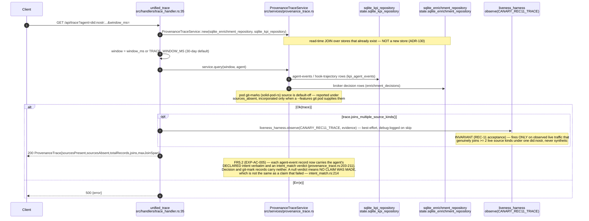

## VC-04.19 `validation` scope — schema dry-run test and static capability stats
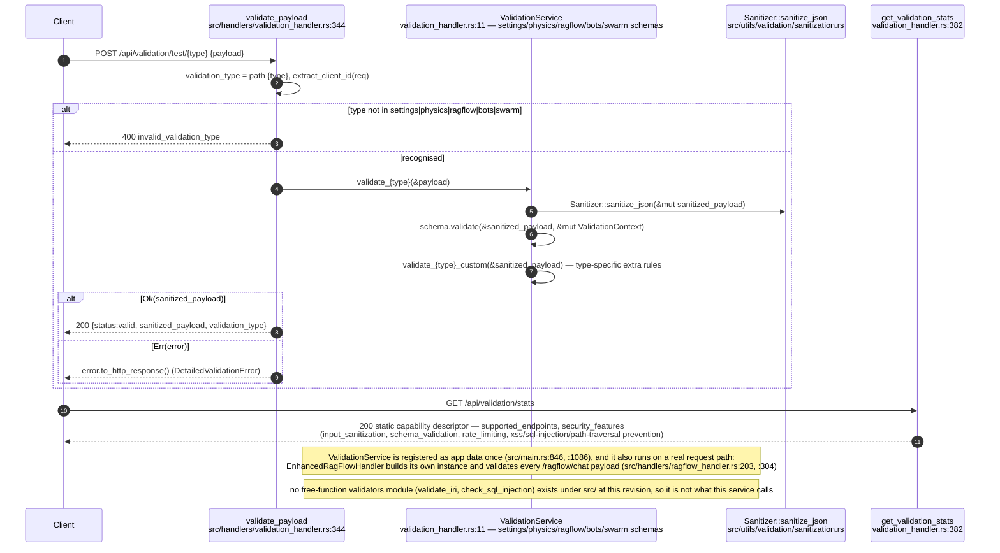

**Drift (corrected):** this panel used to say `ValidationService` is the consumer of a free-function `validators::{validate_iri, check_sql_injection, …}` module and is reachable only through the dry-run test route. Neither holds at `86cdd7635`: no such functions exist under `src/`, and `EnhancedRagFlowHandler` runs `validate_ragflow_chat` on the live `/ragflow/chat` path (`src/handlers/ragflow_handler.rs:203`, `:304`).

## VC-04.20 `schema` scope — GraphServiceSupervisor read, SchemaService cache refresh
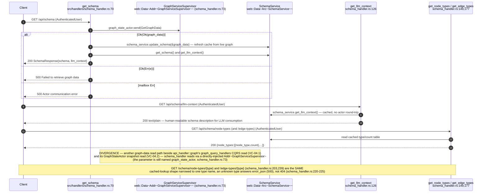

## VC-04.22 `semantic` — graph-analysis service, and the removed inference stack
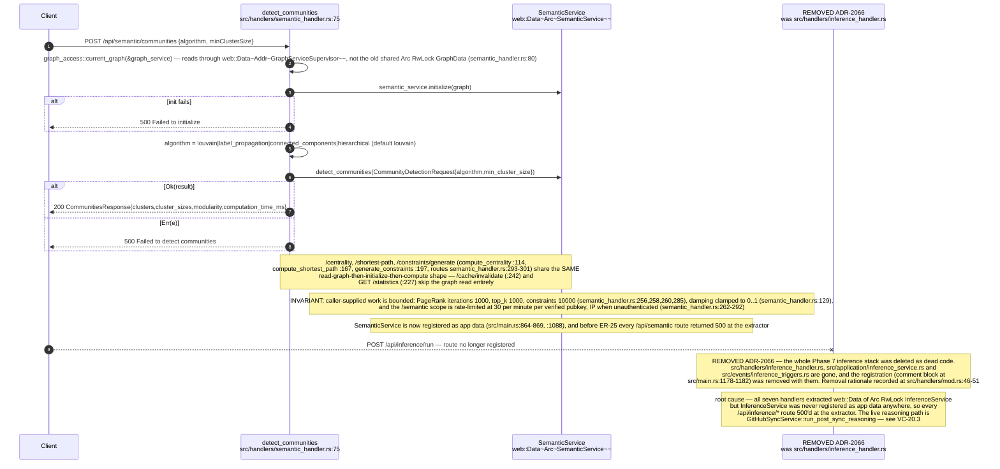

## VC-04.23 `workspace` scope — RequireAuth + RateLimit(60/min), WorkspaceActor CRUD with timeout
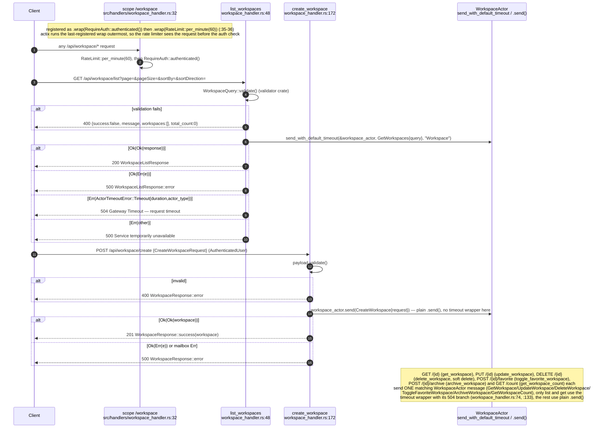

## VC-04.24 `GET /api/pages` — metadata fan-out over the content API
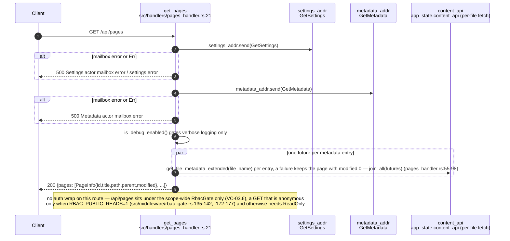

**Tension:** `get_pages` starts one `get_file_metadata_extended` call per metadata entry and awaits them all with an unbounded `join_all` (`src/handlers/pages_handler.rs:55-98`), with no cache and no concurrency cap. With public reads on, each anonymous `GET /api/pages` fans out one upstream content-API request per page in the corpus. Source tracing only; the cost per call depends on the content API configured. Close it with a bounded `buffer_unordered` and a short-lived cache.

## VC-04.25 `client-logs` (REST) and `client-messages` (WebSocket) — telemetry ingest and outbound stream
```mermaid
sequenceDiagram
    autonumber
    participant C as Client
    participant CL as handle_client_logs<br/>src/handlers/client_log_handler.rs:39
    participant TL as telemetry logger<br/>get_telemetry_logger()
    participant WS as websocket_client_messages<br/>src/handlers/client_messages_handler.rs:106
    participant CW as ClientMessagesWs actor<br/>client_messages_handler.rs:10

    C->>CL: POST /api/client-logs {logs:[...], sessionId, timestamp}
    alt logs.len() > MAX_LOG_ENTRIES (1000)
        CL-->>C: 413 Too many log entries
    end
    CL->>CL: client_session_id = X-Session-ID header or payload.sessionId
    CL->>CL: correlation_id = Uuid::parse_str(client_session_id) or new_v4() fallback
    opt telemetry logger present
        CL->>TL: TelemetryEvent::new(...).with_client_session_id(...).with_metadata(log_count,...)
    end
    CL->>CL: append entries to /app/logs/client.log
    CL-->>C: 200 {status:success}
    Note over CL: registered EARLY in the /api scope (src/main.rs:1139) specifically to avoid<br/>scope-registration-order conflicts (VC-01.10) — RBAC-allowlisted (src/middleware/rbac_gate.rs:57)

    C->>WS: GET /ws/client-messages (Upgrade: websocket)
    WS->>WS: token = Authorization Bearer, plus the ?token= query only in debug or dev-auth builds (client_messages_handler.rs:137-151)
    alt token empty or missing
        WS-->>C: 401 {error: Authentication required} — client_ip logged as SECURITY warning (client_messages_handler.rs:166-169)
    else no NostrService configured
        WS-->>C: 401 fail closed (client_messages_handler.rs:173-175)
    else nostr_service.get_session(token) is None
        WS-->>C: 401 "token does not name a live, unexpired session" (client_messages_handler.rs:177-179)
    else live session
        WS->>CW: ws::start(ClientMessagesWs::new(app_state), req, stream) (client_messages_handler.rs:182)
        CW->>C: 101 Switching Protocols, text {type:init, status:connected}
        CW->>CW: start_heartbeat() — ctx.run_interval(30s) ping, 90s no-pong -> ctx.stop()
        CW->>CW: start_message_stream() — ctx.run_interval(100ms) drains app_state.client_message_rx
        loop every 100ms while messages queued
            CW->>C: text {type:client_message, content, timestamp, session_id, agent_id}
        end
        loop client frames
            C->>CW: Ping/Pong/Text/Binary/Close
            alt Binary
                CW->>CW: warn — binary messages not supported on this stream
            end
        end
    end
    Note over WS: RESOLVED (ADR-2044, ADR-2058) — the token is resolved through NostrService::get_session, which enforces AUTH_TOKEN_EXPIRY,<br/>and the query fallback is compiled out of release (comment client_messages_handler.rs:113-135, code :136-180)
    Note over CW: every socket drains the ONE shared app_state.client_message_rx with try_recv (client_messages_handler.rs:35-39),<br/>so with two sockets open each message reaches whichever socket drains first, not every client
```

**Drift (corrected):** this panel used to say the `/ws/client-messages` upgrade checked only that a token was present, so any non-empty string passed. At `86cdd7635` the handler resolves the token with `NostrService::get_session` and fails closed on unknown, expired or absent tokens (`src/handlers/client_messages_handler.rs:166-179`).

**Tension:** `start_message_stream` drains the single process-wide `client_message_rx` with `try_recv` on a 100 ms interval in every connected socket (`src/handlers/client_messages_handler.rs:34-52`). The receivers compete, so a message goes to one socket, chosen by timing, and is never filtered by its `session_id`. Source tracing only. Close it with a broadcast channel or a per-session route.

## VC-04.27 `pay` scope — HTTP 402 balance/debit gate, mounted with the embedded-Pod feature, inert until PAY_ENABLED
```mermaid
sequenceDiagram
    autonumber
    participant C as Client
    participant CFG as VcPayConfig::from_env<br/>src/handlers/pay_handler.rs:98 — PAY_ENABLED, PAY_COST_SATS, PAY_LEDGER_DIR
    participant INFO as pay_info_handler<br/>pay_handler.rs:465 GET /pay/.info
    participant BAL as pay_balance_handler<br/>pay_handler.rs:477
    participant RES as pay_resource_handler<br/>pay_handler.rs:530
    participant DEP as pay_deposit_handler<br/>pay_handler.rs:504
    participant ST as FsPaymentStore<br/>get_balance and debit
    Note over BAL,RES: extract_caller_pubkey (pay_handler.rs:404) now calls the shared verifier validate_nip98_token_bound with BodyBinding::NoBody for these GETs (pay_handler.rs:413-418)<br/>so each token is single-use in the process-wide replay cache (src/utils/nip98.rs:164-168, claim :573)<br/>and the debit receipt headers are built with HeaderName::from_bytes, skipping a bad pair instead of panicking (pay_handler.rs:567-575), project commit 5fa0e1325

    Note over CFG: embedded-Pod routes mount at src/main.rs:1105 (VC-01) at the App root, outside the /api RbacGate — inert until<br/>PAY_ENABLED=true, gated handler-by-handler rather than by a scope-level middleware
    C->>INFO: GET /pay/.info (always reachable, no gate)
    INFO-->>C: 200 {enabled, methods:[lightning], cost_tiers} — reports the REAL enabled flag
    C->>BAL: GET /pay/.balance
    alt !config.enabled
        BAL-->>C: 403 Payment system is disabled
    else enabled
        BAL->>BAL: extract_caller_pubkey(req, None) — NIP-98 Authorization header (pay_handler.rs:488)
        alt no pubkey
            BAL-->>C: 401 Authentication required
        else
            BAL->>BAL: did = pubkey_to_did(pubkey)
            BAL->>ST: store.get_balance(&did)
            BAL-->>C: 200 balance_response(did, balance, cost_sats)
        end
    end
    C->>RES: GET /pay/{resource_path}
    alt !config.enabled
        RES-->>C: 403 Payment system is disabled
    else enabled and authenticated
        RES->>RES: cost = config.cost_for_endpoint(#quot;/{resource}#quot) — P2-05 per-endpoint cost tier<br/>(inference=cost*10, image-gen=cost*100, analytics=cost*5, default=cost_sats)
        RES->>ST: store.debit(&did, cost)
        alt Ok(remaining)
            RES-->>C: 200 {resource,charged,balance:remaining,unit:sat} with payment headers (pay_handler.rs:558-577)
        else PaymentError::InsufficientBalance
            RES-->>C: 402 payment_required_body (pay_handler.rs:579-581)
        else other store error
            RES-->>C: 500 Payment store error (pay_handler.rs:583-585)
        end
        Note over RES: resource proxying is a STUB — this confirms and charges but never<br/>forwards to the underlying resource handler (pay_handler.rs:527-529)
    Note over CFG,ST: PROPOSED, NOT LIVE — ADR-2111 (decision_status proposed, implementation_status<br/>none, 2026-09-21) would DELETE FsPaymentStore and the whole /pay/* route set and replace<br/>them with a thin proxy to the agentbox wallet surface, carrying the caller's NIP-98 identity<br/>through, so this repo stops owning a sats ledger. Everything drawn above is the LIVE state<br/>today — docs/adr/ADR-2111-re-sequence-rgb-for-bridged-assets-and-delete-the-host-payment-store.md:38<br/>Re-qualified 2026-10-01: the sidestr-rs parity release does not implement it, FsPaymentStore<br/>and /pay/* stay host-owned and the record stays proposed (ADR-2111-re-sequence-rgb-for-bridged-assets-and-delete-the-host-payment-store.md:83, :95-96)
    end
    C->>DEP: POST /pay/.deposit
    DEP-->>C: 403 when disabled, else 501 Not Implemented — #quot;Contact the server operator for manual funding#quot (:505-516)
    Note over DEP: DIVERGENCE — Lightning deposit is a stub in this commit, spec link only (webledgers.org)
```

## VC-04.28 `quic_transport_handler` — DOC-DRIFT: the QUIC transport was removed under ADR-2066, two Postcard structs survive
```mermaid
flowchart TB
    Q["quic_transport_handler.rs (101 lines) — now holds ONLY PostcardNodeUpdate and<br/>PostcardBatchUpdate plus their BinaryNodeData round-trip impls (quic_transport_handler.rs:22-75)"]
    FIELDS["PostcardNodeUpdate: id,x,y,z,vx,vy,vz,cluster_id,anomaly_score,community_id (:22-36)<br/>PostcardBatchUpdate: frame_id,timestamp_ms,nodes:Vec~PostcardNodeUpdate~ (:70-75)<br/>round-trip impls From/Into BinaryNodeData (:38-67), one #[cfg(test)] unit test (:82-100)"]
    IMP["imported directly by (fastwebsockets_handler.rs:34)<br/>`use super::quic_transport_handler::{PostcardBatchUpdate, PostcardNodeUpdate}`<br/>— never by any HTTP/WS route in this file"]
    MODRS["src/handlers/mod.rs:116-122 — module doc comment records the removal;<br/>NO pub use re-export of anything from this module exists"]
    NONE["NO configure fn, no route, scope, or .service() call anywhere in src/main.rs<br/>registers this module — it never had one even before the removal"]
    Q --> FIELDS --> IMP
    Q --> MODRS --> NONE
    D1["DOC-DRIFT (pre-dates this verification window, commit 35c2448a8) — the previously-diagrammed<br/>QuicTransportServer, QuicServerConfig, QuicClientSession, ControlMessage, TopologyNode,<br/>TopologyEdge, PostcardDeltaUpdate and the encode/decode/calculate_deltas free functions do<br/>NOT exist in this file any more. ADR-2066 removed the whole QUIC/WebTransport server as dead<br/>code — constructed nowhere, routed nowhere, only ever re-exported (never called). Only the two<br/>Postcard wire-format structs survive, kept because fastwebsockets_handler.rs's own<br/>postcard-serialized position broadcasts import them directly."]
    NONE --- D1
```
