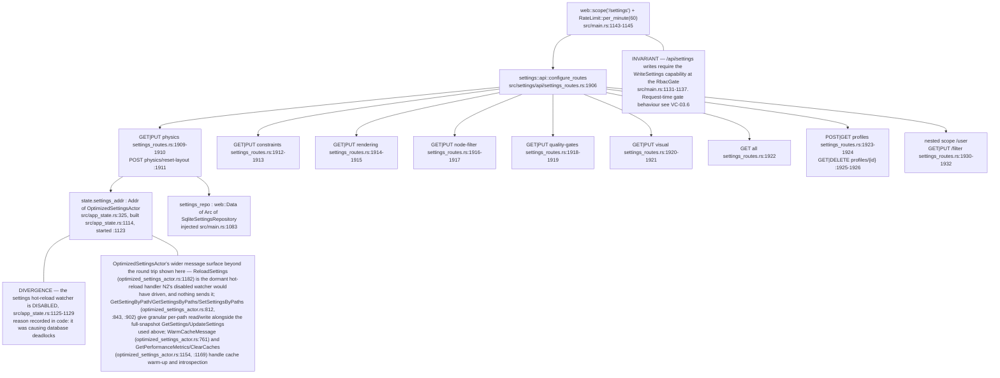
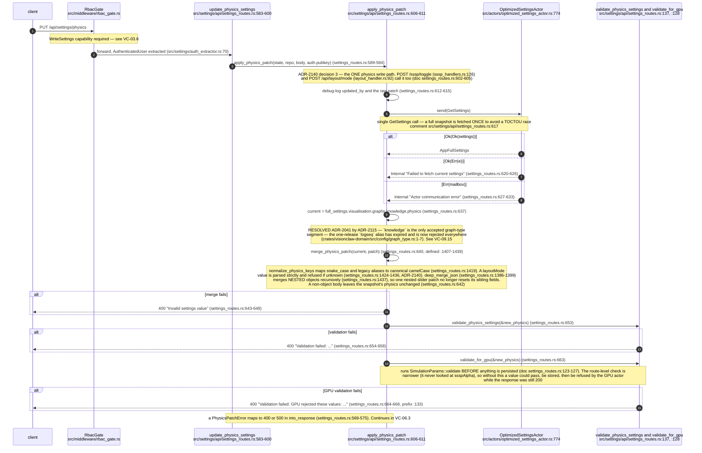
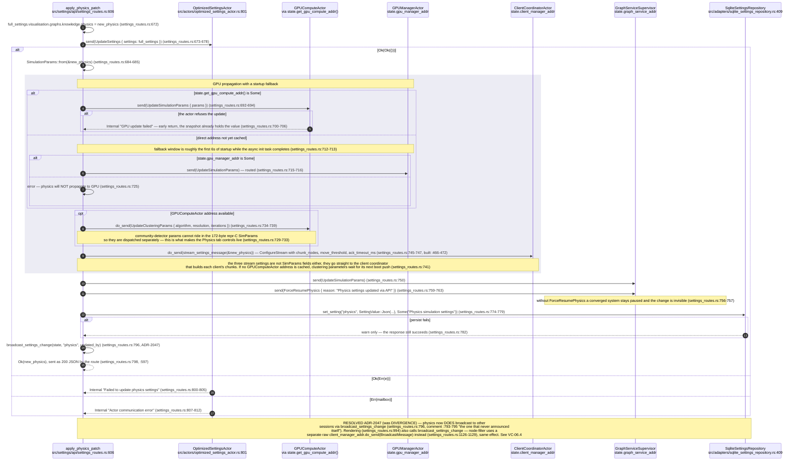
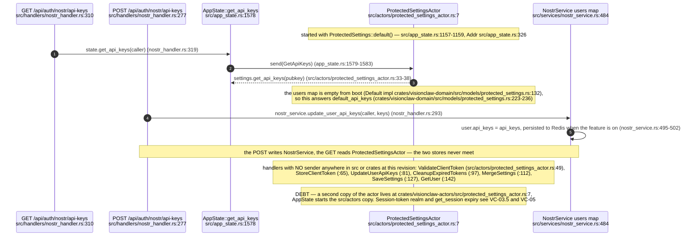
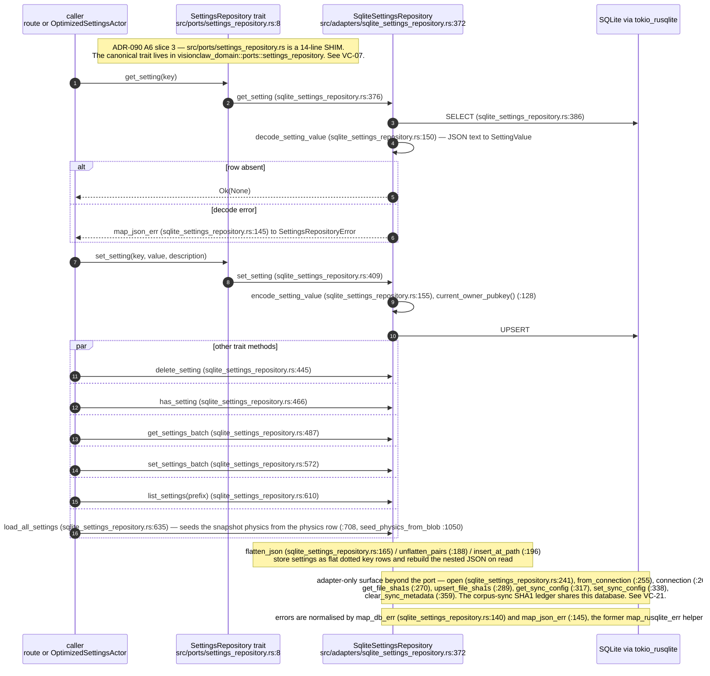
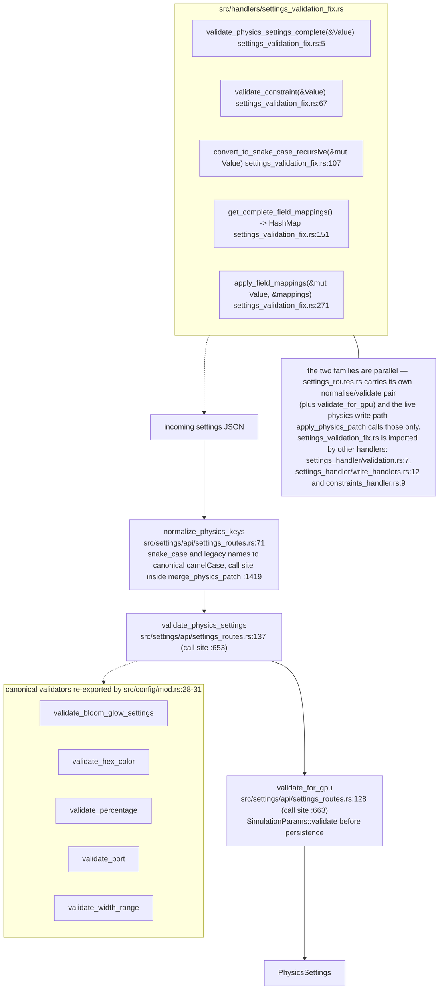
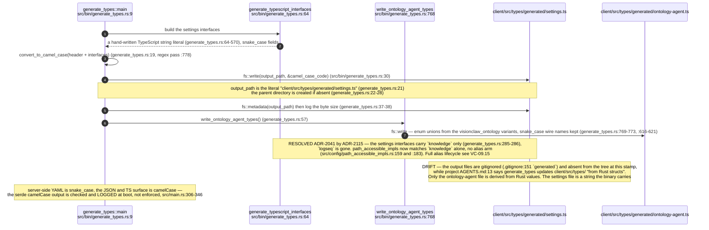

## VC-06.1 Settings route surface and the actor behind it

**Invariant:** the actor snapshot is loaded from the repository once, when the actor starts (`../project/src/actors/optimized_settings_actor.rs:700-710`). The only other path that reloads it is `ReloadSettings` (`../project/src/actors/optimized_settings_actor.rs:1201`), and at this revision nothing in `src/` or `crates/` sends that message.

## VC-06.2 PUT /api/settings/physics — the flagship round trip, phase 1 read and merge

## VC-06.3 PUT /api/settings/physics — phase 2 write-back, GPU propagation, persistence

**Tension:** a GPU actor that refuses the update makes `apply_physics_patch` return 500 "GPU update failed" (`../project/src/settings/api/settings_routes.rs:700-706`), but `UpdateSettings` has already replaced the actor snapshot (`../project/src/settings/api/settings_routes.rs:673-680`). The early return skips the SQLite write (`:774-779`) and the broadcast (`:796`). The in-memory snapshot then holds a value the GPU refused and the store never saw, and the next PATCH merges onto it. Source tracing cannot show how often the actor refuses a value that has already passed `validate_for_gpu` (`:663`).

## VC-06.4 Broadcast asymmetry — which settings reach other sessions

```mermaid
sequenceDiagram
    autonumber
    participant H1 as update_rendering_settings<br/>src/settings/api/settings_routes.rs:961
    participant H2 as update_node_filter_settings<br/>src/settings/api/settings_routes.rs:1062
    participant H3 as apply_physics_patch<br/>src/settings/api/settings_routes.rs:606
    participant H4 as reset_layout<br/>src/settings/api/settings_routes.rs:1799
    participant BC as broadcast_settings_change<br/>src/settings/api/settings_routes.rs:442-458
    participant CC as ClientCoordinatorActor<br/>state.client_manager_addr
    participant B as other browser sessions<br/>client/src/store/websocket/textMessageHandler.ts:138

    H1->>BC: broadcast_settings_change(state, "rendering", pubkey) (settings_routes.rs:994)
    H3->>BC: broadcast_settings_change(state, "physics", updated_by) (settings_routes.rs:796) — PUT physics, SSSP toggle and layout mode all reach it
    H4->>BC: broadcast_settings_change(state, "physics", "reset-layout") (settings_routes.rs:1883) — sent only after ResetPositions succeeded
    BC->>CC: do_send(BroadcastMessage { message }) (settings_routes.rs:451-453) — category-only payload built :443-448, no settings echoed
    CC->>B: WS frame — other sessions converge
    H2->>CC: do_send(BroadcastMessage { message }) (settings_routes.rs:1126-1129) — OWN inline call, bypasses broadcast_settings_change
    Note over H2,CC: payload built at settings_routes.rs:1111-1125, fuller than BC's — echoes the actual settings fields,<br/>not just category. Comment "Propagate node filter changes..." at settings_routes.rs:1108-1110
    CC->>B: WS frame
    B->>B: handleSettingsUpdated (textMessageHandler.ts:154) — own echo dropped (:162), stale timestamp dropped (:171), nodeFilter applied directly (:180-188), others re-read (:190, :194-215)
    Note over H1,B: RESOLVED ADR-2047 — physics (PUT, reset-layout and the other apply_physics_patch callers) and rendering now ALL emit<br/>through the single broadcast_settings_change emitter (settings_routes.rs:442-458). node-filter keeps its own richer, separate<br/>broadcast. RESOLVED ADR-2080 (vc-clients) — the client now CONSUMES settingsUpdated (textMessageHandler.ts:138-140).<br/>Still silent by choice: constraints, quality-gates, visual, profiles.
```

**Open:** `reset_layout` writes the canonical defaults to the GPU actors and to SQLite (`../project/src/settings/api/settings_routes.rs:1823-1863`) but never sends `UpdateSettings` to `OptimizedSettingsActor`. `GET /api/settings/physics` reads SQLite first (`:480-485`), so it shows the reset. The next `apply_physics_patch` merges onto the actor snapshot instead (`:618`, `:637`), and that snapshot still holds the pre-reset values until the process restarts, because nothing sends `ReloadSettings`. On source evidence, the first physics PUT after a reset writes every field it does not name back to its pre-reset value. This needs a runtime check to confirm.

## VC-06.6 ProtectedSettingsActor — API keys, client tokens and user records

**Tension:** `POST /api/auth/nostr/api-keys` stores keys on the `NostrService` user record (`../project/src/handlers/nostr_handler.rs:293`, `../project/src/services/nostr_service.rs:495`). `GET` on the same resource reads `ProtectedSettingsActor` (`../project/src/handlers/nostr_handler.rs:319`, `../project/src/app_state.rs:1578-1586`), which starts from `ProtectedSettings::default()` (`../project/src/app_state.rs:1159`), whose `users` map is empty (`../project/crates/visionclaw-domain/src/models/protected_settings.rs:132`), and has no writer. On source evidence a non-power user never reads back the keys they saved. This needs a runtime check to confirm.

**Drift:** the panel this replaces drew the api-keys routes driving all eight actor messages. At this revision only `GetApiKeys` has a sender, and seven handlers are unreachable.

## VC-06.7 Hexagonal hop — SettingsRepository port to the SQLite adapter

**Invariant:** ADR-2140 decision 1 makes the stored `physics` row the source of truth for the snapshot's physics (`../project/src/adapters/sqlite_settings_repository.rs:1041-1049`). The doc comment says `UpdateSettings` persists nothing and `save_all_settings` has no live caller, which is why `apply_physics_patch` writes the row itself.

## VC-06.8 Validation and field-mapping helpers

## VC-06.9 Generated client types — src/bin/generate_types.rs

**Drift:** `AGENTS.md:13` (`../project/AGENTS.md:13`) says `cargo run --bin generate_types` "updates `client/src/types/` from Rust structs". The settings half does not read any Rust struct. `generate_typescript_interfaces` returns a fixed raw string (`../project/src/bin/generate_types.rs:64-570`), so a field added to `PhysicsSettings` does not reach `settings.ts` unless someone edits that string by hand. Only `ontology-agent.ts` is built from Rust values (`../project/src/bin/generate_types.rs:576-597`). Even there, the variant tables are kept in step by hand (`:572-575`).

**Debt:** the boot "serde alias" block in `main.rs` (`../project/src/main.rs:314-346`) logs a confirmation when the rendering JSON is camelCase, and logs an error when serialisation fails. Neither outcome stops boot, so "asserted at boot" in the earlier panel was too strong.
