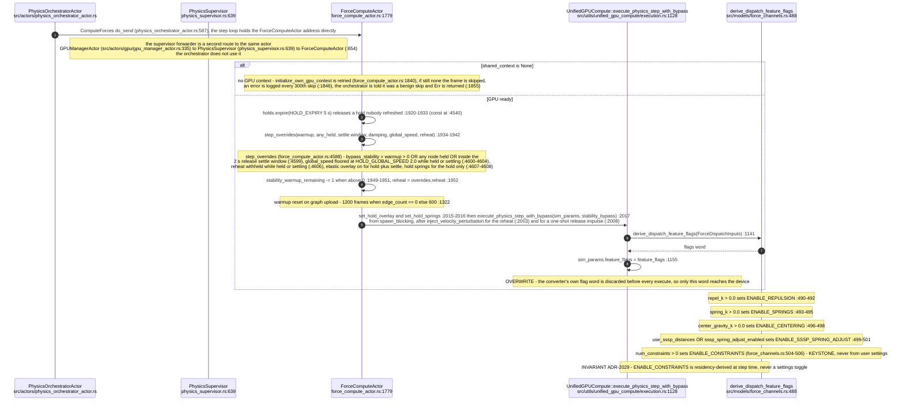
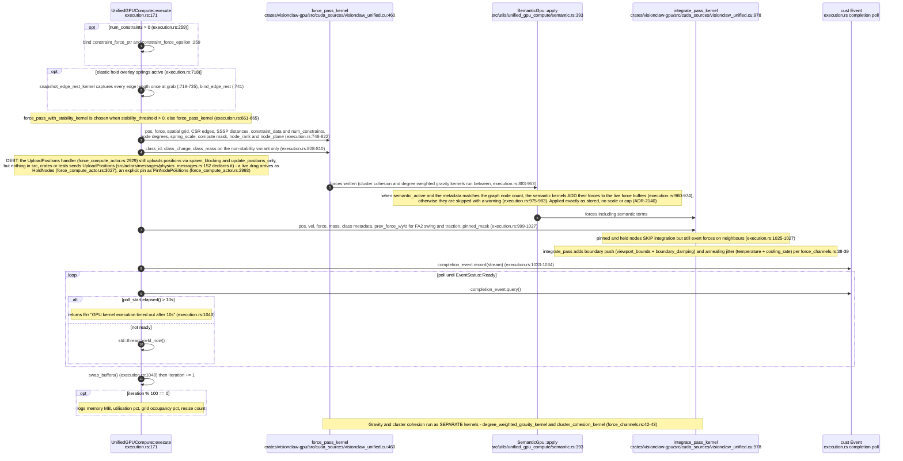
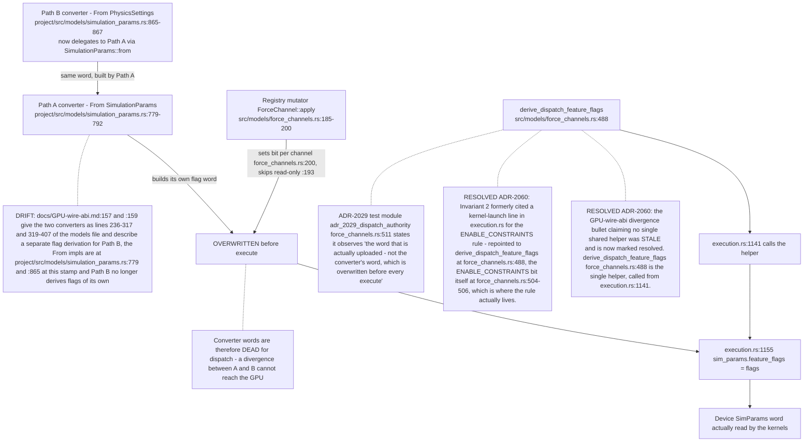
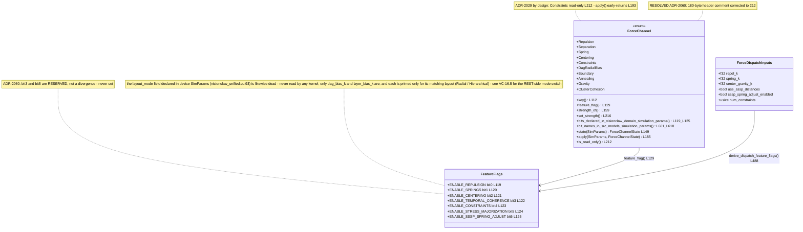
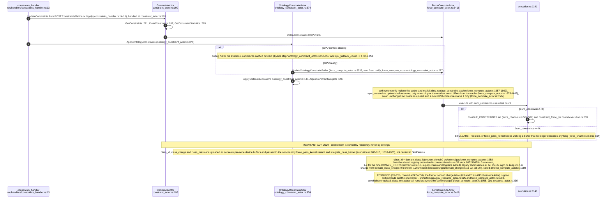
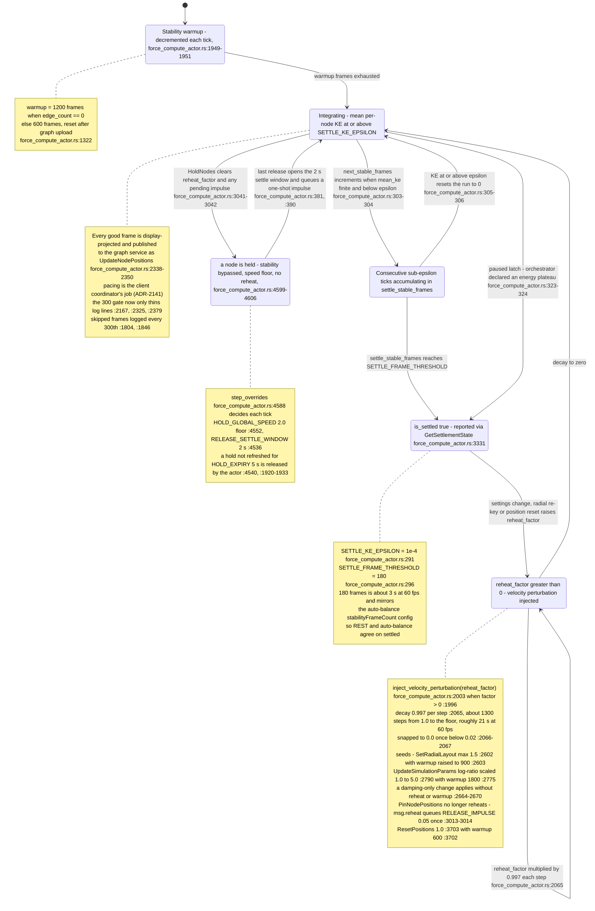
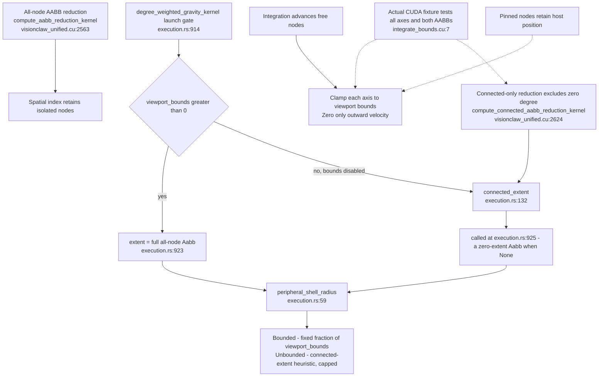
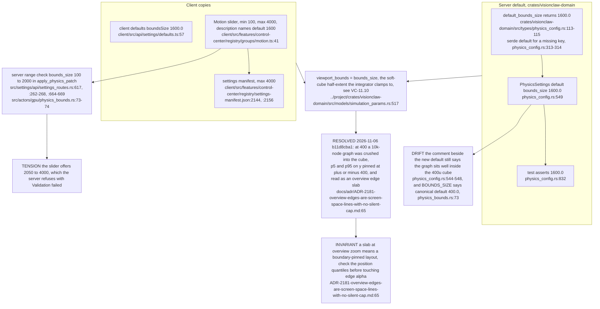

## For developers

One physics step runs ComputeForces through ForceComputeActor: SimParams, the feature-flag word, the kernel launch, integration, and the warm-up, settle and reheat cycle. The force channels are the registry of named forces that settings and constraints switch on. Read this before changing a force, a flag or the settle behaviour.

## For the business

This is the engine that lays the knowledge graph out on screen. Its settle and reheat cycle decides how quickly a graph comes to rest after a change, and how much it moves when someone drags a node.

## VC-11.1 Physics tick — phase 1, params and flag word

## VC-11.2 Physics tick — phase 2, kernel launch and integrate

## VC-11.3 Feature-flag derivation across the conversion paths

## VC-11.4 Force-channel registry

## VC-11.5 Constraint residency — upload and flag consequence

## VC-11.7 Semantic forces on the GPU and stress majorization

```mermaid
sequenceDiagram
    autonumber
    participant PS as PhysicsSupervisor<br/>physics_supervisor.rs:820
    participant FCA as ForceComputeActor<br/>force_compute_actor.rs:2875
    participant EX as UnifiedGPUCompute<br/>execution.rs:1064 enable_semantic
    participant SG as SemanticGpu<br/>src/utils/unified_gpu_compute/semantic.rs:393
    participant SMA as StressMajorizationActor<br/>stress_majorization_actor.rs:311

    Note over PS,SG: SemanticForcesActor was REMOVED (ADR-2140, commit 929fb32c1) - its Configure messages, kernel_bridge stubs and CPU twins are gone, the semantic forces are the physics.semantic settings group
    PS->>FCA: UpdateSimulationParams forwarded (physics_supervisor.rs:820)
    FCA->>FCA: idempotency gate compares the semantic group directly (force_compute_actor.rs:4701-4702)
    FCA->>EX: set_semantic_config(stored group) when it changed (force_compute_actor.rs:2709-2717, execution.rs:1084)
    EX->>SG: set_config, semantic_active = config.any_enabled() (execution.rs:1093)
    PS->>FCA: GetHierarchyLevels (physics_supervisor.rs:966) and RecalculateHierarchy (:990) now go to ForceComputeActor (force_compute_actor.rs:2851, :2875)
    FCA->>FCA: refresh_semantic on every graph upload (force_compute_actor.rs:1276, fn at :4773)
    FCA->>EX: derive node type, DAG level, physicality, role, maturity, cross-domain and edge-type metadata, load PTXModule::SemanticForces, enable_semantic (force_compute_actor.rs:4782-4788)
    PS->>FCA: SetRelationshipTable (physics_supervisor.rs:1039) replaces the ontology relationship table on the device (force_compute_actor.rs:2906)
    alt metadata or PTX or upload fails
        Note over FCA: error "semantic forces UNAVAILABLE for this graph", semantic = None, semantic_active = false (force_compute_actor.rs:4806-4808) - forces are OFF, there is no CPU fallback
    else ready
        EX->>SG: apply(positions, forces) each step after force_pass, before integrate (execution.rs:960-974)
        Note over SG: skipped with a warning if the metadata node count differs from the graph (execution.rs:975-983)
    end
    Note over FCA,SG: DAG layering is the semantic dag force (crates/visionclaw-gpu/src/cuda_sources/semantic_forces.cu:204, group default OFF at semantic_config.rs:55), distinct from the SimParams radial bias dag_bias_k that force_pass_kernel gates on dag_bias_k > 0 with no feature-flag bit (force_channels.rs:34-35)
    PS->>SMA: TriggerStressMajorization (physics_supervisor.rs:669, forwarded at :685)
    alt no GPU context
        Note over SMA: handler returns Err "GPU not initialized" (stress_majorization_actor.rs:321-323), perform_stress_majorization (:71) returns Err "GPU not available for stress majorization" (:95) - hard failure, no CPU degradation
    else GPU ready
        SMA->>SMA: perform_stress_majorization runs entirely on the GPU, CheckStressMajorization :365, UpdateStressMajorizationParams :343
    end
    Note over SMA,FCA: DEBT: ForceComputeActor keeps TriggerStressMajorization, GetStressMajorizationStats and ResetStressMajorizationSafety handlers that only return Err pointing at StressMajorizationActor (force_compute_actor.rs:3457-3464, :3469-3478, :3485-3494)
    Note over SMA,FCA: DIVERGENCE bit5 ENABLE_STRESS_MAJORIZATION is declared but never set by derive_dispatch_feature_flags - stress majorization is not a GPU force channel
    Note over SMA,FCA: Stress majorization params live on CPU in SemanticProcessorActor and are absent from GPU SimParams - project/src/models/simulation_params.rs:77
    Note over SMA,FCA: DIVERGENCE bit3 ENABLE_TEMPORAL_COHERENCE is likewise declared but never set - both are reserved bits, not wired force terms
```

## VC-11.9 Warmup, settle and reheat cycle

## VC-11.10 Hard bounds and connected extent

## VC-11.11 boundsSize: one default in three copies, and the overview slab it caused

**What it shows:** the 2026-11-06 change of the soft-cube default from 400 to 1600, made in the Rust default, the client defaults and the Motion slider, and where the server's range check disagrees with the slider.

**Debt (parallel):** the default lives in the Rust crate and twice in the client (`crates/visionclaw-domain/src/types/physics_config.rs:113-115`, `client/src/api/settings/defaults.ts:57`, `client/src/features/control-center/registry/groups/motion.ts:41`), and only the Rust copy is pinned by a test (`crates/visionclaw-domain/src/types/physics_config.rs:832`).

**Open (risk):** the new default only fills a missing key (`crates/visionclaw-domain/src/types/physics_config.rs:313`), so a store whose `physics` row already holds 400 presumably keeps the crushed layout; not checked against the live store.

**Tension (risk):** the slider's maximum of 4000 (`client/src/features/control-center/registry/groups/motion.ts:41`) exceeds the server's `BOUNDS_SIZE` ceiling of 2000 (`src/actors/gpu/physics_bounds.rs:74`), which `validate_physics_settings` enforces on the physics patch path (`src/settings/api/settings_routes.rs:262-268`, `:664-669`), so the top half of the slider is refused there.
