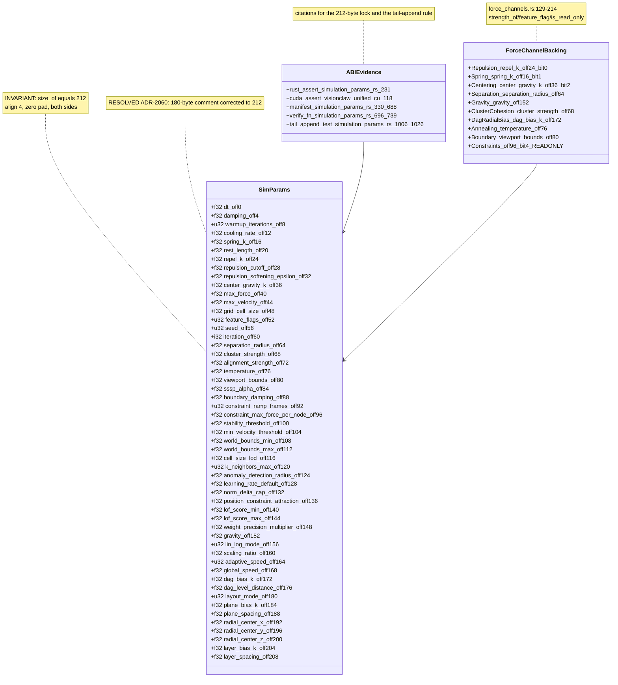
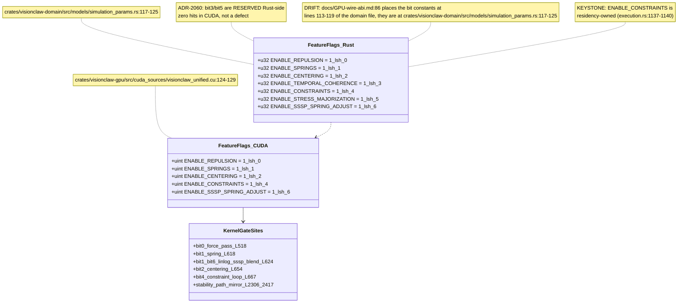
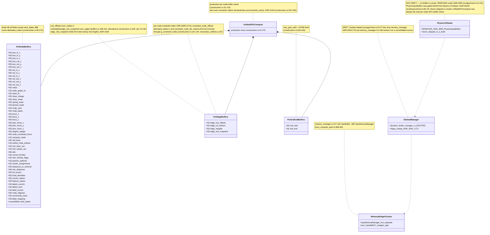
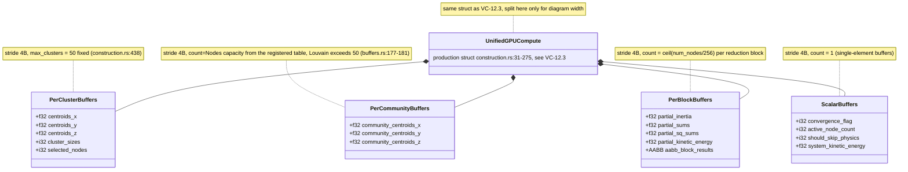
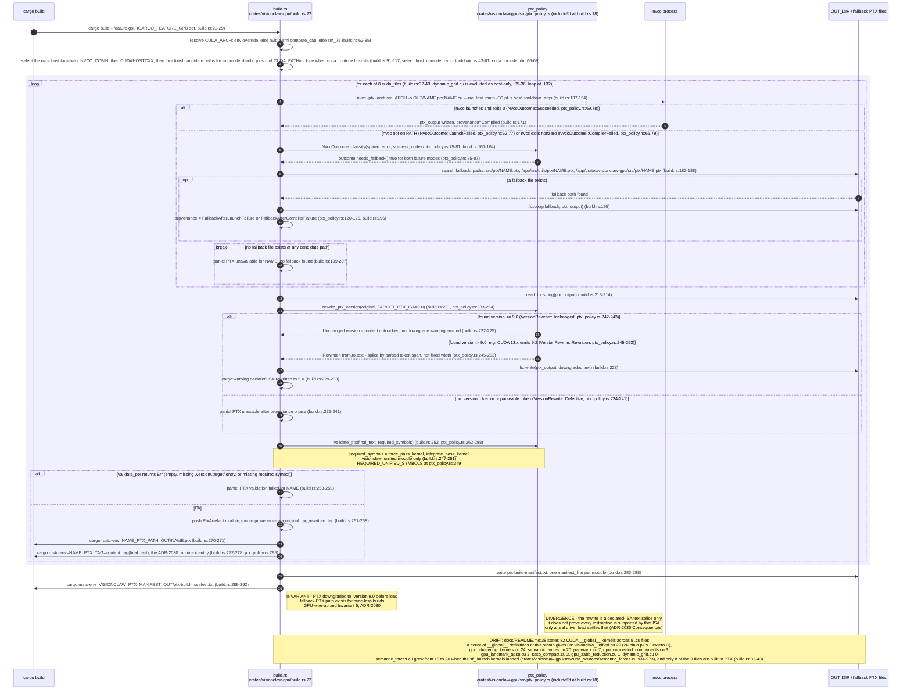
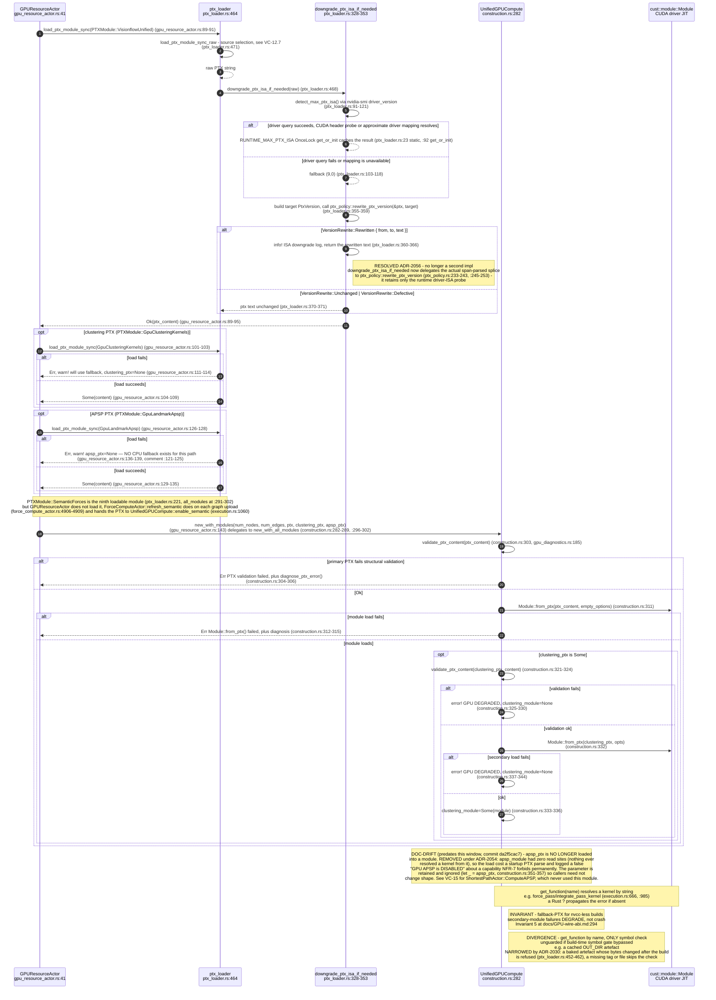

## For developers

SimParams is a 212-byte repr(C) struct shared by Rust and CUDA. This topic lays out its fields, the feature-flag bits, the GPU buffers, and how build.rs produces the PTX the runtime loads. Any field change must move both sides together.

## For the business

A mismatch between the Rust and GPU copies of the parameters makes the layout physics silently wrong. These diagrams show where the two copies are pinned to each other.

## VC-12.1 SimParams full 212-byte repr(C) layout

## VC-12.2 feature_flags bitfield (u32 at offset 52)

## VC-12.3 GPU core physics buffers: per-node, per-edge, per-grid-cell

## VC-12.4 GPU analytics-adjacent buffers: cluster, community, block, scalar

## VC-12.5 build.rs: nvcc to PTX to .version 9.0 downgrade

## VC-12.6 runtime PTX load, module init and kernel handle lookup

## VC-12.7 PTX source selection: compiled vs pre-shipped vs runtime-compiled

```mermaid
flowchart TD
    Start["load_ptx_module_sync_raw(module)<br/>ptx_loader.rs:471"] --> Identity{"check_baked_artefact - baked file present<br/>and its content tag differs from NAME_PTX_TAG?<br/>ptx_loader.rs:472, fn at ptx_loader.rs:452-462"}
    Identity -->|yes| ErrIdentity["Err PtxIdentityMismatch - rebuild, never a silent substitute<br/>ptx_loader.rs:423-446"]
    Identity -->|"no, or no baked path, tag or file"| DockerCheck{"DOCKER_ENV set?<br/>ptx_loader.rs:474"}
    DockerCheck -->|yes| DockerPre["load_precompiled_ptx(module)<br/>ptx_loader.rs:477"]
    DockerPre --> DockerPreOk{"found and valid?"}
    DockerPreOk -->|yes| ReturnA["Ok(content)<br/>ptx_loader.rs:477-478"]
    DockerPreOk -->|no| DockerCompile["compile_ptx_fallback_sync_module(module)<br/>ptx_loader.rs:482"]
    DockerCompile --> ReturnB["Ok/Err from nvcc runtime compile"]

    DockerCheck -->|no| BakedCheck{"get_compiled_ptx_path(module) resolves?<br/>ptx_loader.rs:485, fn at ptx_loader.rs:309-316"}
    BakedCheck -->|"option_env! baked path (build.rs cargo:rustc-env)"| ReadBaked["fs::read_to_string(path)<br/>ptx_loader.rs:486"]
    BakedCheck -->|"or std::env::var(module.env_var()) runtime override<br/>ptx_loader.rs:315"| ReadBaked
    ReadBaked --> ValidBaked{"validate_ptx ok?<br/>ptx_loader.rs:488"}
    ValidBaked -->|yes| ReturnC["Ok(content) - fastest path, fresh OUT_DIR PTX<br/>ptx_loader.rs:495-496"]
    ValidBaked -->|no| PreCompiled
    BakedCheck -->|"neither set"| PreCompiled["load_precompiled_ptx(module)<br/>ptx_loader.rs:509"]

    PreCompiled --> C1["1. baked compiled_ptx_path option_env!<br/>ptx_loader.rs:534-536"]
    C1 --> C2["1b. runtime env var override module.env_var()<br/>ptx_loader.rs:539-541"]
    C2 --> C3["2. target/release-or-debug/build/star/out/NAME.ptx<br/>newest mtime first<br/>ptx_loader.rs:551-570"]
    C3 --> C4["3a. crates/visionclaw-gpu/src/ptx/NAME.ptx<br/>ptx_loader.rs:576"]
    C4 --> C5["3b. ../visionclaw-gpu/src/ptx/NAME.ptx<br/>ptx_loader.rs:577-579"]
    C5 --> C6["3c. /app/crates/visionclaw-gpu/src/ptx/NAME.ptx<br/>ptx_loader.rs:580"]
    C6 --> C7["3d. legacy /app/src/utils/ptx/NAME.ptx<br/>ptx_loader.rs:582"]
    C7 --> C8["3e. legacy ./src/utils/ptx/NAME.ptx<br/>ptx_loader.rs:583"]
    C8 --> AnyValid{"first candidate that reads and validate_ptx ok?<br/>ptx_loader.rs:586-593"}
    AnyValid -->|yes| ReturnD["Ok(content)<br/>ptx_loader.rs:588-591"]
    AnyValid -->|no candidate found| RuntimeCompile["compile_ptx_fallback_sync_module(module)<br/>ptx_loader.rs:517"]

    RuntimeCompile --> Arch["effective_cuda_arch(): delegates to detect_runtime_cuda_arch()<br/>ptx_loader.rs:324-326"]
    Arch --> CuSrc{"src/utils/NAME.cu exists under CARGO_MANIFEST_DIR?<br/>ptx_loader.rs:654-660"}
    CuSrc -->|no| ErrNoSrc["Err CUDA source not found<br/>ptx_loader.rs:661-665"]
    CuSrc -->|yes| SpawnNvcc["nvcc -ptx -std=c++17 -arch=sm_ARCH NAME.cu -o TMP.ptx<br/>ptx_loader.rs:682-702"]
    SpawnNvcc --> NvccOk{"spawn ok and exit 0?"}
    NvccOk -->|no| ErrNvcc["Err nvcc failed, includes stdout/stderr<br/>ptx_loader.rs:704-717"]
    NvccOk -->|yes| ReadTmp["fs::read_to_string(TMP.ptx)<br/>ptx_loader.rs:719-725"]
    ReadTmp --> ValidateTmp["validate_ptx(ptx_content)<br/>ptx_loader.rs:727"]
    ValidateTmp --> ReturnE["Ok(content)<br/>ptx_loader.rs:728-733"]

    ReturnA --> Downgrade["downgrade_ptx_isa_if_needed(raw) - see VC-12.5<br/>ptx_loader.rs:468"]
    ReturnB --> Downgrade
    ReturnC --> Downgrade
    ReturnD --> Downgrade
    ReturnE --> Downgrade
```

