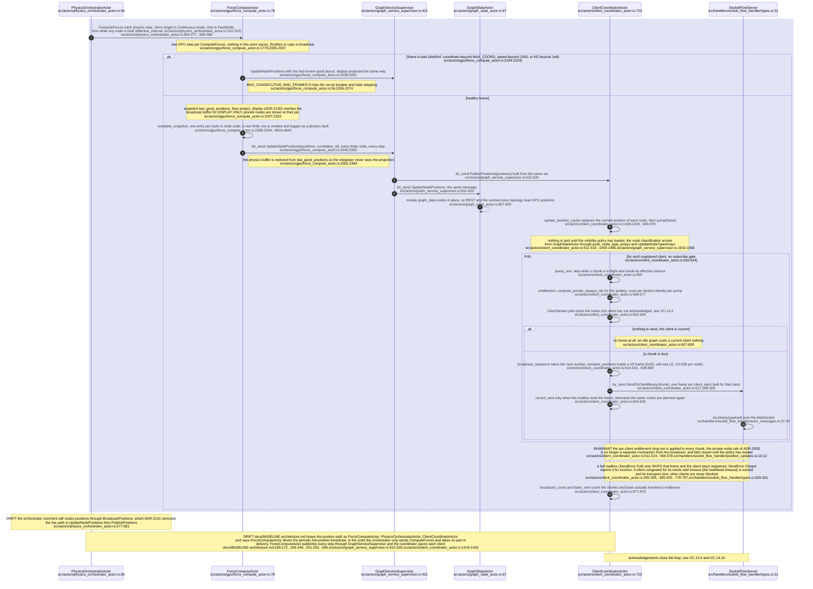
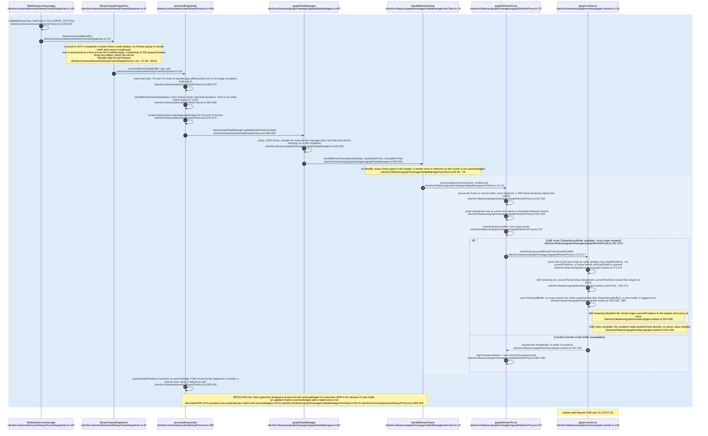
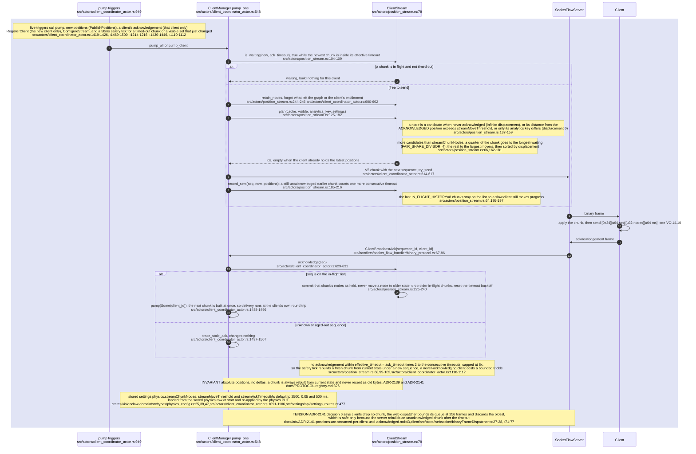
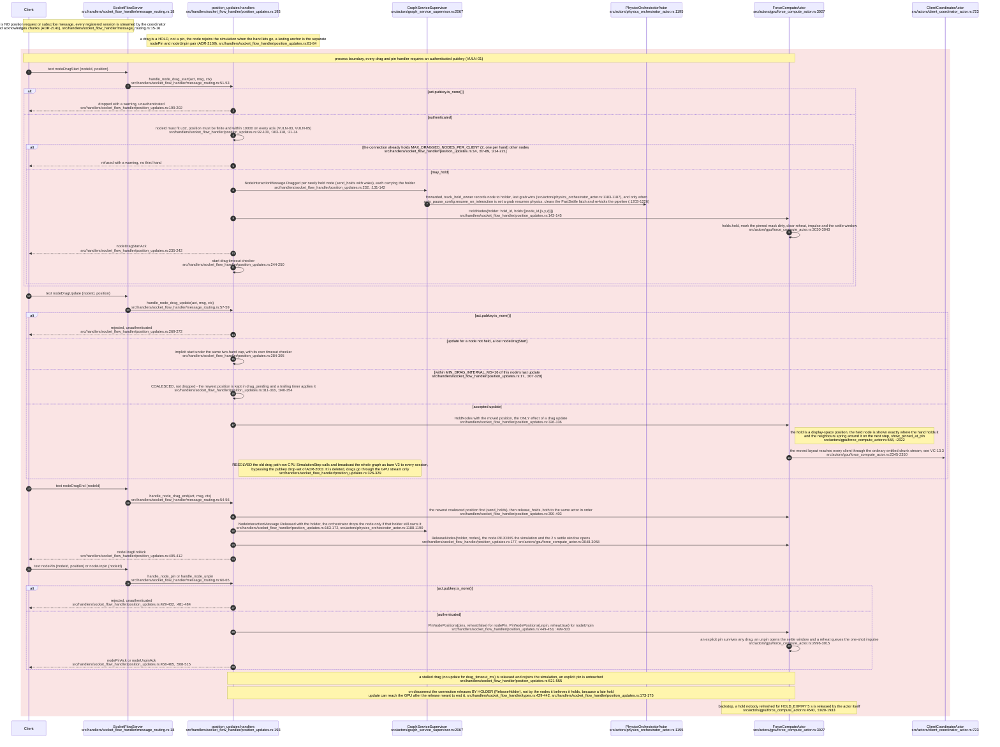
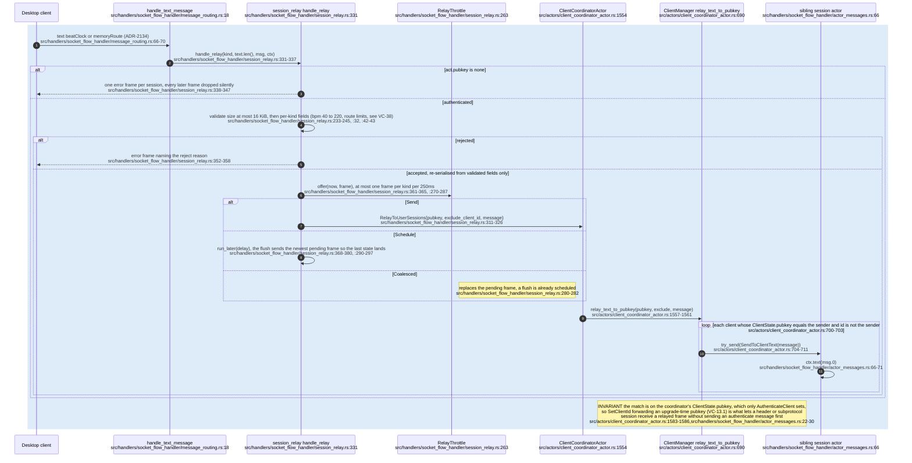
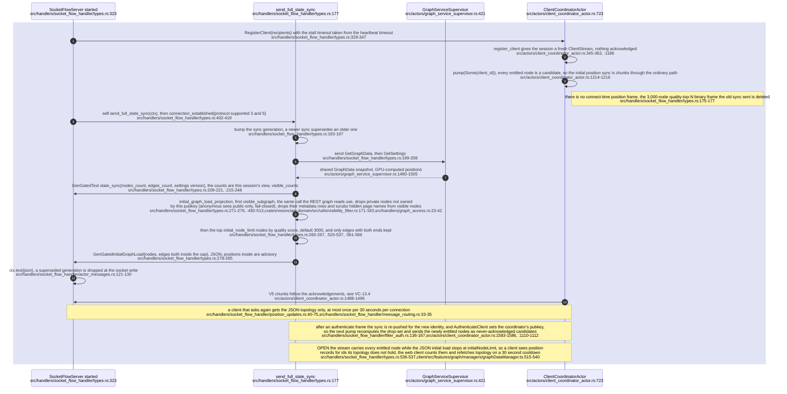
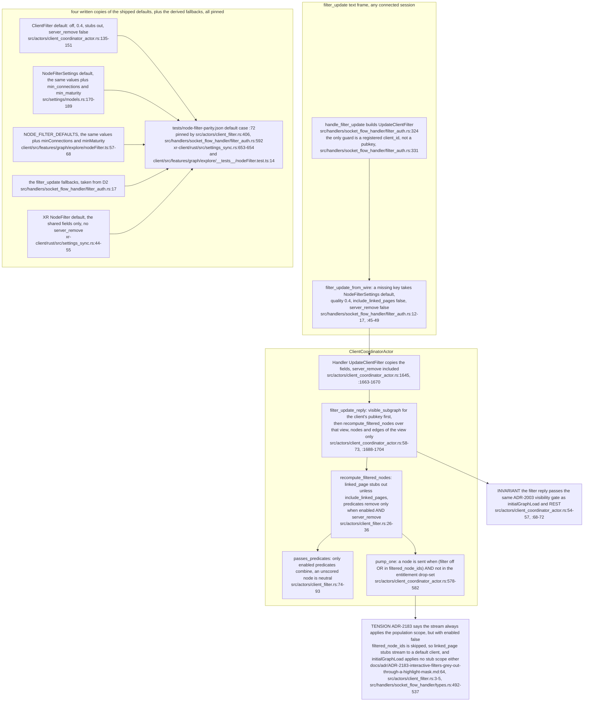
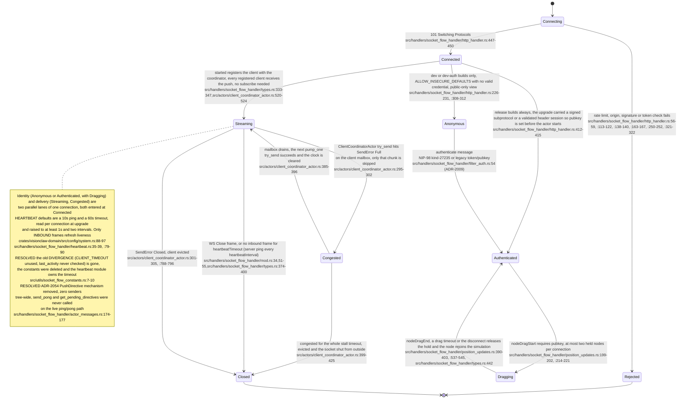

## For developers

Positions are streamed per client and paced by acknowledgements (ADR-2141). ForceComputeActor publishes every step, and ClientCoordinatorActor sends each client the nodes it has not acknowledged, after the entitlement drop-set and the client's node filter. At 809a859aa the initial graph load and the `filter_update` reply both use the same visible_subgraph gate as the REST reads, the per-client node filter removes nodes only on an explicit server_remove opt-in, and every copy of the filter defaults is pinned to one fixture.

## For the business

Every viewer sees the graph move live, but only nodes it may see. A private node reaches only its owner, including when a viewer changes its node filter, which once re-sent the whole graph without that check.

## VC-13.3 Position stream end to end: GPU step to per-client chunk

**Drift (KNOWN_ISSUES vs code):** BROADCAST-001 itself now describes the ADR-2141 per-client stream (`docs/KNOWN_ISSUES.md:77-81`), but the resolved-issues row for the delta filter still says Continuous mode "always sends full snapshots at 10fps" (`docs/KNOWN_ISSUES.md:117`). The coordinator streams each client only the nodes it has not acknowledged (`src/actors/client_coordinator_actor.rs:606-609`).

**Tension (parallel):** the disconnect path releases the GPU by holder, because its authors note that releasing by list misses a hold that arrives late (`src/handlers/socket_flow_handler/types.rs:432-434`). The orchestrator is still released by that list (`src/handlers/socket_flow_handler/types.rs:435`, `:442`). Whether a `Dragged` can reach it after its node left `dragged_nodes` is not shown: drag start inserts the node before it spawns the send (`src/handlers/socket_flow_handler/position_updates.rs:229`, `:232-233`). A stale entry would keep the 0 ms step and block the auto-pause (`src/actors/physics_orchestrator_actor.rs:310-311`, `:673`).

## VC-13.1 WS connect, upgrade and authentication

```mermaid
sequenceDiagram
    autonumber
    participant C as Client
    participant HH as socket_flow_handler<br/>src/handlers/socket_flow_handler/http_handler.rs:49
    participant NS as NostrService get_session<br/>src/handlers/socket_flow_handler/http_handler.rs:222
    participant N98 as nip98::validate_nip98_token<br/>src/utils/nip98.rs:428
    participant WSS as SocketFlowServer actor<br/>src/handlers/socket_flow_handler/types.rs:320
    participant FA as filter_auth::handle_authenticate<br/>src/handlers/socket_flow_handler/filter_auth.rs:54

    rect rgb(225,228,245)
    Note over C,HH: process boundary — HTTP/WS upgrade at /wss
    C->>HH: GET /wss (Upgrade: websocket)
    HH->>HH: WEBSOCKET_RATE_LIMITER.is_allowed(client_ip)<br/>src/handlers/socket_flow_handler/http_handler.rs:56
    alt rate limited
        HH-->>C: 429 create_rate_limit_response<br/>src/handlers/socket_flow_handler/http_handler.rs:58
    else Origin header check
        HH->>HH: validate Origin against CORS_ALLOWED_ORIGINS or same-host<br/>src/handlers/socket_flow_handler/http_handler.rs:67-111
        alt Origin invalid and not same-host
            HH-->>C: 403 Forbidden<br/>src/handlers/socket_flow_handler/http_handler.rs:118-121
        else Origin missing (release build)
            HH-->>C: 400 Origin header required<br/>src/handlers/socket_flow_handler/http_handler.rs:138-140
        else Origin OK
            HH->>HH: read Sec-WebSocket-Protocol, nip98::websocket_auth_header takes the single nostr. subprotocol<br/>src/handlers/socket_flow_handler/http_handler.rs:146-154
            Note right of HH: browsers cannot set Authorization on a WebSocket upgrade, so the signed NIP-98 event rides as an<br/>unpadded URL-safe nostr.TOKEN subprotocol and only the neutral visionclaw protocol is echoed<br/>src/utils/nip98.rs:636-655,src/handlers/socket_flow_handler/http_handler.rs:10
            opt signed subprotocol present
                HH->>NS: verify_nip98_auth(header, signed_upgrade_url, GET) single-use<br/>src/handlers/socket_flow_handler/http_handler.rs:156-161
                alt NostrService absent, or invalid or replayed
                    HH-->>C: 401 Invalid or replayed WebSocket signature<br/>src/handlers/socket_flow_handler/http_handler.rs:158-167
                else verified
                    HH->>HH: signed_user = Some(user)<br/>src/handlers/socket_flow_handler/http_handler.rs:162
                end
            end
            Note right of HH: RESOLVED (estate register ER-25) the upgrade-time URL is now signed_upgrade_url, which delegates to nip98_request_url,<br/>the same single reconstruction the post-connect authenticate frame uses, a test pins them equal when a proxy sends both<br/>Forwarded and X-Forwarded-* headers<br/>src/handlers/socket_flow_handler/http_handler.rs:40-46, :503-519,src/utils/auth.rs:159-189
            opt no signed user, so the Authorization Bearer token is the carrier
                HH->>HH: read Authorization Bearer token<br/>src/handlers/socket_flow_handler/http_handler.rs:178-184
                Note right of HH: RESOLVED ADR-2058 the ?token= query-string fallback is compiled<br/>in only for dev builds (http_handler.rs:187-202), release builds<br/>log and ignore it (http_handler.rs:204-214) and use the header alone
                alt token present
                    HH->>NS: nostr_service.get_session(token)<br/>src/handlers/socket_flow_handler/http_handler.rs:222
                    alt session valid
                        NS-->>HH: Some(session)
                        HH->>HH: signed_user = session, so the header-token client is attributed like the signed one<br/>src/handlers/socket_flow_handler/http_handler.rs:258-262
                        Note right of HH: RESOLVED 0d636fd0e (S-7f, verified in VC-03.2) the validated session used to be checked and then dropped<br/>so a header-session client reached the pubkey and is_power_user assignment below as anonymous.<br/>Authorization is therefore NOT the only carrier, the signed subprotocol is the browser path
                    else session invalid
                        NS-->>HH: None
                        alt release build (or dev without ALLOW_INSECURE_DEFAULTS)
                            HH-->>C: 401 Invalid or expired authentication token<br/>src/handlers/socket_flow_handler/http_handler.rs:250-251
                        else dev build with ALLOW_INSECURE_DEFAULTS=1
                            Note right of HH: dev-only bypass, compile-gated out of release, connection stays anonymous<br/>src/handlers/socket_flow_handler/http_handler.rs:226-231
                        end
                    end
                    opt NostrService absent
                        HH-->>C: 401 Authentication service unavailable (dev builds allow it only with ALLOW_INSECURE_DEFAULTS)<br/>src/handlers/socket_flow_handler/http_handler.rs:265-292
                    end
                else no token at all
                    alt release build
                        HH-->>C: 401 Authentication required<br/>src/handlers/socket_flow_handler/http_handler.rs:321-322
                    else dev build with ALLOW_INSECURE_DEFAULTS=1
                        Note right of HH: unauthenticated WS permitted, dev only<br/>src/handlers/socket_flow_handler/http_handler.rs:308-312
                    end
                end
            end
            HH->>WSS: ws_server = SocketFlowServer::new(...)<br/>src/handlers/socket_flow_handler/http_handler.rs:384
            HH->>WSS: per-connection heartbeat timings from system.websocket, and a closer for the raw TCP socket<br/>src/handlers/socket_flow_handler/http_handler.rs:390-409
            HH->>WSS: signed user, if any, sets pubkey and is_power_user (signed subprotocol and header session alike)<br/>src/handlers/socket_flow_handler/http_handler.rs:412-415
            HH->>WSS: connection_url = nip98_request_url(req) for the post-connect authenticate frame<br/>src/handlers/socket_flow_handler/http_handler.rs:427
            Note over HH: INVARIANT: X-Forwarded-Proto and X-Forwarded-Host win over connection_info in nip98_request_url,<br/>and nginx forwards X-Forwarded-Host $http_host for /wss so the dialled port survives<br/>src/utils/auth.rs:170-188,nginx.production.conf:248
            opt ?token= present a second time (dev builds only, src/handlers/socket_flow_handler/http_handler.rs:371-379)
                HH->>NS: nostr_service.get_session(token_from_qs)<br/>src/handlers/socket_flow_handler/http_handler.rs:432
                NS-->>HH: user with pubkey, is_power_user
                HH->>WSS: ws_server.pubkey = Some(user.pubkey)<br/>src/handlers/socket_flow_handler/http_handler.rs:433-434
                Note right of HH: DEBT redundant since 0d636fd0e, the first extraction already routes a dev query token<br/>through get_session into signed_user, see VC-03.2<br/>src/handlers/socket_flow_handler/http_handler.rs:187-202, :262
            end
            Note over HH: DRIFT the registry's /wss row says NIP-98 Bearer or a ?token= query with the handler at http_handler.rs:139-150 and the Origin<br/>requirement at :130, the query token is dev-build only, the Bearer path is 178-184 and the Origin rejections are 118-121 and 138-140<br/>docs/PROTOCOL-registry.md:263,src/handlers/socket_flow_handler/http_handler.rs:118-121, :138-140, :178-214
            HH->>C: 101 Switching Protocols (WsResponseBuilder, PUBLIC_WS_PROTOCOLS echoed)<br/>src/handlers/socket_flow_handler/http_handler.rs:447-450
            WSS->>WSS: started registers anonymous ClientRecipients with the coordinator, which gives the session a fresh position stream, see VC-13.6<br/>src/handlers/socket_flow_handler/types.rs:333-347,src/actors/client_coordinator_actor.rs:1214-1216
            WSS->>WSS: SetClientId forwards an upgrade-time pubkey to the coordinator as AuthenticateClient<br/>src/handlers/socket_flow_handler/actor_messages.rs:14-30
            Note right of WSS: before this forward the coordinator held a session authenticated at the upgrade as anonymous<br/>so the same-user relay and per-user filters missed it until an authenticate frame arrived<br/>src/handlers/socket_flow_handler/actor_messages.rs:17-21
            WSS->>WSS: ping timer from the heartbeat settings, then send_full_state_sync (JSON topology only, no positions) and connection_established<br/>src/handlers/socket_flow_handler/types.rs:374-419
        end
    end
    end

    rect rgb(225,245,230)
    Note over C,WSS: post-connect NIP-98 "authenticate" message (kind 27235, ADR-2009 primary realm)
    C->>WSS: text message type=authenticate, event=base64 kind-27235 event<br/>src/handlers/socket_flow_handler/message_routing.rs:36-38
    WSS->>FA: handle_authenticate(act, msg, ctx)<br/>src/handlers/socket_flow_handler/filter_auth.rs:54
    alt VISIONCLAW_DEV_MODE full bypass (dev builds only)
        FA-->>C: authenticate_success (DEV_MODE_PUBKEY, power_user)<br/>src/handlers/socket_flow_handler/filter_auth.rs:70-103
    else event field present (NIP-98 path)
        FA->>N98: verify_nip98_auth auth_header=Nostr plus event_b64, ws_url, method=GET<br/>src/handlers/socket_flow_handler/filter_auth.rs:111-118
        N98->>N98: check kind==27235<br/>src/utils/nip98.rs:20,462
        N98->>N98: freshness ±TOKEN_MAX_AGE_SECONDS=60s<br/>src/utils/nip98.rs:169,467-484
        N98->>N98: url and method match, body binding, then Schnorr signature<br/>src/utils/nip98.rs:510,518,526,560-565
        N98->>N98: claim event id in replay cache (TTL=120s, cap 100000, 1000 per signer, fail-closed ReplayCacheFull)<br/>src/utils/nip98.rs:178,198,215,258-262,322-324,573 (ADR-2002)
        alt validation and single-use claim succeed
            N98-->>FA: Ok(user)
            FA-->>C: authenticate_success{pubkey, is_power_user}<br/>src/handlers/socket_flow_handler/filter_auth.rs:148-156
            FA->>WSS: AuthenticateClient to the coordinator, bump_sync_generation, then send_full_state_sync re-push of the topology filtered by the new pubkey, positions follow from the stream<br/>src/handlers/socket_flow_handler/filter_auth.rs:136-167
        else signature/URL/method/freshness/replay fails
            N98-->>FA: Err(e)
            FA-->>C: error NIP-98 WebSocket authentication failed<br/>src/handlers/socket_flow_handler/filter_auth.rs:168-176
        end
    else legacy token+pubkey fields (ADR-2009 secondary realm)
        Note right of FA: legacy { token, pubkey, ephemeral? } path, get_session must return the same pubkey<br/>src/handlers/socket_flow_handler/filter_auth.rs:181-189, :257-260
    end
    end
```

## VC-13.7 Client decode: ordered chunk to SharedArrayBuffer and acknowledgement

## VC-13.4 Per-client chunk lifecycle: plan, in flight, acknowledge, time out

## VC-13.2 Drag, hold and pin control messages: the GPU is the only physics

## VC-13.9 Same-user session relay: beatClock and memoryRoute

## VC-13.6 Connect-time sync: topology over JSON, positions from the stream

## VC-13.10 Per-client node filter: population scope, opt-in removal and the gated filter reply

**Invariant:** every copy of the node-filter defaults, the `filter_update` fallbacks included, is pinned to the `default` case of `tests/node-filter-parity.json` (`tests/node-filter-parity.json:72`), by `shipped_defaults_match_the_fixture_default_case` (`src/actors/client_filter.rs:406`), `an_empty_filter_update_takes_the_shipped_defaults` (`src/handlers/socket_flow_handler/filter_auth.rs:592`), the XR fixture test (`xr-client/rust/src/settings_sync.rs:653-654`) and the client suite (`client/src/features/graph/explore/__tests__/nodeFilter.test.ts:14`).

**Debt (parallel):** the defaults are still written four times and pinned by tests rather than shared (`src/actors/client_coordinator_actor.rs:135-151`, `src/settings/models.rs:170-189`, `client/src/features/graph/explore/nodeFilter.ts:57-68`, `xr-client/rust/src/settings_sync.rs:44-55`), and only two of them carry the degree and maturity floors (`src/settings/models.rs:185-186`, `client/src/features/graph/explore/nodeFilter.ts:66-67`); and `filtered_node_ids` is recomputed over the whole graph on register and authenticate (`src/actors/client_coordinator_actor.rs:1248-1251`, `:1621-1624`) but over the caller's view on `filter_update` (`src/actors/client_coordinator_actor.rs:73`), so the same client's set has two bases.

## VC-13.8 Client session lifecycle

