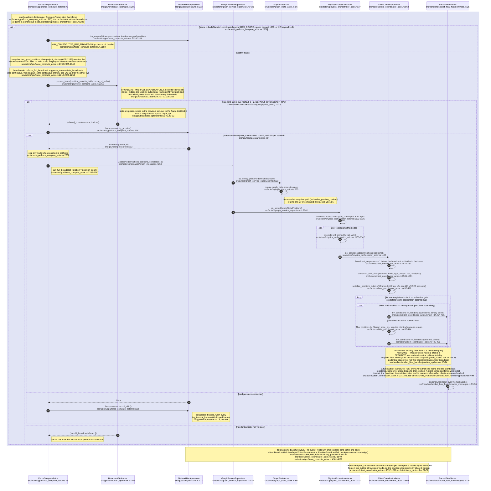
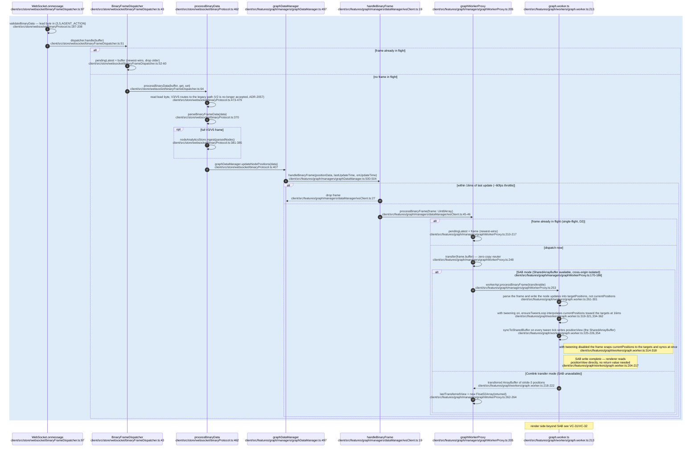
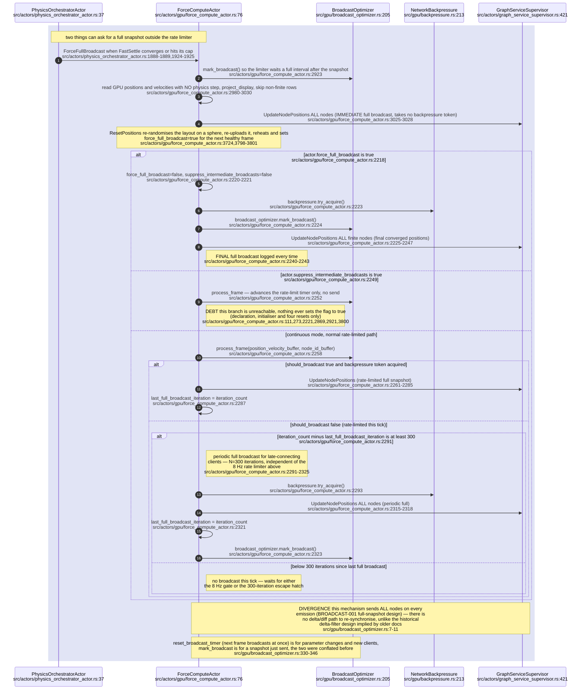
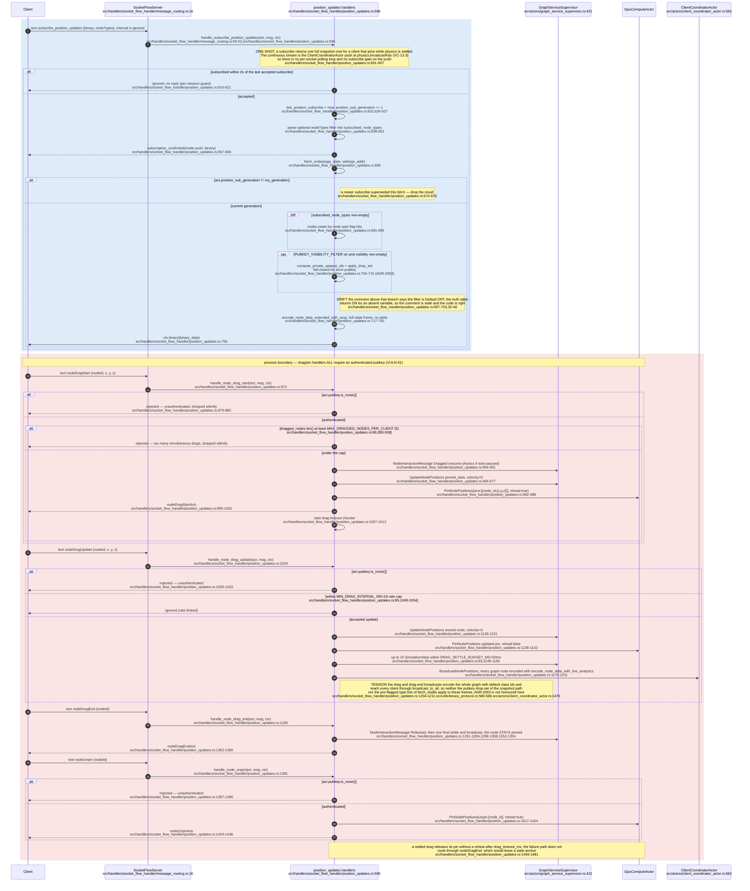
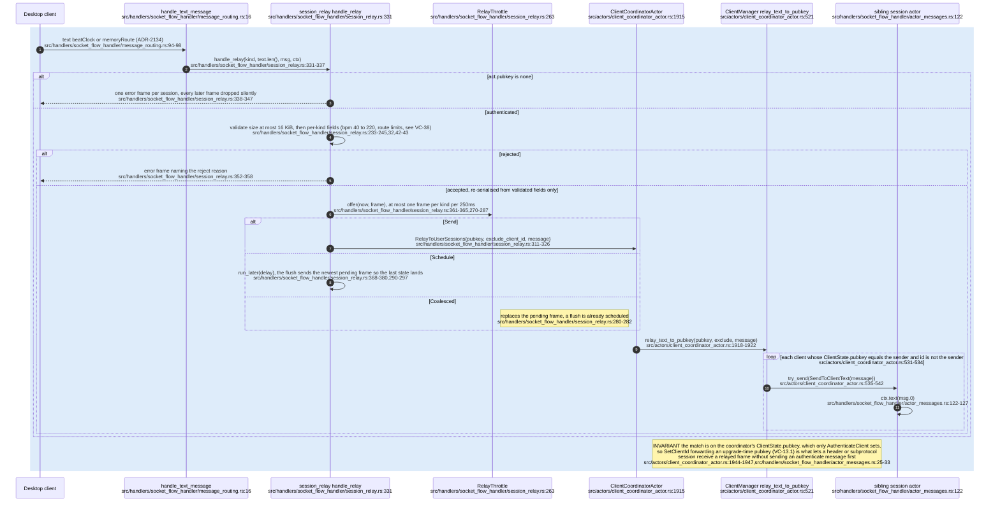
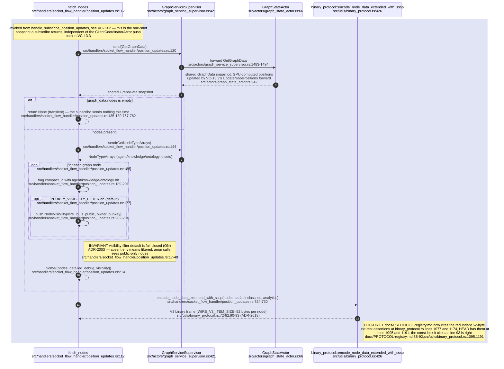
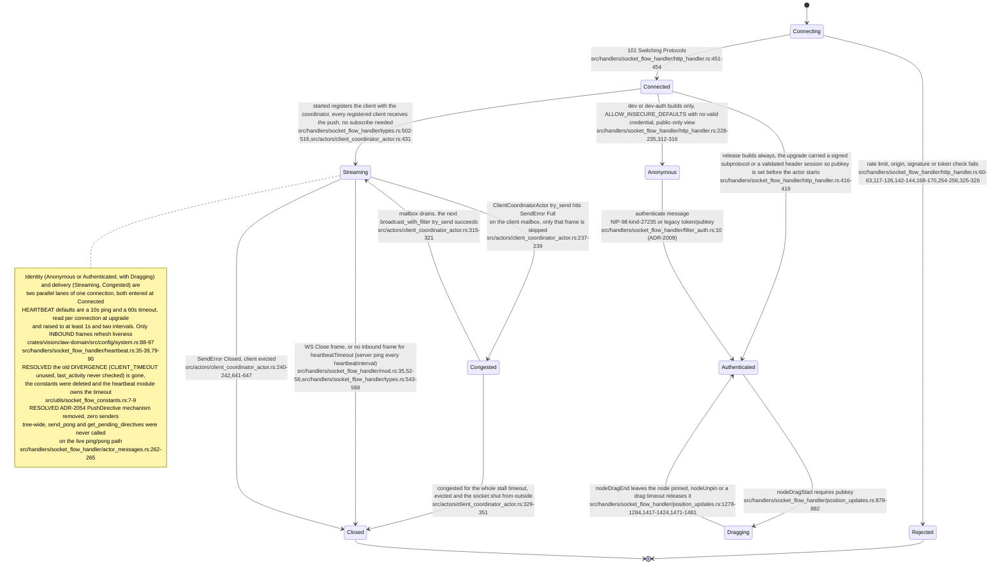

## VC-13.3 GPU broadcast frame end to end

## VC-13.1 WS connect, upgrade and authentication

```mermaid
sequenceDiagram
    autonumber
    participant C as Client
    participant HH as socket_flow_handler<br/>src/handlers/socket_flow_handler/http_handler.rs:53
    participant NS as NostrService get_session<br/>src/handlers/socket_flow_handler/http_handler.rs:226
    participant N98 as nip98::validate_nip98_token<br/>src/utils/nip98.rs:428
    participant WSS as SocketFlowServer actor<br/>src/handlers/socket_flow_handler/types.rs:489
    participant FA as filter_auth::handle_authenticate<br/>src/handlers/socket_flow_handler/filter_auth.rs:10

    rect rgb(225,228,245)
    Note over C,HH: process boundary — HTTP/WS upgrade at /wss
    C->>HH: GET /wss (Upgrade: websocket)
    HH->>HH: WEBSOCKET_RATE_LIMITER.is_allowed(client_ip)<br/>src/handlers/socket_flow_handler/http_handler.rs:60
    alt rate limited
        HH-->>C: 429 create_rate_limit_response<br/>src/handlers/socket_flow_handler/http_handler.rs:62
    else Origin header check
        HH->>HH: validate Origin against CORS_ALLOWED_ORIGINS or same-host<br/>src/handlers/socket_flow_handler/http_handler.rs:71-115
        alt Origin invalid and not same-host
            HH-->>C: 403 Forbidden<br/>src/handlers/socket_flow_handler/http_handler.rs:122
        else Origin missing (release build)
            HH-->>C: 400 Origin header required<br/>src/handlers/socket_flow_handler/http_handler.rs:142-144
        else Origin OK
            HH->>HH: read Sec-WebSocket-Protocol, nip98::websocket_auth_header takes the single nostr. subprotocol<br/>src/handlers/socket_flow_handler/http_handler.rs:150-158
            Note right of HH: browsers cannot set Authorization on a WebSocket upgrade, so the signed NIP-98 event rides as an<br/>unpadded URL-safe nostr.TOKEN subprotocol and only the neutral visionclaw protocol is echoed<br/>src/utils/nip98.rs:636-655,src/handlers/socket_flow_handler/http_handler.rs:10
            opt signed subprotocol present
                HH->>NS: verify_nip98_auth(header, signed_upgrade_url, GET) single-use<br/>src/handlers/socket_flow_handler/http_handler.rs:160-165
                alt NostrService absent, or invalid or replayed
                    HH-->>C: 401 Invalid or replayed WebSocket signature<br/>src/handlers/socket_flow_handler/http_handler.rs:162-170
                else verified
                    HH->>HH: signed_user = Some(user)<br/>src/handlers/socket_flow_handler/http_handler.rs:166
                end
            end
            Note right of HH: DRIFT the upgrade-time URL is rebuilt by signed_upgrade_url from connection_info<br/>alone while the post-connect authenticate frame uses nip98_request_url, whose docs claim to be the<br/>one reconstruction for every NIP-98 entry point, so the two agree only while connection_info<br/>and the X-Forwarded-Proto and X-Forwarded-Host headers agree<br/>src/handlers/socket_flow_handler/http_handler.rs:42-50,src/utils/auth.rs:159-189
            opt no signed user, so the Authorization Bearer token is the carrier
                HH->>HH: read Authorization Bearer token<br/>src/handlers/socket_flow_handler/http_handler.rs:182-188
                Note right of HH: RESOLVED ADR-2058 the ?token= query-string fallback is compiled<br/>in only for dev builds (http_handler.rs:191-206), release builds<br/>log and ignore it (http_handler.rs:208-218) and use the header alone
                alt token present
                    HH->>NS: nostr_service.get_session(token)<br/>src/handlers/socket_flow_handler/http_handler.rs:226
                    alt session valid
                        NS-->>HH: Some(session)
                        HH->>HH: signed_user = session, so the header-token client is attributed like the signed one<br/>src/handlers/socket_flow_handler/http_handler.rs:257-266
                        Note right of HH: RESOLVED 0d636fd0e (S-7f, verified in VC-03.2) the validated session used to be checked and then dropped<br/>so a header-session client reached the pubkey and is_power_user assignment below as anonymous.<br/>Authorization is therefore NOT the only carrier, the signed subprotocol is the browser path
                    else session invalid
                        NS-->>HH: None
                        alt release build (or dev without ALLOW_INSECURE_DEFAULTS)
                            HH-->>C: 401 Invalid or expired authentication token<br/>src/handlers/socket_flow_handler/http_handler.rs:254-255
                        else dev build with ALLOW_INSECURE_DEFAULTS=1
                            Note right of HH: dev-only bypass, compile-gated out of release, connection stays anonymous<br/>src/handlers/socket_flow_handler/http_handler.rs:228-235
                        end
                    end
                    opt NostrService absent
                        HH-->>C: 401 Authentication service unavailable (dev builds allow it only with ALLOW_INSECURE_DEFAULTS)<br/>src/handlers/socket_flow_handler/http_handler.rs:269-296
                    end
                else no token at all
                    alt release build
                        HH-->>C: 401 Authentication required<br/>src/handlers/socket_flow_handler/http_handler.rs:321-326
                    else dev build with ALLOW_INSECURE_DEFAULTS=1
                        Note right of HH: unauthenticated WS permitted, dev only<br/>src/handlers/socket_flow_handler/http_handler.rs:312-316
                    end
                end
            end
            HH->>WSS: ws_server = SocketFlowServer::new(...)<br/>src/handlers/socket_flow_handler/http_handler.rs:388
            HH->>WSS: per-connection heartbeat timings from system.websocket, and a closer for the raw TCP socket<br/>src/handlers/socket_flow_handler/http_handler.rs:394-413
            HH->>WSS: signed user, if any, sets pubkey and is_power_user (signed subprotocol and header session alike)<br/>src/handlers/socket_flow_handler/http_handler.rs:416-419
            HH->>WSS: connection_url = nip98_request_url(req) for the post-connect authenticate frame<br/>src/handlers/socket_flow_handler/http_handler.rs:431
            Note over HH: INVARIANT: X-Forwarded-Proto and X-Forwarded-Host win over connection_info in nip98_request_url,<br/>and nginx forwards X-Forwarded-Host $http_host for /wss so the dialled port survives<br/>src/utils/auth.rs:170-188,nginx.production.conf:248
            opt ?token= present a second time (dev builds only, src/handlers/socket_flow_handler/http_handler.rs:375-383)
                HH->>NS: nostr_service.get_session(token_from_qs)<br/>src/handlers/socket_flow_handler/http_handler.rs:436
                NS-->>HH: user with pubkey, is_power_user
                HH->>WSS: ws_server.pubkey = Some(user.pubkey)<br/>src/handlers/socket_flow_handler/http_handler.rs:437-438
                Note right of HH: DEBT redundant since 0d636fd0e, the first extraction already routes a dev query token<br/>through get_session into signed_user, see VC-03.2<br/>src/handlers/socket_flow_handler/http_handler.rs:191-206,266
            end
            HH->>C: 101 Switching Protocols (WsResponseBuilder, PUBLIC_WS_PROTOCOLS echoed)<br/>src/handlers/socket_flow_handler/http_handler.rs:451-454
            WSS->>WSS: started registers anonymous ClientRecipients with the coordinator<br/>src/handlers/socket_flow_handler/types.rs:502-516
            WSS->>WSS: SetClientId forwards an upgrade-time pubkey to the coordinator as AuthenticateClient<br/>src/handlers/socket_flow_handler/actor_messages.rs:17-33
            Note right of WSS: before this forward the coordinator held a session authenticated at the upgrade as anonymous<br/>so the same-user relay and per-user filters missed it until an authenticate frame arrived<br/>src/handlers/socket_flow_handler/actor_messages.rs:20-24
            WSS->>WSS: ping timer from the heartbeat settings, then send_full_state_sync and connection_established<br/>src/handlers/socket_flow_handler/types.rs:543-583
        end
    end
    end

    rect rgb(225,245,230)
    Note over C,WSS: post-connect NIP-98 "authenticate" message (kind 27235, ADR-2009 primary realm)
    C->>WSS: text message type=authenticate, event=base64 kind-27235 event<br/>src/handlers/socket_flow_handler/message_routing.rs:64-66
    WSS->>FA: handle_authenticate(act, msg, ctx)<br/>src/handlers/socket_flow_handler/filter_auth.rs:10
    alt VISIONCLAW_DEV_MODE full bypass (dev builds only)
        FA-->>C: authenticate_success (DEV_MODE_PUBKEY, power_user)<br/>src/handlers/socket_flow_handler/filter_auth.rs:26-59
    else event field present (NIP-98 path)
        FA->>N98: verify_nip98_auth auth_header=Nostr plus event_b64, ws_url, method=GET<br/>src/handlers/socket_flow_handler/filter_auth.rs:67-74
        N98->>N98: check kind==27235<br/>src/utils/nip98.rs:20,462
        N98->>N98: freshness ±TOKEN_MAX_AGE_SECONDS=60s<br/>src/utils/nip98.rs:169,467-484
        N98->>N98: url and method match, body binding, then Schnorr signature<br/>src/utils/nip98.rs:510,518,526,560-565
        N98->>N98: claim event id in replay cache (TTL=120s, cap 100000, 1000 per signer, fail-closed ReplayCacheFull)<br/>src/utils/nip98.rs:178,198,215,258-262,322-324,573 (ADR-2002)
        alt validation and single-use claim succeed
            N98-->>FA: Ok(user)
            FA-->>C: authenticate_success{pubkey, is_power_user}<br/>src/handlers/socket_flow_handler/filter_auth.rs:104-112
            FA->>WSS: AuthenticateClient to the coordinator, bump_sync_generation, then send_full_state_sync re-push filtered by new pubkey<br/>src/handlers/socket_flow_handler/filter_auth.rs:92-123
        else signature/URL/method/freshness/replay fails
            N98-->>FA: Err(e)
            FA-->>C: error NIP-98 WebSocket authentication failed<br/>src/handlers/socket_flow_handler/filter_auth.rs:124-132
        end
    else legacy token+pubkey fields (ADR-2009 secondary realm)
        Note right of FA: legacy { token, pubkey, ephemeral? } path, get_session must return the same pubkey<br/>src/handlers/socket_flow_handler/filter_auth.rs:137-145,213-216
    end
    end
```

## VC-13.7 Client decode: binary frame to SharedArrayBuffer

## VC-13.4 Full-snapshot escape hatches: ResetPositions, ForceFullBroadcast and the 300-iteration periodic send

## VC-13.2 Subscribe to position updates, and drag/pin control messages

## VC-13.9 Same-user session relay: beatClock and memoryRoute

## VC-13.6 One-shot snapshot — GetGraphData to binary encode

## VC-13.8 Client session lifecycle

