## VC-15.1 POST /analytics/clustering/run — spectral/kmeans/louvain/default dispatch with CPU fallback

## VC-15.2 POST /analytics/clustering/dbscan — direct RunDBSCAN, GPU-only, precondition refusals

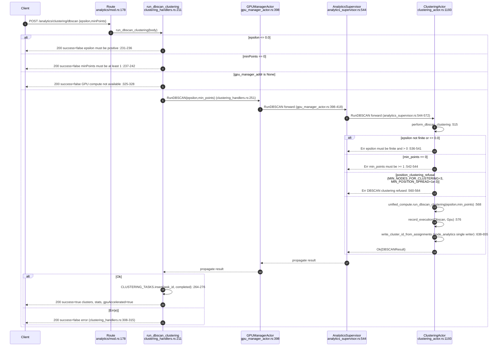

## VC-15.3 POST /analytics/community/detect — sent to ForceComputeActor, which refuses

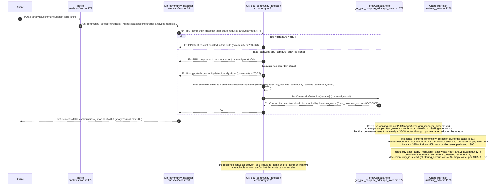

## VC-15.4 POST /analytics/anomaly/detect — LOF / Z-score structural anomaly

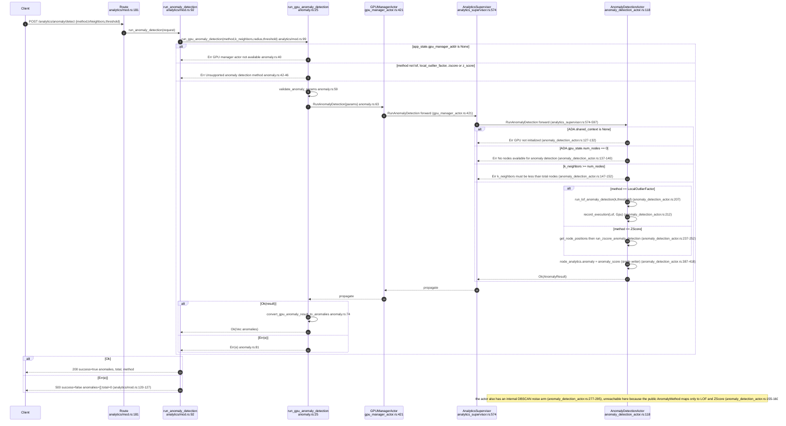

## VC-15.5 PageRank compute / cached result / cache clear — the AppState address is never set

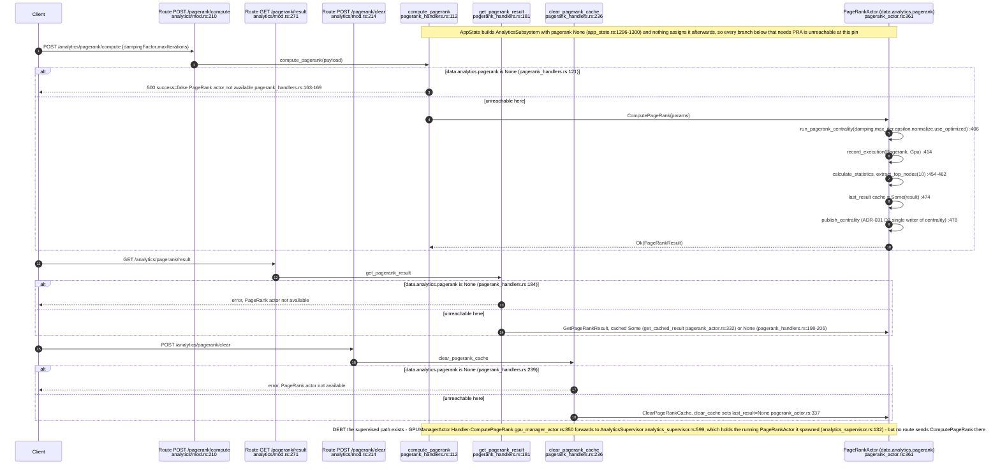

## VC-15.6 POST /analytics/pathfinding/sssp and /pathfinding/apsp — supervised ShortestPathActor

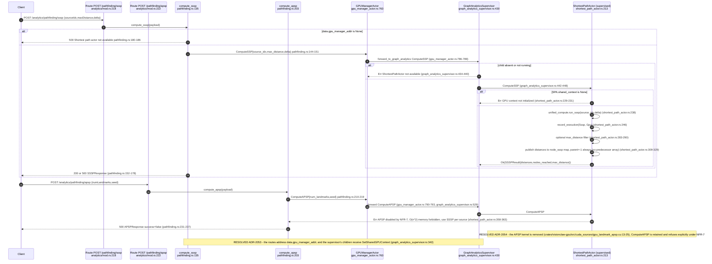

## VC-15.7 POST /analytics/sssp/compute — CPU Dijkstra via GraphServiceSupervisor, result discarded

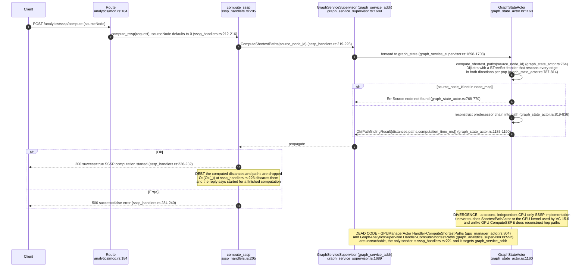

## VC-15.8 POST /analytics/pathfinding/connected-components — supervised GPU actor, no CPU fallback

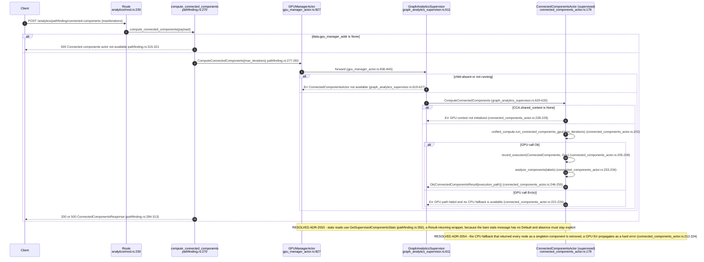

## VC-15.9 POST /analytics/pathfinding/path — point-to-point A* / Bidirectional Dijkstra / Semantic / SSSP dispatch

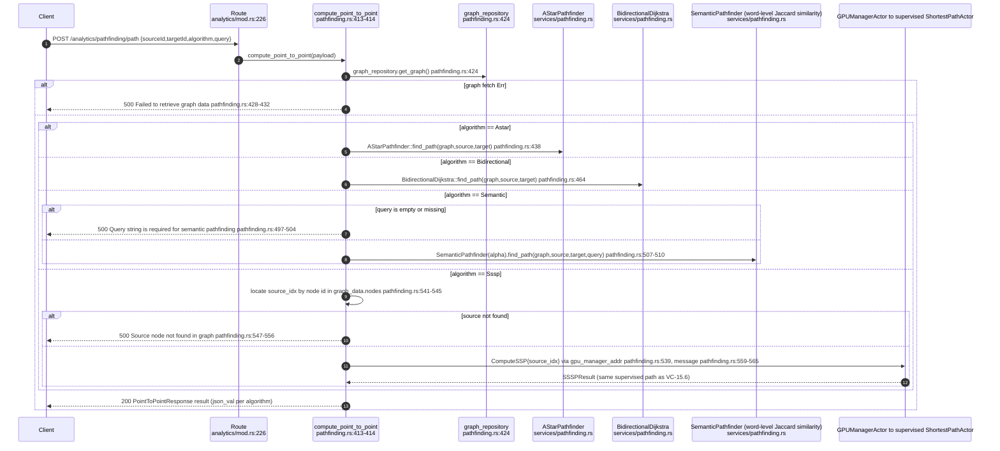

## VC-15.10 POST /pathfinding/semantic-path, /query-traversal, /chunk-traversal — CPU semantic A*

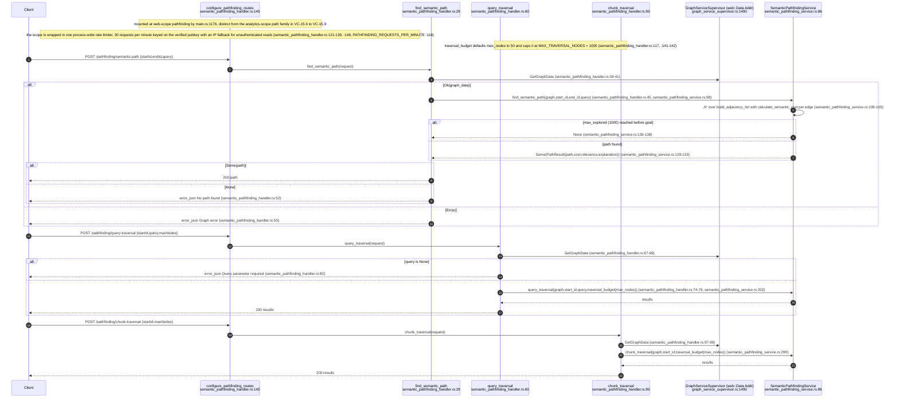

## VC-15.12 Visual analytics GPU types (src/gpu/visual_analytics.rs) with validate() failure modes

```mermaid
classDiagram
    class Vec4 {
        x: f32
        y: f32
        z: f32
        t: f32
        new(x,y,z,t) Result~Vec4,GPUSafetyError~
        validate() Result~(),GPUSafetyError~
    }
    note for Vec4 "visual_analytics.rs:13, new at :21 rejects non-finite components and abs greater than 1e6 (MAX_VAL :28), validate at :50"

    class IsolationLayer {
        layer_id: i32
        opacity: f32
        z_offset: f32
        focus_center: Vec4
        focus_radius: f32
        temporal_range: f32_2
        edge_opacity: f32
        new(layer_id) IsolationLayer
        validate() Result~(),GPUSafetyError~
    }
    note for IsolationLayer "visual_analytics.rs:75, new() at :95, validate at :113 rejects opacity/edge_opacity outside 0..1 and a negative layer_id"

    class VisualAnalyticsParams {
        total_nodes: i32
        total_edges: i32
        active_layers: i32
        force_scale: f32_4
        rest_length: f32
        primary_focus_node: i32
        embedding_dims: i32
        camera_position: Vec4
        viewport_bounds: Vec4
        validate() Result~(),GPUSafetyError~
    }
    note for VisualAnalyticsParams "visual_analytics.rs:207 (38 fields), Default impl at :257, validate() at :312 covers node/edge counts and force scales"

    class VisualAnalyticsBuilder {
        <<builder, live external consumer>>
    }
    note for VisualAnalyticsBuilder "visual_analytics.rs:537, used by src/handlers/api_handler/analytics/params_handlers.rs:347"

    class PerformanceMetrics {
        <<live external consumer>>
    }
    note for PerformanceMetrics "visual_analytics.rs:500, used by src/handlers/api_handler/analytics/types.rs:4"

    class GPUSafetyError {
        <<enum, subset shown>>
        InvalidKernelParams
        BufferBoundsExceeded
        ResourceExhaustion
        InvalidBufferSize
        DeviceError
    }
    note for GPUSafetyError "src/utils/gpu_safety.rs:176, twelve variants in all, the five above are the ones these validators and allocations name"

    IsolationLayer --> Vec4
    VisualAnalyticsParams --> Vec4
    Vec4 ..> GPUSafetyError
    IsolationLayer ..> GPUSafetyError
    VisualAnalyticsParams ..> GPUSafetyError

    note "RESOLVED ADR-2054 (src/gpu/mod.rs:32-37): TSNode, TSEdge, VisualAnalyticsGPU and<br/>VisualAnalyticsEngine are REMOVED - dead code, never instantiated outside their<br/>own module. Vec4, IsolationLayer, VisualAnalyticsParams, VisualAnalyticsBuilder<br/>and PerformanceMetrics remain, each with a live external consumer<br/>(physics_messages.rs, params_handlers.rs, types.rs)."
```

## VC-15.13 Analytics kernel trust status and the CPU reference oracle

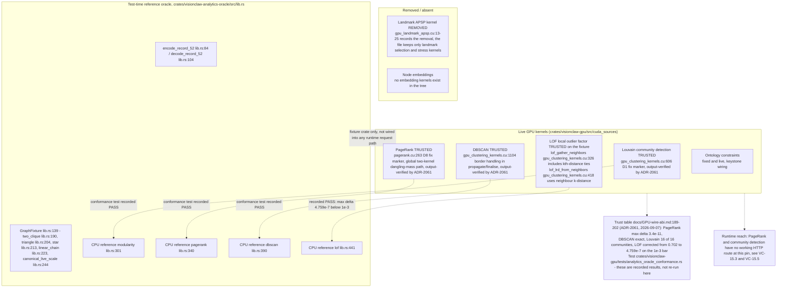

**Debt:** two analytics routes cannot reach a GPU kernel at the pin. `POST /analytics/community/detect` sends `RunCommunityDetection` to `ForceComputeActor` (`src/handlers/api_handler/analytics/community.rs:61-64`, `:91`), whose handler only returns an error (`src/actors/gpu/force_compute_actor.rs:3347-3352`). The PageRank routes read `AppState.analytics.pagerank` (`src/handlers/api_handler/analytics/pagerank_handlers.rs:121`), which is built as `None` (`src/app_state.rs:1296-1300`) and never assigned. Both have working supervised paths through `GPUManagerActor` (`src/actors/gpu/gpu_manager_actor.rs:375`, `:850`), the pattern ADR-2053 already applied to the pathfinding routes. Closing this needs both routes moved to `gpu_manager_addr`, plus route-level tests that fail on the stub replies.

**Debt:** `POST /analytics/sssp/compute` computes a full CPU Dijkstra and then discards it, answering `SSSP computation started` (`src/handlers/api_handler/analytics/sssp_handlers.rs:226-232`).

**Drift:** before this restamp the topic placed the Louvain D1 marker at `gpu_clustering_kernels.cu:581` (a loop line; the marker is at `:606`) and described the APSP kernel as `#if 0`-guarded, but ADR-2054 had already removed it (`crates/visionclaw-gpu/src/cuda_sources/gpu_landmark_apsp.cu:13-25`).
