## For developers

The analytics routes: clustering, community, anomaly, PageRank, shortest paths and components. At 809a859aa every gated analytics route takes its decision from one `CallerGate`; point-to-point A*, bidirectional and semantic paths run over `caller_view` instead (`analytics/pathfinding.rs:557`). A caller whose view hides nodes is answered on the CPU over that view for communities, PageRank, SSSP, APSP and components; full-access callers reach the GPU actors through `GPUManagerActor`. Anomalies and DBSCAN clusters are still filtered after a whole-graph run, and no SSSP run is written to the wire any more.

## For the business

These are the graph insights a user can ask for: clusters, important nodes, paths between ideas. A user who cannot see a private node does not learn of it through an analytics answer, and community and importance scores are now worked out from what that user can see. Some routes still answer with stubs, and the register lists them.

## VC-15.1 POST /analytics/clustering/run — spectral/kmeans/louvain/default dispatch with CPU fallback

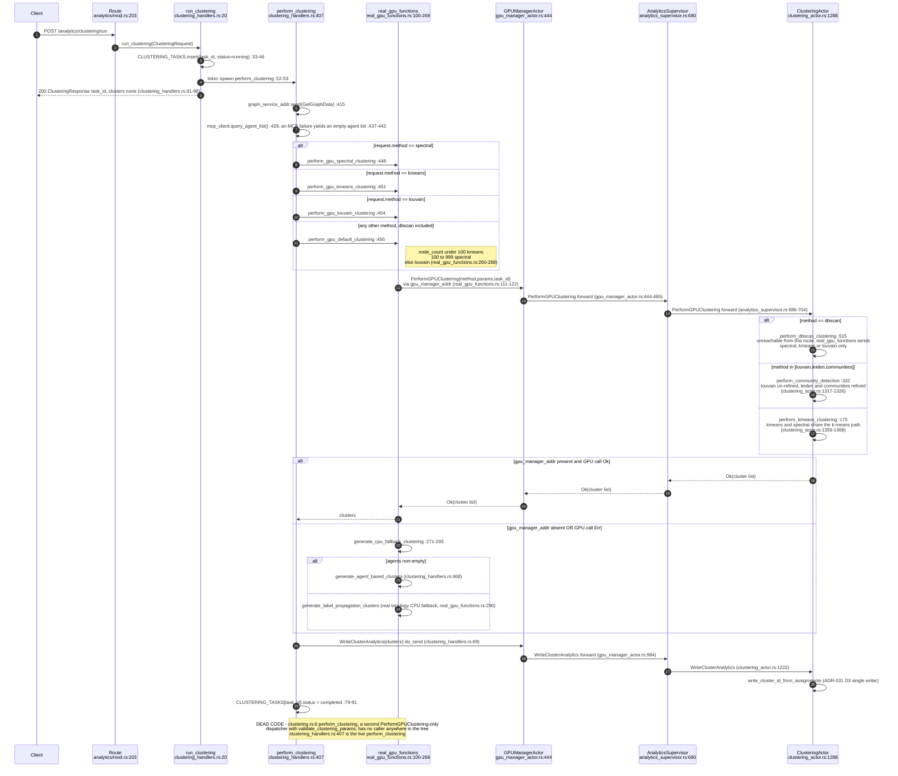

## VC-15.2 POST /analytics/clustering/dbscan — direct RunDBSCAN, GPU-only, precondition refusals

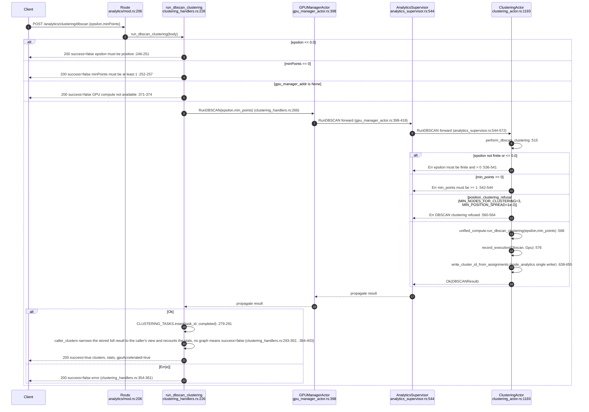

## VC-15.3 POST /analytics/community/detect — full access reaches ClusteringActor, a gated caller is answered on the CPU over its view

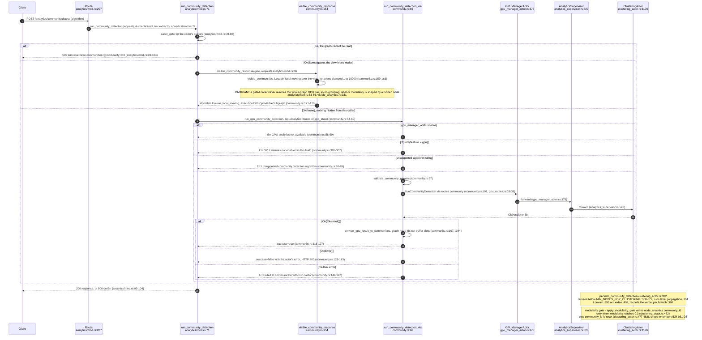

**What it shows:** the route splits on the caller gate before any GPU work. A caller whose view hides nodes is answered by CPU local moving over that view; a full-access caller goes through `GPUManagerActor` to `ClusteringActor`, which the old `ForceComputeActor` refusal stub never reached.

**Why it is this way:** commits ab05ee9d6 and 405edcfe1 (2026-11) replaced filter-after with compute-over-the-view and routed full access through `gpu_routes.rs` (ADR-2184).

**Tension (parallel):** a gated caller always gets Louvain local moving whatever `algorithm` it asked for (`src/handlers/api_handler/analytics/community.rs:171`), while a full-access caller gets label propagation, Louvain or Leiden (`src/handlers/api_handler/analytics/community.rs:76-79`), so two callers asking the same question get different algorithms.

## VC-15.4 POST /analytics/anomaly/detect — LOF / Z-score structural anomaly

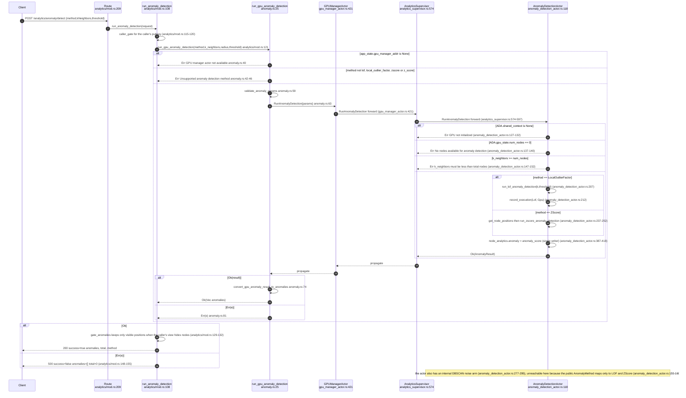

## VC-15.5 PageRank compute / cached result / cache clear — gated callers on the CPU, full access through the GPU manager

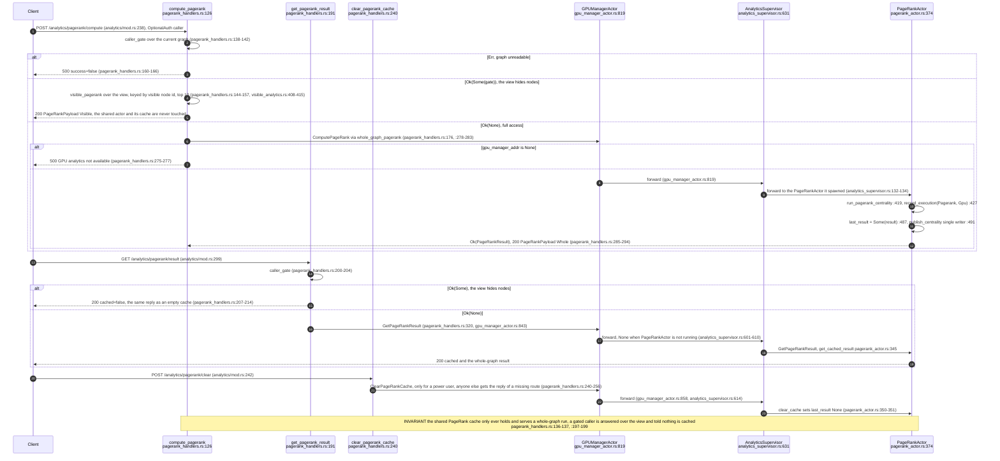

**What it shows:** the three PageRank routes after the 2026-11 visibility sweep. The `AppState.analytics.pagerank` address that nothing ever set is gone; full access reaches `PageRankActor` through `GPUManagerActor` and `AnalyticsSupervisor`.

**Why it is this way:** commit 405edcfe1 added the `GetPageRankResult` and `ClearPageRankCache` forwards and `gpu_routes.rs`, so the full-access path stops failing (ADR-2184).

**Open (risk):** RESOLVED at visionclaw 46edc196 — `POST /analytics/pagerank/clear` now refuses everyone but a power user, with the reply of a missing route (`src/handlers/api_handler/analytics/pagerank_handlers.rs:240-249`, `:260-262`), so only an operator can evict the whole-graph cache that full-access callers read.

## VC-15.6 POST /analytics/pathfinding/sssp and /pathfinding/apsp — supervised ShortestPathActor, gated callers over the view

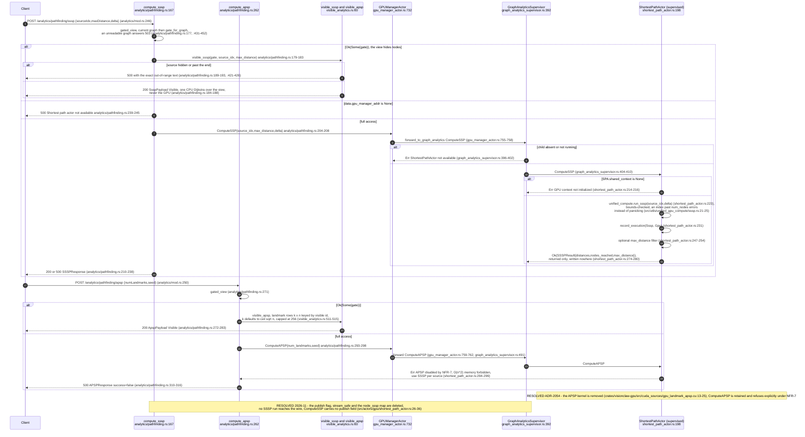

**What it shows:** SSSP and APSP split on the caller gate. The GPU actor now only returns its distances; the run-to-wire publish path and its `stream_safe` precondition were removed in ca9113b2f and 7a0674e79.

**Tension (parallel):** a gated caller is answered on `/pathfinding/apsp` with landmark rows (`src/handlers/api_handler/analytics/pathfinding.rs:271-283`), while a full-access caller always gets the NFR-7 refusal (`src/actors/gpu/shortest_path_actor.rs:294-299`), so seeing less of the graph yields more of the answer.

## VC-15.7 POST /analytics/sssp/compute — the one CPU Dijkstra via GraphServiceSupervisor, result discarded

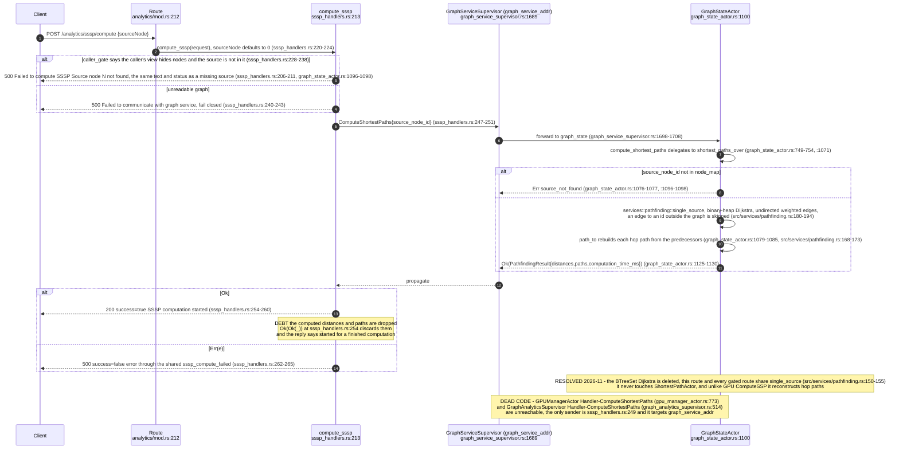

## VC-15.8 POST /analytics/pathfinding/connected-components — supervised GPU actor, no CPU fallback

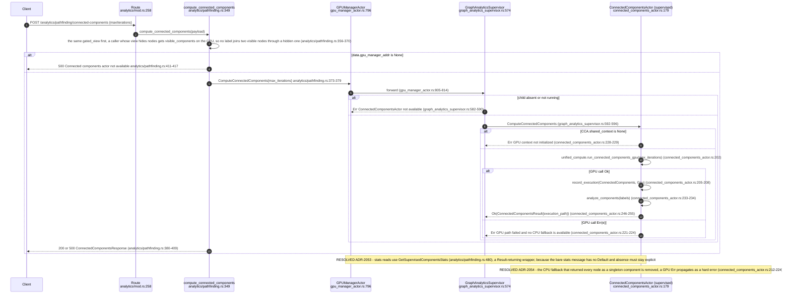

## VC-15.9 POST /analytics/pathfinding/path — point-to-point A* / Bidirectional Dijkstra / Semantic / SSSP dispatch

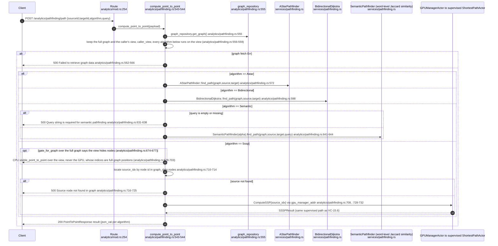

## VC-15.10 POST /pathfinding/semantic-path, /query-traversal, /chunk-traversal — CPU semantic A*

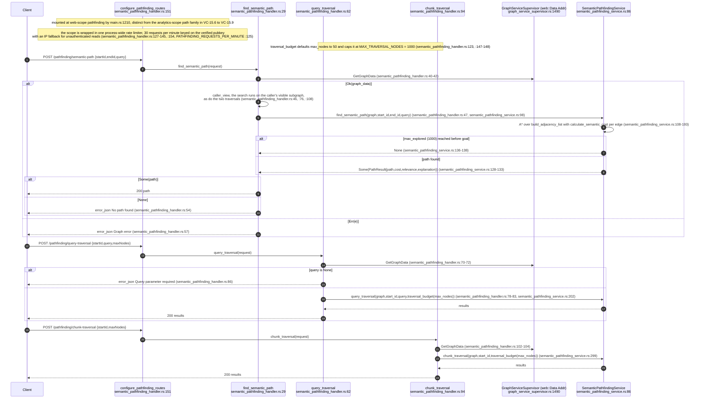

## VC-15.12 Visual analytics GPU types (src/gpu/visual_analytics.rs) with validate() failure modes

## VC-15.13 Analytics kernel trust status and the CPU reference oracle

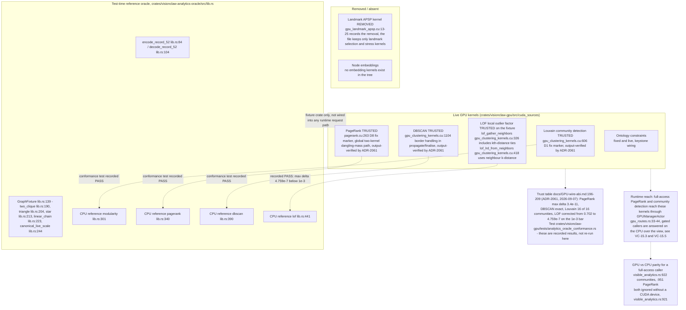

**Debt:** `POST /analytics/sssp/compute` computes a full CPU Dijkstra and then discards it, answering `SSSP computation started` (`src/handlers/api_handler/analytics/sssp_handlers.rs:254-260`).

**Drift:** before this restamp the topic placed the Louvain D1 marker at `gpu_clustering_kernels.cu:581` (a loop line; the marker is at `:606`) and described the APSP kernel as `#if 0`-guarded, but ADR-2054 had already removed it (`crates/visionclaw-gpu/src/cuda_sources/gpu_landmark_apsp.cu:13-25`).

**Invariant:** `CallerGate` is the one ADR-060 "is anything hidden from this caller" decision; `gate_for_graph` and `caller_gate` are its only constructors (`src/handlers/graph_access.rs:77-82`, `:120`, `:159`), and ids and GPU positions are distinct types so they cannot be mixed (`src/handlers/graph_access.rs:44-53`).

**Debt (parallel):** the gate still reads the graph two ways. Point-to-point reads `graph_repository` (`src/handlers/api_handler/analytics/pathfinding.rs:555`) while every other gate reads `GraphServiceSupervisor` (`src/handlers/graph_access.rs:159-168`), and `gated_view` fetches the graph even when the filter is off (`src/handlers/api_handler/analytics/pathfinding.rs:431-451`) where `caller_gate` skips the fetch (`src/handlers/graph_access.rs:163-165`).

**Invariant:** there is one CPU single-source shortest path, `single_source` (`src/services/pathfinding.rs:180`), used by `/sssp/compute` (`src/actors/graph_state_actor.rs:1079`) and the gated routes; the GPU `run_sssp` (`src/utils/unified_gpu_compute/sssp.rs:20`) is its accelerator for full-access callers.

**Tension (risk):** anomalies are still scored over the whole graph and only filtered on the way out (`src/handlers/api_handler/analytics/visible_results.rs:1-7`), because LOF scores layout positions every node shaped; and DBSCAN clusters keep their whole-graph cluster ids after hidden members are dropped (`src/handlers/api_handler/analytics/visible_analytics.rs:173-177`). A visible node's anomaly score or cluster number can still reflect hidden nodes.

**Open (risk):** the GPU-vs-CPU parity tests for communities and PageRank are `#[ignore]` without a CUDA device (`src/handlers/api_handler/analytics/visible_analytics.rs:921-922`), so nothing in a GPU-less run checks that a gated and a full-access caller see the same algorithm's answer.

**Drift (loose end):** the point-to-point SSSP comment still says a GPU run would "be published to the shared stream" (`src/handlers/api_handler/analytics/pathfinding.rs:671-673`); the publish path was deleted in ca9113b2f.
