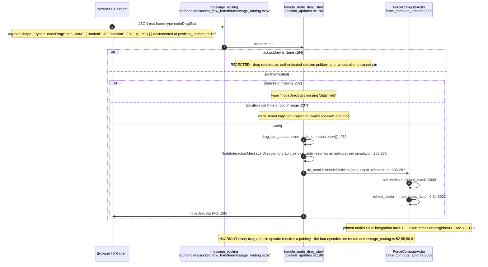
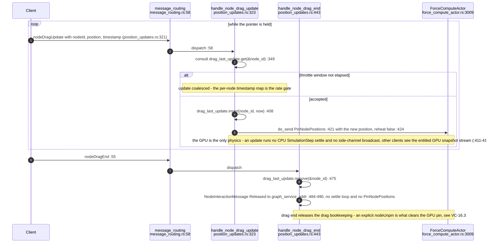
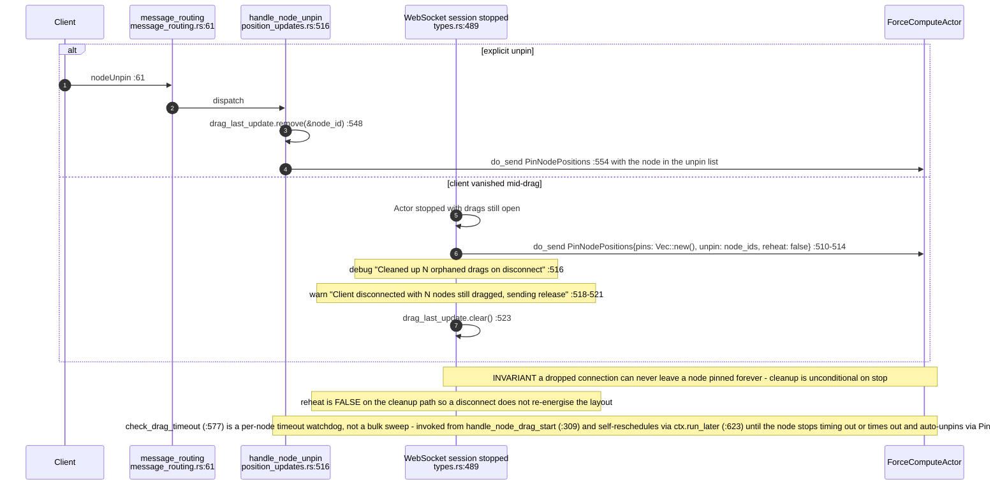
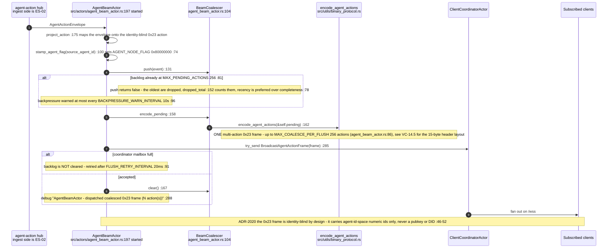
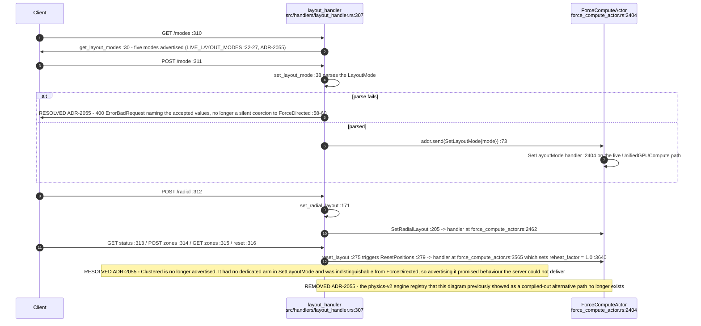
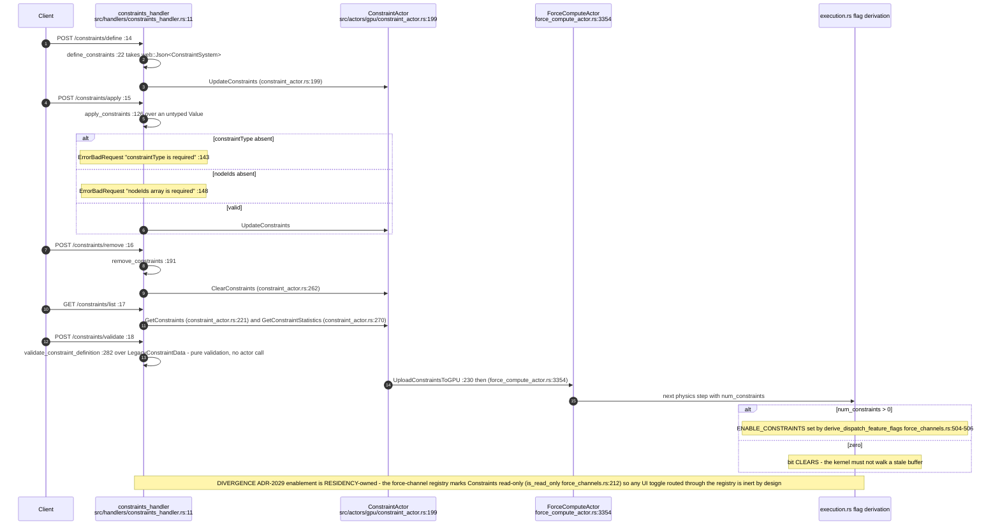
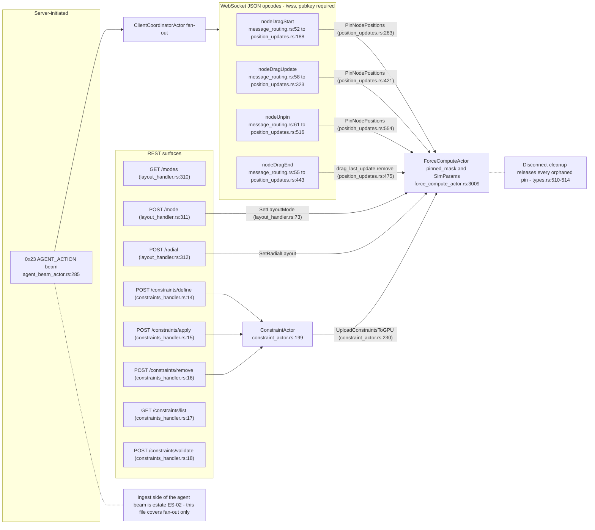
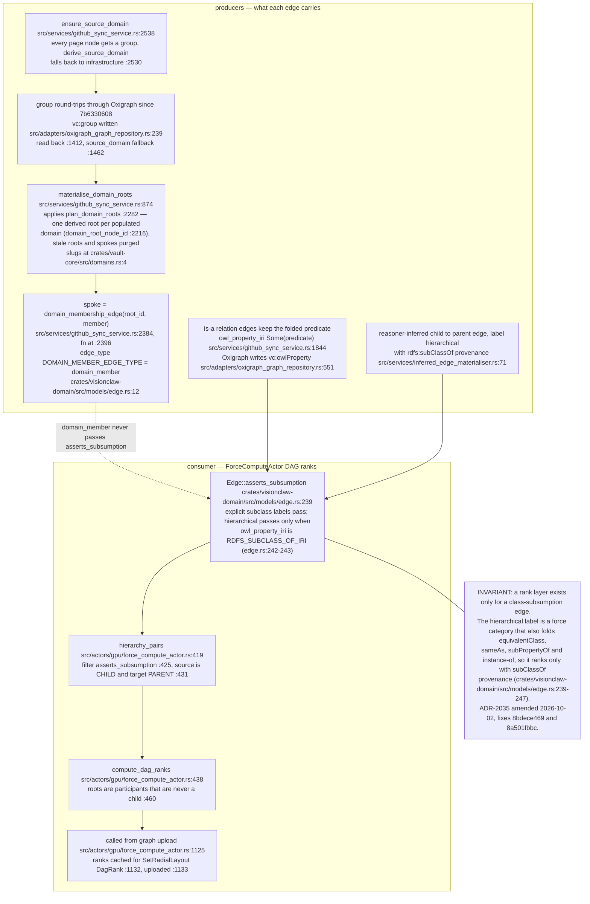

## VC-16.1 Node drag start — pin acquisition

## VC-16.2 Drag update and drag end

## VC-16.3 Unpin and orphaned-drag cleanup on disconnect

## VC-16.4 Agent beam 0x23 fan-out

## VC-16.5 Layout mode switch over REST — post-ADR-2055

## VC-16.6 Constraint CRUD to GPU residency

## VC-16.7 Interaction surface map

## VC-16.8 DAG rank layering — subClassOf provenance, domain spokes as domain_member

**Invariant (ADR-2035, amended 2026-10-02):** the DAG ranker layers an edge only when `Edge::asserts_subsumption` holds (`crates/visionclaw-domain/src/models/edge.rs:239-247`), applied in `hierarchy_pairs` (`src/actors/gpu/force_compute_actor.rs:425`); a `hierarchical` edge counts only with `rdfs:subClassOf` in `owl_property_iri`, and domain-root spokes carry `domain_member` (`src/services/github_sync_service.rs:2396`, `crates/visionclaw-domain/src/models/edge.rs:12`). This resolves the earlier drift in which the ADR accepted the bare label on the premise that ingest never wrote membership under it, while `materialise_domain_roots` did, ranking every domain root below its own members. The amendment records the observed census: 9,796 subclass edges plus 6,400 spokes ranked together on the pre-fix binary (`docs/adr/ADR-2035-dag-rank-accepts-hierarchical-label.md:196`). A same-day follow-up (`8a501fbbc`, recorded at `docs/adr/ADR-2035-dag-rank-accepts-hierarchical-label.md:288-340`) made the roots themselves stable: `materialise_domain_roots` now applies the pure `plan_domain_roots` reconcile (`src/services/github_sync_service.rs:2282`), so each domain has one derived root id in every process and stale counter-minted roots and their `hierarchical` spokes are purged on the next sync.

**Drift (ADR-2035 vs code):** the record's Context still says the ranker uses `is_directed_hierarchy_relation` (`docs/adr/ADR-2035-dag-rank-accepts-hierarchical-label.md:28-29`), and its Consequences still describe the accept as coupled to ingest labelling (`docs/adr/ADR-2035-dag-rank-accepts-hierarchical-label.md:61-62`). That function was deleted in 8bdece469 and replaced by `hierarchy_pairs` (`src/actors/gpu/force_compute_actor.rs:419`). The Decision section (`:37-43`) is current; the surrounding prose is not.

**Open:** the fix moves a dependency onto provenance. A producer that writes a `hierarchical` subclass edge without `rdfs:subClassOf` in `owl_property_iri`, or a store path that drops `vc:owlProperty` (`src/adapters/oxigraph_graph_repository.rs:551`), would silently stop ranking. The ADR names this as its review trigger; nothing at boot detects it.
