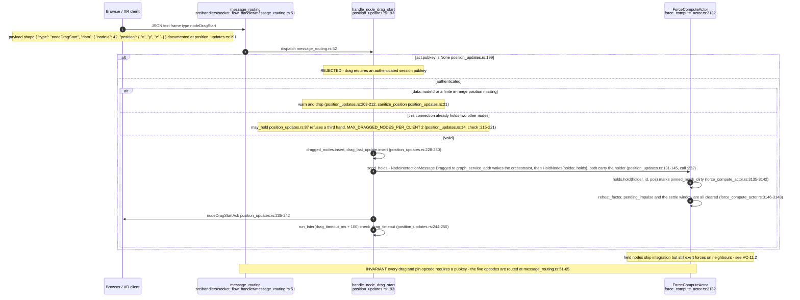
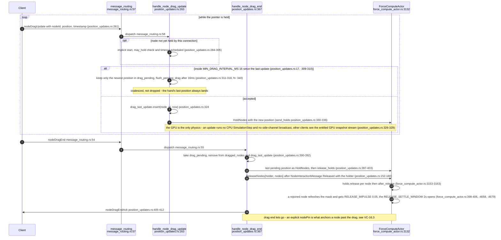
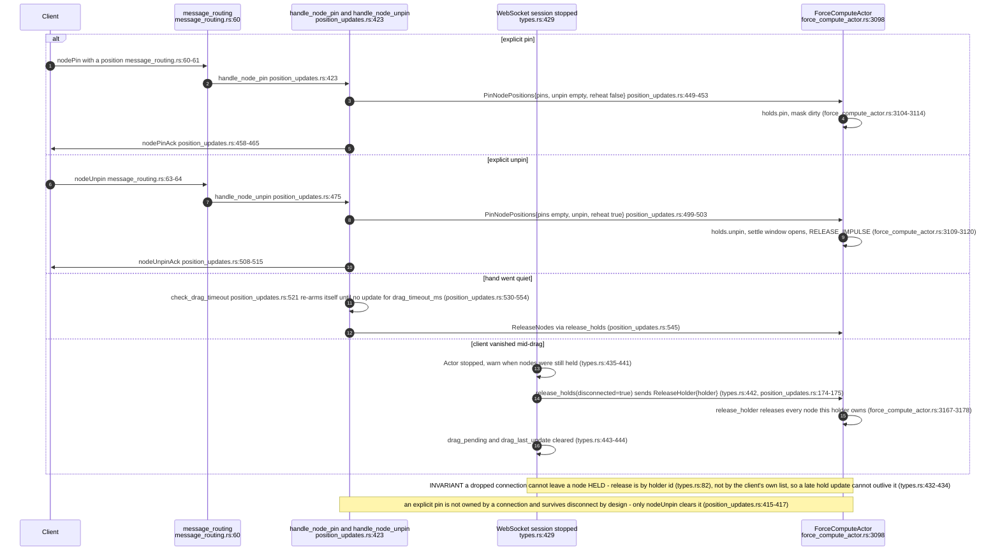
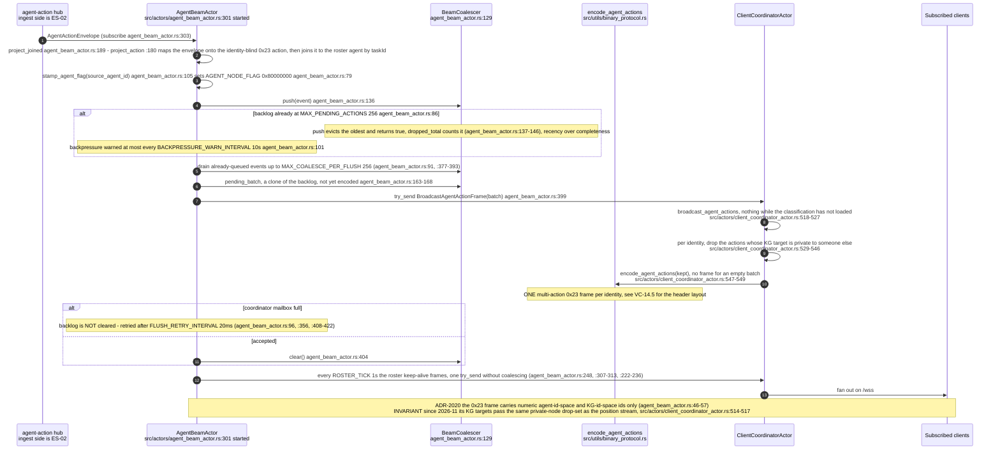
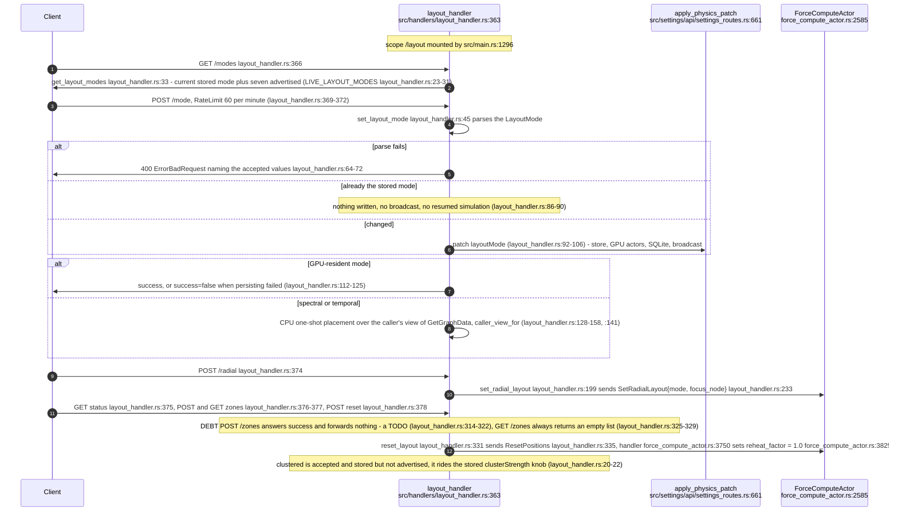
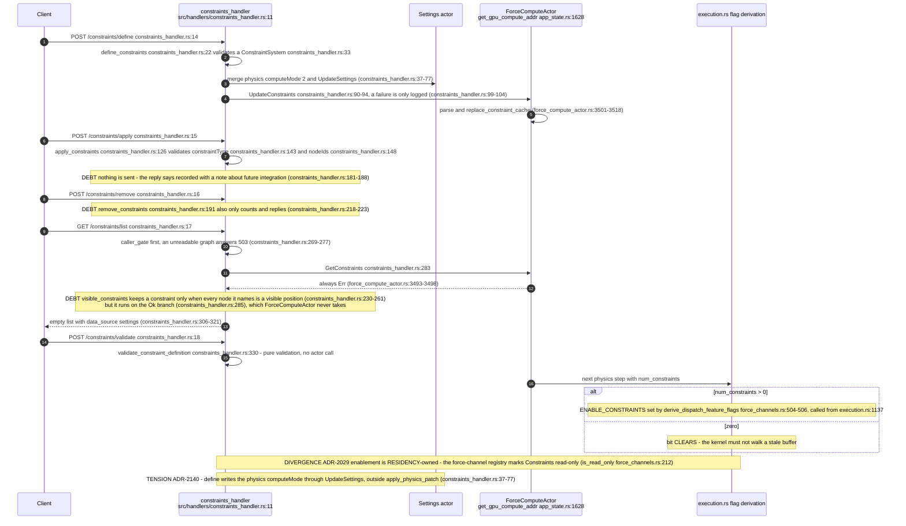
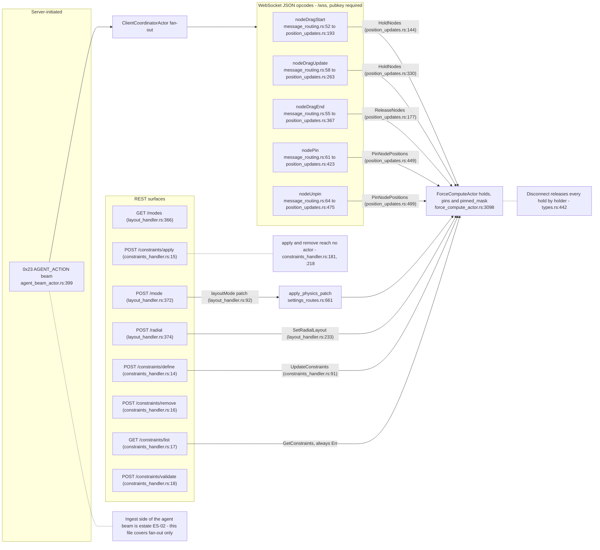
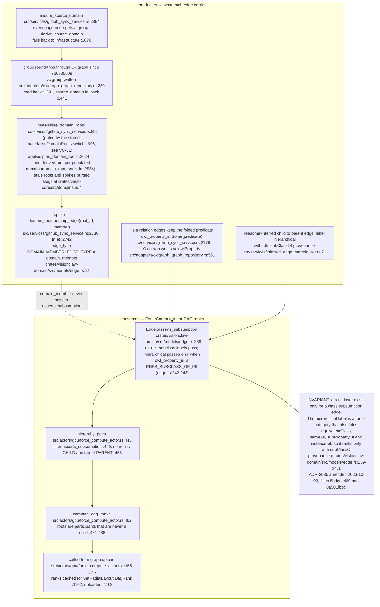

These panels are drawn at `86cdd7635582`, where a drag is a hold (ADR-2169): the hand's hold is released separately from an explicit pin. The [current contract audit](../../estate-review/2026-11-01-drag-holds-and-acceptance.md) and [VC-52](52-drag-holds-and-observation-gates.md) trace the hold lifecycle at their own pin. The ADR-2140 layout mode (`physics.layoutMode`), the step cadence and the three settle mechanisms are drawn at `d6c091f0f` in [VC-54](54-layout-mode-step-cadence-and-settle.md).

## For developers

Interaction covers drag holds, pins, layout modes, constraint routes and agent beams. A drag is a hold that the connection owns, and the orchestrator now records which connection owns each held node. CPU layout modes are computed over the caller's visible subgraph.

## For the business

Dragging, pinning and choosing a layout are how a user arranges the graph. A drag affects every viewer's layout, so its ownership and release rules matter whenever several people share a graph.

## VC-16.1 Node drag start — the connection takes hold

## VC-16.2 Drag update and drag end

## VC-16.3 Explicit pin and unpin, timeout and disconnect release

## VC-16.4 Agent beam 0x23 fan-out

## VC-16.5 Layout mode over REST — one stored field, written through the physics patch

## VC-16.6 Constraint REST routes — ForceComputeActor cache, two record-only routes

## VC-16.7 Interaction surface map

## VC-16.8 DAG rank layering — subClassOf provenance, domain spokes as domain_member

**Invariant (ADR-2035, amended 2026-10-02):** the DAG ranker layers an edge only when `Edge::asserts_subsumption` holds (`crates/visionclaw-domain/src/models/edge.rs:239-247`), applied in `hierarchy_pairs` (`src/actors/gpu/force_compute_actor.rs:449`). A `hierarchical` edge counts only with `rdfs:subClassOf` in `owl_property_iri`. Domain-root spokes carry `domain_member` (`src/services/github_sync_service.rs:2742`, `crates/visionclaw-domain/src/models/edge.rs:12`). This resolves an earlier drift: the ADR accepted the bare label on the premise that ingest never wrote membership under it, but `materialise_domain_roots` did, and every domain root ranked below its own members. The amendment records the observed census: 9,796 subclass edges and 6,400 spokes ranked together on the pre-fix binary (`docs/adr/ADR-2035-dag-rank-accepts-hierarchical-label.md:196-200`). A same-day follow-up (`8a501fbbc`, recorded at `docs/adr/ADR-2035-dag-rank-accepts-hierarchical-label.md:286-337`) made the roots themselves stable. `materialise_domain_roots` now applies the pure `plan_domain_roots` reconcile (`src/services/github_sync_service.rs:2624`), so each domain has one derived root id in every process, and the next sync purges stale counter-minted roots and their `hierarchical` spokes.

**Drift (ADR-2035 vs code):** the record's Context still says the ranker uses `is_directed_hierarchy_relation` (`docs/adr/ADR-2035-dag-rank-accepts-hierarchical-label.md:28-29`). Its Consequences still describe the accept as coupled to ingest labelling (`docs/adr/ADR-2035-dag-rank-accepts-hierarchical-label.md:61-62`). That function was deleted in 8bdece469 and replaced by `hierarchy_pairs` (`src/actors/gpu/force_compute_actor.rs:443`). The Decision section (`:37-48`) is current; the surrounding prose is not.

**Open:** the fix moves a dependency onto provenance. A producer that writes a `hierarchical` subclass edge without `rdfs:subClassOf` in `owl_property_iri` would silently stop ranking, and so would a store path that drops `vc:owlProperty` (`src/adapters/oxigraph_graph_repository.rs:551`). The ADR names this as its review trigger; nothing at boot detects it.

**Debt:** two constraint routes and one layout route answer success without effect. `POST /constraints/apply` and `/constraints/remove` reach no actor (`src/handlers/constraints_handler.rs:181-188`, `:218-223`), and `POST /layout/zones` is a TODO (`src/handlers/layout_handler.rs:318`). `GET /constraints/list` always falls back to an empty list, because `ForceComputeActor` refuses `GetConstraints` (`src/actors/gpu/force_compute_actor.rs:3493-3498`). `ConstraintActor` is not addressed by any of these routes.

**Open:** `POST /layout/radial` and `POST /layout/reset` take no `AuthenticatedUser` extractor, unlike `POST /layout/mode` (`src/handlers/layout_handler.rs:46`). Whether the enclosing `/api` scope authenticates them is outside this source trace.
