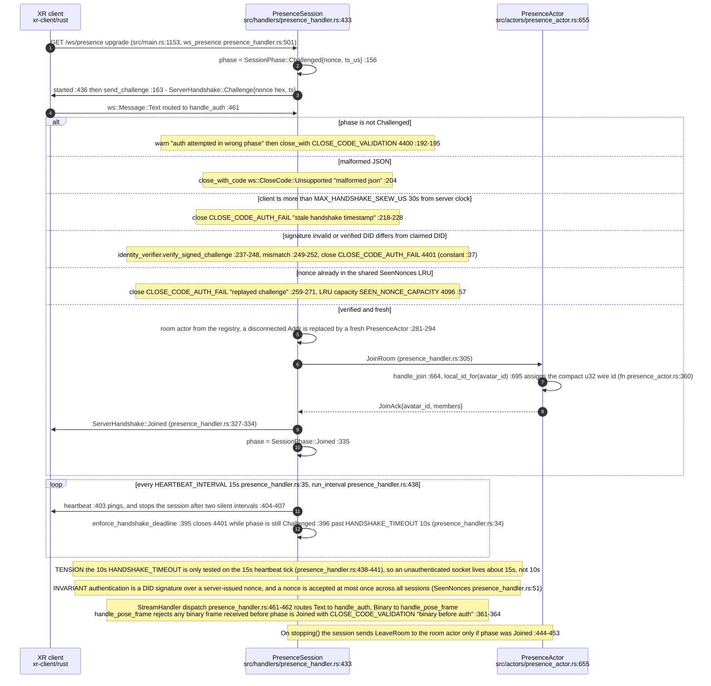
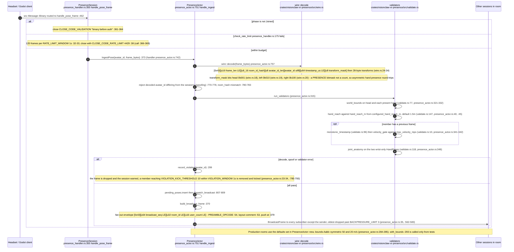
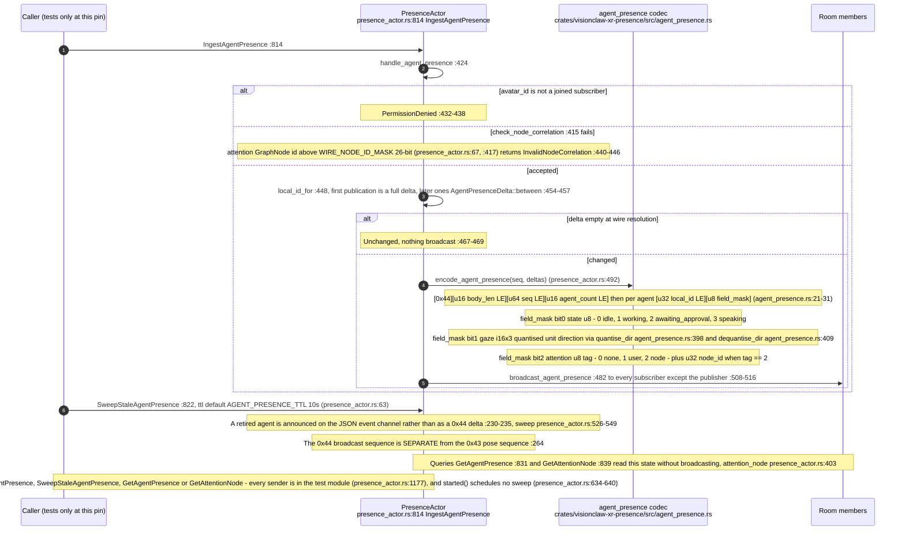
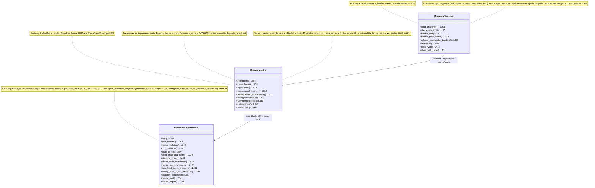

## For developers

The `visionclaw-xr-presence` crate holds the presence wire types and validation. The server's `presence_handler` and `PresenceActor` use it to authenticate a headset session, relay its pose to peers on the 0x43 frame and carry agent co-presence on the sibling 0x44 channel. Re-stamped at ec785afa9: no presence source changed, and the only drift is in the governing XR-client and PROTOCOL-registry docs and in `main.rs` line positions.

## For the business

People wearing headsets in the same space see each other's head and hands move in real time, and AI agents appear beside them as present participants. A session must prove who it is before its movements are shared.

## VC-17.1 Presence session handshake and authentication

## VC-17.2 Headset pose to peers — 0x43 path

## VC-17.3 Agent co-presence — 0x44 sibling channel

## VC-17.6 PresenceActor message surface

**Debt:** the 0x44 agent co-presence channel (ADR-2020) is implemented inside `PresenceActor` but has no production ingress at the pin. `IngestAgentPresence`, `SweepStaleAgentPresence`, `GetAgentPresence` and `GetAttentionNode` are sent only from the test module (`src/actors/presence_actor.rs:1177`), and `PresenceActor::started` schedules only subscriber eviction (`src/actors/presence_actor.rs:634-640`), so a published agent state would never be swept. Closing it needs a server path that publishes agent state into a room and a periodic sweep.

**Tension:** `HANDSHAKE_TIMEOUT` is 10 s (`src/handlers/presence_handler.rs:34`) but is enforced only on the 15 s heartbeat interval (`src/handlers/presence_handler.rs:438-441`), so an unauthenticated socket survives roughly 15 s.

**Drift:** before this restamp the topic credited room bounds to `with_bounds`; production rooms are created with `PresenceActor::new` (`src/handlers/presence_handler.rs:285`) and keep the defaults at `src/actors/presence_actor.rs:284-285`.

**Open:** the XR client gained a Codescape backend mode (ADR-2143 A6) in which the same presence socket targets a Codescape server that "serves the graph stream, presence, voice" itself (`../project/docs/XR-client.md:1319`), so the `PresenceSession` and `PresenceActor` above are the VisionClaw backend only. See [VC-43](43-codescape-presence-lifecycle.md) for the separate Codescape lifecycle audit.

The [1 November admission review](../../estate-review/2026-11-01-room-admission-and-voice.md) traces the current join handler and proposed membership controls in [VC-49](49-room-admission.md). The historical nonce-authentication diagrams above do not imply membership admission or a room cap.
