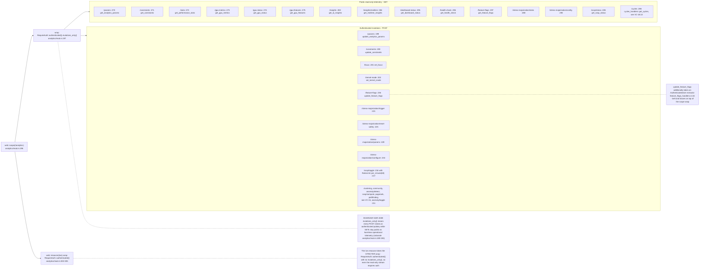
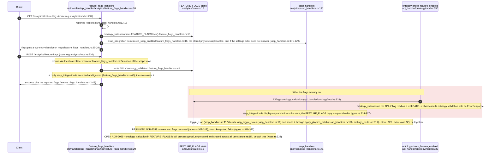
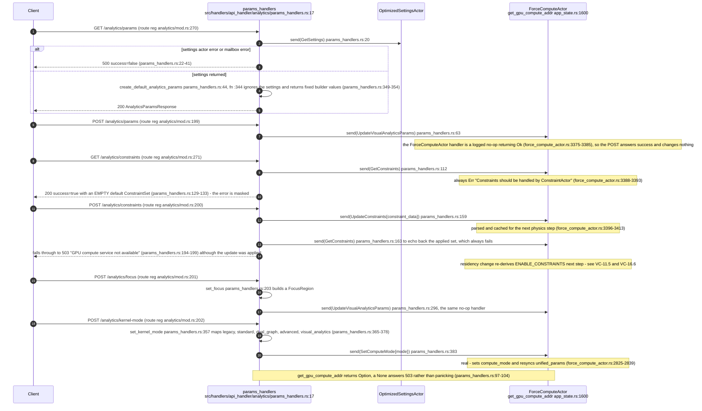
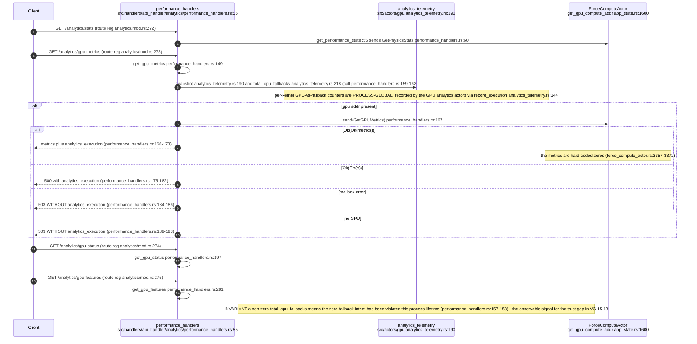
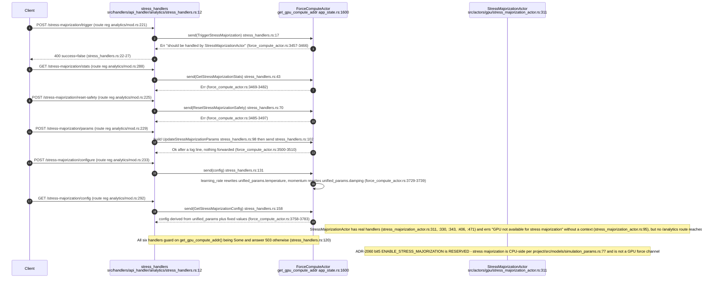
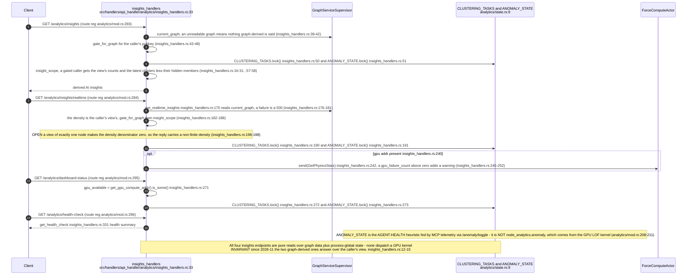
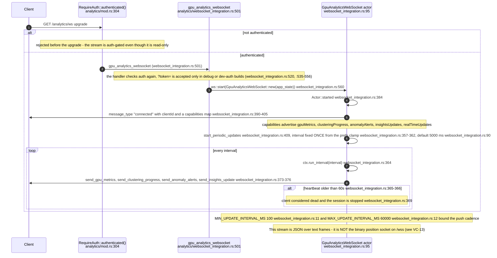
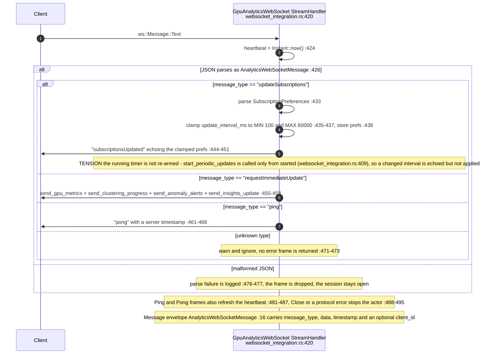
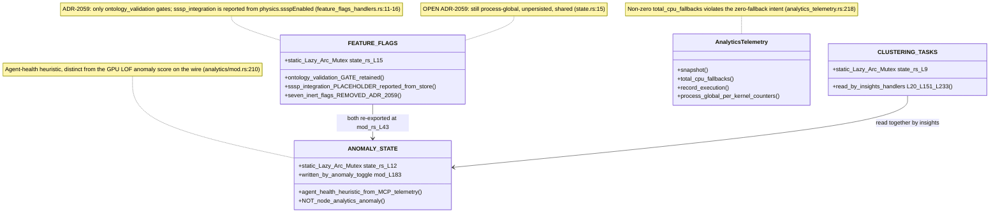
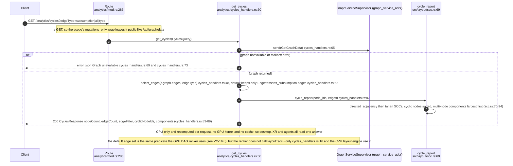

## For developers

These are the analytics support handlers: feature flags, parameters, performance, stress majorization, insights, the analytics WebSocket and the cycles report. Several of them reach ForceComputeActor stubs, and the register records which ones answer success without having any effect.

## For the business

These routes back the analytics panels and their settings. Where a route reports success without effect, the panel shows a change that never happened.

## VC-18.1 /analytics scope — auth wrapper and route table

## VC-18.2 Feature flags — get, update, and what they actually gate

## VC-18.3 Params handlers — analytics params, constraints, focus, kernel mode

## VC-18.4 Performance handlers — stats, GPU metrics, status and features

## VC-18.5 Stress-majorization handlers — they reach ForceComputeActor stubs

## VC-18.6 Insights handlers

## VC-18.7 Analytics WebSocket — connect, subscribe, stream

## VC-18.8 Analytics WebSocket — inbound message handling

## VC-18.9 Analytics process-global state

## VC-18.10 GET /analytics/cycles — directed-cycle report on the CPU

**Tension (ADR-2138 vs code):** resolved at 7c953a40b — ADR-2138 was `proposed` / `none` / `inactive` while `GET /analytics/cycles` was already registered and served. At the pin its frontmatter is `decision_status: proposed`, `implementation_status: complete`, `activation_status: staged` (`docs/adr/ADR-2138-directed-cycles-are-a-server-analysis-with-one-adjacency.md:5-7`), so the ledger agrees with the code (`src/handlers/api_handler/analytics/mod.rs:286`, `src/handlers/api_handler/analytics/cycles_handlers.rs:60`). Ownership and activation are still open. The decision stays `proposed` because the record leaves acceptance to the owner. Activation stays `staged` until the XR Shapes tab first runs on a headset against a live graph (its `review_trigger`, `docs/adr/ADR-2138-directed-cycles-are-a-server-analysis-with-one-adjacency.md:13`).

**Debt:** resolved — `toggle_sssp` now writes through `apply_physics_patch` (`src/handlers/api_handler/analytics/sssp_handlers.rs:126`, `src/settings/api/settings_routes.rs:617`), and ADR-2140 records the item as closed (`docs/adr/ADR-2140-physics-forces-have-one-stored-definition-and-no-scale-factors.md:44`).

**Debt:** every `/analytics/stress-majorization/*` route sends to `ForceComputeActor`, because `get_gpu_compute_addr` returns that actor (`src/app_state.rs:1600`). Its handlers are stubs. Trigger, stats and reset return `Err`; params returns `Ok` without forwarding (`src/actors/gpu/force_compute_actor.rs:3457-3510`). The real `StressMajorizationActor` handlers (`src/actors/gpu/stress_majorization_actor.rs:311`) are unreachable from HTTP. Closing this needs the routes to address the supervised stress actor, or the routes to be removed.

**Tension (ADR-2140):** `POST /stress-majorization/configure` rewrites `unified_params.temperature` and `unified_params.damping` in `ForceComputeActor` (`src/actors/gpu/force_compute_actor.rs:3729-3739`) outside the stored physics document. That is a second write path for a physics value. This trace does not establish whether the value reaches the device before the next resync from the store.

**Debt:** `POST /analytics/params` and `POST /analytics/focus` reach a no-op handler that answers `Ok` (`src/actors/gpu/force_compute_actor.rs:3375-3385`). `GET /analytics/constraints` masks a guaranteed `Err` as an empty successful set (`src/handlers/api_handler/analytics/params_handlers.rs:129-133`). `POST /analytics/constraints` applies the update and then answers 503 (`src/handlers/api_handler/analytics/params_handlers.rs:194-199`). `GetGPUMetrics` returns hard-coded zeros (`src/actors/gpu/force_compute_actor.rs:3357-3372`).
