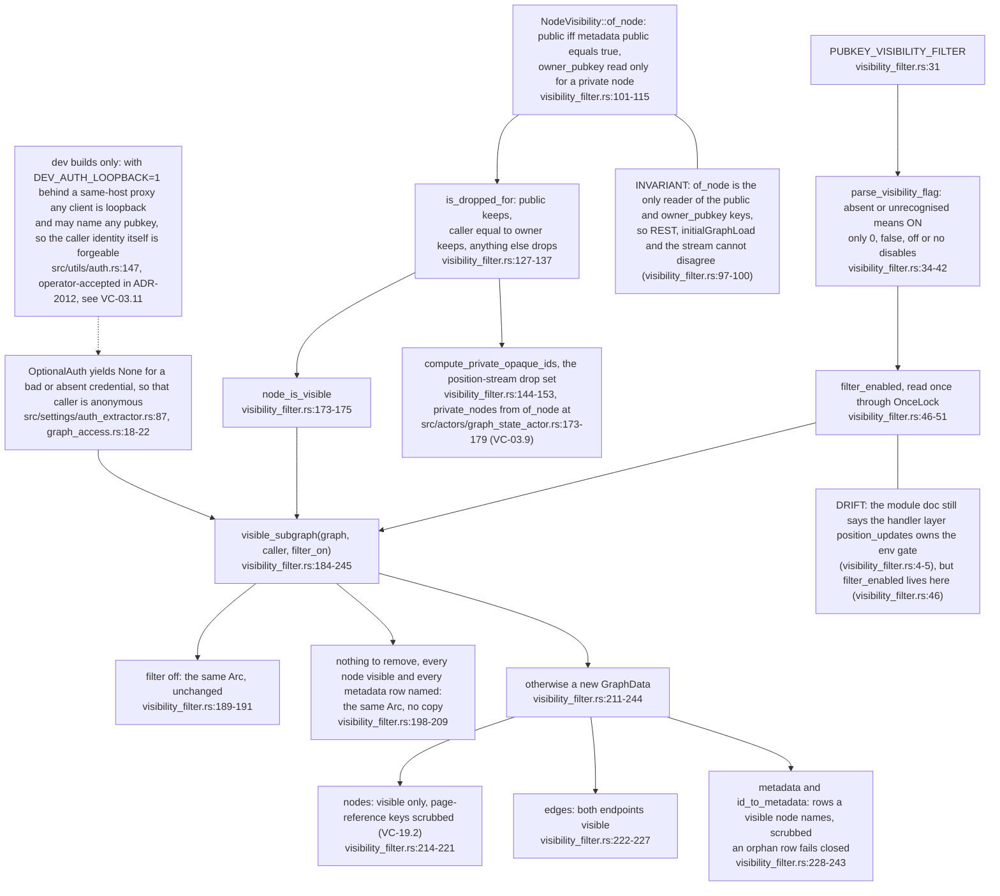
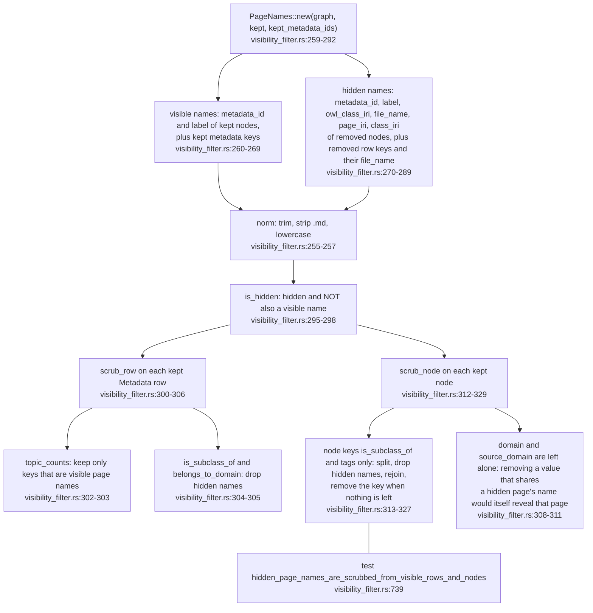
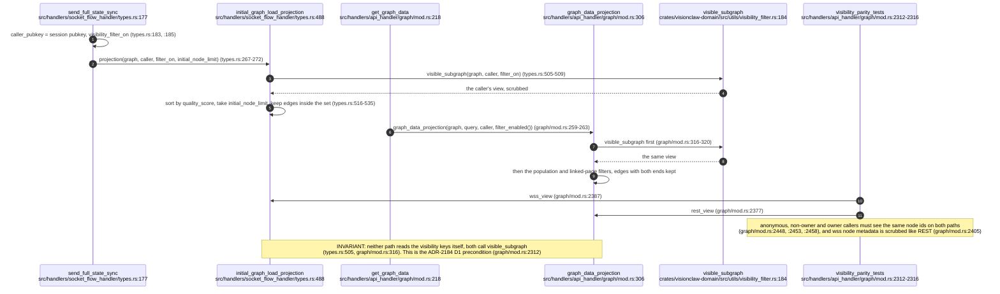
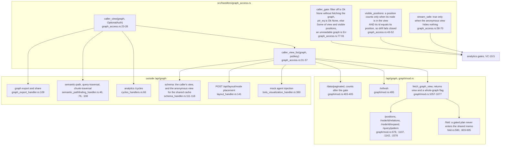
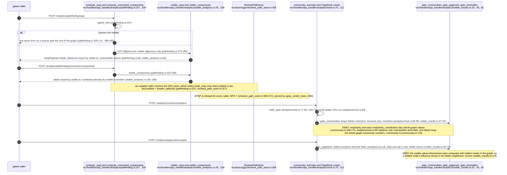
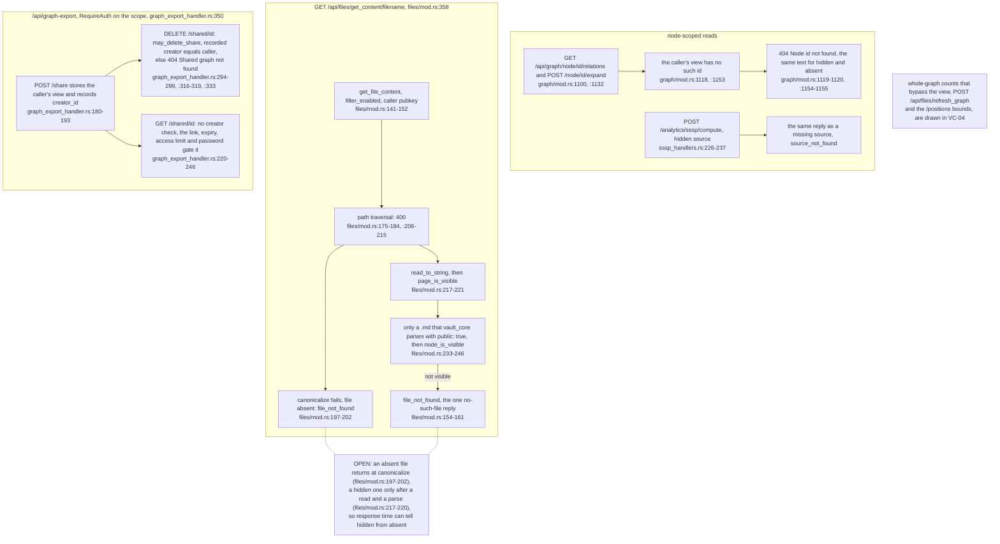

## For developers

Every read that returns node identities applies one visibility policy, whether it is REST, the `/wss` initial load or an analytics answer. `NodeVisibility::of_node` is the only reader of the `public` and `owner_pubkey` metadata keys. `node_is_visible` applies the rule: keep a node that is public or owned by the caller, drop everything else. `visible_subgraph` builds the caller's graph from that rule: visible nodes, edges whose two endpoints are both visible, metadata rows a visible node names, and visible metadata with hidden page names scrubbed out (VC-19.1, VC-19.2). `graph_access` wraps the policy for handlers (VC-19.4). The `/wss` `initialGraphLoad` and `GET /api/graph/data` are pinned to the same output for three callers (VC-19.3). The policy's default-on, fail-closed parse comes from ADR-2003. Closing the REST gap was the ADR-2184 precondition, recorded in PROTOCOL 0.1.17 and 0.1.18. Analytics actors compute over the whole graph and hold no per-caller state. A gated caller either gets a CPU answer computed over their own view (SSSP, components, point-to-point) or a whole-graph answer filtered on the way out (communities, anomalies, PageRank, DBSCAN) (VC-19.5). What filtering on the way out still leaks, and the other gates (identical not-found replies, `get_content`, share deletion), are in VC-19.6. The live position stream applies the same rule through a drop set (VC-03.9).

## For the business

A visitor who is not signed in sees only public pages. A signed-in user also sees their own private pages, and never anyone else's. The same rule applies to the graph view, to every analysis the server runs, to file contents and to shared snapshots. A private page someone else owns looks exactly like a page that does not exist. Some numbers that describe the whole graph, such as overall community scores, still include private pages. The security review accepted that.

## VC-19.1 The policy core: one reader of the visibility keys, one subgraph

**What it shows.** The single rule and the one function that applies it to a whole graph. **Why it is this way.** ADR-2003 makes the filter on by default and fail-closed. A shared `Arc` is returned whenever the caller loses nothing, so callers can use `Arc::ptr_eq` to tell an ungated caller from a gated one (`../project/src/handlers/graph_access.rs:86`).

**Drift (SECURITY-profiles vs code):** `SECURITY-profiles.md:41` and `:96` place `parse_visibility_flag` at `visibility_filter.rs:26` and `filter_enabled` at `:38`, within `:23-43`. At this commit they are at `:34` and `:46`, and the env constant is at `:31`.

## VC-19.2 The PageNames scrub inside visible rows and nodes

**What it shows.** How a visible page stops naming a hidden one. **Why it is this way.** Security review M1 found visible metadata naming hidden pages (commit 395b62924). Tags were added and plain domain text removed in efec9b27d, because a value that disappears is itself a signal. PROTOCOL 0.1.18 records the scrubbed fields (`../project/docs/PROTOCOL-registry.md:8`).

**Open (risk):** `scrub_row` leaves the rest of a visible row as it is, including the free-text `definition`, `owl_class` and `hyperlink_count` (`../project/crates/visionclaw-domain/src/models/metadata.rs:62`, `:46`, `:15`). An authored definition that links a hidden page, or a link count that includes one, still reaches a caller who cannot see that page (`visibility_filter.rs:300-306`).

## VC-19.3 One projection for /wss initialGraphLoad and GET /api/graph/data

**What it shows.** The two first-load paths and the test that holds them equal. **Why it is this way.** ADR-2184 builds the desktop node table from the REST load and refuses a second read path. PROTOCOL 0.1.17 records that `/api/graph` had no gate until this lane (`../project/docs/PROTOCOL-registry.md:9`).

**Drift (ADR-2184 vs code):** `ADR-2184-a-client-side-columnar-node-table-drives-visual-encoding.md:40` still says no visibility gate exists in REST `/api/graph/data`, and cites the `/wss` gate at `position_updates.rs:64-72`. At this commit the REST read is gated (`../project/src/handlers/api_handler/graph/mod.rs:316`), and the `/wss` gate is `types.rs:505`.

**Tension (risk):** node ids stay compact `0..N-1` with gaps where nodes are hidden, so the gaps in a gated `/api/graph/data` or `initialGraphLoad` reveal how many nodes are hidden. PROTOCOL records this residual as documented, not renumbered (`../project/docs/PROTOCOL-registry.md:401`), and `visible_subgraph` keeps each node's own id (`visibility_filter.rs:214-221`).

## VC-19.4 graph_access: the handler-facing helpers and every route that uses them

**What it shows.** The four helpers, and every route that runs a graph through them before answering. **Why it is this way.** One wrapper over `visible_subgraph` means no handler reads the visibility keys itself. `caller_gate` skips the graph fetch when the filter is off, so ungated deployments pay nothing (`graph_access.rs:81-83`).

**Debt (parallel):** the "is anything hidden from this caller" decision is written four times. It is `caller_gate` (`../project/src/handlers/graph_access.rs:77-91`), `gated_view` (`../project/src/handlers/api_handler/analytics/pathfinding.rs:408-436`), `visible_ids` (`../project/src/handlers/semantic_handler.rs:245-257`) and `caller_clusters` (`../project/src/handlers/api_handler/analytics/clustering_handlers.rs:381-403`). The last one keys its visible set by node id (`:399`), while the other three use `visible_positions`.

**Drift (PROTOCOL vs code):** `PROTOCOL-registry.md:400` places `caller_view` at `graph/mod.rs:1076`. The wrapper is at `graph/mod.rs:1087`, and the line before it is a call (`:1074`).

## VC-19.5 Gated analytics shapes: compute over the view, or filter on the way out

**What it shows.** The two gating strategies and which routes use which. **Why it is this way.** Security review item 5 (805dc6c8f) and 84ccd9aaa found GPU answers that gave hidden ids or joined visible nodes through hidden ones. Path-like answers are recomputed over the view. Community, anomaly and PageRank actors are shared and keep no per-caller state, so their answers are filtered on the way out (`../project/src/handlers/api_handler/analytics/pagerank_handlers.rs:93-105`).

**Tension (risk):** filtering on the way out leaves structure computed over the whole graph in a gated answer: global modularity, community numbering and PageRank values for visible nodes (`../project/src/handlers/api_handler/analytics/community.rs:169-179`, `../project/src/handlers/api_handler/analytics/visible_results.rs:43-48`). The commits record these as review follow-ups, but no record found at this commit marks them as accepted.

**Invariant:** the semantic routes filter the analyser's answers per caller, which is sound only while every analysis returns empty. `semantic_analyses_still_return_nothing_so_response_filtering_is_sound` fails as soon as one returns data (`../project/src/adapters/actix_semantic_adapter.rs:453-498`).

## VC-19.6 Not-found equals hidden: node reads, get_content and shares

**What it shows.** Where a hidden thing answers exactly like a missing one, and where the caller is checked against a stored owner. **Why it is this way.** ADR-060's rule is that a hidden name and an unknown one must be indistinguishable (`../project/src/handlers/api_handler/files/mod.rs:154-155`). Review L1 added the share creator (95ca5cb80), and `get_content` was gated in 0489303c7.

**Open (risk):** `GraphExportHandler::new` runs inside `configure_routes` (`../project/src/handlers/graph_export_handler.rs:343-344`), which runs once per actix worker (`../project/src/main.rs:1204`, four workers at `:1276`). Each worker therefore has its own in-memory share map (`graph_export_handler.rs:41`). On source evidence, a share created on one worker answers 404 to GET and DELETE served by another worker, and every share is lost on restart.

**Open (risk):** a share with no recorded `creator_id` can never be deleted (`../project/src/handlers/graph_export_handler.rs:298`). The scope requires authentication (`:350`), so only shares created before the creator was recorded have no creator. GET of a share returns the creator's view, their private nodes included, to anyone authenticated who holds the link (`:220-246`).
