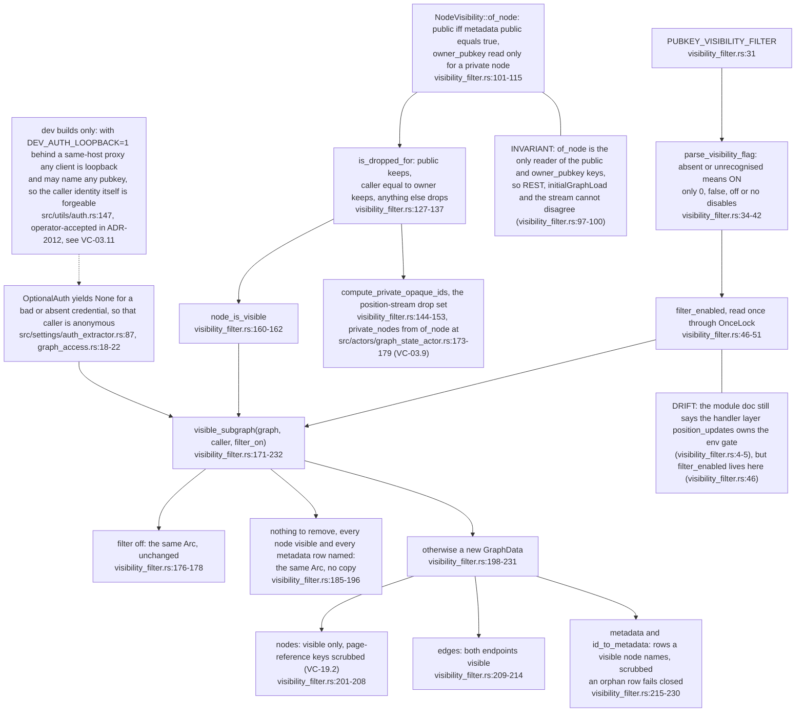
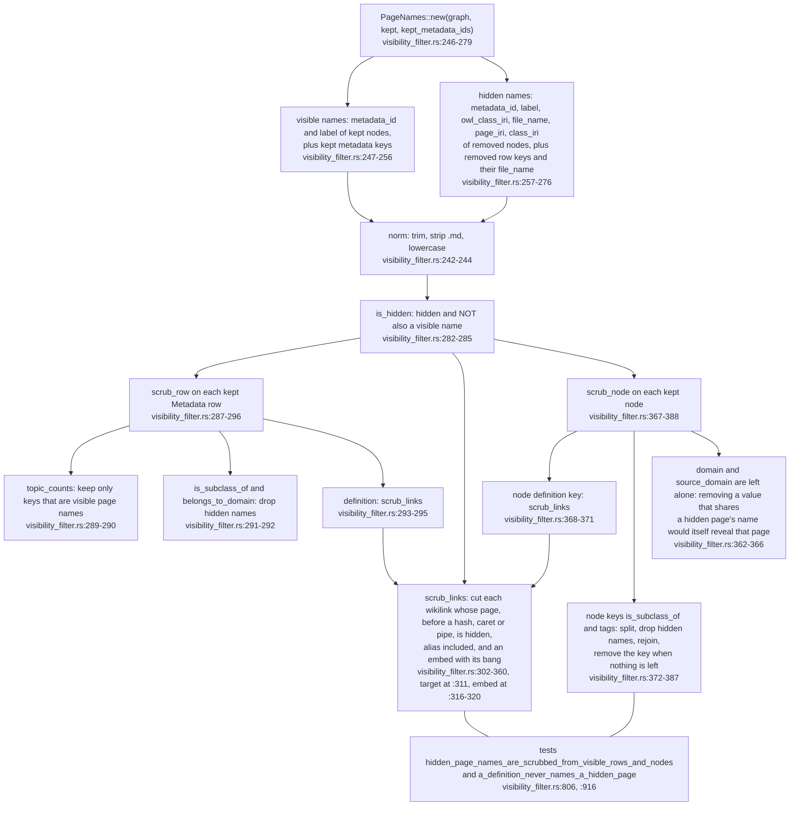
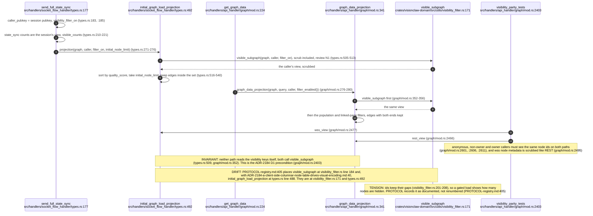
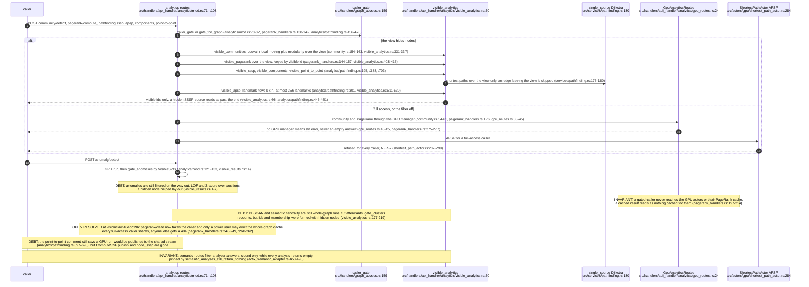
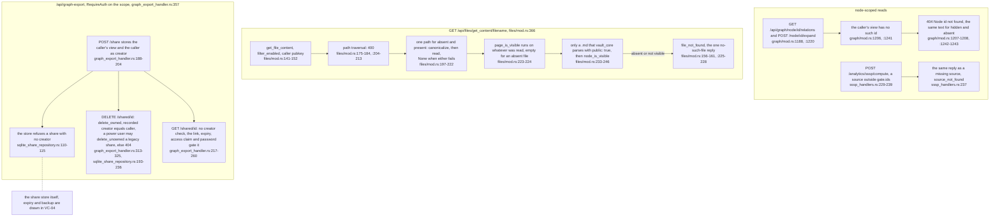
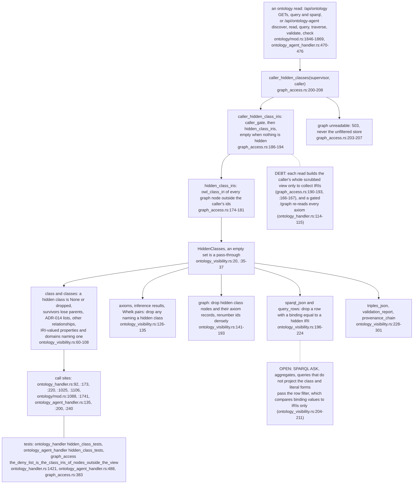

## For developers

Every read that returns node identities applies one visibility policy, whether it is REST, the `/wss` initial load, an analytics answer or an ontology read. `NodeVisibility::of_node` is the only reader of the `public` and `owner_pubkey` metadata keys. `node_is_visible` applies the rule: keep a node that is public or owned by the caller, drop everything else. `visible_subgraph` builds the caller's graph from that rule: visible nodes, edges whose two endpoints are both visible, metadata rows a visible node names, and visible metadata with hidden page names scrubbed out, wikilinks inside a `definition` included (VC-19.1, VC-19.2). The `/wss` `initialGraphLoad` and `GET /api/graph/data` are pinned to the same output for three callers (VC-19.3). Handlers reach the policy through `graph_access` (VC-19.4). Since the 2026-11-06 sweep there is one decision type, `CallerGate`, which carries the caller's view and two distinct sets: visible node ids and visible GPU positions. A gated caller's analytics are computed on the CPU over the view (SSSP, point-to-point, components, APSP landmarks, communities with modularity, PageRank). Full-access callers go to the GPU through `gpu_routes`. Only structural anomalies and semantic centrality are still filtered on the way out (VC-19.5). Hidden reads answer exactly like missing ones, and share deletion is checked against the recorded creator (VC-19.6). The Oxigraph ontology store still holds formal classes whose pages are private, so every ontology read now takes a per-caller deny-list of hidden class IRIs (VC-19.7). The live position stream applies the same rule through a drop set (VC-03.9).

## For the business

A visitor who is not signed in sees only public pages. A signed-in user also sees their own private pages, and never anyone else's. The same rule applies to the graph view, to every analysis the server runs, to file contents, to shared snapshots and now to the ontology browser and the agent ontology tools. A private page someone else owns looks exactly like a page that does not exist. Analyses for a user who cannot see everything are computed over what that user can see, so a private page no longer shapes their community scores or rankings. Two analyses, anomaly detection and semantic centrality, still use scores that private pages helped shape. Some ontology queries (yes/no questions, counts, text matches) can still hint at a private class.

## VC-19.1 The policy core: one reader of the visibility keys, one subgraph

**What it shows.** The single rule and the one function that applies it to a whole graph. **Why it is this way.** ADR-2003 makes the filter on by default and fail-closed. A shared `Arc` is returned whenever the caller loses nothing, so `gate_for_graph` uses `Arc::ptr_eq` to tell an ungated caller from a gated one (`../project/src/handlers/graph_access.rs:136`).

## VC-19.2 The PageNames scrub inside visible rows and nodes

**What it shows.** How a visible page stops naming a hidden one. **Why it is this way.** Security review M1 found visible metadata naming hidden pages (commit 395b62924). Tags were added and plain domain text removed in efec9b27d, because a value that disappears is itself a signal. The 2026-11-06 sweep added the `definition` wikilinks (SECURITY-profiles "Metadata scrub", `../project/docs/SECURITY-profiles.md:110`).

**Open (risk):** `scrub_links` only looks for `[[` (`../project/crates/visionclaw-domain/src/utils/visibility_filter.rs:305`), so a Markdown link such as `[text](Hidden.md)` in an authored definition still names a hidden page to a caller who cannot see it. Whether the corpus writes such links was not checked.

## VC-19.3 One projection for /wss initialGraphLoad and GET /api/graph/data

**What it shows.** The two first-load paths, the session counts sent before them, and the test that holds them equal. **Why it is this way.** ADR-2184 builds the desktop node table from the REST load and refuses a second read path; its precondition now reads "met 2026-11-06" (`../project/docs/adr/ADR-2184-a-client-side-columnar-node-table-drives-visual-encoding.md:40`).

**Tension (parallel):** the ontology graph scrub renumbers node ids densely "so no gap marks where a node was" (`../project/src/services/ontology_visibility.rs:137-170`), while `visible_subgraph` keeps ids and their gaps. Two hidden-node policies give opposite answers on whether an id gap is a leak.

## VC-19.4 graph_access: one CallerGate, and every route that uses the module

```mermaid
flowchart TB
    subgraph GA["src/handlers/graph_access.rs"]
        CV["caller_view(graph, OptionalAuth), caller_view_for(graph, pubkey)<br/>graph_access.rs:23-28, :36-42"]
        CG["CallerGate: graph, view, VisibleIds, VisibleSlots<br/>graph_access.rs:82-87, newtypes :47, :53"]
        GFG["gate_for_graph: None when the view is the same Arc,<br/>else ids of the view, and slots whose node id equals the slot<br/>graph_access.rs:120-153, slot rule :140-146"]
        CGA["caller_gate: filter off is Ok None without fetching the graph,<br/>an unreadable graph is Err<br/>graph_access.rs:159-168"]
        IAS["id_at_slot: a position names a node only when visible, fail closed<br/>graph_access.rs:109-114"]
        VC["visible_counts: nodes, edges, metadata of the view<br/>graph_access.rs:224-236"]
        HC["caller_hidden_classes, the ontology deny-list, VC-19.7<br/>graph_access.rs:200-208"]
        GFG --> CG
        CGA --> GFG
        CG --> IAS
        CGA --> HC
    end
    subgraph RG["/api/graph, graph/mod.rs"]
        G1["/data/paginated and /refresh<br/>graph/mod.rs:464, :554"]
        G3["fetch_graph_view, view and a whole-graph flag<br/>graph/mod.rs:1155-1175"]
        G4["/positions ids, node relations, expand, query pattern<br/>graph/mod.rs:814, :1195, :1230, :1666"]
        G5["/fold: a gated plan never enters the shared memo<br/>fold.rs:580, :597"]
        G3 --> G4
        G3 --> G5
    end
    subgraph SW["gated by the sweep"]
        S1["GET /api/pages<br/>pages_handler.rs:84"]
        S2["insights and insights/realtime<br/>insights_handlers.rs:44, :183"]
        S3["hierarchy-levels<br/>semantic_forces.rs:68"]
        S4["GET /api/constraints/list<br/>constraints_handler.rs:269"]
        S5["refresh_graph and state_sync counts<br/>files/mod.rs:261, types.rs:210"]
    end
    subgraph OTH["other users"]
        O1["export and share, the caller's view<br/>graph_export_handler.rs:111"]
        O2["semantic-path, query-traversal, chunk-traversal<br/>semantic_pathfinding_handler.rs:46, :76, :108"]
        O3["cycles, schema, layout mode, mock agents<br/>cycles_handlers.rs:66, schema_handler.rs:116-117,<br/>layout_handler.rs:141, bots_visualization_handler.rs:360"]
        O4["analytics: community, anomaly, PageRank, SSSP, DBSCAN, VC-19.5<br/>analytics/mod.rs:78, :115, pagerank_handlers.rs:138,<br/>sssp_handlers.rs:229, clustering_handlers.rs:390"]
    end
    CV --> G1
    CV --> G3
    CV --> O1
    CV --> O2
    CV --> O3
    CGA --> S1
    CGA --> S3
    CGA --> S4
    GFG --> S2
    VC --> S5
    CGA --> O4
    DRS["DRIFT: SECURITY-profiles.md:105 places caller_gate at graph_access line 175 and<br/>SECURITY-profiles.md:107 places visible_counts at line 200, which is caller_hidden_classes (graph_access.rs:200).<br/>They are at graph_access.rs:159 and graph_access.rs:224"]
    CGA -.- DRS
```

**What it shows.** The module's one decision type and every route that runs a graph through it. **Why it is this way.** The sweep replaced four per-route "is anything hidden" helpers with `CallerGate`; ids and positions are separate types because they agree only while the graph is compact (`../project/src/handlers/graph_access.rs:49-51`), pinned by `ids_and_positions_are_distinct_sets_on_a_non_compact_graph` (`graph_access.rs:269`).

**Debt (parallel):** three thin wrappers sit beside `caller_gate`: `gated_view`, which fetches the graph even with the filter off (`../project/src/handlers/api_handler/analytics/pathfinding.rs:456-478`), a private `caller_gate` with another signature (`../project/src/handlers/semantic_handler.rs:252-260`) and the `/positions` id set (`../project/src/handlers/api_handler/graph/mod.rs:812-815`). The graph itself is read three ways: through the supervisor (`../project/src/handlers/graph_access.rs:239-246`), straight from the graph state actor (`../project/src/handlers/api_handler/graph/mod.rs:1161-1171`) and from `graph_repository` in point-to-point (`../project/src/handlers/api_handler/analytics/pathfinding.rs:580`).

## VC-19.5 Gated analytics: computed over the view on the CPU, full access on the GPU

**What it shows.** Which strategy each analytics route takes now, and where full-access requests go. **Why it is this way.** The sweep moved every per-node answer onto the view because filtering a whole-graph answer left modularity, community numbering and PageRank values shaped by hidden nodes (PROTOCOL 0.1.20). `gpu_routes` exists because the community route used to reach `ForceComputeActor`, which refused it, and PageRank read an address nothing set (`../project/src/handlers/api_handler/analytics/gpu_routes.rs:9-12`).

**Tension (parallel):** APSP gives a gated caller a CPU landmark answer (`../project/src/handlers/api_handler/analytics/pathfinding.rs:296-311`) while a full-access caller is refused by NFR-7 (`../project/src/actors/gpu/shortest_path_actor.rs:287-299`), so seeing less of the graph gets a caller more of the API.

**Open (risk):** every gated CPU answer (Louvain up to 10,000 iterations, PageRank up to 1,000, APSP up to 256 Dijkstra runs) runs inline on the actix worker, with no `spawn_blocking` or `web::block` anywhere in the analytics handlers (`../project/src/handlers/api_handler/analytics/community.rs:159-163`, `../project/src/handlers/api_handler/analytics/pagerank_handlers.rs:148-154`). On a large view one request can stall one of the four workers.

## VC-19.6 Not-found equals hidden: node reads, get_content and shares

**What it shows.** Where a hidden thing answers exactly like a missing one, and where the caller is checked against a stored owner. **Why it is this way.** ADR-060's rule is that a hidden name and an unknown one must be indistinguishable (`../project/src/handlers/api_handler/files/mod.rs:154-155`). The sweep made a missing page take the same steps as a hidden one, because it used to answer before any read (`files/mod.rs:197-200`), and moved shares into one SQLite store so the creator check holds across workers.

**Open (risk):** GET of a share returns the creator's view, their private nodes included, to anyone authenticated who holds the link (`../project/src/handlers/graph_export_handler.rs:217-260`, view taken at `:111`). The link is the only key.

**Drift (SECURITY-profiles vs code):** `SECURITY-profiles.md:109` names the share deletion rule `graph_export_handler.rs` `may_delete_share_as`. No such function exists at this commit; the rule is `delete_owned` and `delete_unowned` (`../project/src/handlers/graph_export_handler.rs:315-325`).

## VC-19.7 The ontology deny-list: a hidden class reads as one never stored

**What it shows.** How a class whose page is private disappears from every ontology read for a caller who cannot see the page. **Why it is this way.** The vault admits a formal class page with `public: false`, so the store holds classes the graph hides; the operator chose "hidden reads as unknown" and accepted hierarchy gaps (SECURITY-profiles 0.1.6, `../project/docs/SECURITY-profiles.md:111`; PROTOCOL 0.1.22, `../project/docs/PROTOCOL-registry.md:9`).

**Open (risk):** SECURITY-profiles lists the residuals the deny-list does not catch (`../project/docs/SECURITY-profiles.md:111`): inferences computed over the whole store on routes outside per-view reasoning (the SPARQL routes over the inferred graph and the validator's inferred triples), store-wide totals in validation reports (left as computed, `../project/src/services/ontology_visibility.rs:266-268`), ontology nodes stored under a slug IRI with no `owl_class_iri` (`hidden_class_iris` reads only that field, `../project/src/handlers/graph_access.rs:179`), and `jev_nlq` and `natural_language_query_service`, which query the store outside these routes. The per-view reasoning of 0.1.8 has since closed the stored-run reads and the `/inferred` run id (`../project/docs/SECURITY-profiles.md:112`).

**Open (risk):** the deny-list is keyed by IRI, not by node. If a visible page and a hidden page carry the same `owl_class_iri`, the class is denied to a caller who can see one of them (`../project/src/handlers/graph_access.rs:174-181`). This fails closed, but nothing tests it.
