## For developers

Corpus pages become OWL classes in Oxigraph's named graphs. Whelk runs EL++ reasoning after each sync, and inferred edges are materialised back into the graph. HTTP routes, the `OntologyActor` and the `vault certify` and `vault propose` CLI expose and govern the result. At ec785afa9 the `state-at` read gained a subjects view fed by the new corpus history (VC-20.7, VC-22.13), and the class-IRI mint for saved nodes is now one helper. At 809a859aa every ontology read surface also answers a class hidden from the caller as one never stored (VC-20.16, SECURITY-profiles 0.1.6).

## For the business

The ontology is the structured vocabulary behind the knowledge graph. Pages are turned into classes, a reasoner works out what follows from them, and every change to the vocabulary goes through a signed, reviewable proposal instead of a direct edit.

## VC-20.1 load_ontology bin - CorpusSource-backed corpus loader
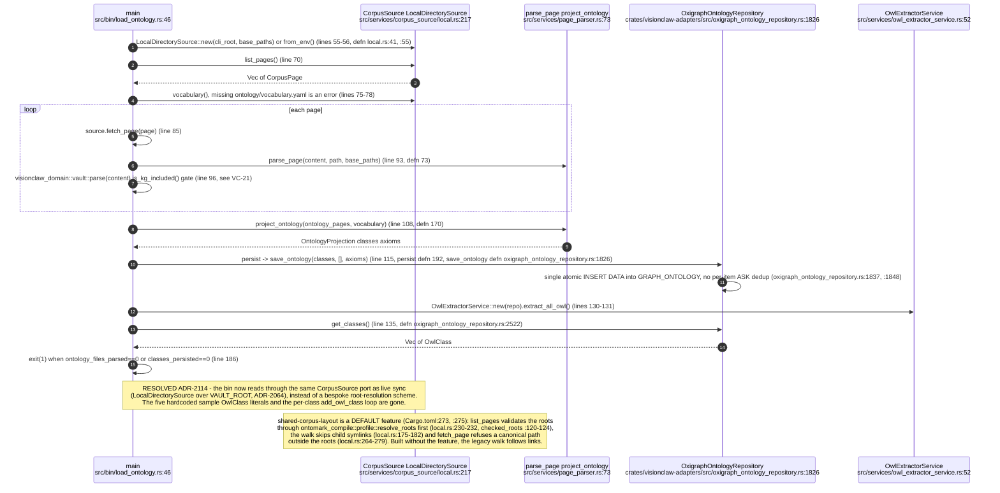

## VC-20.2 Oxigraph named-graph layout — ontology and knowledge graphs
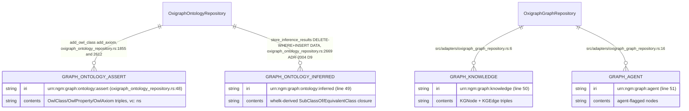

## VC-20.5 Oxigraph named-graph layout — shapes, provenance, cache and migrations graphs
```mermaid
erDiagram
    GRAPH_SHAPES {
        string iri "urn:ngm:graph:shapes (line 56)"
        string contents "SHACL shape triples loaded from ttl at startup"
    }
    GRAPH_PROVENANCE {
        string iri "urn:ngm:graph:provenance (line 57)"
        string contents "append-only PROV-O activity triples, see VC-22"
    }
    GRAPH_CACHE_SSSP {
        string iri "urn:ngm:graph:cache:sssp (oxigraph_ontology_repository.rs:73)"
        string contents "shortest-path cache quads, own sub-domain so CLEAR GRAPH invalidates atomically"
    }
    GRAPH_CACHE_APSP {
        string iri "urn:ngm:graph:cache:apsp (line 74)"
        string contents "all-pairs shortest-path cache quads"
    }
    GRAPH_MIGRATIONS {
        string iri "urn:ngm:graph:migrations (sparql_migrations.rs:44)"
        string contents "applied SPARQL migration ids, ADR-101 D2"
    }
    OxigraphOntologyRepository ||--o{ GRAPH_SHAPES : "load_shacl_shapes, oxigraph_ontology_repository.rs:411"
    OxigraphOntologyRepository ||--o{ GRAPH_PROVENANCE : "emit_provenance, oxigraph_ontology_repository.rs:652, see VC-22"
    OxigraphOntologyRepository ||--o{ GRAPH_CACHE_SSSP : "own sub-domain, atomic CLEAR GRAPH, line 73"
    OxigraphOntologyRepository ||--o{ GRAPH_CACHE_APSP : "line 74"
    SparqlMigrations ||--o{ GRAPH_MIGRATIONS : "sparql_migrations.rs:44, excluded from graph-export/GPU paths"
```

## VC-20.3 Whelk EL++ reasoning cycle (github_sync post-sync)
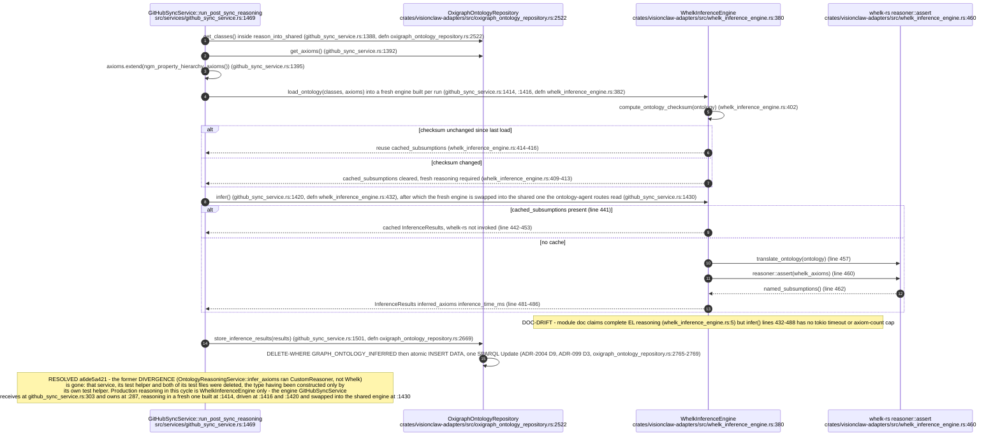

**Drift (resolved a6de5a421):** this diagram recorded a second reasoner, `OntologyReasoningService`, that ran `CustomReasoner` beside Whelk and was never constructed outside its own tests; `a6de5a421` deleted the service, its test helper, `tests/ontology_reasoning_integration_test.rs` and `tests/unit/ontology_reasoning_test.rs`, so the only reasoner driven from the sync cycle is the `WhelkInferenceEngine` that `GitHubSyncService` owns (`src/services/github_sync_service.rs:287`, `src/services/github_sync_service.rs:303`, `src/services/github_sync_service.rs:1414`, `src/services/github_sync_service.rs:1416`, `src/services/github_sync_service.rs:1420`, `src/services/github_sync_service.rs:1430`).

**Debt:** RESOLVED at visionclaw 010e1109 — the second `CustomReasoner` home, `OntologyPipelineService::trigger_reasoning`, and its never-called entry point `on_ontology_modified` were deleted with the service and its orphan test by ADR-2192 (`../project/docs/adr/ADR-2192-the-reasoner-the-sync-pipeline-and-node-thinning-are-stored-operator-switches.md:54`); the sync cycle drawn here is the only reasoning path, and `run_post_sync_reasoning` now takes the stored `SyncSwitches` (`src/services/github_sync_service.rs:1469-1482`).

## VC-20.4 inferred-edge materialisation and class-summary index
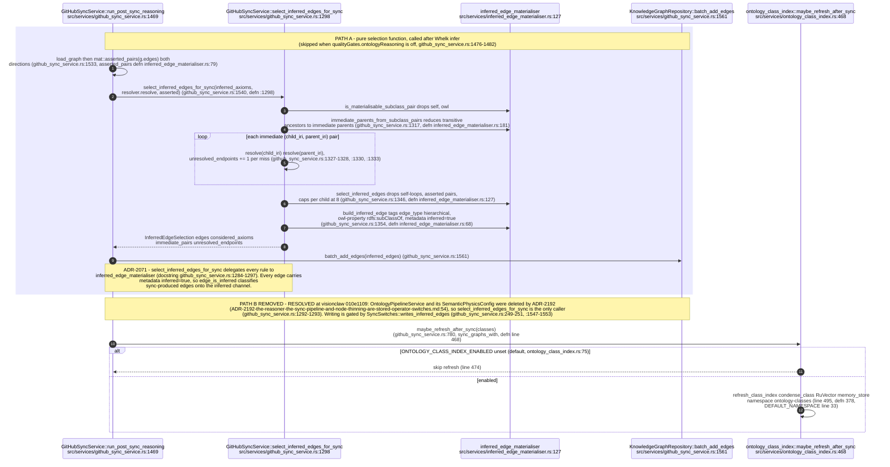

**Debt:** RESOLVED at visionclaw 010e1109 — `POST /api/ontology-physics/enable|disable` no longer pass through the always-true `check_ontology_feature` (only `GET /constraints` does, `src/handlers/api_handler/ontology_physics/mod.rs:149`): they are thin writers of the stored physics keys through `apply_physics_patch` (`src/handlers/api_handler/ontology_physics/mod.rs:58-95`), and the `Settings.ontology_physics` bool is gone (ADR-2192).

**Drift:** RESOLVED at visionclaw 010e1109 — PATH B, which built its own ancestor map and skipped the vacuous-axiom filter, was removed with `OntologyPipelineService` (`../project/docs/adr/ADR-2192-the-reasoner-the-sync-pipeline-and-node-thinning-are-stored-operator-switches.md:54`), so the docstring claim that the paths cannot drift now holds trivially (`src/services/github_sync_service.rs:1284-1297`).

## VC-20.6 SPARQL read path - /ontology/query
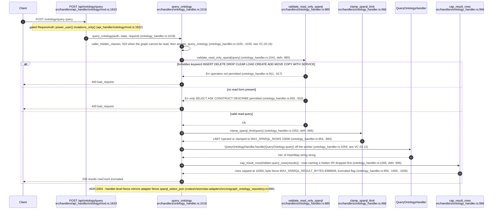

## VC-20.7 ontology HTTP route families
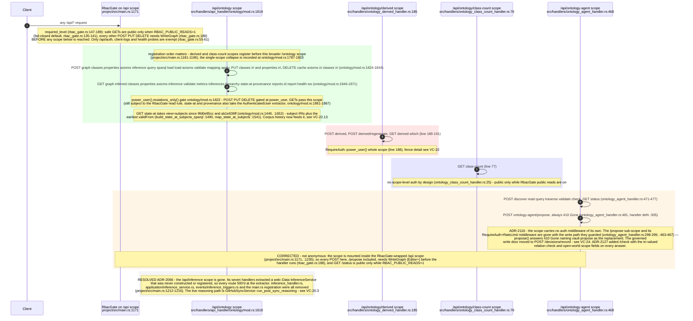

**Drift:** ADR-2116 and the handler comment call every `/ontology-agent` route anonymous (`src/handlers/ontology_agent_handler.rs:463-467`), but the scope is mounted inside the `RbacGate`-wrapped `/api` scope (`../project/src/main.rs:1171`, `../project/src/main.rs:1235`) and `required_level` demands `WriteGraph` for every non-safe method outside the auth/health allowlist (`src/middleware/rbac_gate.rs:179-189`). In practice an unsigned caller is refused, while any signed caller passes, because an unassigned pubkey defaults to Editor (`src/services/role_store.rs:366`). Two comments disagree with the code: `src/middleware/rbac_gate.rs:200` calls `RBAC_PUBLIC_READS` default-on against the fail-closed `src/middleware/rbac_gate.rs:135-141`, and `../project/src/main.rs:1238` still says `/decisions/record` is authed like `/propose`.

## VC-20.8 OntologyActor message set

```mermaid
classDiagram
    class OntologyActor
    class InitializeActor
    class JobCompleted
    class LoadOntologyAxioms
    class UpdateOntologyMapping
    class ValidateOntology
    class ApplyInferences
    class GetOntologyReport
    class GetOntologyHealth
    class ClearOntologyCaches
    class TriggerReasoning
    class GetCachedOntologies
    class ApplyMaterializedAxioms

    OntologyActor ..> InitializeActor : Handler ontology_actor.rs 654
    OntologyActor ..> JobCompleted : Handler line 686
    OntologyActor ..> LoadOntologyAxioms : Handler line 696
    OntologyActor ..> UpdateOntologyMapping : Handler line 728
    OntologyActor ..> ValidateOntology : Handler line 738
    OntologyActor ..> ApplyInferences : Handler line 796
    OntologyActor ..> GetOntologyReport : Handler line 818
    OntologyActor ..> GetOntologyHealth : Handler line 853
    OntologyActor ..> ClearOntologyCaches : Handler line 885
    OntologyActor ..> TriggerReasoning : Handler line 909
    OntologyActor ..> GetCachedOntologies : Handler line 932

    note for LoadOntologyAxioms "LoadOntologyAxioms, ClearOntologyCaches,<br/>GetCachedOntologies, GetOntologyHealth now re-exported from<br/>visionclaw_actors::messages::ontology_messages<br/>(ontology_messages.rs:11-17), not defined in this webxr crate file"
    note for ValidateOntology "fields ontology_id, graph_data, mode, job_id<br/>(ontology_messages.rs:37-46), rtype Result of ValidationReport<br/>or String. owl_validator (src/services/owl_validator.rs:2) is a<br/>shim: pub use visionclaw_ontology::services::owl_validator::*<br/>(ADR-090 Phase A4), mirrored by src/inference/mod.rs:2 and<br/>src/reasoning/mod.rs:2 into the same crate.<br/>RESOLVED ADR-2065 - the orphaned second definition<br/>src/services/owl_validator_stubs.rs (a CPU-only<br/>ValidationConfig/PropertyGraph/RdfTriple/ConstraintSummary/<br/>ValidationReport set, no mod declaration or use anywhere,<br/>never compiled) has been deleted; owl_validator is now the<br/>single validation definition."
    note for ApplyInferences "fields rdf_triples, max_depth<br/>(ontology_messages.rs:52-55)"
    note for TriggerReasoning "fields ontology_id i64, source String<br/>(ontology_actor.rs:904-907), handler forwards to ReasoningActor<br/>per comment lines 918-920 which no longer exists"
    note for ApplyMaterializedAxioms "fields axioms, graph_data<br/>(ontology_messages.rs:76-79); NOT handled by OntologyActor -<br/>routed GPUManagerActor gpu_manager_actor.rs 651 to<br/>PhysicsSupervisor physics_supervisor.rs 747 to<br/>OntologyConstraintActor ontology_constraint_actor.rs 445"
    note for OntologyActor "RESOLVED - ProcessOntologyData and<br/>LogseqPage no longer exist in ontology_messages.rs; page<br/>ingest now runs through parse_page/project_ontology over the<br/>vault-core frontmatter model, see VC-20.1/VC-21"
```

## VC-20.13 Every ontology actix handler dispatches its sync CQRS handler off the worker

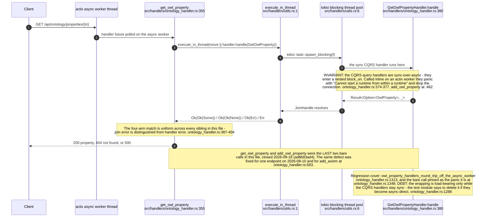

## VC-20.14 vault certify — the derivation certificate, the shared crate and the Whelk-parity invariant (ADR-2147, ontomark ADR-OM-009)

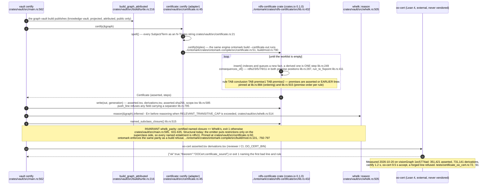

## VC-20.15 vault propose — the consequence delta on the PatchProposal (ADR-2147)

Current construction and consumer limits are assessed in [VC-41](41-proposal-construction-and-consumer-scope.md), including version metadata in consequence counts and grouped proposals that cannot reach application. This sequence is re-pinned to the stamped revision; the measurements in its last notes are historical.

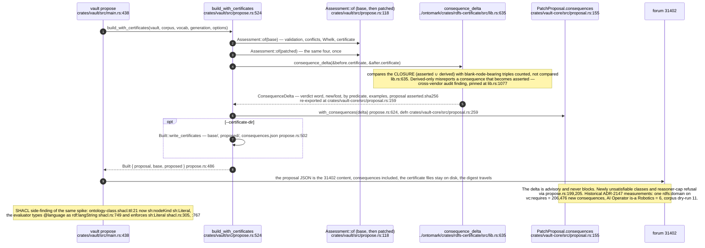

## VC-20.16 Ontology reads answer a hidden class as one never stored (per-caller deny-list)

<!-- 2026-11-06 restamp 809a859aa: new. 3d1539ef7 adds services/ontology_visibility.rs and threads HiddenClasses through every /api/ontology read, /query, /sparql and the six /api/ontology-agent read routes; SECURITY-profiles 0.1.6 records it -->
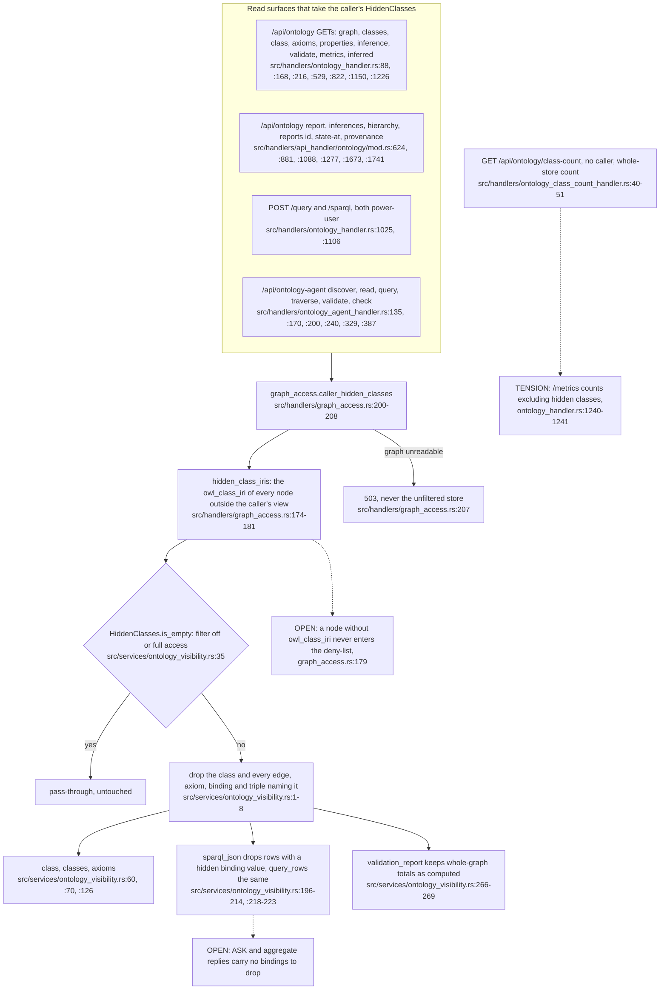

**Invariant:** a hidden class reads exactly as a class never stored: every listed route resolves the caller's deny-list before touching the store and fails closed with 503 when the graph cannot be read (`src/handlers/graph_access.rs:200-208`), and an empty set is a pass-through (`src/services/ontology_visibility.rs:35`).

**Tension (risk):** `GET /api/ontology/class-count` takes no caller and returns the whole-store `class_count` (`src/handlers/ontology_class_count_handler.rs:40-51`), while `GET /api/ontology/metrics` counts over the store minus the caller's hidden classes (`src/handlers/ontology_handler.rs:1240-1241`). The difference between the two is the number of classes hidden from that caller.

**Open (risk):** the residuals SECURITY-profiles 0.1.6 lists are unfiltered: SPARQL `ASK`, aggregates, queries that do not project the class and literal forms; inferences computed over the whole store on routes outside per-view reasoning; store-wide totals in validation reports (`src/services/ontology_visibility.rs:266-268`); and ontology nodes with no `owl_class_iri`, which `hidden_class_iris` skips (`src/handlers/graph_access.rs:179`). All are recorded at `../project/docs/SECURITY-profiles.md:111`. The 0.1.8 per-view reasoning has since closed the stored-run reads and the `/inferred` run id (`../project/docs/SECURITY-profiles.md:112`).
