## VC-20.1 load_ontology bin - CorpusSource-backed corpus loader
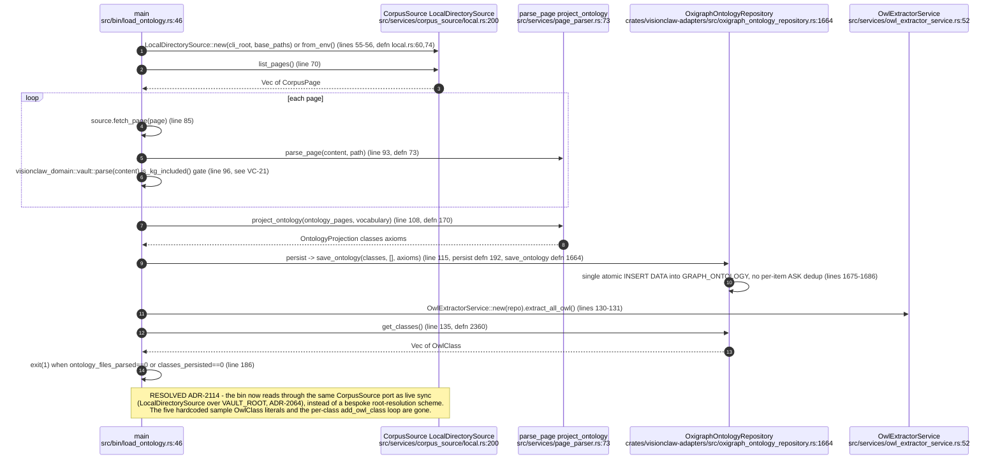

## VC-20.2 Oxigraph named-graph layout — ontology and knowledge graphs
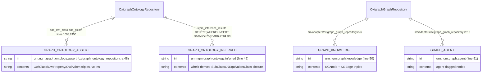

## VC-20.5 Oxigraph named-graph layout — shapes, provenance, cache and migrations graphs
```mermaid
erDiagram
    GRAPH_SHAPES {
        string iri "urn:ngm:graph:shapes (line 56)"
        string contents "SHACL shape triples loaded from ttl at startup"
    }
    GRAPH_PROVENANCE {
        string iri "urn:ngm:graph:provenance (line 57)"
        string contents "append-only PROV-O activity triples, see VC-22"
    }
    GRAPH_CACHE_SSSP {
        string iri "urn:ngm:graph:cache:sssp (oxigraph_ontology_repository.rs:73)"
        string contents "shortest-path cache quads, own sub-domain so CLEAR GRAPH invalidates atomically"
    }
    GRAPH_CACHE_APSP {
        string iri "urn:ngm:graph:cache:apsp (line 74)"
        string contents "all-pairs shortest-path cache quads"
    }
    GRAPH_MIGRATIONS {
        string iri "urn:ngm:graph:migrations (sparql_migrations.rs:44)"
        string contents "applied SPARQL migration ids, ADR-101 D2"
    }
    OxigraphOntologyRepository ||--o{ GRAPH_SHAPES : "load_shacl_shapes line 410"
    OxigraphOntologyRepository ||--o{ GRAPH_PROVENANCE : "emit_provenance line 651 see VC-22"
    OxigraphOntologyRepository ||--o{ GRAPH_CACHE_SSSP : "own sub-domain, atomic CLEAR GRAPH, line 73"
    OxigraphOntologyRepository ||--o{ GRAPH_CACHE_APSP : "line 74"
    SparqlMigrations ||--o{ GRAPH_MIGRATIONS : "sparql_migrations.rs:44, excluded from graph-export/GPU paths"
```

## VC-20.3 Whelk EL++ reasoning cycle (github_sync post-sync)
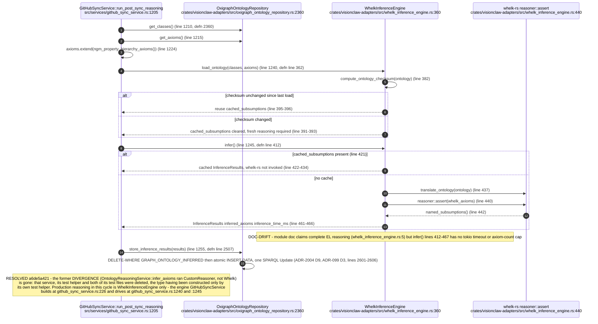

**Drift (resolved a6de5a421):** this diagram recorded a second reasoner, `OntologyReasoningService`, that ran `CustomReasoner` beside Whelk and was never constructed outside its own tests; `a6de5a421` deleted the service, its test helper, `tests/ontology_reasoning_integration_test.rs` and `tests/unit/ontology_reasoning_test.rs`, so the only reasoner driven from the sync cycle is the `WhelkInferenceEngine` that `GitHubSyncService` owns (`src/services/github_sync_service.rs:226`, `src/services/github_sync_service.rs:1240`, `src/services/github_sync_service.rs:1245`).

**Debt:** `CustomReasoner` survives in a second place, `OntologyPipelineService::trigger_reasoning` (`src/services/ontology_pipeline_service.rs:244`), reached only through `on_ontology_modified` (`src/services/ontology_pipeline_service.rs:157`), and a search of `src/` and `crates/` at the stamped commit finds no caller of that method outside `tests/integration/pipeline_test.rs:94`; PATH B in VC-20.4 therefore hangs off an entry point the running server never invokes.

**Drift (doc comment vs callers):** the doc comment on `on_ontology_modified` says it is called automatically by `GitHubSyncService` (`src/services/ontology_pipeline_service.rs:150`), while the sync cycle in this diagram calls the Whelk engine and `select_inferred_edges_for_sync` directly (`src/services/github_sync_service.rs:1294`).

## VC-20.4 inferred-edge materialisation and class-summary index
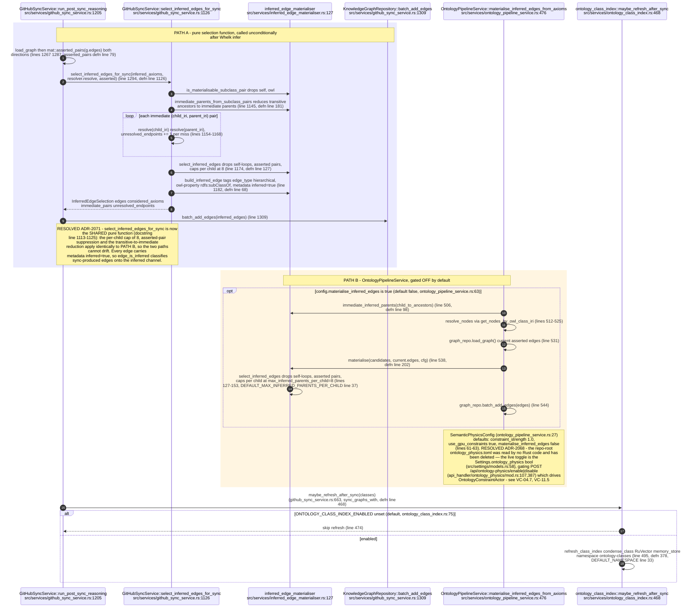

## VC-20.6 SPARQL read path - /ontology/query
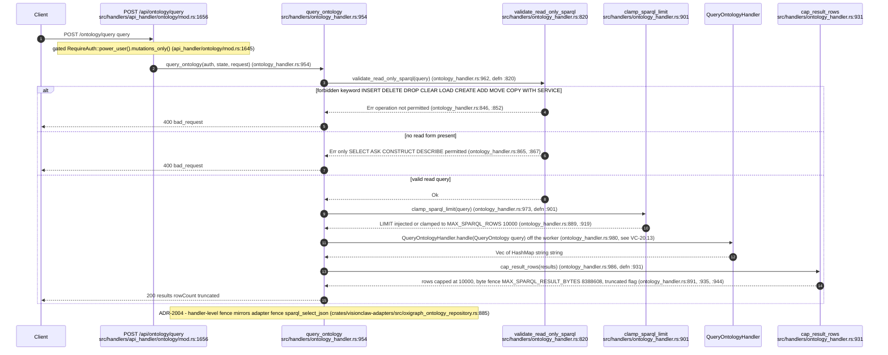

## VC-20.7 ontology HTTP route families
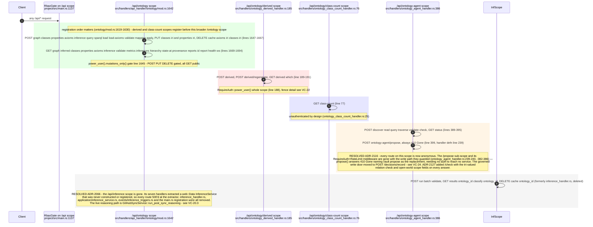

## VC-20.8 OntologyActor message set

```mermaid
classDiagram
    class OntologyActor
    class InitializeActor
    class JobCompleted
    class LoadOntologyAxioms
    class UpdateOntologyMapping
    class ValidateOntology
    class ApplyInferences
    class GetOntologyReport
    class GetOntologyHealth
    class ClearOntologyCaches
    class TriggerReasoning
    class GetCachedOntologies
    class ApplyMaterializedAxioms

    OntologyActor ..> InitializeActor : Handler ontology_actor.rs 654
    OntologyActor ..> JobCompleted : Handler line 686
    OntologyActor ..> LoadOntologyAxioms : Handler line 696
    OntologyActor ..> UpdateOntologyMapping : Handler line 728
    OntologyActor ..> ValidateOntology : Handler line 738
    OntologyActor ..> ApplyInferences : Handler line 796
    OntologyActor ..> GetOntologyReport : Handler line 818
    OntologyActor ..> GetOntologyHealth : Handler line 853
    OntologyActor ..> ClearOntologyCaches : Handler line 885
    OntologyActor ..> TriggerReasoning : Handler line 909
    OntologyActor ..> GetCachedOntologies : Handler line 932

    note for LoadOntologyAxioms "LoadOntologyAxioms, ClearOntologyCaches,<br/>GetCachedOntologies, GetOntologyHealth now re-exported from<br/>visionclaw_actors::messages::ontology_messages<br/>(ontology_messages.rs:11-17), not defined in this webxr crate file"
    note for ValidateOntology "fields ontology_id, graph_data, mode, job_id<br/>(ontology_messages.rs:37-46), rtype Result of ValidationReport<br/>or String. owl_validator (src/services/owl_validator.rs:2) is a<br/>shim: pub use visionclaw_ontology::services::owl_validator::*<br/>(ADR-090 Phase A4), mirrored by src/inference/mod.rs:2 and<br/>src/reasoning/mod.rs:2 into the same crate.<br/>RESOLVED ADR-2065 - the orphaned second definition<br/>src/services/owl_validator_stubs.rs (a CPU-only<br/>ValidationConfig/PropertyGraph/RdfTriple/ConstraintSummary/<br/>ValidationReport set, no mod declaration or use anywhere,<br/>never compiled) has been deleted; owl_validator is now the<br/>single validation definition."
    note for ApplyInferences "fields rdf_triples, max_depth<br/>(ontology_messages.rs:52-55)"
    note for TriggerReasoning "fields ontology_id i64, source String<br/>(ontology_actor.rs:904-907), handler forwards to ReasoningActor<br/>per comment lines 918-920 which no longer exists"
    note for ApplyMaterializedAxioms "fields axioms, graph_data<br/>(ontology_messages.rs:76-79); NOT handled by OntologyActor -<br/>routed GPUManagerActor gpu_manager_actor.rs 651 to<br/>PhysicsSupervisor physics_supervisor.rs 747 to<br/>OntologyConstraintActor ontology_constraint_actor.rs 445"
    note for OntologyActor "RESOLVED - ProcessOntologyData and<br/>LogseqPage no longer exist in ontology_messages.rs; page<br/>ingest now runs through parse_page/project_ontology over the<br/>vault-core frontmatter model, see VC-20.1/VC-21"
```

## VC-20.13 Every ontology actix handler dispatches its sync CQRS handler off the worker

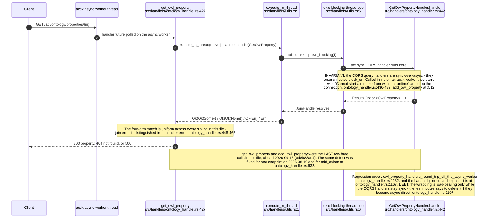

## VC-20.14 vault certify — the derivation certificate, the shared crate and the Whelk-parity invariant (ADR-2147, ontomark ADR-OM-009)

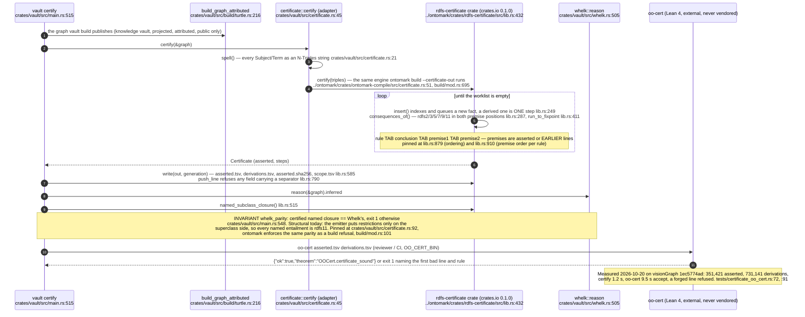

## VC-20.15 vault propose — the consequence delta on the PatchProposal (ADR-2147)

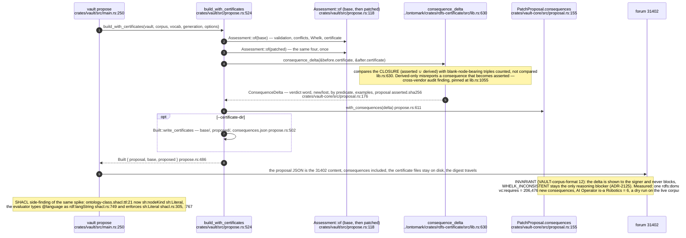
