## For developers

This topic records which store is the write master for each data class: four SQLite databases, Oxigraph named graphs, the Solid pod and RuVector. It also covers how provenance is appended, how erasure reaches each store, and how a caller's view of the graph is cut. At ec785afa9 two mechanisms were added: the visible subgraph now scrubs hidden page names out of visible metadata (VC-22.12), and full syncs append public corpus history to the provenance graph (VC-22.13). At 809a859aa graph shares became a fifth durable SQLite store, `data/shares.sqlite3`, backed up as a required member but not reached by per-user erasure (VC-22.14), and the corpus-history writer now takes its public test from `NodeVisibility::of_node`.

## For the business

Every piece of data has one authoritative home, so a correction or a deletion has a known place to land. Private pages must not leak through the names other pages mention, and the history kept for audit contains only what was already public, because that history cannot yet be deleted.

## VC-22.1 Write-master per data class

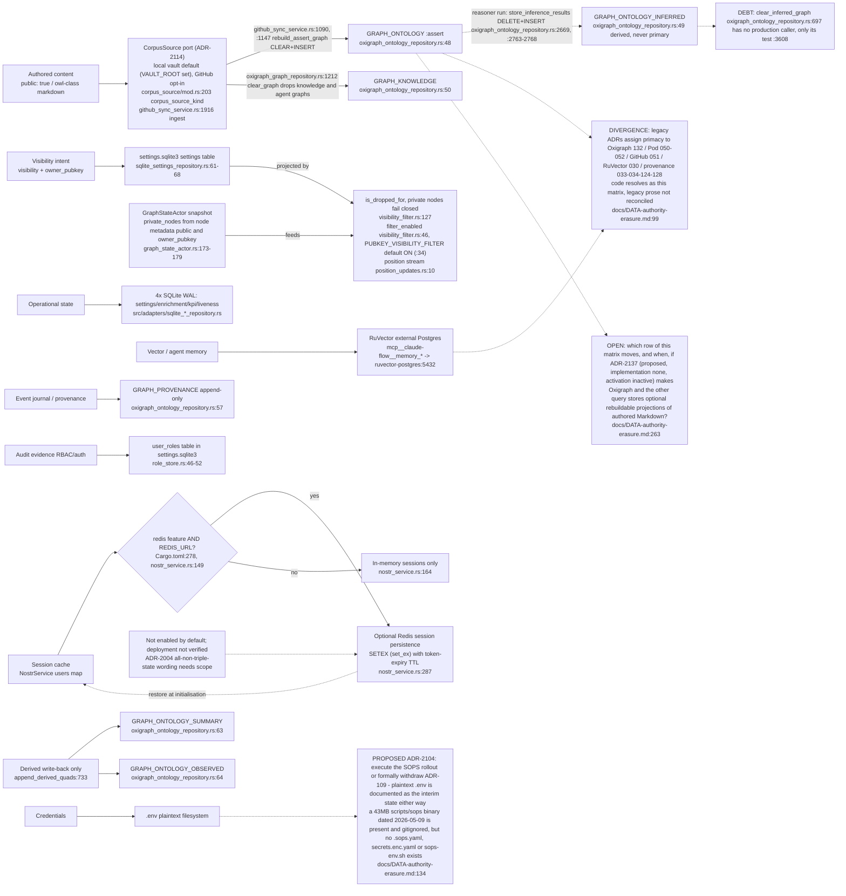

## VC-22.2 SQLite schemas (four write-master databases)

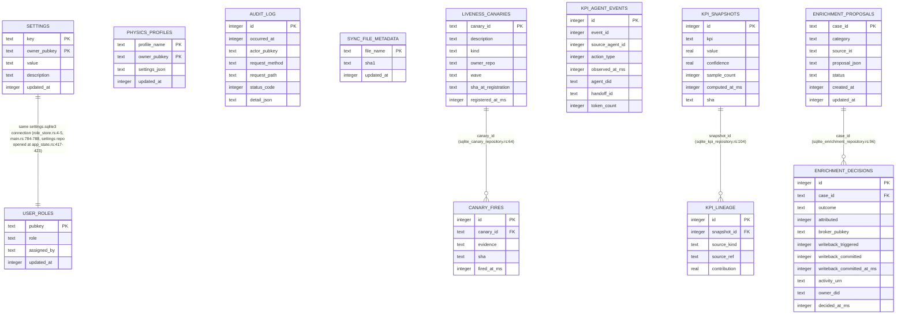

## VC-22.3 Derived-writeback fence (`POST /api/ingest/writeback`, ADR-2015)

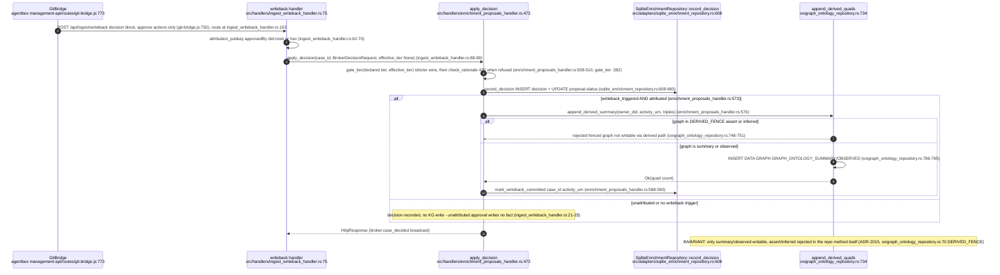

## VC-22.4 Provenance write — two producers, one append-only graph (ADR-2016)

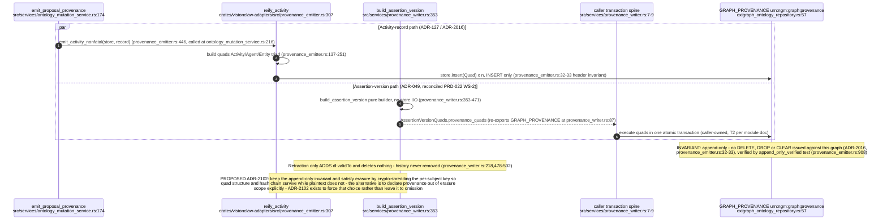

## VC-22.5 Unified provenance trace read path (`GET /api/trace`)

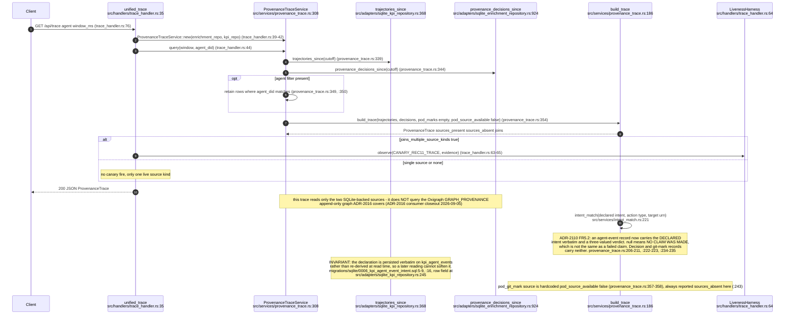

## VC-22.6 Erasure — `deleteAgentMemory` Pod path (RuVector tombstone gap)

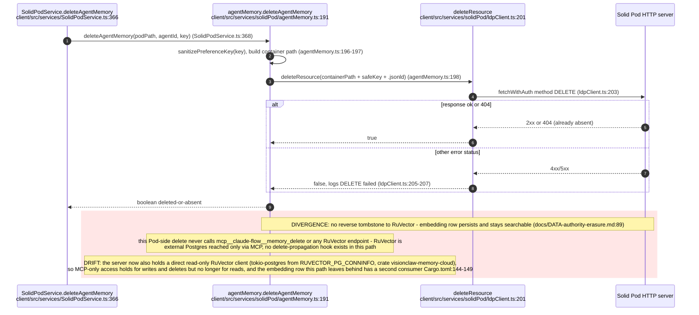

## VC-22.7 SQLite online backup (`scripts/backup-sqlite.sh`, ADR-2017)

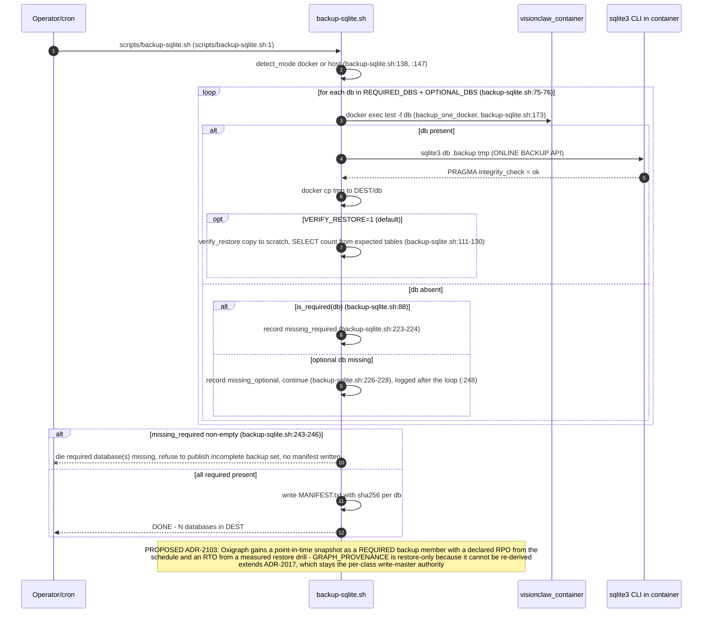

## VC-22.8 Dual-writes: fact fan-out to two stores

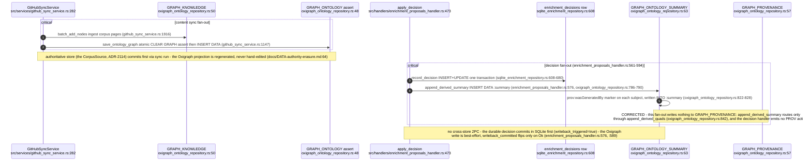

**Drift:** the approved-decision fan-out leaves nothing in the append-only `GRAPH_PROVENANCE` ledger ADR-2016 describes: the `prov:wasGeneratedBy` marker is a quad in `:summary` (`crates/visionclaw-adapters/src/oxigraph_ontology_repository.rs:822-828`), `append_derived_summary` writes only through `append_derived_quads` (`crates/visionclaw-adapters/src/oxigraph_ontology_repository.rs:842`), and `apply_decision` (`src/handlers/enrichment_proposals_handler.rs:473`) emits no PROV activity.

## VC-22.9 RBAC open-by-default posture on a read

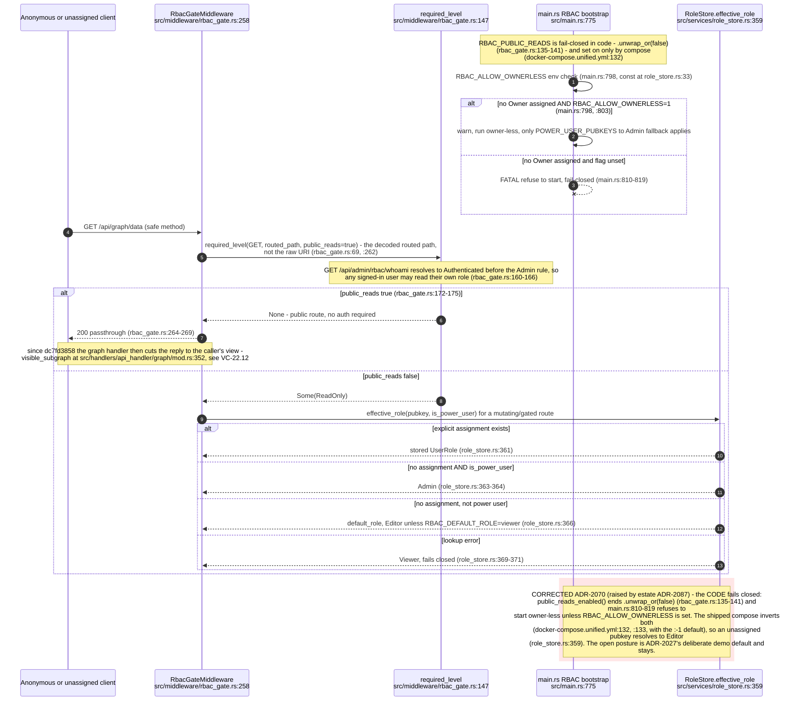

## VC-22.10 Full-sync corpus rebuild, ontology-typed filter and decision re-materialisation (ADR-2114, ADR-050)

```mermaid
sequenceDiagram
    autonumber
    participant OP as Operator (force_full_sync)
    participant SYNC as GitHubSyncService.sync_graphs<br/>src/services/github_sync_service.rs:342
    participant KGREPO as kg_repo.clear_graph<br/>src/adapters/oxigraph_graph_repository.rs:1212
    participant REBUILD as rebuild_assert_graph<br/>src/services/github_sync_service.rs:1090
    participant AG as GRAPH_ONTOLOGY assert
    participant DECREB as rematerialise_decisions<br/>src/services/github_sync_service.rs:1236
    participant DIRECT as add_owl_class/add_axiom<br/>application/ontology/directives.rs (governed write door)

    OP->>SYNC: FORCE_FULL_SYNC=1
    alt force_full_sync true (github_sync_service.rs:465, :742)
        SYNC->>KGREPO: clear_graph() drops GRAPH_KNOWLEDGE and GRAPH_AGENT (github_sync_service.rs:515-519, oxigraph_graph_repository.rs:1215-1216)
        SYNC->>REBUILD: rebuild_assert_graph(stats) (github_sync_service.rs:742-744)
        REBUILD->>REBUILD: filter KG nodes to ontology-typed only, ONTOLOGY_TYPE_KEY metadata (github_sync_service.rs:1106)
        REBUILD->>AG: CLEAR GRAPH assert then INSERT DATA class nodes + class-relation edges (save_ontology_graph, atomic) (github_sync_service.rs:1147)
        Note over REBUILD,AG: this CLEAR wipes the ENTIRE assert graph including runtime OWL classes/axioms added via the governed write door (github_sync_service.rs:1073-1075)
        REBUILD->>DECREB: rematerialise_decisions() ADR-050 read-half, called AFTER the class CLEAR+INSERT (github_sync_service.rs:1163)
        DECREB->>DECREB: list_pages_under(DECISIONS_DIR), decision_page_quads_logged per page (github_sync_service.rs:1237, :1265)
        DECREB->>AG: insert_quads_to_store re-derived dl:DecisionRecord quads, non-fatal on failure (github_sync_service.rs:1276, :1163-1169)
    else incremental sync (SHA1 filter narrowed file list)
        SYNC->>SYNC: clear_graph guard not entered, existing data left intact (github_sync_service.rs:515)
    end
    Note over DIRECT,AG: a class added via add_owl_class/add_axiom between full-syncs is NOT itself in GRAPH_PROVENANCE-protected history for the<br/>assert graph - only re-derivation from the corpus (the visionGraph vault via CorpusSource, ADR-2114) restores it after the next rebuild
    Note over DECREB,AG: attribution is deliberately NOT re-materialised here - the signed PROV-O attribution stays in GRAPH_PROVENANCE (ADR-049)<br/>the corpus decision page carries only the summary (github_sync_service.rs:1155-1162)
    Note over SYNC,AG: PROPOSED ADR-2102: one durable erasure record, five store acknowledgements, and a partial erasure that is recorded<br/>and retryable rather than a silent success - agentbox ADR-2060 is the RuVector-side half and is referenced, not superseded
```

## VC-22.11 SQLite membership contract vs KPI/enrichment sole-source risk

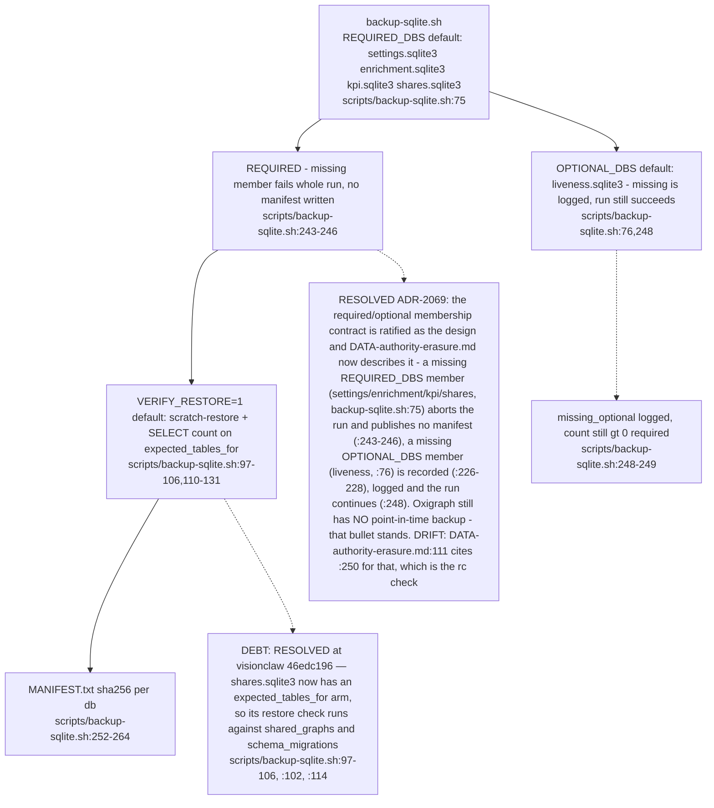

## VC-22.12 Visible subgraph and hidden page-name scrub (ADR-060 M1)

<!-- 2026-11-06 restamp ec785afa9: new. dc7fd3858 gates REST graph reads with the /wss policy, 395b62924 and efec9b27d scrub hidden page names -->
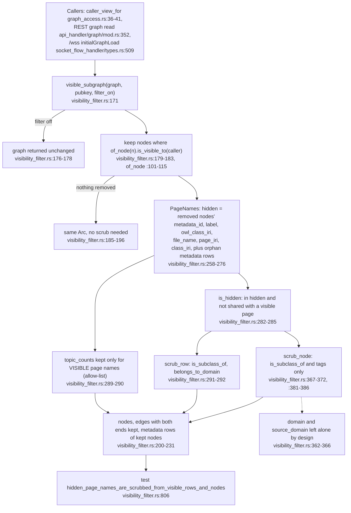

**Invariant:** a visible node or metadata row never names a removed page in a page-reference key. `scrub_node` covers `is_subclass_of` and `tags` (`crates/visionclaw-domain/src/utils/visibility_filter.rs:372`), and `scrub_row` covers `is_subclass_of`, `belongs_to_domain` and `topic_counts` (`crates/visionclaw-domain/src/utils/visibility_filter.rs:289-292`).

**Tension (risk):** plain `domain` and `source_domain` text is not scrubbed, by design: these keys are frontmatter text, not links, and removing a value that matches a hidden page name would itself reveal the page (`crates/visionclaw-domain/src/utils/visibility_filter.rs:362-366`). A visible page whose `domain` text equals a hidden page's name still shows that name.

**Debt (parallel):** the scrub uses two rules. `topic_counts` keeps only names on the visible allow-list (`crates/visionclaw-domain/src/utils/visibility_filter.rs:289-290`). Every other key removes only names on the hidden block-list (`crates/visionclaw-domain/src/utils/visibility_filter.rs:291-292`, `:379`), so a dangling reference to a page that does not exist survives everywhere except `topic_counts`.

## VC-22.13 Corpus history in the provenance graph (VisionFlow ADR-2022 P2 and P4)

<!-- 2026-11-06 restamp ec785afa9: new. 9fd0e85cc and ab1e636ff record full-sync corpus changes as assertion-versions. ADR-2022 here is the VisionFlow record. VisionClaw's own ADR-2022 is did:nostr hex identity, so it is not listed in adrs -->
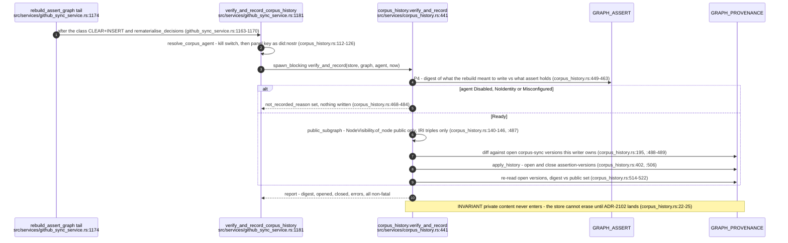

**Invariant:** the corpus-history writer and the wire paths share one public test: `public_subgraph` keeps the nodes `NodeVisibility::of_node` calls public (`src/services/corpus_history.rs:144`, `crates/visionclaw-domain/src/utils/visibility_filter.rs:101`), so private content cannot enter the unerasable provenance graph by a second, diverging rule.

**Open (risk):** the writer records nothing when no panel key is configured (`src/services/corpus_history.rs:474-477`), and surfaces that only as `SyncStatistics.corpus_history_not_recorded` and a warn. Any deployment without an ACSP panel key therefore keeps no corpus history.

## VC-22.14 Graph shares: one durable store, outside erasure

<!-- 2026-11-06 restamp 809a859aa: new. 3a23f4fa5 moves shares from a map per actix worker into data/shares.sqlite3; bcadfb6a5 requires a creator -->
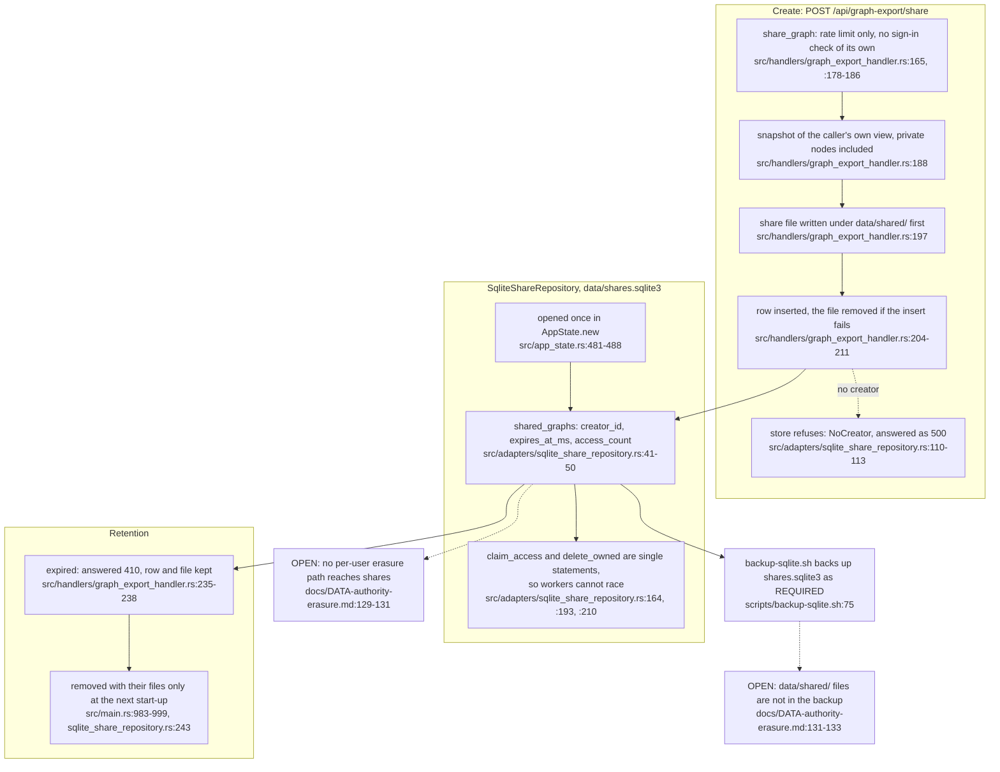

**Open (risk):** a share is a copy of its creator's view and can hold the creator's private nodes (`src/handlers/graph_export_handler.rs:188`), it now survives restarts, and no per-user erasure path reaches it, so erasing a user leaves the shares they created and their files (`docs/DATA-authority-erasure.md:114-115`, `:129-131`). A share made without an expiry is kept until its creator deletes it (`docs/DATA-authority-erasure.md:122-123`).

**Debt (loose end):** the refusal worded "Sharing a graph requires a signed-in caller" sits in the plain export handler (`src/handlers/graph_export_handler.rs:142-146`), while `share_graph` has no sign-in check: an anonymous share request snapshots the graph and writes the file before the store refuses it (`src/adapters/sqlite_share_repository.rs:110-113`) and is answered 500, not 401 (`src/handlers/graph_export_handler.rs:205-210`).

**Debt (loose end):** an expired share is refused with 410 but its row and file stay until the next start-up sweep (`src/handlers/graph_export_handler.rs:235-238`, `src/main.rs:983-999`); a long-running server keeps every expired share's private snapshot on disk.

**Drift:** `docs/DATA-authority-erasure.md:120` cites `src/app_state.rs:475-482` for where the share store is built; at this commit those lines are the end of the KPI store opening plus the start of the share store, which is opened at `src/app_state.rs:481-488`.
