## For developers

This topic covers the read-side analytics: the insight loop trace, KPI compute and lineage, the briefing service, natural-language queries to SPARQL, and the semantic processor and edge classifier. At ec785afa9 the `/api/semantic` routes filter their answers per caller. At 809a859aa a gated caller's communities and shortest paths are computed over that caller's view instead; centrality is still filtered after a whole-graph run, which is sound only while the analyser returns empty results, as a tripwire test enforces (VC-25.14).

## For the business

These features turn the graph into answers: health indicators, briefings and plain-English questions. The community and importance views on the semantic routes return nothing yet, so they are safe to expose but not yet useful.

## VC-25.1 Insight loop trace assembly (REC-10, compute-on-read)

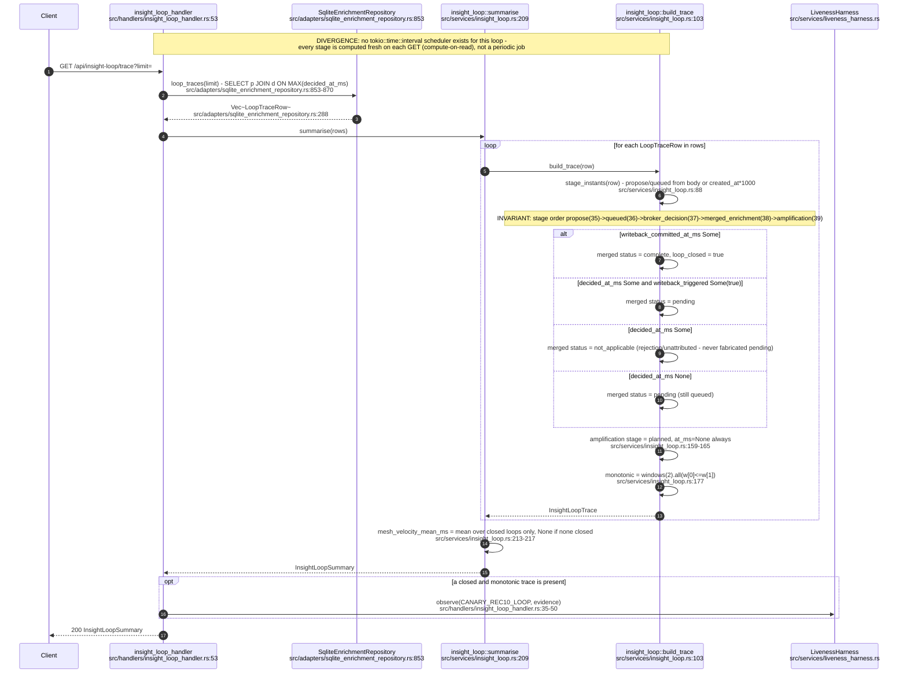

## VC-25.2 insight_loop_handler routes

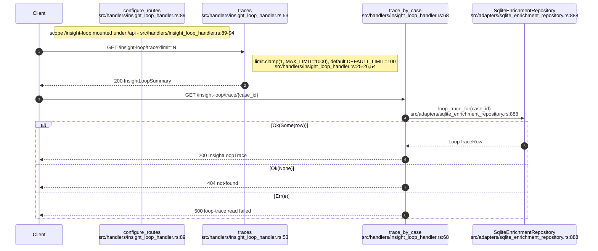

## VC-25.3 KPI compute and persist (kpi_snapshots / kpi_lineage / kpi_agent_events)

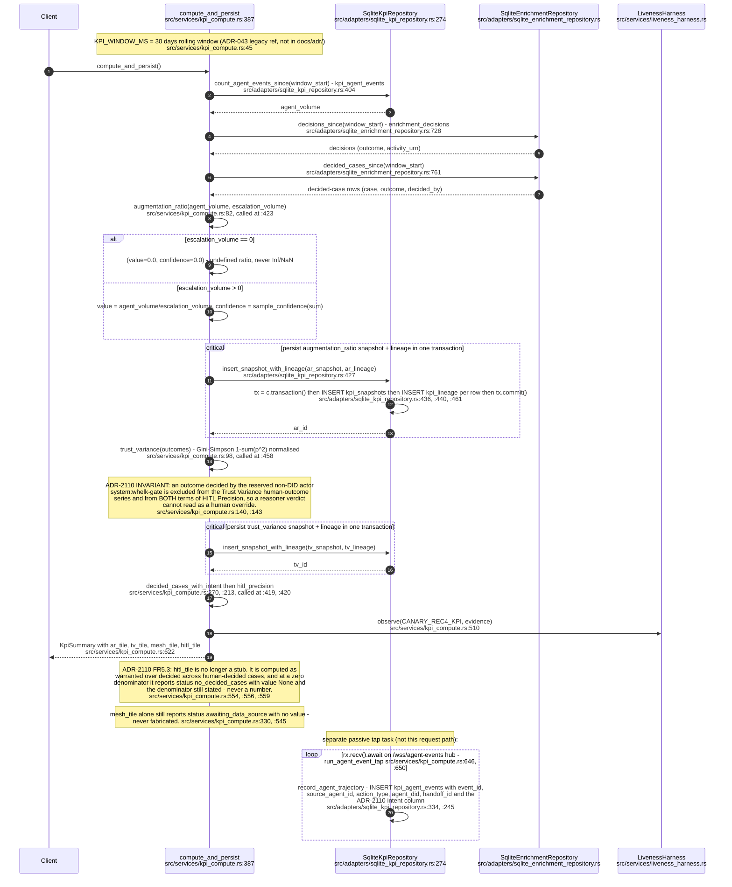

## VC-25.4 kpi_handler read routes

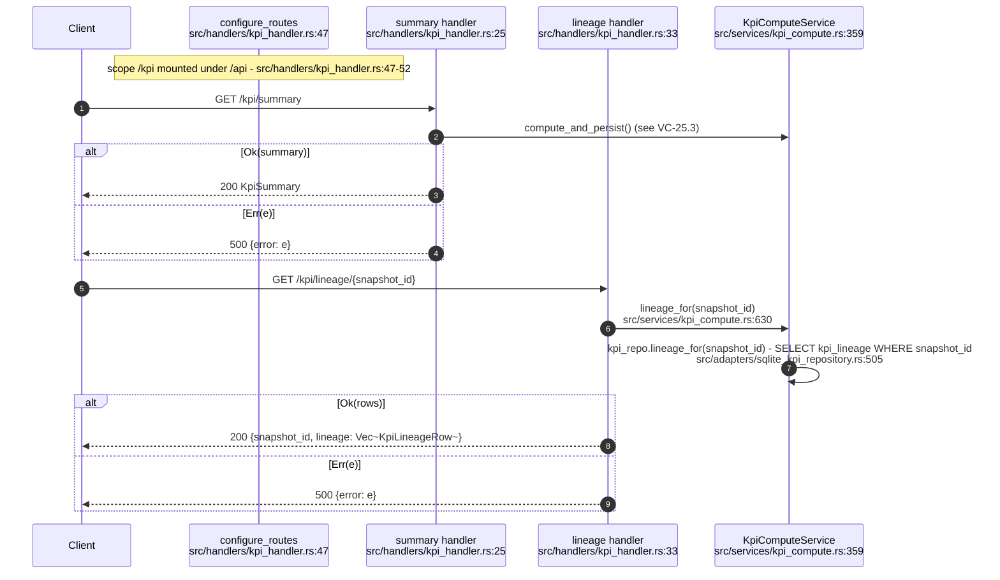

## VC-25.6 Briefing service and handler (submit + debrief)

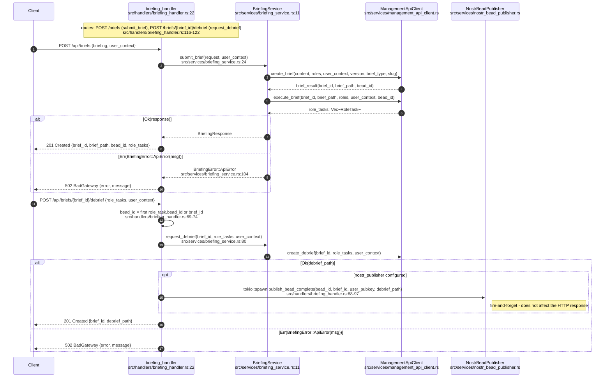

## VC-25.7 Natural language query: parse -> plan -> execute

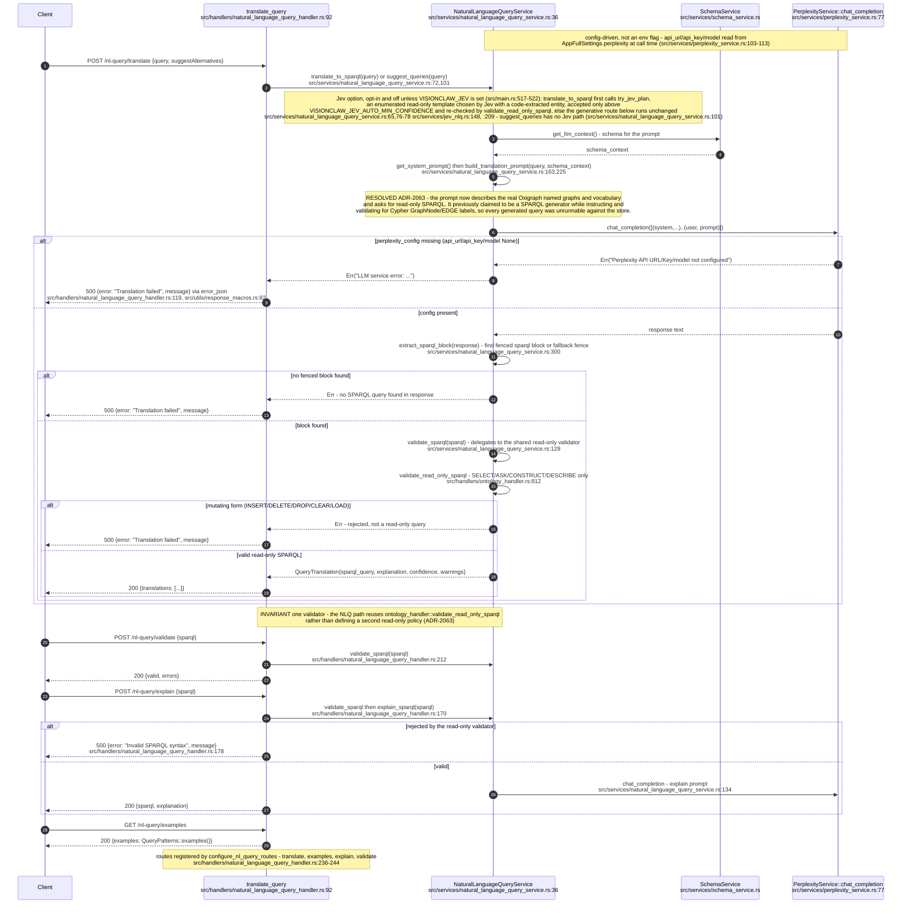

**Tension:** every refusal on the NLQ routes is reported as a server fault. `translate_query` and `explain_sparql` answer a failed translation, an LLM reply with no SPARQL block, a mutating query and an invalid query through `error_json!` (`../project/src/handlers/natural_language_query_handler.rs:119`, `:178`), which builds `HttpResponse::InternalServerError` (`../project/src/utils/response_macros.rs:82`). A caller cannot tell "your query was refused" from "the service broke" by status; only `/nl-query/validate` answers 200 with `{valid, errors}`. Earlier stamps of this panel showed these as 200.

## VC-25.8 SemanticProcessorActor message handling

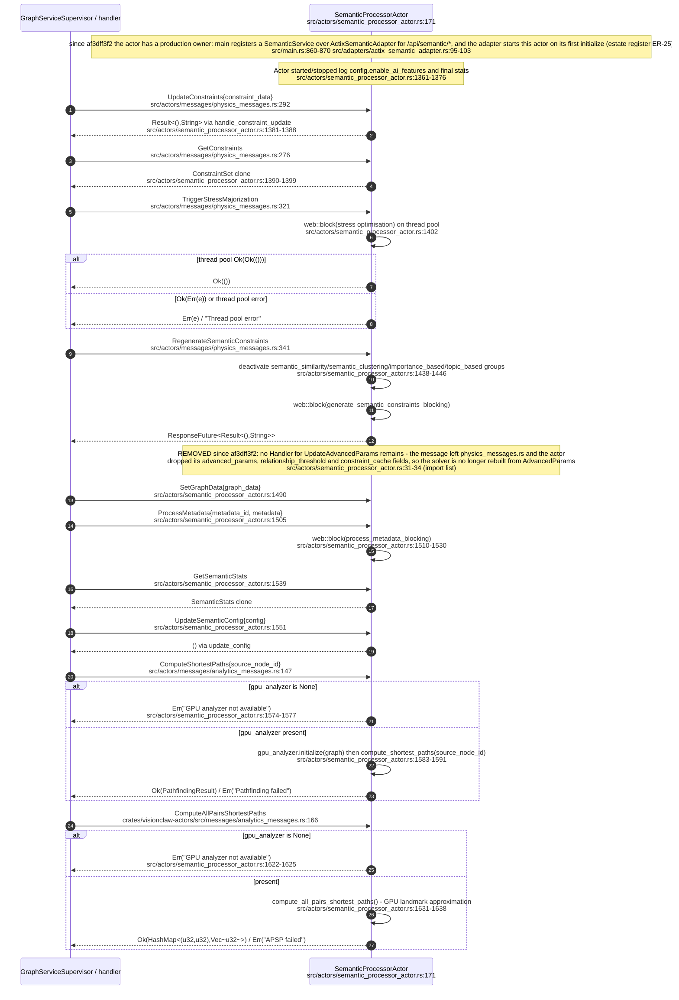

## VC-25.9 semantic_analyzer feature extraction + semantic_type_registry lookup/register

ADR-2114 unified corpus reads (local vault + GitHub via one `CorpusSource`) so `relation_edges` now
takes a `ParsedPage` and vault-core `Vocabulary` rather than JSON-LD; the registry lookup pattern is
otherwise unchanged. `SemanticAnalyzer` is a separate, unrelated caller shown for the same actor.

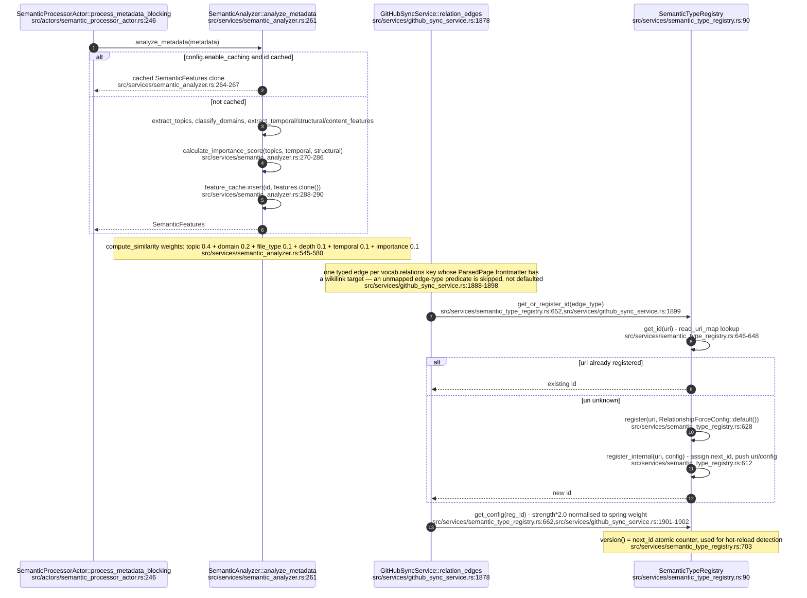

## VC-25.10 edge_classifier classification rules

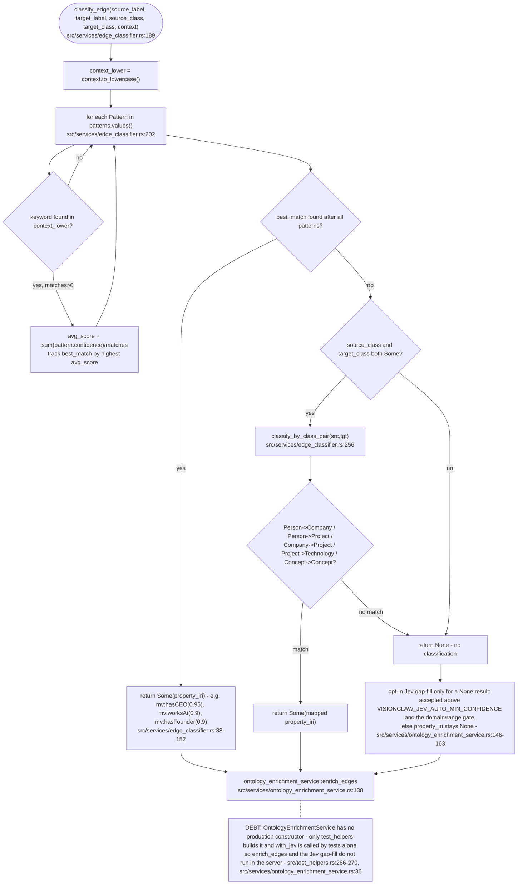

## VC-25.12 MetadataActor message handling

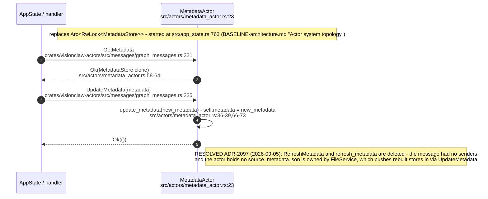

**Drift:** the governing baseline places MetadataActor's start at `app_state.rs:774` (`../project/docs/BASELINE-architecture.md:170`); at this revision the actor starts at `../project/src/app_state.rs:763`, with its log line at `:762`.

## VC-25.13 file_service + graph_serialization + empty-graph guard

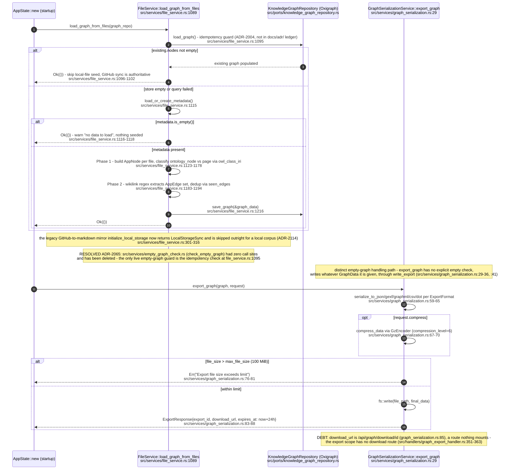

## VC-25.14 /api/semantic routes: gated callers computed over their own view

<!-- 2026-11-06 restamp ec785afa9: new. 84ccd9aaa gates the semantic routes per caller, 14c429baf adds the M2 tripwire test -->
<!-- 2026-11-06 restamp 809a859aa: redrawn. 405edcfe1 - communities and shortest paths for a gated caller are computed over the caller's view on the CPU, never a filtered whole-graph run -->
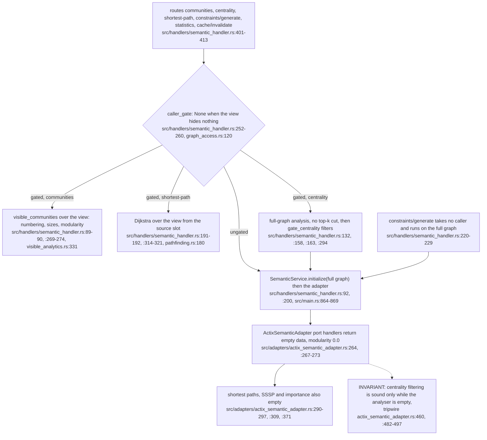

**Invariant:** filtering per caller after the analysis is sound only while the analyser returns nothing. `semantic_analyses_still_return_nothing_so_response_filtering_is_sound` (`src/adapters/actix_semantic_adapter.rs:460`) fails as soon as communities, centrality, shortest paths or SSSP distances return data (`src/adapters/actix_semantic_adapter.rs:482-497`). Communities and shortest paths no longer depend on it for gated callers (`src/handlers/semantic_handler.rs:89-90`, `:191-192`); centrality still does (`src/handlers/semantic_handler.rs:163`).

**Debt (loose end):** the port handlers return empty results for communities, shortest paths, SSSP and importance (`src/adapters/actix_semantic_adapter.rs:267-273`, `:290-297`, `:309`, `:371`). The shortest-path stub builds a `ComputeShortestPaths` message and drops it (`src/adapters/actix_semantic_adapter.rs:285-288`). The GPU-backed `ComputeShortestPaths` handler (`src/actors/semantic_processor_actor.rs:1564`) is never reached from `/api/semantic`, so an ungated caller gets 200 with empty data while a gated caller gets real CPU results.

**Tension (parallel):** centrality is the one gated semantic route still filtered after a whole-graph run (`src/handlers/semantic_handler.rs:132`, `:163`), while the analytics PageRank already has a view-local `visible_pagerank` (`src/handlers/api_handler/analytics/visible_analytics.rs:408`). The day the adapter returns scores, a gated caller's visible scores will have been shaped by hidden nodes.

**Open (risk):** the NLQ prompt context lists up to ten `owl_class_iri` values and a total drawn from the whole graph (`src/services/schema_service.rs:145-146`, `:83-89`), sent to the LLM for every translation (`src/services/natural_language_query_service.rs:81`), and Jev templates query the ontology graph directly (`src/services/jev_nlq.rs:56`). SECURITY-profiles 0.1.6 names `jev_nlq` and `natural_language_query_service` as outside the ontology deny-list (`docs/SECURITY-profiles.md:111`).
