## For developers

VisionClaw embeds a Solid pod and proxies it with NIP-98-signed requests and WAC access control. The client has its own LDP, type-index, WAC and notification stack. The ontology release is pulled from GitHub into the pod at boot. At ec785afa9 the boot pull treats a release as current only when both its build SHA and its source SHA match what the pod already holds (VC-26.13).

## For the business

Each user's data is kept in a Solid pod that the server embeds, with access controlled per resource. The published ontology is copied into the pod at start-up and verified, and a failed download never breaks the server.

## VC-26.1 Deployment topology — embedded pod vs feature-off stub
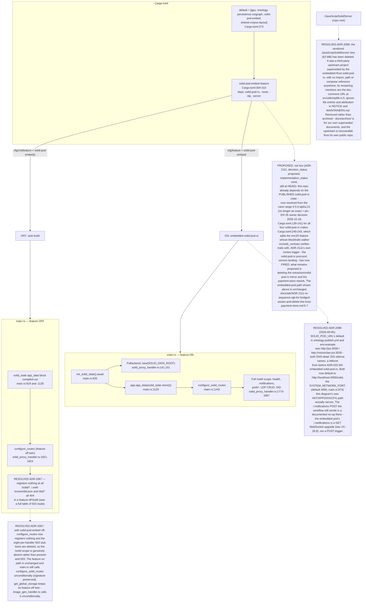

## VC-26.2 solid_proxy_handler — route dispatch, auth, WAC
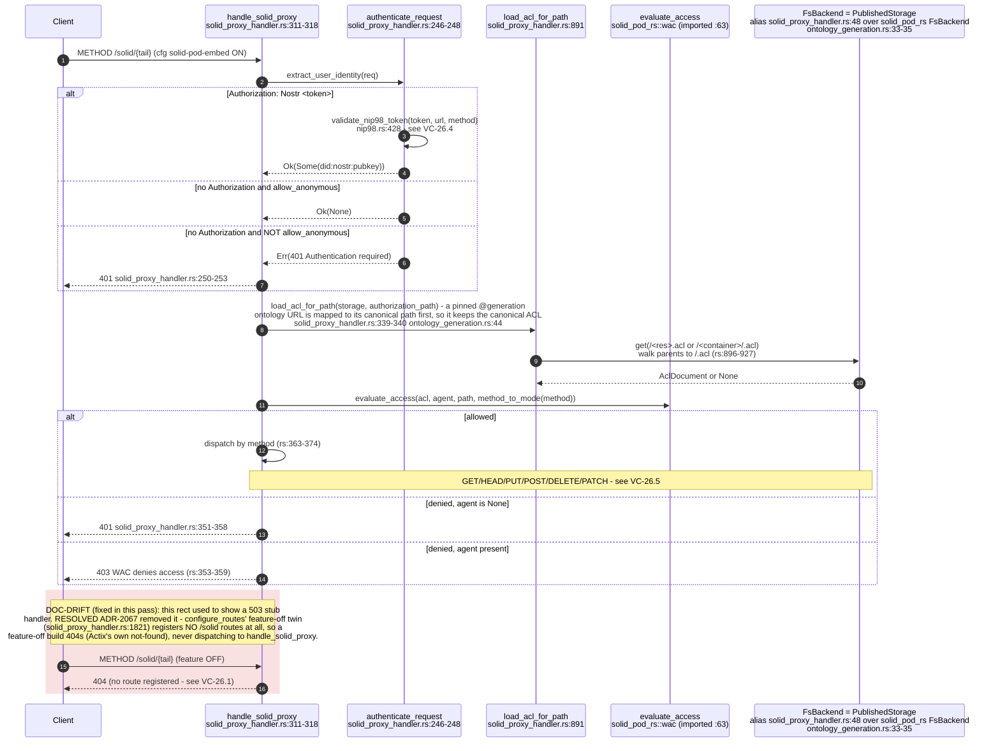

## VC-26.3 Login / pod session init — SolidPodService + useSolidPod
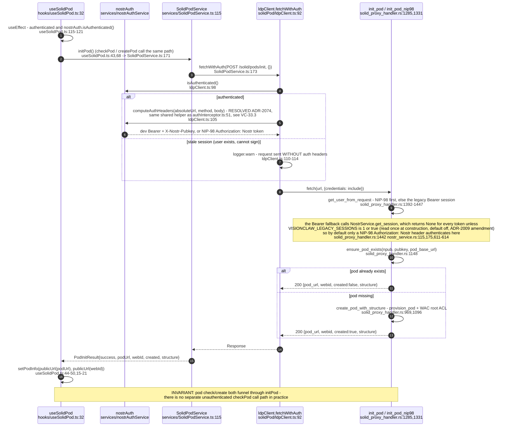

## VC-26.4 NIP-98 signed request reaching the pod — identity chain
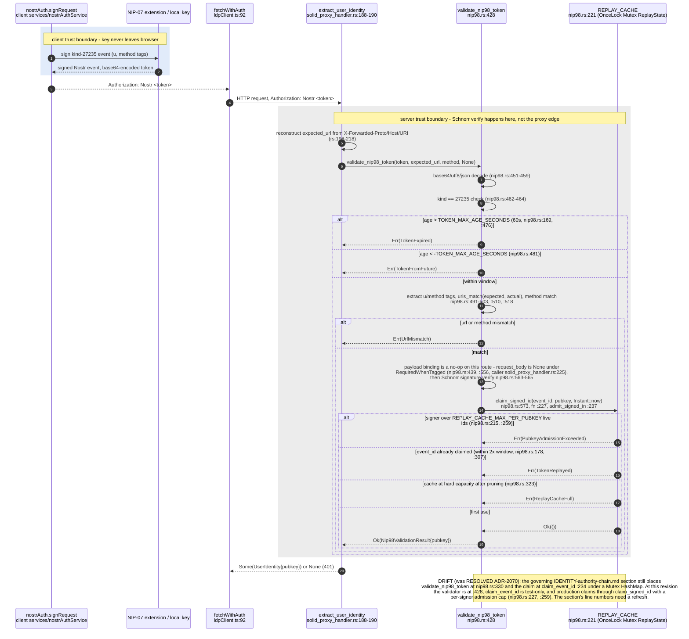

**Tension:** the embedded pod never binds a write body to its signature. `extract_user_identity` calls `validate_nip98_token(token, &expected_url, expected_method, None)` (`../project/src/handlers/solid_proxy_handler.rs:225`). The public wrapper selects `BodyBinding::RequiredWhenTagged` (`../project/src/utils/nip98.rs:439`), and with no body that policy matches the catch-all `(RequiredWhenTagged, _, _) => {}` (`../project/src/utils/nip98.rs:556`). A `payload` tag is therefore never compared on `/solid` PUT, POST or PATCH, and the `/solid` scope adds no other body check (`../project/src/handlers/solid_proxy_handler.rs:1773-1807`). Someone holding an unused token for one write can send different bytes to the same URL and method inside the 60-second window; the single-use claim (`:573`) limits this to one substitution. Source tracing only; no request was sent. It parallels SP-ID-01 in `docs/estate-review/2026-11-01-solid-identity-boundaries.md`. What would close it: pass the received body and use `BodyBinding::Required` on write methods, with a route-level test that a body differing from the signed hash is refused.

## VC-26.5 ldpClient CRUD — LDP resource operations
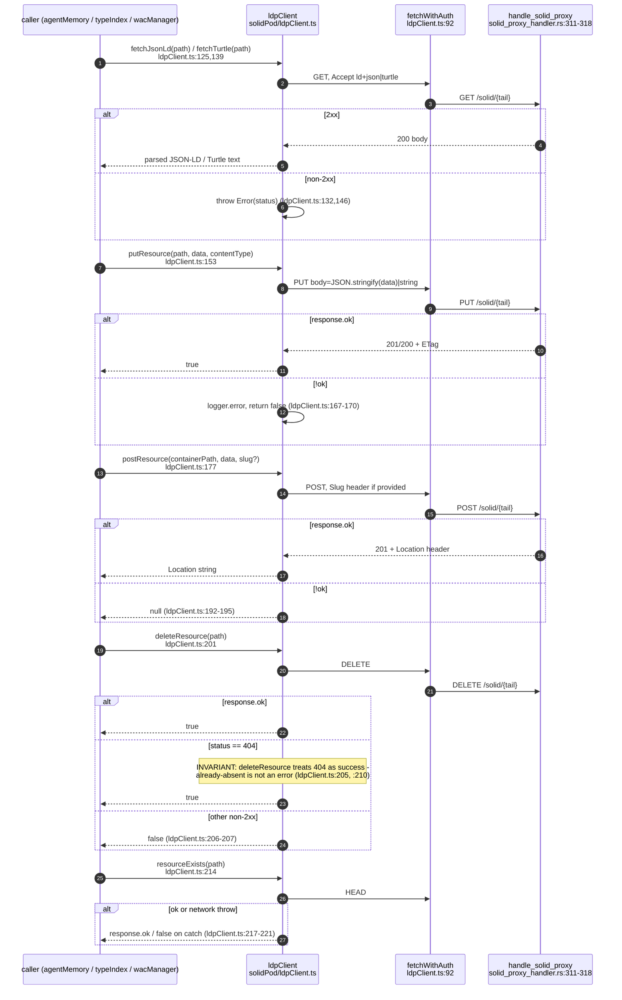

## VC-26.6 agentMemory — read / write / delete
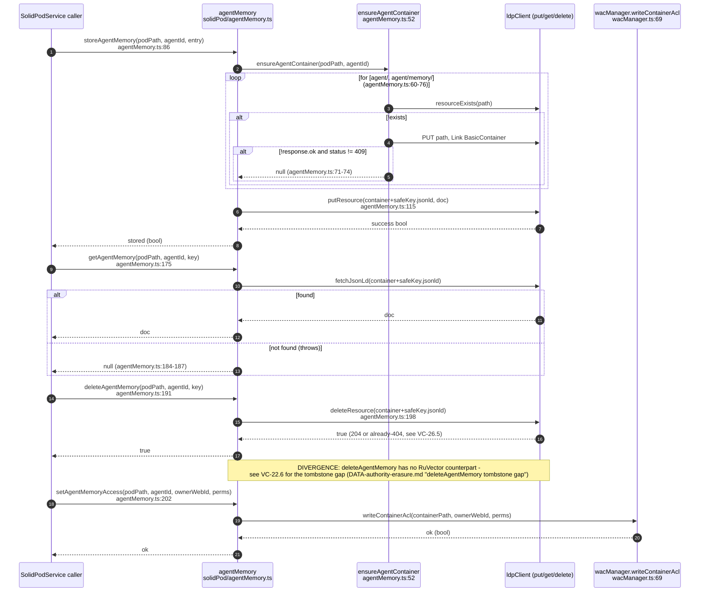

## VC-26.7 wacManager — WAC ACL write (client) and read (server)
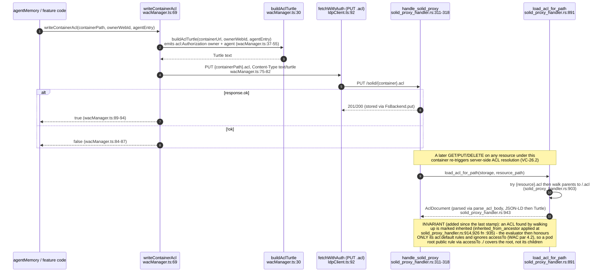

## VC-26.8 typeIndex — registration and discovery
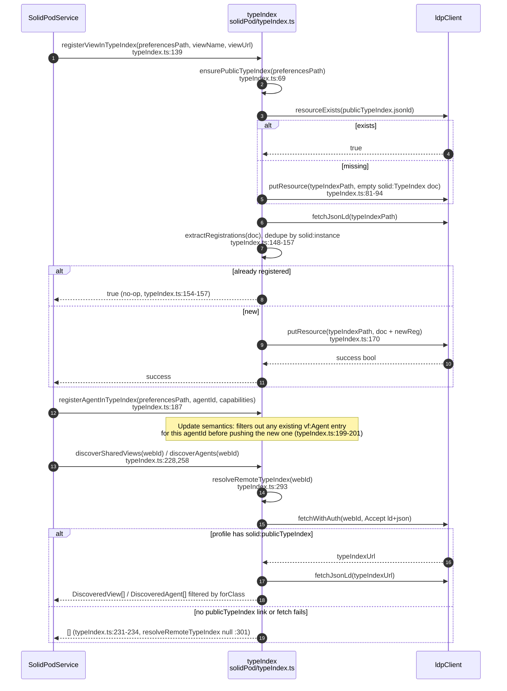

## VC-26.9 podNotifications subscription + solidWebSocket store
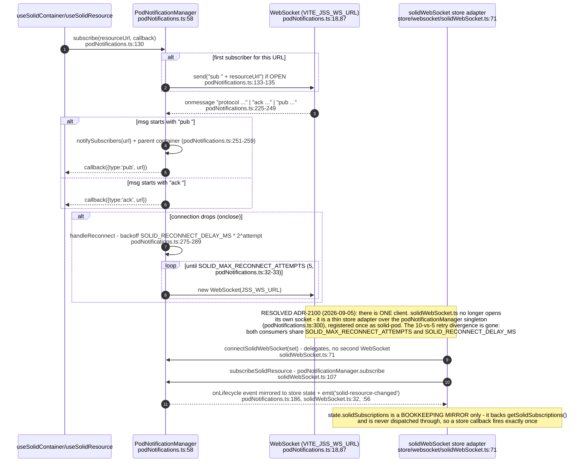

## VC-26.10 jss schemaParser — generation-pinned JSON-LD load with cache
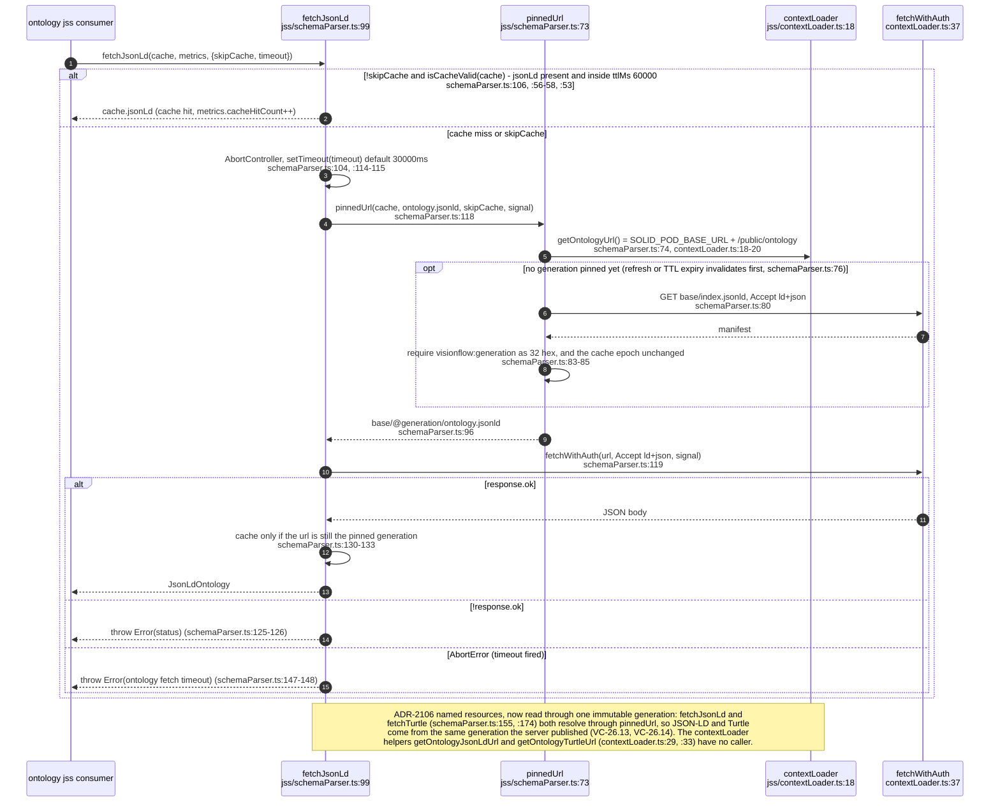

**Debt:** `getOntologyJsonLdUrl` and `getOntologyTurtleUrl` (`../project/client/src/features/ontology/services/jss/contextLoader.ts:29`, `:33`) are exported but nothing in `client/src` calls them since `schemaParser.ts` moved to generation-pinned URLs (`../project/client/src/features/ontology/services/jss/schemaParser.ts:73-97`). Their doc comment still describes them as the way to fetch the ontology. Delete them, or point the comment at `pinnedUrl`.

**Drift:** earlier stamps of this panel showed `fetchJsonLd` requesting `getOntologyJsonLdUrl()` directly; the client now fetches `index.jsonld` first and reads `@<generation>/` paths.

## VC-26.12 Client component/hook tree
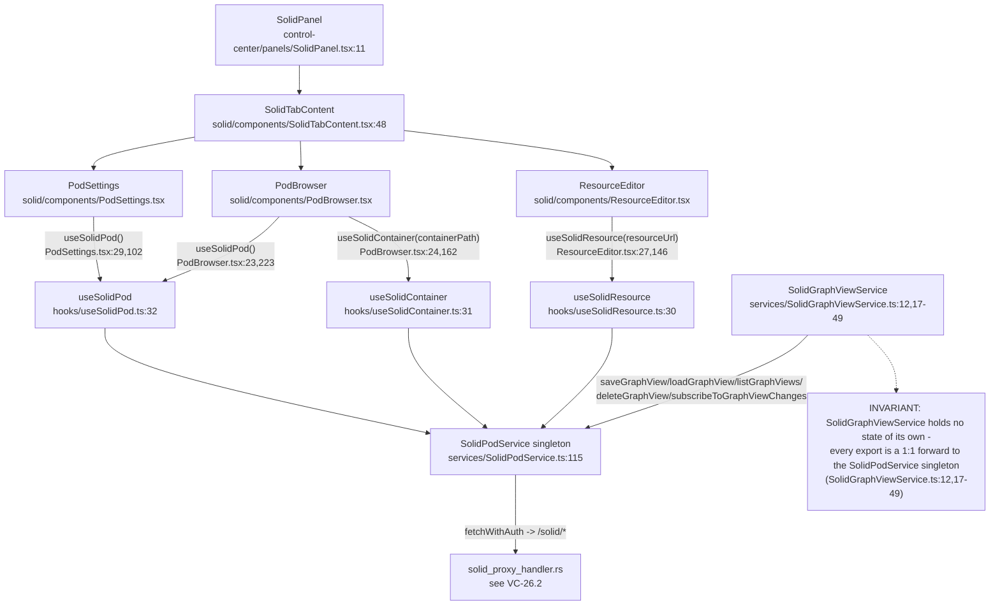

## VC-26.13 Ontology boot pull — GitHub release into the embedded pod (ADR-2106)
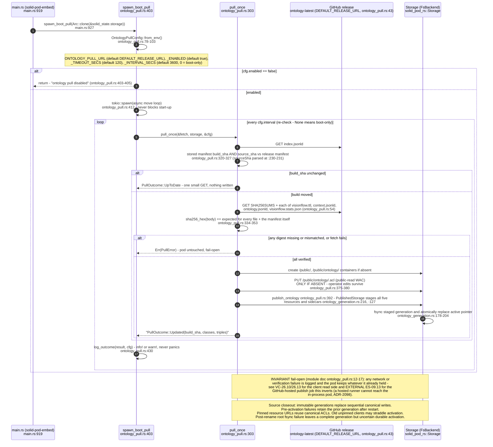

## VC-26.14 Ontology publication failure boundaries — verified bytes versus atomic visibility

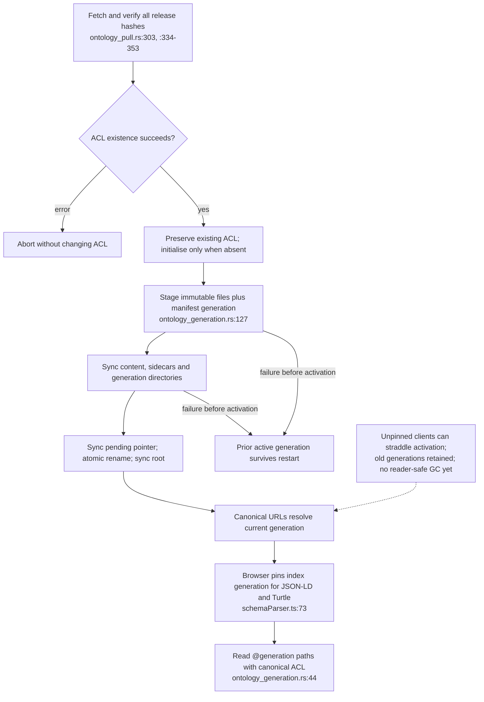
