## VC-27.1 BotsClient — legacy `:9500` MCP-TCP poller (superseded path)

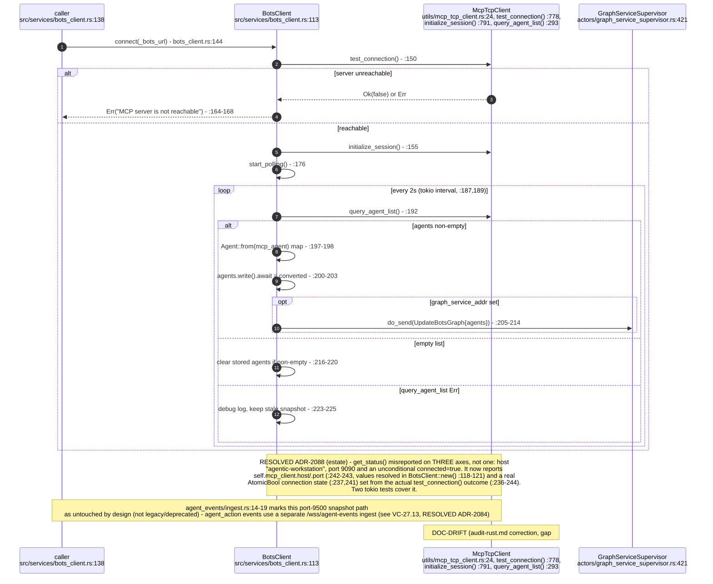

## VC-27.2 McpRelayManager — multi-agent-container lifecycle via docker exec

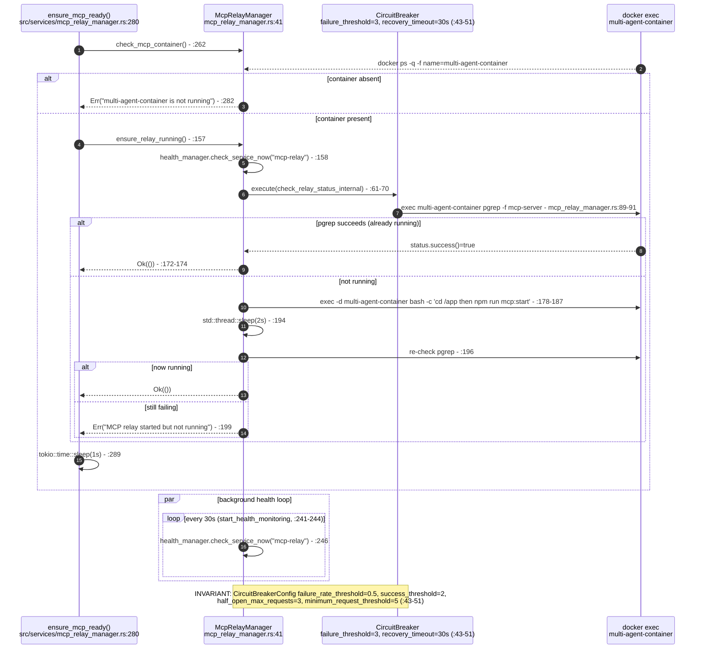

## VC-27.3 MCPRelayActor — `/ws/mcp-relay` session lifecycle (connect/retry/teardown)

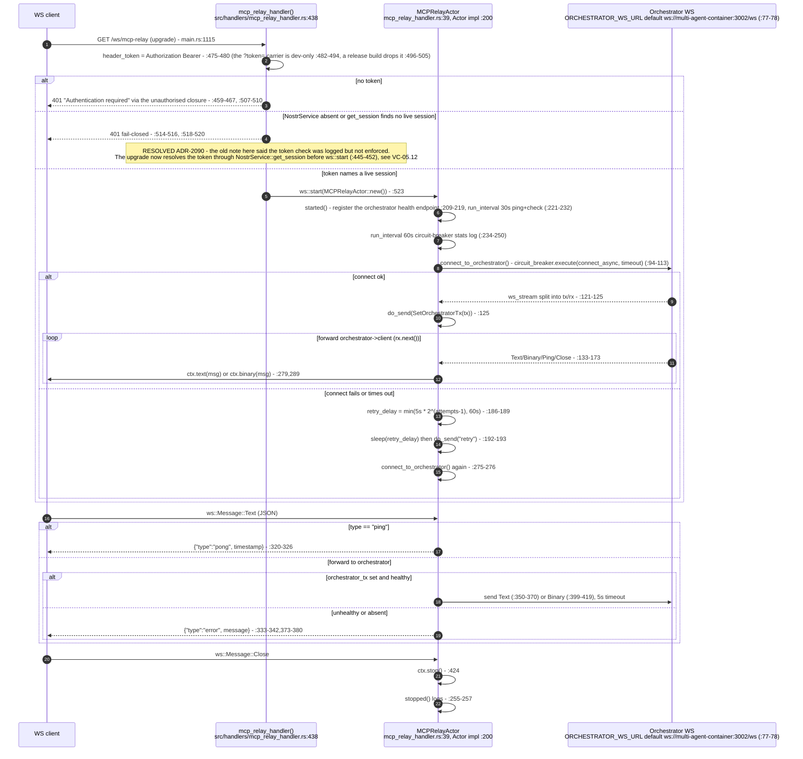

## VC-27.4 MultiMcpAgentDiscovery — per-server agent + tool discovery, polled only while a socket is attached

```mermaid
sequenceDiagram
    autonumber
    participant Sync as sync_running<br/>src/services/multi_mcp_agent_discovery.rs:184
    participant D as MultiMcpAgentDiscovery<br/>multi_mcp_agent_discovery.rs:101
    participant CF as claude-flow server<br/>host=claude_flow_host(): CLAUDE_FLOW_HOST, then MCP_HOST, then multi-agent-container (:144-148, :220) port=MCP_TCP_PORT default 9500 (:221-224)
    participant RS as ruv-swarm server<br/>host=RUV_SWARM_HOST port=RUV_SWARM_PORT default 9501 (:237-241)
    participant DAA as daa server<br/>host=DAA_HOST port=DAA_PORT default 9502 (:254-258)

    Note over Sync,D: DOC-DRIFT (RESOLVED 2026-10-12, project 6a1a74b8b/4f4345503) - this diagram used to show start_discovery() driven by an unnamed Caller, because nothing constructed the service.<br/>AppState::new now builds it and runs initialize_default_servers (src/app_state.rs:1166-1168), and every /multi-mcp/ws socket attaches and calls sync_running (VC-05.13)
    Sync->>D: initialize_default_servers() once at boot - :212-270 (called at src/app_state.rs:1168)
    D->>D: insert claude-flow :215-230 (enabled :225), ruv-swarm :232-247 (enabled only if env_configured :242), daa :249-264 (enabled only if env_configured :259) - env_configured :134-137
    Sync->>D: attach() :170 and detach() :175 move the subscriber count synchronously, sync_running :184-193 starts or stops the loop to match
    D->>D: start_discovery :298 - epoch bumped :307, wake notified :308, so a quick restart leaves one loop
    loop while running and this loop's epoch is current (tokio::spawn multi_mcp_agent_discovery.rs:324-434, condition :327)
        par concurrent per enabled server (multi_mcp_agent_discovery.rs:336-410)
            D->>CF: discover_server_agents :452 -> discover_claude_flow_agents - :472, :482-568
            CF-->>D: query_server_info / query_agent_list / query_swarm_status - :512,533,556
            D->>RS: discover_ruv_swarm_agents - :473, :570-661
            RS-->>D: same three-call pattern, server_type=RuvSwarm - :600,626,649
            D->>DAA: discover_daa_agents - :474, :663-750
            DAA-->>D: same pattern, server_type=Daa - :693,718,738
        end
        alt discover_server_agents Ok
            D->>D: insert server_info/agents/topology, successful_discoveries+=1 - :348-378
        else Err (connect/timeout)
            D->>D: failed_discoveries+=1, is_connected=false, entry inserted if absent so a first-cycle failure is visible - :379-406
        end
        D->>D: cycles += 1 :413, epoch recheck :417, then select between sleep(sleep_ms) and wake - :425-428
    end
    D->>D: stop_discovery :437-450 - running=false, epoch bumped :441, caches cleared :446-448
    Note over D,CF: RESOLVED ADR-2083 (estate) - WIRED, not removed: the per-server values are deliberate, so the<br/>loop now sleeps the minimum interval across ENABLED servers (select_discovery_interval_ms :46, called :333), with a named<br/>MIN_DISCOVERY_INTERVAL_MS floor so a misconfigured 0 cannot spin it, and a named fallback when no server is<br/>enabled. The flat 1000ms sleep is gone (:425-428).
    Note over CF,DAA: supported_tools fallback differs per server when query_server_info fails:<br/>claude-flow=[agent_list,swarm_status,server_info] (multi_mcp_agent_discovery.rs:523-527),<br/>ruv-swarm (:614) and daa (:707) each have their own equivalent fallback list in their own discover_*_agents function
    rect rgb(255,235,235)
    Note over D,DAA: OPEN: ruv-swarm and daa have no confirmed endpoint in this estate and stay disabled unless RUV_SWARM_* or DAA_* are set (:242, :259).<br/>None of this was observed against a live claude-flow hub
    Note over D,DAA: RESOLVED 2026-10-12 (project 9f98e3787): discovery now resolves the claude-flow host as BotsClient does (CLAUDE_FLOW_HOST, then MCP_HOST, then multi-agent-container), so both pollers target the same host on port 9500. The host is resolved by claude_flow_host (multi_mcp_agent_discovery.rs:144-148, used at :220) in the same order as bots_client.rs:120-122, so the old localhost fallback is gone.
    Note over D,DAA: DEBT: DiscoveryStats total_discoveries :91, total_agents_discovered :94, servers_online :97 and servers_offline :98 are declared but never written<br/>by this loop, which updates only successful_discoveries :367, failed_discoveries :383 and last_discovery_time :368<br/>The WS frame no longer reads those stored fields: build_discovery_frame derives total_discoveries as successful+failed, total_agents_discovered as agents.len() and servers_online/offline from the frame's own server list (multi_mcp_websocket_handler.rs:393-402)
    end
```

## VC-27.5 MultiMcpVisualizationWs — `/multi-mcp/ws` session and opcodes

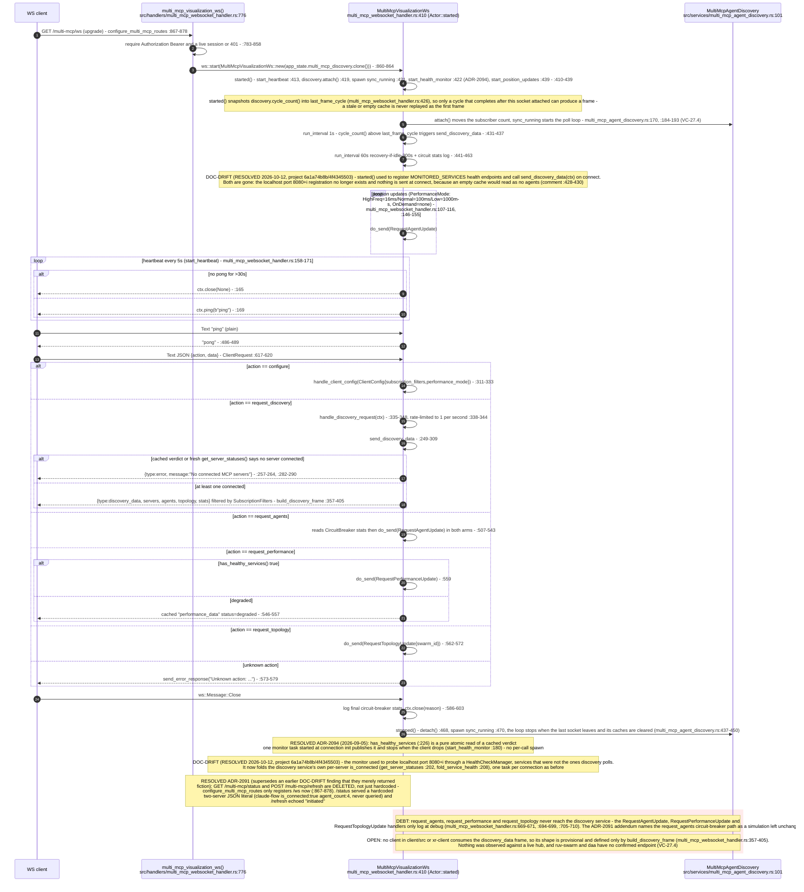

## VC-27.6 MultiMcpVisualizationActor — message set and periodic ticks

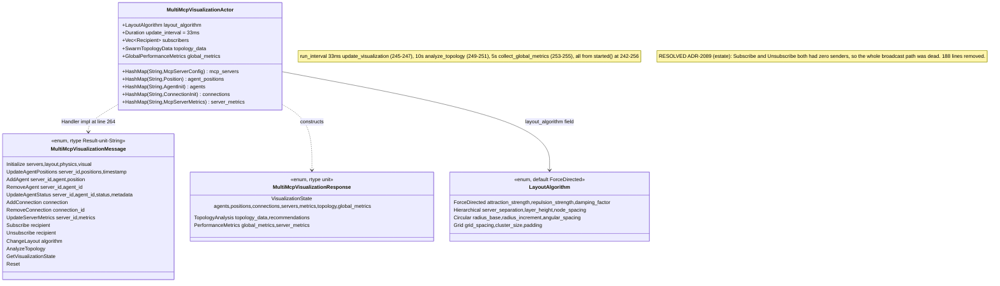

## VC-27.7 AgentMonitorActor — Management API poll loop and debounce

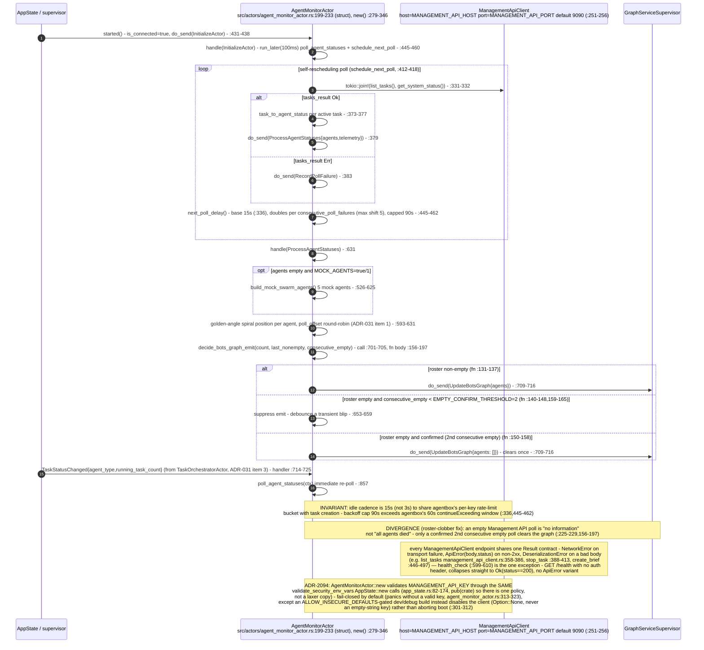

## VC-27.8 TaskOrchestratorActor — CreateTask/Interrupt/Drain message handlers

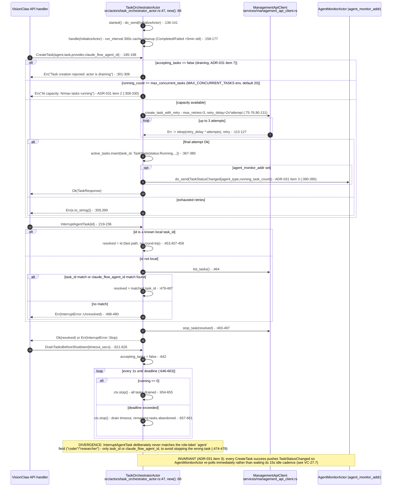

## VC-27.11 AgentVisualizationProcessor — `/api/visualization/agents/ws` init/refresh

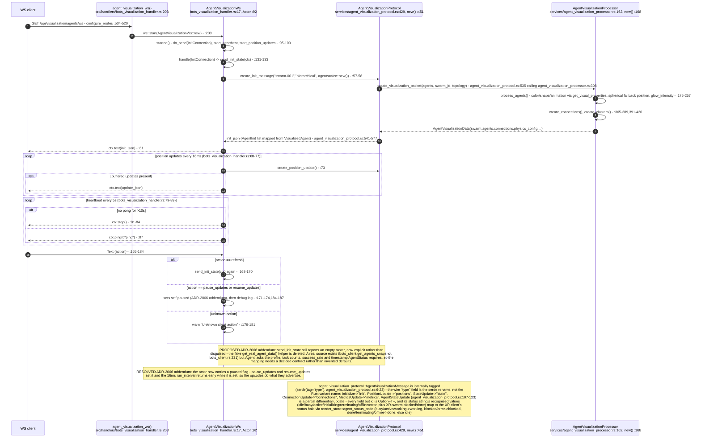

## VC-27.13 `/wss/agent-events` ingest — schema validation, hub fan-out, provenance

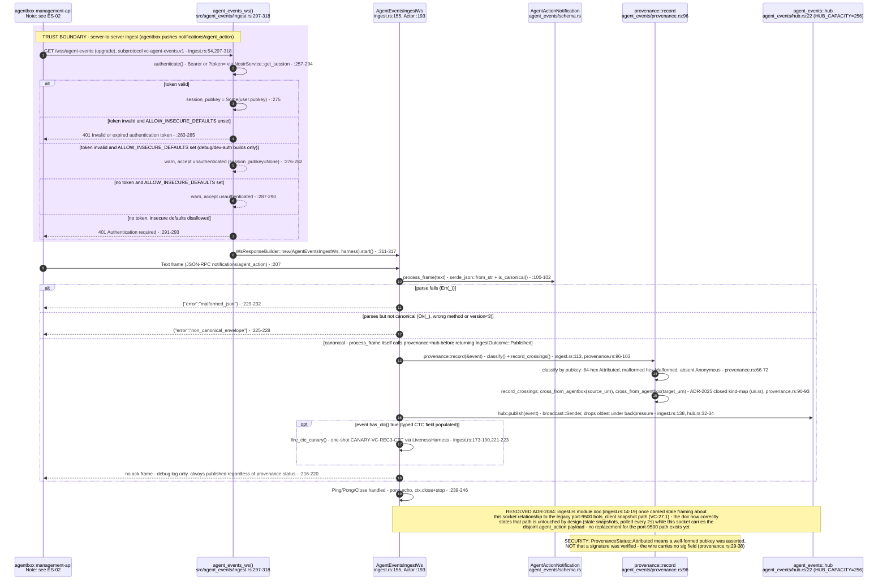

## VC-27.14 AgentDemoDirector — one server-side synthetic producer (ADR-2142)

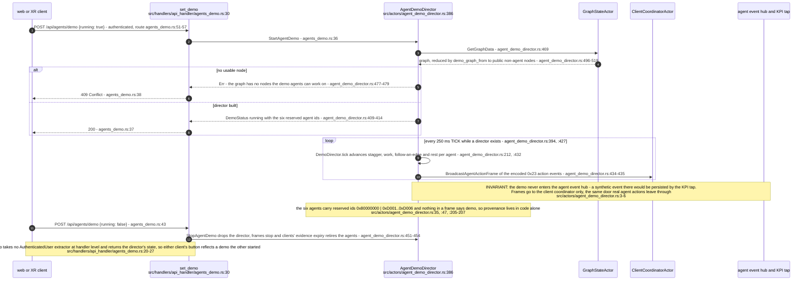

**What it shows:** the shared agents demo as a server-side producer of agent-action frames that is started and stopped through one authenticated endpoint and fans out through the client coordinator, bypassing the agent-event hub that VC-27.13 describes.

**Why it is this way:** ADR-2142 (2026-10-14) replaced two client-side demo producers, each feeding only its own screen, with one director both clients control; it stays out of the hub so synthetic events never reach durable records. The decision is accepted and implemented, with activation staged.
