## For developers

The React client boots through `AppInitializer`: graph worker first, then the settings store, then the graph socket and the REST topology in parallel; the stores below it (settings, websocket, timeline, beams, worker errors) are what every surface reads. Three mechanisms changed at ec785afa9: every acknowledged binary chunk is applied first (ADR-2141, VC-30.10), the worker's position buffer grows with the graph (ADR-2181 D4, VC-30.11), and retired settings are stripped on both load paths (ADR-2189, VC-30.3, VC-30.8). At 809a859 the settings-integrity merge (`7cde2f00c`) inverted load precedence: the server document is the base and a value the server stores beats this browser's copy, except a change this browser could not save (VC-30.13). Changes made before load are held rather than dropped, and every lost write (not ready, sync off, failed) lands in one persisted record that the status chip counts (VC-30.3, VC-30.4, VC-30.12). The dead `exportApi.ts` is deleted (`90f1bb1c0`, VC-30.8).

## For the business

Opening the app loads the graph engine, the person's saved preferences and the live graph together. Every live position update is drawn before the server is told it arrived, and very large graphs no longer silently lose their outer nodes. Preferences now follow the server: a change made on another device, by another viewer or by the assistant shows up on the next load instead of being overwritten by an old copy in this browser. A change that could not be saved is no longer lost quietly; the status chip says how many are unsaved and why. Some unsaved changes never clear on their own (see the register), so the chip can stay lit.

## VC-30.1 Provider nesting and top-level render states
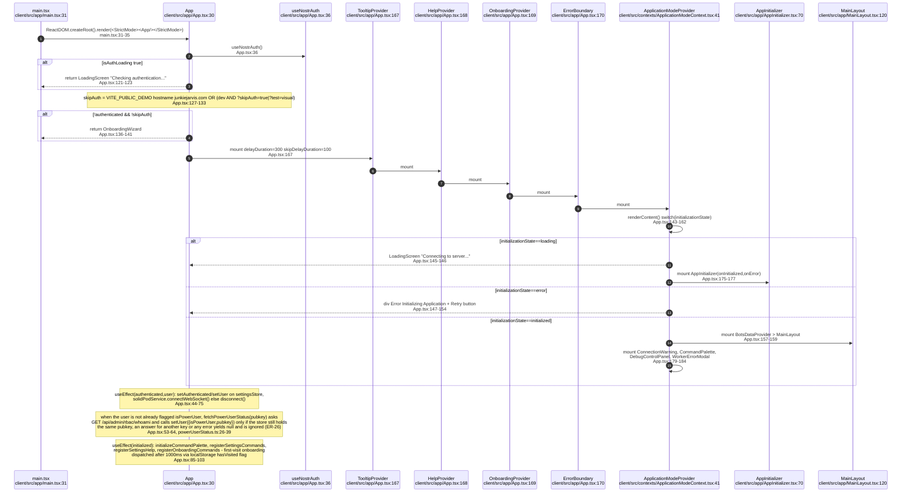
## VC-30.2 AppInitializer — worker, settings, websocket and data fan-out
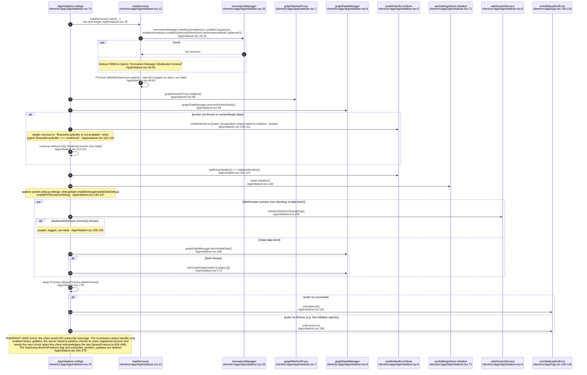
## VC-30.3 Zustand store catalogue
```mermaid
classDiagram
    class useSettingsStore {
      client/src/store/settingsStore.ts:27
      persist middleware name="graph-viz-settings-v2"
      storage localStorage via createJSONStorage settingsStore.ts:36
      partialize authenticated,user,isPowerUser,partialSettings settingsStore.ts:37-46
      merge() strips ADR-2189 retired paths then restores persisted.partialSettings settingsStore.ts:47-73
    }
    class CoreSlice {
      partialSettings DeepPartial~Settings~ coreSlice.ts:70
      settings DeepPartial~Settings~ coreSlice.ts:71
      loadedPaths Set~string~ coreSlice.ts:72
      loadingSections Set~string~ coreSlice.ts:73
      initialized bool coreSlice.ts:74
      authenticated bool coreSlice.ts:75
      settingsSyncEnabled bool coreSlice.ts:78
      +initialize() coreSlice.ts:85
      +get(path) coreSlice.ts:200
      +set(path,value,skipServerSync) coreSlice.ts:232
      +subscribe(path,cb,immediate) coreSlice.ts:261
      +ensureLoaded(paths) coreSlice.ts:275
      +loadSection(section) coreSlice.ts:335
      +updateSettings(updater) coreSlice.ts:371
      +updateComputeMode(mode) coreSlice.ts:442
      +updateConstraints(constraints) coreSlice.ts:453
    }
    class PhysicsSlice {
      +updatePhysics(graphName,params) physicsSlice.ts:19
      +updateWarmupSettings(settings) physicsSlice.ts:134
      updatePhysics clamps streamChunkNodes 100-20000, streamMoveThreshold 0-100, streamAckTimeoutMs 20-10000 (ADR-2141) physicsSlice.ts:80-89
      +notifyPhysicsUpdate() no-op since 2026-06-03 physicsSlice.ts:145-155
      +updateTweening(graphName,params) params enabled,responseMs 5-1000,snapThreshold,maxDivergence physicsSlice.ts:157,172-174
      +notifyTweeningUpdate(params) dispatches window CustomEvent tweeningSettingsUpdated physicsSlice.ts:204
    }
    class PersistenceSlice {
      +getByPath(path) persistenceSlice.ts:36
      +setByPath(path,value) persistenceSlice.ts:47
      +batchUpdate(updates) persistenceSlice.ts:60
      +flushPendingUpdates() persistenceSlice.ts:84
      +resetSettings() persistenceSlice.ts:88
      +exportSettings() persistenceSlice.ts:107
      +importSettings(json) persistenceSlice.ts:128
    }
    class SubscriberTrie {
      subscriberTrieRoot SubscriberTrieNode subscriberTrie.ts:13
      +getOrCreateTrieNode(path,create) subscriberTrie.ts:18
      +collectDescendants(node,out) subscriberTrie.ts:34
      +collectMatchedCallbacks(changedPaths) subscriberTrie.ts:41
      +scheduleNotify(callbacks) requestAnimationFrame batch subscriberTrie.ts:78
    }
    class useWebSocketStore {
      client/src/store/websocketStore.ts:9-16 re-export shim (36 lines)
      real impl client/src/store/websocket/index.ts:515 lines
      socket WebSocket~null~ storeState.ts:48
      isConnected bool storeState.ts:49
      isServerReady bool storeState.ts:50
      connectionState ConnectionState storeState.ts:51
      solidSubscriptions Map~string,Set~ storeState.ts:55
      nodeTypeMap Map~number,NodeType~ storeState.ts:56
      messageQueue QueuedMessage[] storeState.ts:57
      statistics WebSocketStatistics storeState.ts:31-44
      reconnectInterval=1000 maxReconnectAttempts=10 storeState.ts:69-71
    }
    class useTimelineStore {
      client/src/store/timelineStore.ts:87
      active bool timelineStore.ts:90
      diffMode bool timelineStore.ts:91
      t,t1,t2 string~null~ timelineStore.ts:92-94
      domainMinMs,domainMaxMs number timelineStore.ts:95-96
      validSubjects,addedSubjects,retractedSubjects,knownSubjects Set~string~ timelineStore.ts:97-100
      version number, bumped on every derived-set change timelineStore.ts:103,181
      +loadStateAt(t,recordedAsOf) timelineStore.ts:105
      +loadDiff(t1,t2,recordedAsOf) timelineStore.ts:133
      +setDiffMode(on) timelineStore.ts:175
      +reset() timelineStore.ts:190
      DEFAULT_DOMAIN_LOOKBACK_MS = 30d timelineStore.ts:34
    }
    class useTransientBeamStore {
      client/src/store/transientBeamStore.ts:65
      beams TransientBeam[] transientBeamStore.ts:66
      +pushBeams(events) transientBeamStore.ts:68
      +pruneExpired() transientBeamStore.ts:94
      +clear() transientBeamStore.ts:107
      DEFAULT_BEAM_DURATION_MS=1500 MAX_TRANSIENT_BEAMS=256 MIN_BEAM_DURATION_MS=400<br/>transientBeamStore.ts:24-28
    }
    class useWorkerErrorStore {
      client/src/store/workerErrorStore.ts:23
      hasWorkerError bool workerErrorStore.ts:24
      transientErrorCount number workerErrorStore.ts:27
      retryWorkerInit fn~null~ workerErrorStore.ts:28
      +setWorkerError(msg,details) workerErrorStore.ts:30
      +recordTransientError(context) workerErrorStore.ts:36
      +resetTransientErrors() workerErrorStore.ts:50
      +setRetryHandler(handler) workerErrorStore.ts:74
      TRANSIENT_THRESHOLD=30 workerErrorStore.ts:21
    }
    class AutoSaveManager {
      client/src/store/autoSaveManager.ts:15 singleton autoSaveManager.ts:149
      pendingChanges Map~string,any~ autoSaveManager.ts:16
      DEBOUNCE_DELAY=500ms autoSaveManager.ts:20
      CLIENT_ONLY_PATHS auth.nostr.connected,auth.nostr.publicKey autoSaveManager.ts:38-41
      +setSyncEnabled(false) marks pending sync-off then clears autoSaveManager.ts:24-35
      +setInitialized(true) flushes changes held before load autoSaveManager.ts:50-55
      -markUnsaved(paths,reason) server-bucket paths only autoSaveManager.ts:58-63
      +queueChange(path,value) autoSaveManager.ts:65
      +queueChanges(changes) autoSaveManager.ts:70
      +forceFlush() autoSaveManager.ts:99
      -flushPendingChanges() calls settingsApi.updateSettingsByPaths autoSaveManager.ts:108
    }
    class useSettingsSyncStatus {
      client/src/store/settingsSyncStatus.ts:29
      unsaved Record~path,UnsavedReason~ settingsSyncStatus.ts:21
      UnsavedReason not-ready,sync-off,failed settingsSyncStatus.ts:17
      persisted key graph-viz-settings-unsynced settingsSyncStatus.ts:27,54
      +markUnsaved(paths,reason) settingsSyncStatus.ts:33
      +markSaved(paths) settingsSyncStatus.ts:39
      +isUnsyncedPath(path) ancestor or descendant match settingsSyncStatus.ts:62-68
      +describeUnsaved(unsaved) chip tooltip settingsSyncStatus.ts:72
    }
    class SettingsRetryManager {
      client/src/store/settingsRetryManager.ts:21 singleton settingsRetryManager.ts:207
      maxRetries=3 baseRetryDelay=1000ms maxRetryDelay=30000ms settingsRetryManager.ts:24-26
      +addFailedUpdate(path,value,error) settingsRetryManager.ts:33
      -processRetryQueue() polled every 5000ms settingsRetryManager.ts:147,56
      -calculateRetryDelay(attempts) exp backoff + jitter settingsRetryManager.ts:134
      dispatches window CustomEvent settings-retry-failed on maxRetries exhausted settingsRetryManager.ts:126-128
    }
    useSettingsStore *-- CoreSlice
    useSettingsStore *-- PhysicsSlice
    useSettingsStore *-- PersistenceSlice
    CoreSlice --> SubscriberTrie : subscribe and updateSettings walk trie
    CoreSlice --> AutoSaveManager : set and updateSettings queueChange coreSlice L253 L401
    PersistenceSlice --> useSettingsSyncStatus : setByPath and batchUpdate bypass the queue, recordWrite persistenceSlice L8 L54 L78
    AutoSaveManager --> SettingsRetryManager : flush failure delegates autoSaveManager L127-133
    AutoSaveManager --> useSettingsSyncStatus : markUnsaved on hold or failure, markSaved on success
    SettingsRetryManager --> useSettingsSyncStatus : markSaved on retry success
    CoreSlice ..> useSettingsSyncStatus : initialize keeps an unsynced local value
    useTimelineStore ..> useTransientBeamStore : independent, no direct coupling
```
## VC-30.4 Settings subscriber trie, selective hooks and autosave/retry pipeline
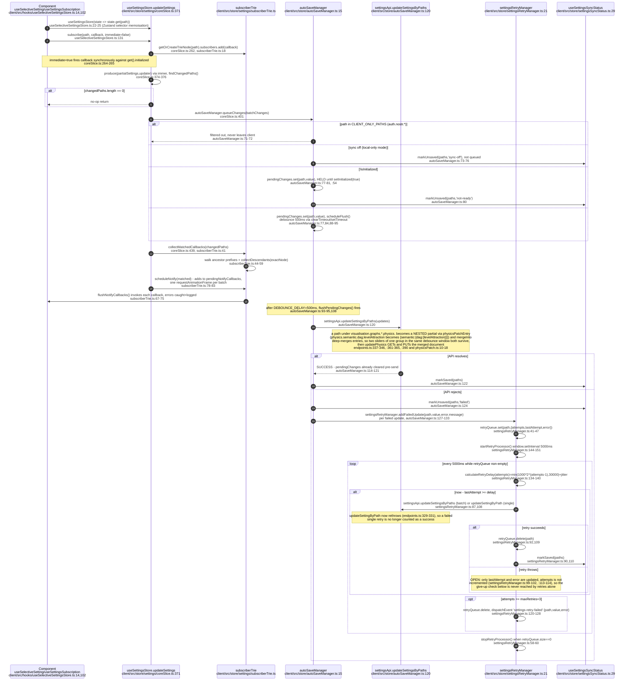
## VC-30.5 WebSocketRegistry and WebSocketEventBus fan-out across three sockets
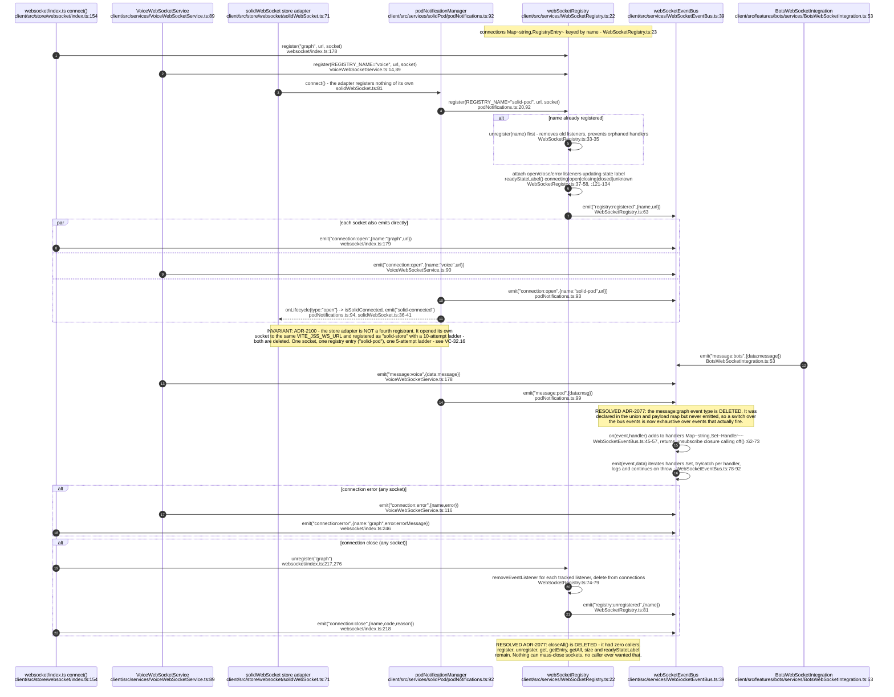
## VC-30.6 platformManager — UA sniff, XR capability probe, event dispatch
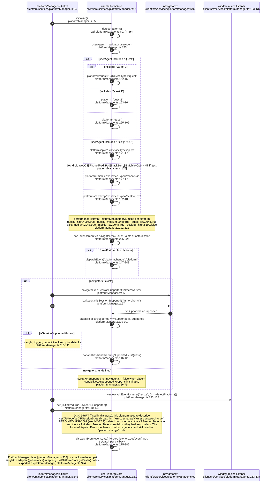
## VC-30.7 remoteLogger — console interception, buffering, batch POST, failure path
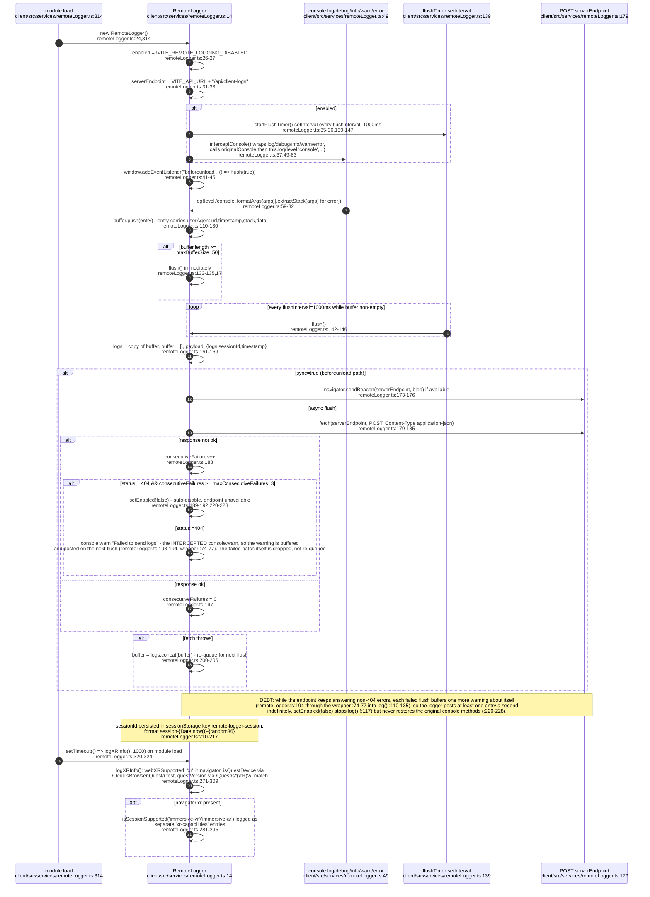
## VC-30.8 api layer — two parallel HTTP stacks and their interceptor chains
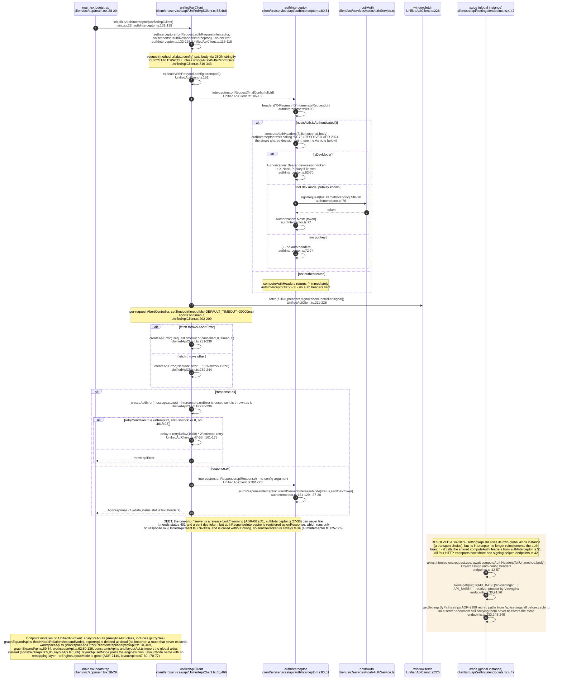
**Drift (retiredPaths comment vs code):** `retiredPaths.ts:11-12` places the server-load strip in the settings store and on a `/visual` response; it runs in `getSettingsByPaths` on `/api/settings/all` (`endpoints.ts:243-247`).
**Invariant:** every settings load goes through `getSettingsByPaths` (`coreSlice.ts:103`, `coreSlice.ts:284`, `persistenceSlice.ts:116`), so a retired path cannot reach the store from the server (`endpoints.ts:247`).

## VC-30.9 graphDataManager — fetchInitialData, setGraphData, id maps, cache
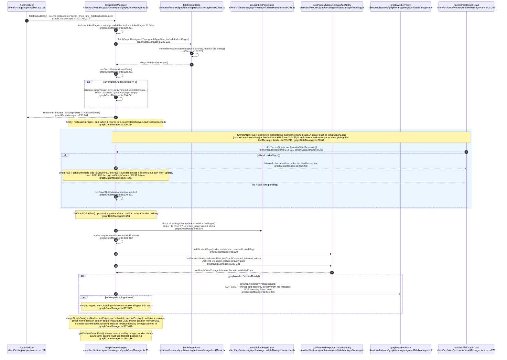
## VC-30.10 graphDataManager binary path and the dataWithPositions forwarding invariant
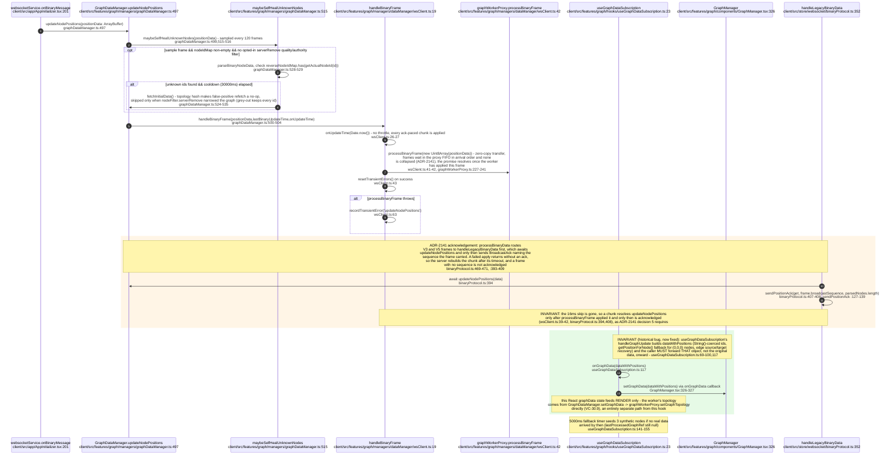
**Debt (loose end):** with the 16 ms throttle gone, `handleBinaryFrame` keeps an unused `_lastUpdateTime` parameter (`wsClient.ts:21`) and `updateNodePositions` still passes `lastBinaryUpdateTime` into it (`graphDataManager.ts:502`).

## VC-30.11 graph worker handoff — proxy init, SAB-vs-Comlink capability, dispose
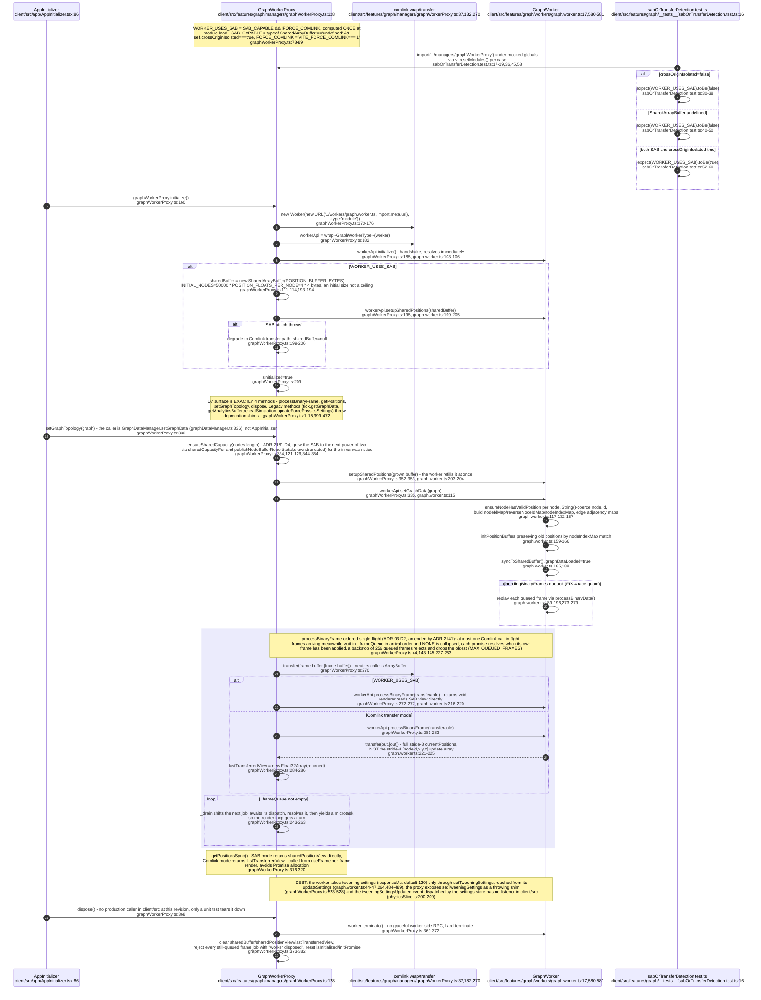
## VC-30.12 Store to component dependency graph
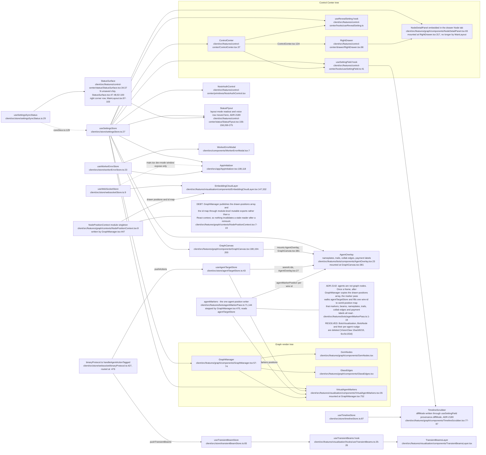
## VC-30.13 Settings load precedence and where an unsaved change surfaces
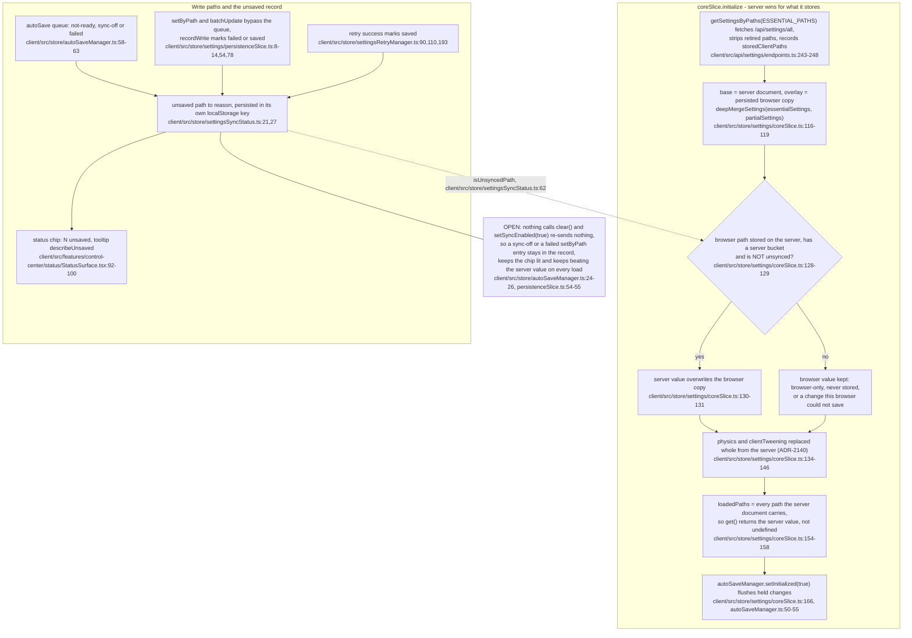
**What it shows:** the load rule since the settings-integrity fix (`7cde2f00c`): the server document is the base, and for any path the server actually stores its value replaces this browser's copy unless the record of unsaved changes holds that path (`coreSlice.ts:128-131`). Every write path that can lose a change now feeds one persisted record, and the status chip counts it (`StatusSurface.tsx:47-48`).
**Why it is this way:** the audit found the browser copy won everywhere (F5) and changes were dropped with a debug log (F7); the fix inverted precedence and made every loss visible (`settingsSyncStatus.ts:1-11`).

**Open (risk):** a `sync-off` entry is never re-queued: `setSyncEnabled(true)` only flips the flag (`autoSaveManager.ts:24-26`), `setByPath` failures go to the record but not to the retry queue (`persistenceSlice.ts:54-55`), and the store's `clear` (`settingsSyncStatus.ts:51`) has no caller, so such a path keeps the chip lit and keeps overriding the server on every load (`coreSlice.ts:129`).
**Open (risk):** a failed retry updates only `lastAttempt` (`settingsRetryManager.ts:99-102`, `settingsRetryManager.ts:113-114`); `attempts` grows only in `addFailedUpdate` (`settingsRetryManager.ts:44`), so a path that keeps failing is retried every poll and the `settings-retry-failed` give-up (`settingsRetryManager.ts:120-128`) never fires from retries alone.
**Tension (parallel):** two write routers disagree on physics: the batch path nests `visualisation.graphs.*.physics.*` through `physicsPatchEntry` (`endpoints.ts:362-364`), while the single-path `updateSettingByPath` used by one-item retries and `setByPath` flattens it to its last segment (`endpoints.ts:303-304`), so a nested physics leaf retried alone lands at the top of the physics document.
**Open (risk):** the FPS auto-degrade writes `visualisation.sceneEffects.*` through `updateSettings` (`useFpsMonitor.ts:117-127`), which queues them into the shared visual bucket (`coreSlice.ts:401`), so one slow machine lowers effects for every viewer when `qualityGates.autoAdjust` is on (`useFpsMonitor.ts:39-41`).
**Debt (loose end):** `getSettingsByPaths` builds a per-path `result` and then returns the whole document (`endpoints.ts:253-261`), so its `paths` argument selects nothing.
**Debt (loose end):** `exportSettings` fetches the full document only when `loadedPaths.size === ESSENTIAL_PATHS.length` (`persistenceSlice.ts:112`), which no longer holds once `initialize` marks every server path loaded (`coreSlice.ts:154-158`).
**Debt (loose end):** the retired-path list cites an ephemeral scratchpad file as its source (`retiredPaths.ts:22`) rather than a tracked document.
