## For developers

The desktop graph is one R3F `Canvas` whose `GraphManager` copies the worker's shared positions once a frame and feeds two edge renderers, two node renderers and one label path. Since 809a859 there is one desktop renderer, three's `WebGPURenderer`, which runs on its own WebGL2 backend where WebGPU is missing (VC-31.6). Every material is TSL; the WebGLRenderer branch, the GLSL twins, the EffectComposer bloom, the DOM label layer and the blend-space correction are deleted (renderer consolidation, 5d1b2d04d). The overview layer (VC-31.12) draws screen-space edge quads and pixel-sized sprites from one float position texture, with glass tubes and gems kept as close-zoom detail (VC-31.4, VC-31.14). A shader that fails on either backend now faults the layer that owns its material, labels included (VC-31.14). Two render-indexed buffers, the highlight mask and the node encoding, are the contracts every drawer reads (VC-31.13). The overview "slab" was a layout pinned to the 400-unit physics bounds, not edge overdraw (VC-31.15). The explore widgets (ADR-2185) and the camera fit (ADR-2180, VC-37) belong to other topics; the explore layer is VC-56.

## For the business

At the default view a visitor sees the whole knowledge graph as dots and fine lines, now as a round cloud rather than a crushed square. Filtering greys the rest out without removing it. Browsers without WebGPU get the same picture through a built-in fallback, not a second, older renderer. If the graph is larger than the screen can draw, or the graphics card cannot build part of the drawing, labels included, a notice says so on the canvas instead of parts disappearing quietly. Rich glass gems and tubes appear only when you zoom in.

## VC-31.1 Canvas consumers and shared child tree
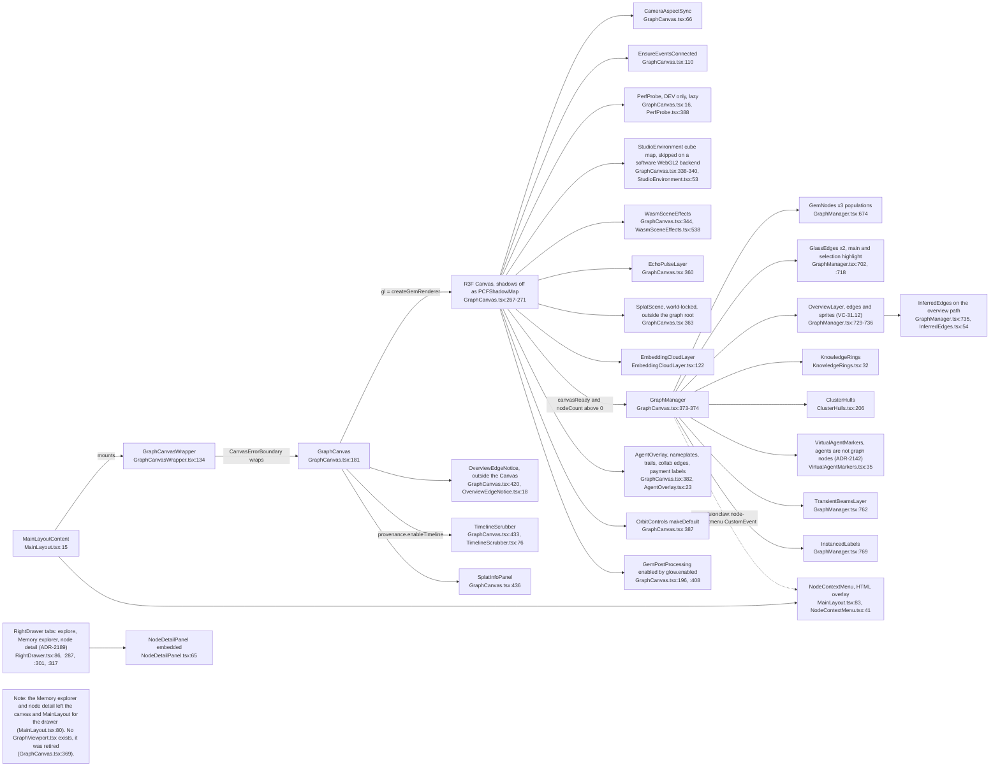

**What it shows.** Who mounts what inside and around the canvas at 809a859. **Why it is this way.** ADR-2189 moved the detail, explore and memory panels into one right-hand drawer, and ADR-2181 D4 needs an in-canvas notice outside the drawing surface. drei's `<Environment>` was replaced because its WebGL cube target fails on the WebGL2 backend (`StudioEnvironment.tsx:6-10`).

**Open (risk):** `StudioEnvironment` was verified only on the WebGL2 backend; the renderer lane had no WebGPU adapter, so the cube-map path on real WebGPU (`StudioEnvironment.tsx:63-69`) is unobserved.

## VC-31.2 GraphManager per-frame hot loop (priority -2) and the edge pass (-0.5)
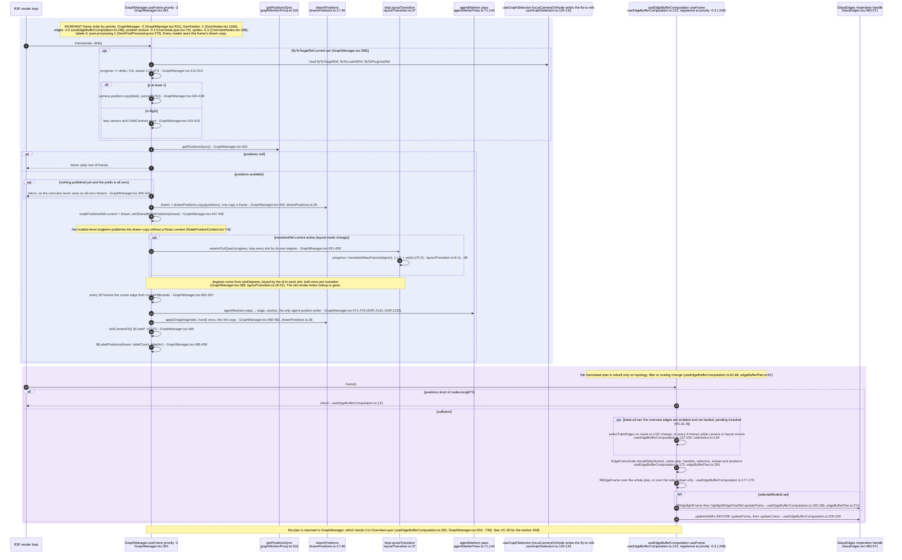

**What it shows.** One frame of the CPU side: drawn copy, layout transition, agent markers, drag, then the edge pass that feeds either every edge or only the tube subset. **Why it is this way.** One copy of the shared buffer per frame keeps every drawer on the same positions (ADR-2135, ADR-2142). ADR-2181 D3 makes tubes a close-zoom subset whose CPU cost scales with the tube budget, not the edge count. The transition mass now follows the node in each slot (a2ecefdb0), and the unread label tick and frustum are deleted.

## VC-31.3 Labels: priority budget, one glyph path, a labels fault
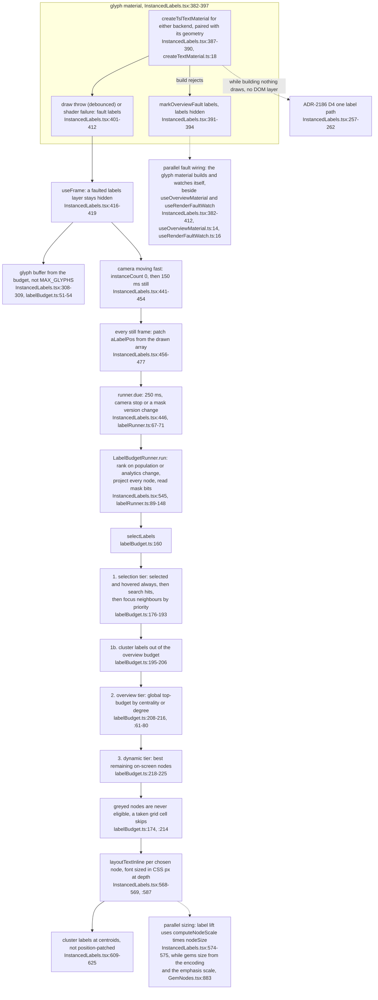

**What it shows.** The label pipeline after ADR-2186 and the renderer consolidation: one importance-ranked budget, refreshed about 4 times a second, drawn as glyph quads with one TSL material on both backends; a failed build or draw becomes a `labels` fault on the canvas notice. **Why it is this way.** Proximity labels crowded the overview, and a fixed budget ranked by centrality (ADR-2186 D1-D2) keeps the count and the glyph buffer bounded. With one renderer the DOM fallback had no job left, so ADR-2186 D4's single label path now holds.

**Debt (parallel):** labels are lifted by `computeNodeScale × nodeSize` (`InstancedLabels.tsx:574-575`), but gems are sized from the encoding and the emphasis scale (`GemNodes.tsx:883`), so a label sits wrong on a size-by column or an emphasised node.

**Debt (parallel):** the glyph material builds, pairs and fault-watches itself (`InstancedLabels.tsx:382-412`), a hand copy of `useOverviewMaterial` (`useOverviewMaterial.ts:14-46`) and `useRenderFaultWatch` (`useRenderFaultWatch.ts:16-33`); `buildFault` says it serves "the glyph material" (`overviewLive.ts:77`), yet the labels call `markOverviewFault` directly (`InstancedLabels.tsx:394`).

**Drift:** the comment at `InstancedLabels.tsx:377-379` still says WebGL uses "the GLSL one at once" and that "the DOM fallback takes over"; neither exists at 809a859 (`InstancedLabels.tsx:257-262`, `:387`).

## VC-31.4 GlassEdges instancing, now the close-zoom tube LOD
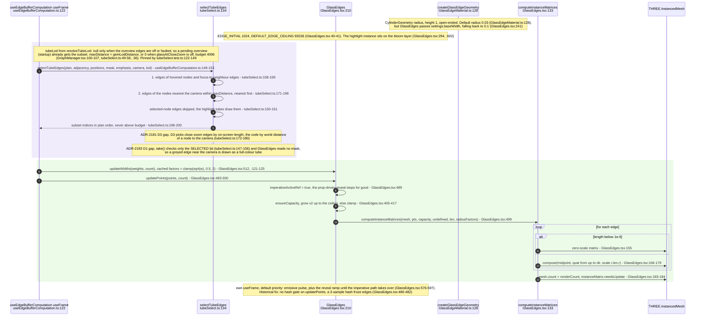

**What it shows.** How tubes are chosen and instanced once the overview edges are live. **Why it is this way.** ADR-2181 D3 demotes world-space tubes, which were sub-pixel at fit and capped at 65,536, to close-zoom detail within a 4,096 budget.

**Tension (ADR-2181 D3 vs code):** D3 picks close-zoom tubes by on-screen edge length. The code picks the edges of nodes within `gemLodDistance` world units of the camera (`tubeSelect.ts:172-180`, `GraphManager.tsx:106`).

**Tension (ADR-2183 D1 vs code):** the tube subset skips only SELECTED edges (`tubeSelect.ts:147-156`), and `GlassEdges` reads no mask, so at close zoom a greyed edge near the camera is drawn as a full-colour tube over its greyed overview line.

## VC-31.5 Node geometries, materials, LOD and colour order per population
```mermaid
classDiagram
    class GemNodes {
        GemNodes.tsx:201 GemNodesInner
        GemNodes.tsx:326 capacity nextPowerOf2 of max nodes 4096
        GemNodes.tsx:484-490 getOverviewSource for the sprites
        GemNodes.tsx:947 gem LOD only for the sprite population (props.spriteMode, chosen by size) while sprites are live
        GemNodes.tsx:1057 a non-LOD gem gets scale 0
    }
    class GemLod {
        gemLod.ts:80 selectGemLod
        gemLod.ts:12 GEM_BUDGET 4096, nearest within gemLodDistance
        GemNodes.tsx:970 selected and hovered are forced
    }
    class ColourPass {
        GemNodes.tsx:913 computeColor, knowledge from the encoding at GemNodes.tsx:183-186
        GemNodes.tsx:914-918 timeline tint
        GemNodes.tsx:922-923 highlightVisualFor grey or emphasis
        GemNodes.tsx:928-930 heat brighten, then setColorAt
        GemNodes.tsx:1151-1161 2 Hz heat repaint from the cached base
    }
    class GemGeometry {
        GemNodeMaterial.ts:269 createGemGeometry
        THREE.IcosahedronGeometry radius 0.5 detail 1, knowledge
    }
    class CrystalOrbGeometry {
        CrystalOrbMaterial.ts:161 createCrystalOrbGeometry
        THREE.IcosahedronGeometry radius 0.5 detail 1, ontology
    }
    class AgentCapsuleGeometry {
        AgentCapsuleMaterial.ts:179 createAgentCapsuleGeometry
        THREE.CapsuleGeometry radius 0.3 length 0.6, agent
    }
    class GemNodeMaterial {
        GemNodeMaterial.ts:38 createGemNodeMaterial
        MeshStandardMaterial, TSL emissive and opacity on WebGPU only
    }
    class CrystalOrbMaterial {
        CrystalOrbMaterial.ts:35 createCrystalOrbMaterial
    }
    class AgentCapsuleMaterial {
        AgentCapsuleMaterial.ts:35 createAgentCapsuleMaterial
        AgentCapsuleMaterial.ts:76 createTslAgentCapsuleMaterial
        AgentCapsuleMaterial.ts:161-163 activity below 0.1 fades alpha to 0.3
    }
    class AgentStatusActivity {
        agentVisualConstants.ts:96-104 AGENT_STATUS_ACTIVITY table
        agentVisualConstants.ts:107 agentStatusActivity
        GemNodes.tsx:1131 packed into meta.w for agents only
    }
    GemNodes ..> GemLod : knowledge only
    GemNodes ..> ColourPass : on colour hash change
    GemNodes ..> GemGeometry : dominant knowledge
    GemNodes ..> CrystalOrbGeometry : dominant ontology
    GemNodes ..> AgentCapsuleGeometry : dominant agent
    GemGeometry --> GemNodeMaterial : paired
    CrystalOrbGeometry --> CrystalOrbMaterial : paired
    AgentCapsuleGeometry --> AgentCapsuleMaterial : paired
    GemNodes ..> AgentStatusActivity : meta.w
    AgentCapsuleMaterial ..> AgentStatusActivity : done fade
    note for ColourPass "ADR-2183 D3 gap: heat brightens<br/>after the grey-out, so a greyed node an agent<br/>touches lights up again, and the sprites copy<br/>these colours (OverviewNodes.tsx:149)"
    note for AgentStatusActivity "DRIFT: AgentCapsuleMaterial.ts:159-160 says a done<br/>agent has no recent work-target beam, but only<br/>offline (0.0) falls below the 0.1 threshold"
```

**What it shows.** The three populations' meshes and the colour pass's order: encoding, timeline, highlight, heat. **Why it is this way.** ADR-2182 D2 keeps the gem look as close-zoom detail for knowledge nodes only, and ADR-2184 D4 moves the knowledge base colour into the shared encoding.

**Tension (ADR-2183 D3 vs code):** greyed nodes get no glow, yet attention heat is applied after the grey-out (`GemNodes.tsx:928-930`, `:1151-1161`), so a greyed node an agent touches brightens, and the sprites copy that colour (`OverviewNodes.tsx:149`).

## VC-31.6 One renderer: WebGPURenderer, its WebGL2 fallback, the guards and bloom scope
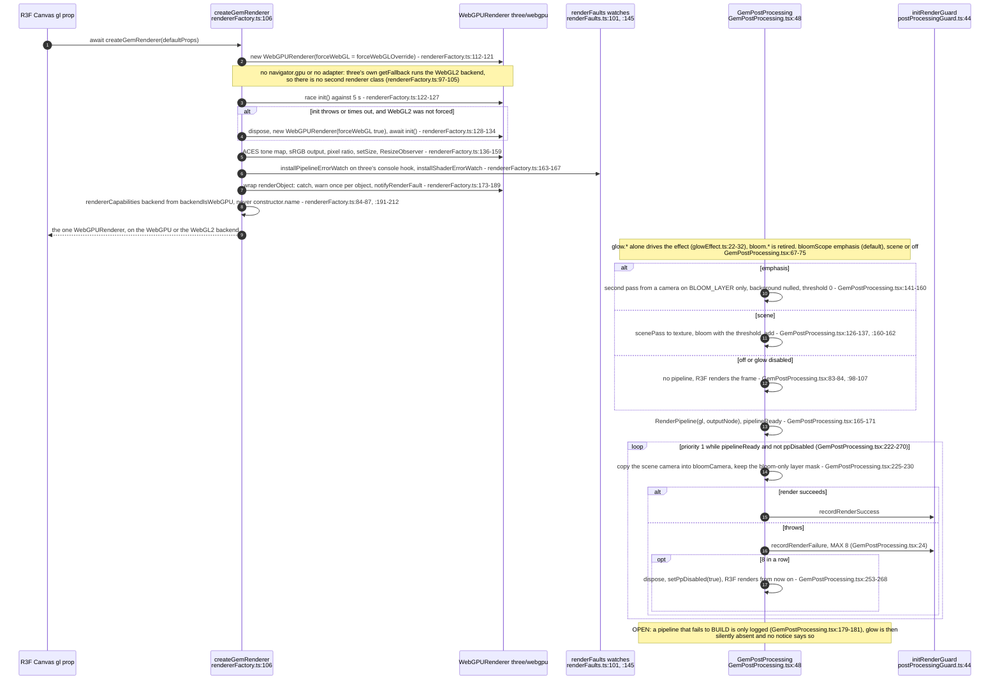

**What it shows.** One renderer class for the desktop, with three's WebGL2 backend as the fallback, the two failure watches installed for both backends, and glow limited to the bloom layer by default. **Why it is this way.** The operator chose WebGPURenderer only (renderer consolidation, 5d1b2d04d; ADR-2181/2182 implementation notes): every material is TSL, so the WebGL2 backend draws the same scene and the GLSL twins could go. ADR-2182 D4 keeps selective bloom on `BLOOM_LAYER` (`bloomLayer.ts:13`), and ADR-2181 D4 requires the renderObject guard to report faults.

**Tension (parallel):** RESOLVED at visionclaw 46edc196 — the two readers of `glow.enabled` now agree: `GraphCanvas.tsx:196` treats a missing value as on (`!== false`) and `glowEffect.ts:25-27` applies the same rule, so the AND at `GemPostProcessing.tsx:84` no longer lets one default silence the other.

**Open (risk):** `installShaderErrorWatch` patches three's private `backend.createRenderPipeline` and reads `backend.get(...).programGPU` (`renderFaults.ts:148-163`). If a three upgrade renames either, the guard at `:148` turns the watch into a silent no-op, and WebGL2 link failures stop faulting their layer.

**Open (risk):** the WebGL2 retry after a failed WebGPU init is not itself guarded (`rendererFactory.ts:132-133`), and a forced-WebGL init failure rethrows (`:129`); either reaches the canvas error boundary rather than a notice.

## VC-31.7 Text rendering: one glyph atlas, one TSL material
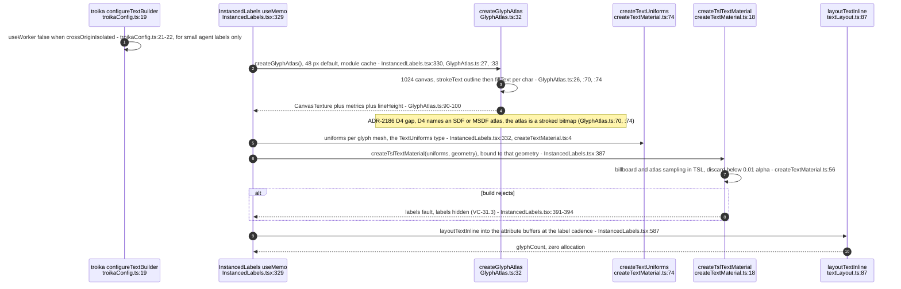

**What it shows.** The glyph atlas and the single TSL glyph material, which WebGPURenderer compiles to WGSL or, on its WebGL2 backend, to GLSL. **Why it is this way.** ADR-2186 D4 asks for one label path. With one renderer the hand-kept GLSL twin was deleted (5d1b2d04d), so only the TSL material remains.

**Tension (ADR-2186 D4 vs code):** D4 specifies an SDF or MSDF atlas, but the atlas is a stroked bitmap raster (`GlyphAtlas.ts:70`, `:74`), so glyphs soften when scaled.

## VC-31.8 WASM scene-effects zero-copy -- init, tick, view rebuild, dispose
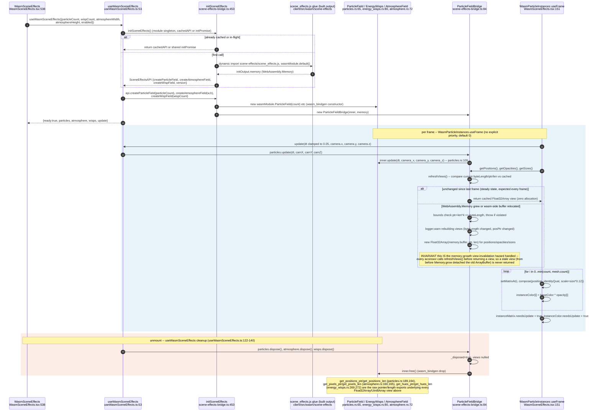

**What it shows.** WASM particles, wisps and atmosphere are read through zero-copy views that rebuild when WebAssembly memory grows. **Why it is this way.** Copying them every frame was avoidable. Rebuilding the views on every growth stops a detached `ArrayBuffer` from ever being read. The sources are unchanged since the last stamp.

## VC-31.9 Transient agent-action beam -- store event to expiry

**What it shows.** An agent-action event, from the 0x23 frame through the store to a fading beam. **Why it is this way.** A beam starts at the drawn agent marker, which is the only agent position (ADR-2142). A bounded FIFO and a 400 ms floor keep bursts cheap.

## VC-31.10 Frame budget instrumentation -- FPS auto-degrade and PerfProbe

**What it shows.** The FPS auto-degrade ladder and the opt-in DEV PerfProbe. **Why it is this way.** Scene effects are the first thing shed under load. The probe runs first in every frame so it can time the rest.

## VC-31.11 Agent marker pass, a purely visual position over the drawn node positions

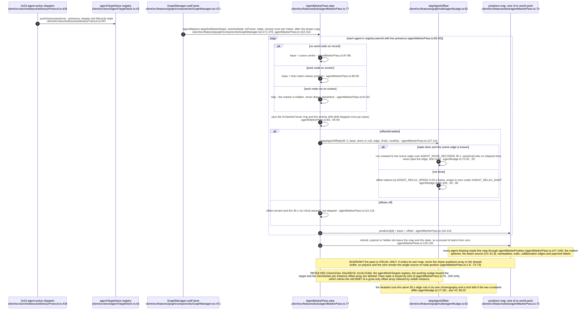

**What it shows.** The visual-only agent marker pass over the drawn positions. **Why it is this way.** Agents are not graph nodes (ADR-2142). The pass writes its own map and never the physics buffer.

## VC-31.12 Overview layer: one GPU node source for edges and sprites
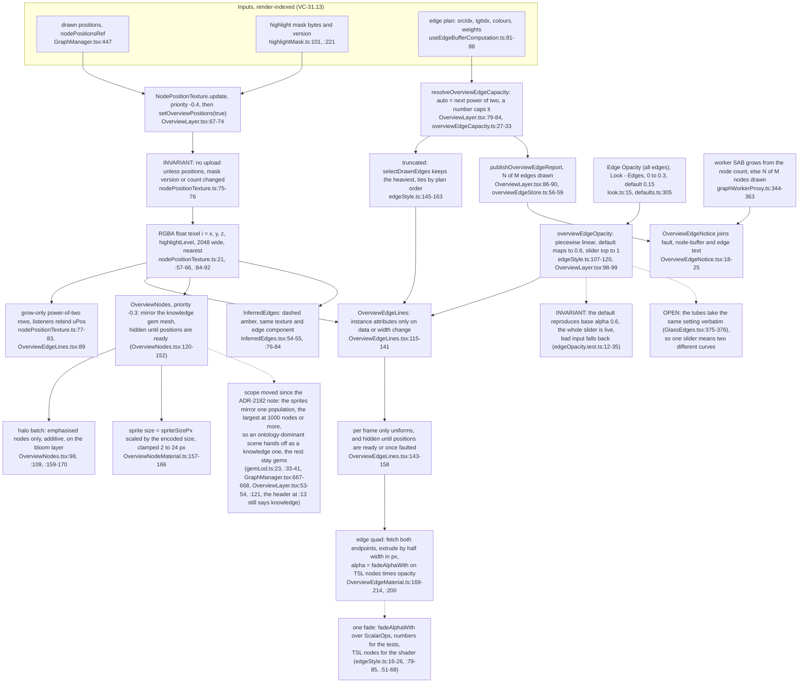

**What it shows.** How the screen-space overview gets its endpoints and centres from one texture refilled only on change, how one Edge Opacity setting maps onto the line alpha, and how capacity limits become a visible notice. **Why it is this way.** ADR-2181 D1/D4 and ADR-2182 D1/D5 ask for no per-edge CPU loop, no per-node work on a settled graph and no silent truncation. The renderer consolidation left one TSL material per layer and one length fade (`edgeStyle.ts:1-10`); the scene blends in linear space on both backends, so the grey-out alpha is used as set (`OverviewLayer.tsx:93-95`).

**Invariant:** the overview meshes stay hidden until real positions reach the texture (`overviewLive.ts:17-20`, `OverviewEdgeLines.tsx:146`, `OverviewNodes.tsx:123-125`), and GraphManager publishes `nodePositionsRef` only once the stream has non-zero positions (`GraphManager.tsx:436-442`), so the sprites never collapse onto the origin while the gems are hidden.

**Open (risk):** `setOverviewPositions(true)` runs every frame once `nodePositionsRef` is set (`OverviewLayer.tsx:67-73`), relying on GraphManager's first-frame all-zero check (`GraphManager.tsx:436-442`); that check runs only while nothing is published, so a later all-zero buffer (a reset stream) still counts as ready.

## VC-31.13 Highlight mask and node encoding: the render-index contracts
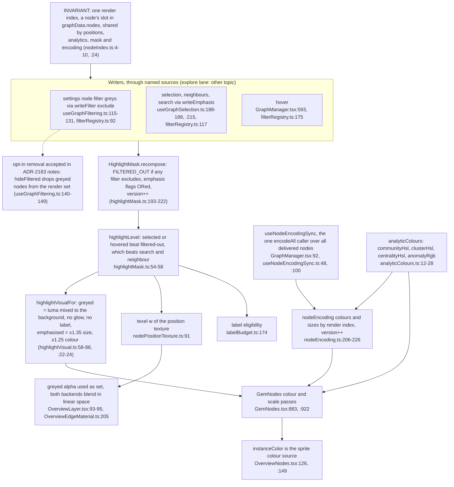

**What it shows.** The two render-indexed buffers that every drawer reads, who writes them, and how a highlight bit becomes a look. The analytic colour formulas now live once, in `analyticColours.ts`, read by the encoding for knowledge nodes (`nodeEncoding.ts:36`, `:91-100`) and by GemNodes for ontology and agent nodes (`GemNodes.tsx:36`, `:529-540`). **Why it is this way.** ADR-2183 D1-D3 has filters grey nodes out through one combinator instead of removing them, and ADR-2184 D4 makes the encoding the single source of the knowledge base colour, so sprites, gems and labels agree. The blend-space correction went with the WebGLRenderer, its only cause (5d1b2d04d).

## VC-31.14 Overview-live gating and the GPU fault fallback
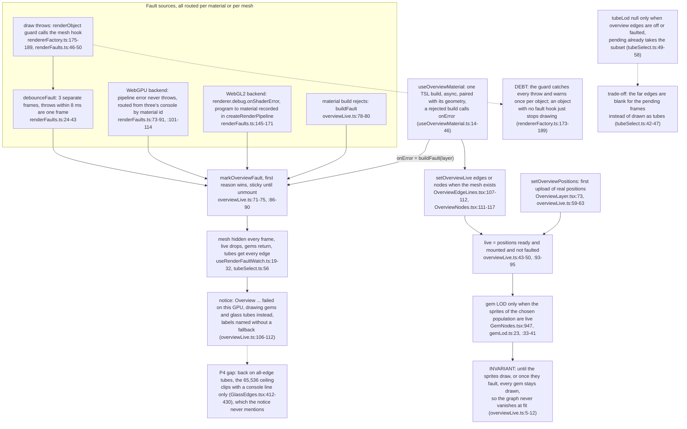

**What it shows.** An overview layer counts as live only once its material has built, real positions are in the texture and no fault has been seen. A throw, a WebGPU pipeline error, a WebGL2 link failure or a rejected build hands the frame back to gems and tubes, and the canvas notice says so; the labels layer reports the same way with no fallback. **Why it is this way.** ADR-2181 D4 rules out a silent skip. Pipeline and program failures never throw on either backend (`renderFaults.ts:52-71`), so the fallback listens to three's console and its shader-error hook as well as wrapping `renderObject`. The tube trigger stopped waiting for "live" because feeding every edge during startup grew `GlassEdges` to its ceiling (`tubeSelect.ts:38-48`, f3738825c).

**Tension (ADR-2179 P4 vs fallback):** after a fault the tubes carry every edge again, and above the 65,536 ceiling they clip with only a console line (`GlassEdges.tsx:412-430`). The canvas notice reports the fault but not that clip (`overviewLive.ts:106-112`).

**Debt (loose end):** only meshes that set a fault hook are protected; any other object whose draw throws is skipped every frame after one console warning (`rendererFactory.ts:174-186`, `renderFaults.ts:46-48`). The renderer lane records this as the remaining part of the old fault gap.

## VC-31.15 The overview "slab": overdraw model, boundary-pinned layout, empty line draws
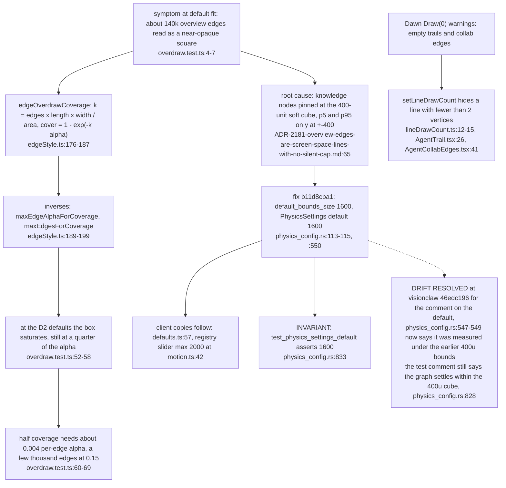

**What it shows.** Two explanations of the overview "slab" side by side: an overdraw planning model that says the default alpha saturates a dense fit box, and the measured root cause, a layout crushed against the 400-unit physics bounds; plus the empty-line fix from the same WebGPU fault lane. **Why it is this way.** The overdraw model is a planning tool for the D2/D4 thresholds, not a renderer path (`edgeStyle.ts:180-181`). The real-WebGPU check found the slab survived an edge alpha of 0.05 and that the nodes themselves formed the square, so the bounds default was raised (b11d8cba1; `ADR-2181-overview-edges-are-screen-space-lines-with-no-silent-cap.md:65`).

**Tension (ADR-2181 D2 vs code, resolved):** the slab at default fit was read as a D2 alpha failure, but it was a boundary-pinned layout; `default_bounds_size` went from 400 to 1600 (`physics_config.rs:113-115`, `:550`), with the ADR-2181 note recording "check the position quantiles before touching edge alpha" (`ADR-2181-overview-edges-are-screen-space-lines-with-no-silent-cap.md:65`).

**Tension (overdraw test vs ADR-2181 note):** `overdraw.test.ts:52` names its case "the slab is overdraw, on any backend", while the ADR note says the slab was the nodes crushed into the cube (`ADR-2181-overview-edges-are-screen-space-lines-with-no-silent-cap.md:65`).

**Debt (parallel):** the bounds default is written four times, `default_bounds_size` (`physics_config.rs:113-115`), the `PhysicsSettings` literal (`:550`), the client defaults (`defaults.ts:57`) and the registry description (`motion.ts:42`); only the Rust test pins one (`physics_config.rs:833`).

**Drift:** RESOLVED at visionclaw 46edc196 for the comment on the default (`physics_config.rs:547-549` now says it was measured under the earlier 400u bounds), but `:828` still says the graph settles "within the ~400u soft-cube bounds", beside the 1600 it annotates.
