## For developers

The desktop graph is one R3F `Canvas` whose `GraphManager` copies the worker's shared positions once a frame and feeds two edge renderers, two node renderers and one label path. The desktop graph-view upgrade (ADR-2179 suite, landed by 16d3bb49e) adds the overview layer (VC-31.12): a float position texture with the highlight level in `w`, screen-space edge quads and pixel-sized node sprites, with glass tubes and gems kept as close-zoom detail only while that layer is live (VC-31.14). Two render-indexed buffers, the highlight mask and the node encoding, are the contracts every drawer reads (VC-31.13). The explore widgets that write the mask (ADR-2185) and the camera fit (ADR-2180, VC-37) belong to other topics; the explore layer is VC-56. Since ec785afa9 the overview line alpha follows the one Edge Opacity setting (VC-31.12).

**Drift (BASELINE vs code):** `BASELINE-architecture.md:292` still calls the suite "proposed, not built". It lists as open gaps, by its own anchors, the 65,536 tube cap, the removal at `useGraphFiltering.ts:116` and the WebGPU DOM labels at `InstancedLabels.tsx:302-304`. At this commit `GraphManager.tsx:735-742` mounts the overview layer, and the DOM path is only a fallback (`InstancedLabels.tsx:305-307`).

## For the business

At the default view a visitor now sees the whole knowledge graph as dots and fine lines, not a grey ball. Filtering greys the rest out without removing it. If the graph is larger than the screen can draw, or the graphics card cannot run the new drawing, a notice says so on the canvas instead of parts disappearing quietly. Rich glass gems and tubes now appear only when you zoom in.

## VC-31.1 Canvas consumers and shared child tree
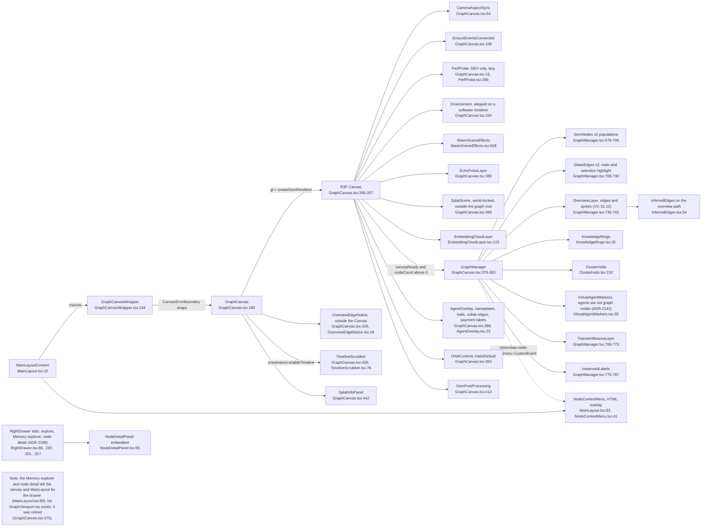

**What it shows.** Who mounts what inside and around the canvas at ec785afa9. **Why it is this way.** ADR-2189 moved the detail, explore and memory panels into one right-hand drawer, and ADR-2181 D4 needs an in-canvas notice that sits outside the WebGL surface.

## VC-31.2 GraphManager per-frame hot loop (priority -2) and the edge pass (-0.5)
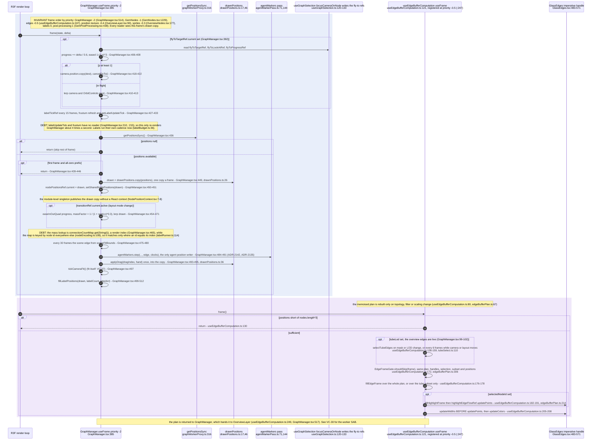

**What it shows.** One frame of the CPU side: drawn copy, agent markers, drag, then the edge pass that now feeds either every edge or only the tube subset. **Why it is this way.** One copy of the shared buffer per frame keeps every drawer on the same positions (ADR-2135, ADR-2142), and ADR-2181 D3 makes tubes a close-zoom subset whose CPU cost scales with the tube budget, not the edge count.

## VC-31.3 Labels: priority budget, one glyph path, DOM fallback
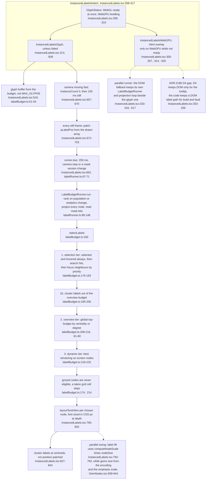

**What it shows.** The label pipeline after ADR-2186: one importance-ranked budget, refreshed about 4 times a second, drawn as glyph quads on both renderers. **Why it is this way.** Proximity labels crowded the overview; a fixed budget ranked by centrality (ADR-2186 D1-D2) keeps the count and the glyph buffer bounded, and the DOM layer survives only as the WebGPU safety net.

**Tension (ADR-2186 D4 vs code):** D4 keeps the DOM `<Html>` only for the node tooltip, but the code keeps a whole DOM label layer as the WebGPU build and fault fallback (`InstancedLabels.tsx:253-259`, `:305-307`).

**Debt (parallel):** the DOM fallback has its own `LabelBudgetRunner` and projection loop beside the glyph one (`InstancedLabels.tsx:333-334`, `:517`).

**Debt (parallel):** labels are lifted by `computeNodeScale × nodeSize` (`InstancedLabels.tsx:792-793`), but gems are sized from the encoding and the emphasis scale (`GemNodes.tsx:939-944`), so a label sits wrong on a size-by column or an emphasised node.

## VC-31.4 GlassEdges instancing, now the close-zoom tube LOD
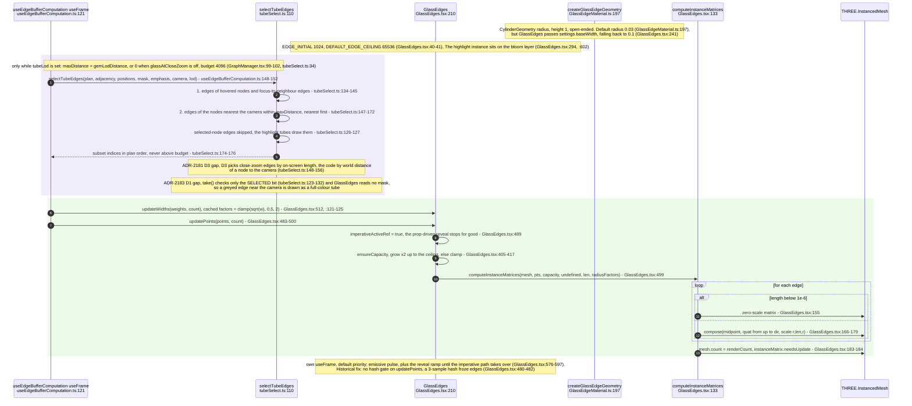

**What it shows.** How tubes are chosen and instanced once the overview edges are live. **Why it is this way.** ADR-2181 D3 demotes world-space tubes, which were sub-pixel at fit and capped at 65,536, to close-zoom detail within a 4,096 budget.

**Tension (ADR-2181 D3 vs code):** D3 picks close-zoom tubes by on-screen edge length. The code picks the edges of nodes within `gemLodDistance` world units of the camera (`tubeSelect.ts:148-156`, `GraphManager.tsx:101`).

**Tension (ADR-2183 D1 vs code):** the tube subset skips only SELECTED edges (`tubeSelect.ts:123-132`), and `GlassEdges` reads no mask, so at close zoom a greyed edge near the camera is drawn as a full-colour tube over its greyed overview line.

## VC-31.5 Node geometries, materials, LOD and colour order per population
```mermaid
classDiagram
    class GemNodes {
        GemNodes.tsx:196 GemNodesInner
        GemNodes.tsx:330 capacity nextPowerOf2 of max nodes 4096
        GemNodes.tsx:524-530 getOverviewSource for the sprites
        GemNodes.tsx:1006 gem LOD only for knowledge while sprites are live
        GemNodes.tsx:1116 a non-LOD gem gets scale 0
    }
    class GemLod {
        gemLod.ts:51 selectGemLod
        gemLod.ts:12 GEM_BUDGET 4096, nearest within gemLodDistance
        GemNodes.tsx:1029 selected and hovered are forced
    }
    class ColourPass {
        GemNodes.tsx:974 computeColor, knowledge from the encoding at GemNodes.tsx:178-181
        GemNodes.tsx:975-979 timeline tint
        GemNodes.tsx:983-984 highlightVisualFor grey or emphasis
        GemNodes.tsx:989-991 heat brighten, then setColorAt
        GemNodes.tsx:1214-1224 2 Hz heat repaint from the cached base
    }
    class GemGeometry {
        GemNodeMaterial.ts:278 createGemGeometry
        THREE.IcosahedronGeometry radius 0.5 detail 1, knowledge
    }
    class CrystalOrbGeometry {
        CrystalOrbMaterial.ts:165 createCrystalOrbGeometry
        THREE.IcosahedronGeometry radius 0.5 detail 1, ontology
    }
    class AgentCapsuleGeometry {
        AgentCapsuleMaterial.ts:183 createAgentCapsuleGeometry
        THREE.CapsuleGeometry radius 0.3 length 0.6, agent
    }
    class GemNodeMaterial {
        GemNodeMaterial.ts:39 createGemNodeMaterial
        MeshStandardMaterial, TSL emissive and opacity on WebGPU only
    }
    class CrystalOrbMaterial {
        CrystalOrbMaterial.ts:36 createCrystalOrbMaterial
    }
    class AgentCapsuleMaterial {
        AgentCapsuleMaterial.ts:36 createAgentCapsuleMaterial
        AgentCapsuleMaterial.ts:78 createTslAgentCapsuleMaterial
        AgentCapsuleMaterial.ts:165-167 activity below 0.1 fades alpha to 0.3
    }
    class AgentStatusActivity {
        agentVisualConstants.ts:96-104 AGENT_STATUS_ACTIVITY table
        agentVisualConstants.ts:107 agentStatusActivity
        GemNodes.tsx:1190 packed into meta.w for agents only
    }
    GemNodes ..> GemLod : knowledge only
    GemNodes ..> ColourPass : on colour hash change
    GemNodes ..> GemGeometry : dominant knowledge
    GemNodes ..> CrystalOrbGeometry : dominant ontology
    GemNodes ..> AgentCapsuleGeometry : dominant agent
    GemGeometry --> GemNodeMaterial : paired
    CrystalOrbGeometry --> CrystalOrbMaterial : paired
    AgentCapsuleGeometry --> AgentCapsuleMaterial : paired
    GemNodes ..> AgentStatusActivity : meta.w
    AgentCapsuleMaterial ..> AgentStatusActivity : done fade
    note for ColourPass "ADR-2183 D3 gap: heat brightens<br/>after the grey-out, so a greyed node an agent<br/>touches lights up again, and the sprites copy<br/>these colours (OverviewNodes.tsx:128)"
    note for AgentStatusActivity "DRIFT: AgentCapsuleMaterial.ts:163-164 says a done<br/>agent has no recent work-target beam, but only<br/>offline (0.0) falls below the 0.1 threshold"
```

**What it shows.** The three populations' meshes and the colour pass's order: encoding, timeline, highlight, heat. **Why it is this way.** ADR-2182 D2 keeps the gem look as close-zoom detail for knowledge nodes only, and ADR-2184 D4 moves the knowledge base colour into the shared encoding.

**Tension (ADR-2183 D3 vs code):** greyed nodes get no glow, yet attention heat is applied after the grey-out (`GemNodes.tsx:989-991`, `:1214-1224`), so a greyed node an agent touches brightens, and the sprites copy that colour (`OverviewNodes.tsx:128`).

## VC-31.6 Renderer selection, render guard and bloom scope
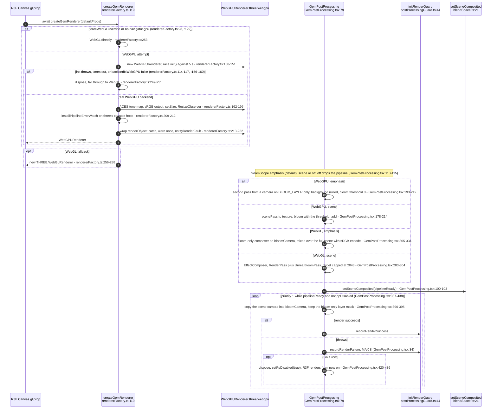

**What it shows.** How the renderer is chosen and wrapped, and how bloom now covers only the bloom layer by default. **Why it is this way.** ADR-2182 D4 restricts glow to emphasis through a selective-bloom layer (`bloomLayer.ts:13`) so that the memory cloud and dense clusters stop feeding it, and ADR-2181 D4 requires the renderObject guard to report faults instead of swallowing them.

## VC-31.7 Text rendering: one glyph atlas, two material dialects
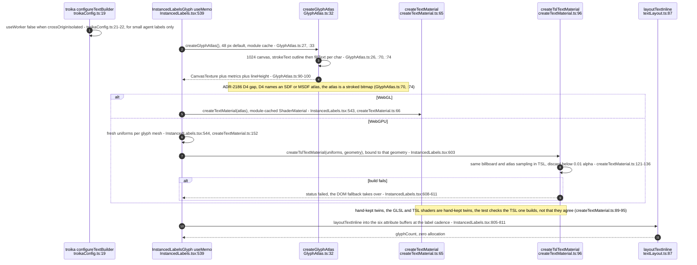

**What it shows.** The glyph atlas and the two material dialects behind the single glyph path. **Why it is this way.** ADR-2186 D4 retired the WebGPU DOM labels, so WebGPU needed a TSL twin of the GLSL glyph material.

**Tension (ADR-2186 D4 vs code):** D4 specifies an SDF or MSDF atlas, but the atlas is a stroked bitmap raster (`GlyphAtlas.ts:70`, `:74`), so glyphs soften when scaled.

**Debt (parallel):** the glyph shader exists as GLSL (`createTextMaterial.ts:65`) and as a hand-kept TSL twin (`createTextMaterial.ts:96`). Its test builds the TSL one but compares no output.

## VC-31.8 WASM scene-effects zero-copy -- init, tick, view rebuild, dispose

**What it shows.** WASM particles, wisps and atmosphere are read through zero-copy views that rebuild when WebAssembly memory grows. **Why it is this way.** Copying them every frame was avoidable. Rebuilding the views on every growth stops a detached `ArrayBuffer` from ever being read. The sources are unchanged since the last stamp.

## VC-31.9 Transient agent-action beam -- store event to expiry
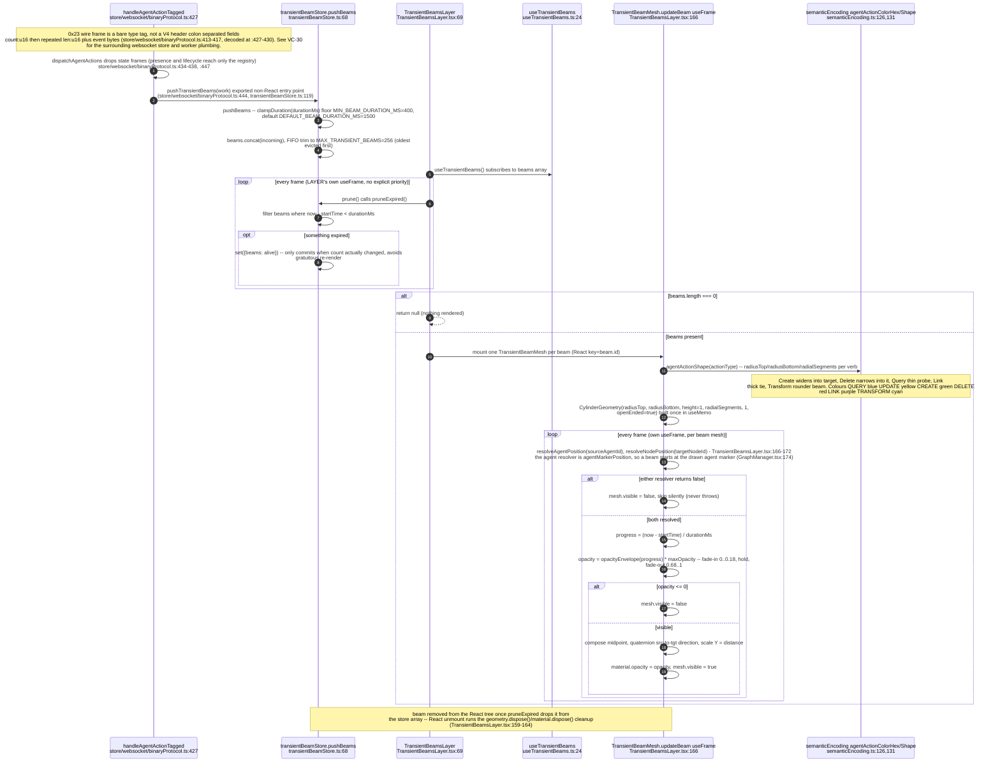

**What it shows.** An agent-action event, from the 0x23 frame through the store to a fading beam. **Why it is this way.** A beam starts at the drawn agent marker, which is the only agent position (ADR-2142). A bounded FIFO and a 400 ms floor keep bursts cheap.

## VC-31.10 Frame budget instrumentation -- FPS auto-degrade and PerfProbe
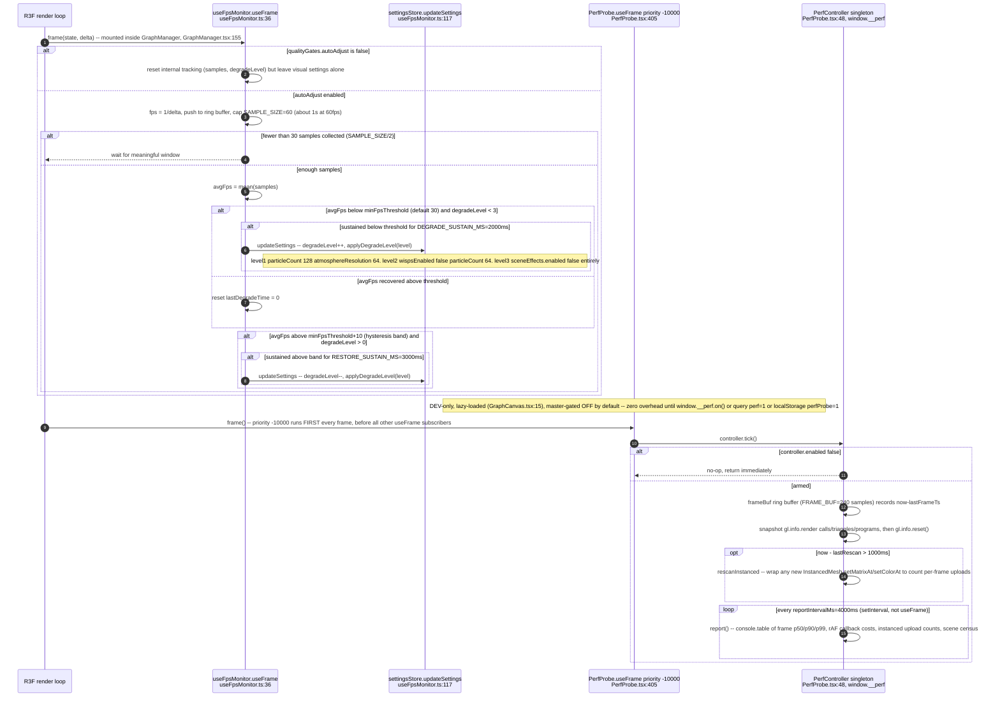

**What it shows.** The FPS auto-degrade ladder and the opt-in DEV PerfProbe. **Why it is this way.** Scene effects are the first thing shed under load. The probe runs first in every frame so it can time the rest.

## VC-31.11 Agent marker pass, a purely visual position over the drawn node positions

**What it shows.** The visual-only agent marker pass over the drawn positions. **Why it is this way.** Agents are not graph nodes (ADR-2142). The pass writes its own map and never the physics buffer.

## VC-31.12 Overview layer: one GPU node source for edges and sprites
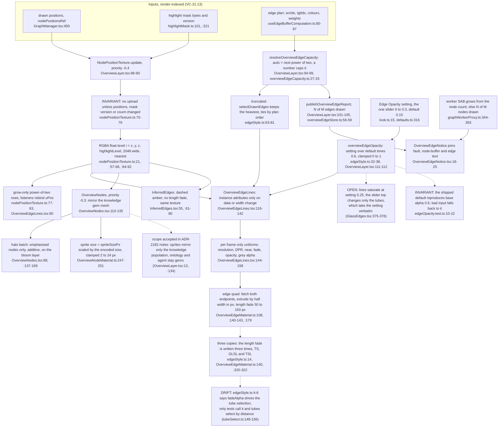

**What it shows.** How the screen-space overview gets its endpoints and centres from one texture refilled only on change, and how capacity limits become a visible notice. **Why it is this way.** ADR-2181 D1/D4 and ADR-2182 D1/D5 ask for no per-edge CPU loop, no per-node work on a settled graph and no silent truncation. `useBackendGreyoutOpacity` (`OverviewLayer.tsx:68-75`) is the single place the greyed alpha meets the blend space.

**Debt (loose end):** `OVERVIEW_EDGE_OPACITY` (`OverviewLayer.tsx:40`) survives as an alias of `OVERVIEW_EDGE_BASE_OPACITY` (`edgeStyle.ts:23`) after ec785afa9 moved the alpha onto the Edge Opacity setting (`OverviewLayer.tsx:111-112`); nothing in the client imports it.

**Debt (parallel):** the on-screen length fade is written three times: TS (`edgeStyle.ts:14`), GLSL (`OverviewEdgeMaterial.ts:140`) and TSL (`OverviewEdgeMaterial.ts:320-322`). Only the TS copy is unit-tested.

**Tension (ADR-2182 D1 vs code):** D1 names `THREE.Points` with a sized `PointsMaterial` for WebGL nodes. The code draws instanced GLSL3 quads (`OverviewNodeMaterial.ts:142`), and its test asserts "never LineSegments/Points" (`overviewMaterials.test.ts:33`). ADR-2181 records the matching edge deviation as accepted. ADR-2182 records none.

**Debt (parallel):** both overview materials are hand-written in two dialects, GLSL (`OverviewEdgeMaterial.ts:216`, `OverviewNodeMaterial.ts:142`) and TSL (`OverviewEdgeMaterial.ts:242`, `OverviewNodeMaterial.ts:158`). The tests only check that each one builds (`overviewMaterials.test.ts:1-5`), so nothing checks that the two produce the same pixels.

## VC-31.13 Highlight mask and node encoding: the render-index contracts
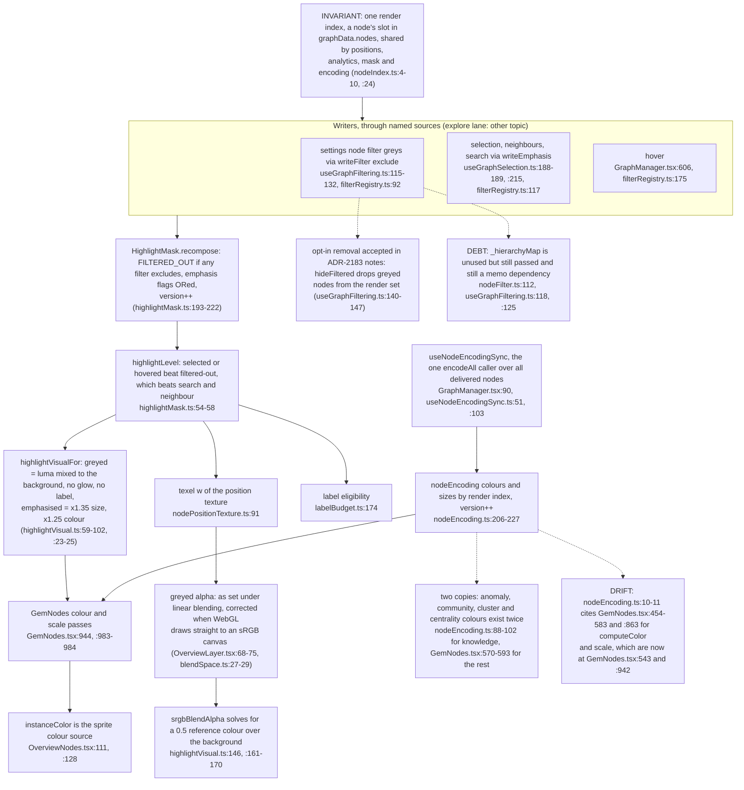

**What it shows.** The two render-indexed buffers that every drawer reads, who writes them and how a highlight bit becomes a look. **Why it is this way.** ADR-2183 D1-D3 has filters grey nodes out through one combinator instead of removing them, and ADR-2184 D4 makes the encoding the single source of the knowledge base colour, so sprites, gems and labels agree.

**Debt (parallel):** the anomaly, community, cluster and centrality colour formulas exist twice: in `nodeEncoding.ts:88-102` for knowledge nodes, and in `GemNodes.tsx:570-593` for ontology and agent nodes.

## VC-31.14 Overview-live gating and the GPU fault fallback
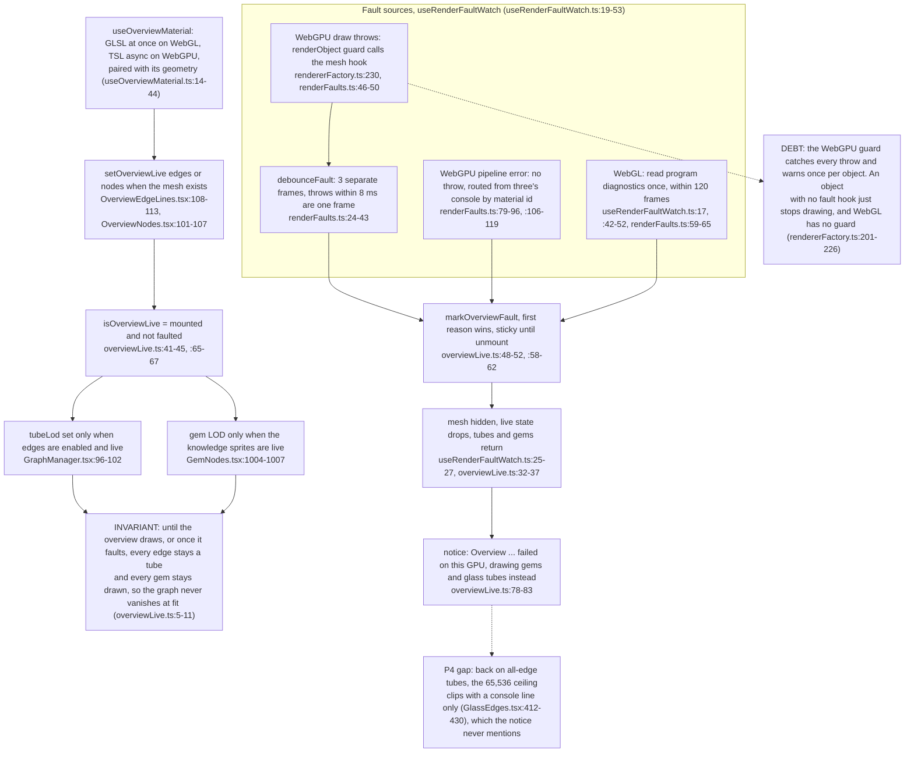

**What it shows.** The overview layers count as live only once their material has built and no fault has been seen. A throw, a pipeline error or a failed WebGL link hands the frame back to gems and tubes, and the canvas notice says so. **Why it is this way.** ADR-2181 D4 rules out a silent skip. Measured WebGPU pipeline failures log through three's console instead of throwing (`renderFaults.ts:67-76`), so the fallback has to listen there as well as wrap `renderObject`.

**Tension (ADR-2179 P4 vs fallback):** after a fault the tubes carry every edge again, and above the 65,536 ceiling they clip with only a console line (`GlassEdges.tsx:412-430`). The canvas notice reports the fault but not that clip (`overviewLive.ts:78-83`).
