## For developers

The browser keeps one `/wss` socket for everything that moves: JSON control frames (filter, drag holds, settings broadcasts, graph-change notices) and binary position frames. Since ADR-2141 the server streams position chunks per client and sends the next only after the client acknowledges the last (VC-32.12); a drag is a server-side hold, not a pin (ADR-2169, VC-32.10). At ec785afa9 the node filter gained a `serverRemove` opt-in (ADR-2183 D2): by default the quality and authority gates only grey nodes in the browser, so the client arms its shrink-guard acceptance window only when the filter can actually narrow the graph (`filterSync.ts:127-128`), matching the server's removal condition (`src/actors/client_filter.rs:28`). The `visual` settings bucket now joins the ADR-2047 broadcast (`src/settings/api/settings_routes.rs:1546`, VC-32.15).

**Debt (parallel):** the "server is removing nodes" condition `enabled && serverRemove` is restated in four places that must stay in step: the shrink-guard arm (`client/src/store/websocket/filterSync.ts:128`), the refetch re-assert (`client/src/store/websocket/textMessageHandler.ts:47`), the self-heal skip (`client/src/features/graph/managers/graphDataManager.ts:524`) and the server predicate (`src/actors/client_filter.rs:28`).

**Open (risk):** the `visual` bucket is one shared settings key (`src/settings/api/settings_routes.rs:1519`, `src/settings/api/settings_routes.rs:1528-1529`), so any signed-in user's visual write now reaches every open session live through the all-client broadcast (`src/settings/api/settings_routes.rs:454-464`); is that shared scope intended?

## For the business

Everything that changes on screen while you watch, nodes moving, someone dragging a node, a colleague changing a shared setting, arrives over one live connection. Turning on the quality filter now greys weaker pages out rather than deleting them from your view; pages are only removed when you ask for that explicitly. A change to the shared look of the graph made in one browser now shows up in every other open browser without a reload.

## VC-32.1 Connect: signed-subprotocol upgrade, dev-mode authenticate message
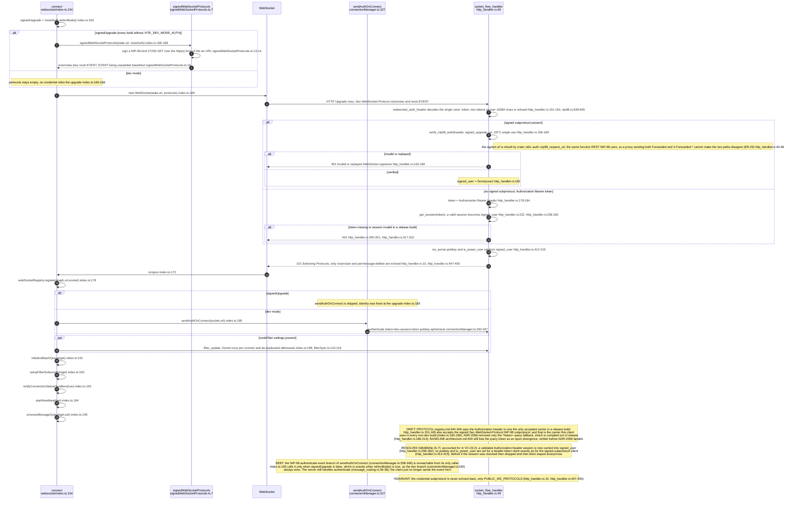
## VC-32.2 Reconnect backoff and ping/pong heartbeat (binary silence is not a failure signal)
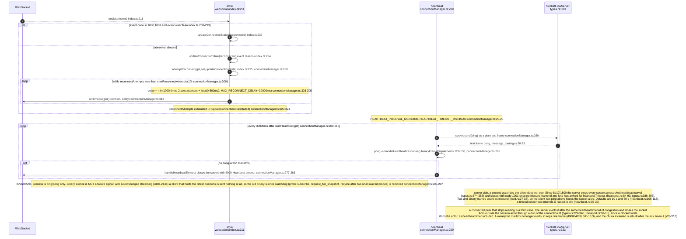
## VC-32.3 Binary frame demux: onmessage tag dispatch and the ordered frame queue
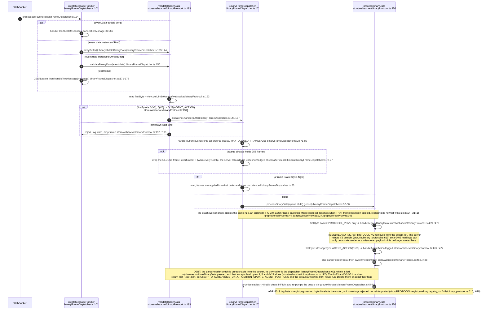
## VC-32.4 Outbound framed-message header (client-originated only)
```mermaid
classDiagram
    class FramedMessageHeader {
      +uint8 type  offset0
      +uint8 version  offset1
      +uint32 payloadLength  offset2 littleEndian
      +uint8 graphTypeFlag  offset6 GRAPH_UPDATE only
    }
    class MessageType {
      GRAPH_UPDATE 0x01
      VOICE_DATA 0x02
      POSITION_UPDATE 0x10
      AGENT_POSITIONS 0x11
      AGENT_STATE_FULL 0x20
      AGENT_ACTION 0x23
      CONTROL_BITS 0x30
      SSSP_DATA 0x31
      BROADCAST_ACK 0x34
      VOICE_CHUNK 0x40
      VOICE_START 0x41
      VOICE_END 0x42
      SYNC_UPDATE 0x50
      ANNOTATION_UPDATE 0x51
      SELECTION_UPDATE 0x52
      USER_POSITION 0x53
      VR_PRESENCE 0x54
      ERROR 0xFF
    }
    class GraphTypeFlag {
      KNOWLEDGE_GRAPH 0x00
      ONTOLOGY 0x01
    }
    class ControlFlags {
      PAUSE_UPDATES bit0
      HIGH_FREQUENCY bit1
      LOW_BANDWIDTH bit2
      VOICE_ENABLED bit3
      DEBUG_MODE bit4
      FORCE_FULL_UPDATE bit5
      USER_INTERACTING bit6
      BACKGROUND_MODE bit7
    }
    FramedMessageHeader --> MessageType : selects codec
    FramedMessageHeader --> GraphTypeFlag : graphTypeFlag field
    note for FramedMessageHeader "createMessage/parseHeader BinaryWebSocketProtocol.ts:73-116. Header size<br/>MESSAGE_HEADER_SIZE=6, GRAPH_UPDATE_HEADER_SIZE=7 (frameTypes.ts:225-226). Used<br/>only by client-to-server encoders: encodePositionUpdates, encodeAgentState,<br/>encodeSSSPData, encodeControlBits, encodeVoiceChunk, flushPositionUpdates and<br/>encodeAgentAction (BinaryWebSocketProtocol.ts:129-224, :293-295). createBroadcastAck is NOT framed:<br/>it writes a bare [0x34] then the 20-byte payload (BinaryWebSocketProtocol.ts:245-255)."
    note for FramedMessageHeader "DEBT: no client code sends a framed message. The six encode* methods have no caller in client/src<br/>outside tests, and flushPositionUpdates drains pendingPositionUpdates, which only<br/>encodePositionUpdates fills (BinaryWebSocketProtocol.ts:136, :213-216), so the flush sent on<br/>interaction end is always null (graphDataManager.ts:611-614). The envelope is dead outbound as well."
    note for MessageType "RESOLVED ADR-2078. The framed header's version byte is written from<br/>PROTOCOL_VERSION (BinaryWebSocketProtocol.ts:86), which is PROTOCOL_V3=3 (frameTypes.ts:30), and the<br/>comment above it now says so (BinaryWebSocketProtocol.ts:81-84). The old header-local PROTOCOL_V4=4 is<br/>deleted from frameTypes.ts (frameTypes.ts:33-37) so PROTOCOL_V4 now names only the delta node<br/>encoding of VC-32.5, and SUPPORTED_HEADER_VERSIONS is V3 and V5 (frameTypes.ts:39). ADR-2078 also<br/>deleted five enum members with no reference anywhere in client/src: VELOCITY_UPDATE 0x12,<br/>AGENT_STATE_DELTA 0x21, AGENT_HEALTH 0x22, HANDSHAKE 0x32 and HEARTBEAT 0x33 (frameTypes.ts:59-63)."
    note for MessageType "The enum is frameTypes.ts:65-101. The server's own MessageType has only five tags. The code comment says this client decodes<br/>AGENT_ACTION and BROADCAST_ACK from the wire (frameTypes.ts:45-57). Only AGENT_ACTION is decoded:<br/>decodeBroadcastAck (backpressure.ts:47) has no caller but its own wrapper (BinaryWebSocketProtocol.ts:260),<br/>since 0x34 travels client to server. Every other member is client-outbound only. Live position frames are unframed and<br/>lead with a bare 0x03 or 0x05 byte, so they never carry a MessageType at all."
    note for FramedMessageHeader "DOC-DRIFT. The docs/PROTOCOL-registry.md frame tag registry lists 0x03, the retired 0x04, 0x05,<br/>0x34 (client to server, no generic header), 0x23, 0x43 and 0x44 (PROTOCOL-registry.md:64-73). This<br/>client-only framed envelope and the rest of its MessageType space (0x01, 0x02, 0x10-0x54) do not<br/>appear in that registry at all."
    note for MessageType "BROADCAST_ACK 0x34 payload (encodeBroadcastAckPayload/decodeBroadcastAck<br/>backpressure.ts:18-69): BROADCAST_ACK_PAYLOAD_SIZE=20 bytes - sequenceId split<br/>low/high uint32 offset0/4, nodesReceived uint32 offset8, timestamp split<br/>low/high uint32 offset12/16, all littleEndian to avoid BigInt64<br/>(backpressure.ts:26-29,36-39). Every applied V5 chunk is acknowledged, there is no batch<br/>cadence (VC-32.8)."
    note for MessageType "SSSP_DATA 0x31 and VOICE_CHUNK 0x40 payloads (ssspVoice.ts:8-91).<br/>SSSPDataRecord: uint32 nodeId, float32 distance, uint32 parentId, uint16 flags<br/>= 14 bytes (SSSP_DATA_SIZE_V2 frameTypes.ts:230, layout ssspVoice.ts:8-21). VoiceChunkHeader: uint16<br/>agentId, uint16 chunkId, uint8 format, uint16 dataLength = 7 bytes<br/>(VOICE_HEADER_SIZE frameTypes.ts:237) then raw audioData (ssspVoice.ts:49-65). Voice agentId is<br/>uint16 (max 65535) - a wire format separate from the uint32 flag-bit node/agent<br/>id of VC-32.6, no alignment issue (ssspVoice.ts:54-56,82-84)."
```
## VC-32.5 Server-to-client position wire records: V3, V5 envelope (V4 delta retired, V2 declined)
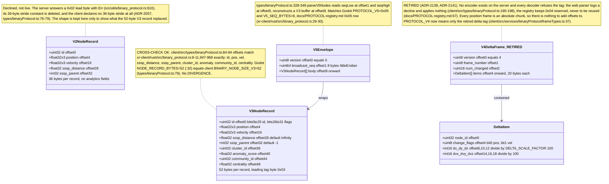
## VC-32.6 Wire node-id: type flag bits over the 26-bit id
```mermaid
classDiagram
    class WireNodeId {
      +uint32 raw  the full id as sent on the wire
      bit31 AGENT_NODE_FLAG 0x80000000
      bit30 KNOWLEDGE_NODE_FLAG 0x40000000
      bits26to28 ONTOLOGY_TYPE_MASK 0x1C000000
      bits0to25 NODE_ID_MASK 0x03FFFFFF  actual id, 0 to 67108863
    }
    class OntologySubtype {
      ONTOLOGY_CLASS_FLAG 0x04000000
      ONTOLOGY_INDIVIDUAL_FLAG 0x08000000
      ONTOLOGY_PROPERTY_FLAG 0x10000000
    }
    WireNodeId --> OntologySubtype : bits26to28 when ontology
    note for WireNodeId "INVARIANT, no DIVERGENCE. Client client/src/types/binaryProtocol.ts:96-107, Godot<br/>decoder xr-client/rust/src/binary_protocol.rs:41-47, and<br/>docs/IDENTIFIER-taxonomy.md:125-130 all agree exactly on mask and flag hex values.<br/>getActualNodeId(nodeId) is nodeId AND NODE_ID_MASK<br/>(types/binaryProtocol.ts:133-135)."
    note for WireNodeId "docs/IDENTIFIER-taxonomy.md:132-142: ids are sequential u32 from a NEXT_NODE_ID<br/>atomic counter. Every encoder branch, the untyped one included, routes through<br/>enforce_wire_id_bounds (src/utils/binary_protocol.rs:185-206): debug_assert fails fast in<br/>development (:186-193) but release does NOT truncate silently. remap_wire_id masks the id into<br/>26 bits and an error! log names the class and both ids (:194-204, ADR-2024). The masked id<br/>still aliases another node, so an over-range id is loud, not harmless."
    note for WireNodeId "INVARIANT (2026-09-08, 6c47b9833): an id that ALREADY carries a recognised<br/>class pattern is forwarded unchanged by the encoder's last branch. Running the 26-bit<br/>bound check on a stamped id panicked every broadcast in debug builds - each XR client<br/>saw a 2 s connection-reset loop - and would have stripped the class flag in release<br/>(src/utils/binary_protocol.rs:475-484). Only a high bit that is NOT a class<br/>pattern is still an overflow, handled by the untyped branch (src/utils/binary_protocol.rs:490)."
    note for WireNodeId "DRIFT: the comment at src/utils/binary_protocol.rs:476-480 still says position_updates.rs and<br/>actor_messages.rs stamp the flag themselves. Neither does at this revision: the stamping<br/>requestSwarmTelemetry handler was removed (ADR-2142, message_routing.rs:11-13), and the one live<br/>position encoder passes real class sets (client_coordinator_actor.rs:650-661). The branch is now defensive."
```
## VC-32.7 getNodeType(): flag precedence decision order
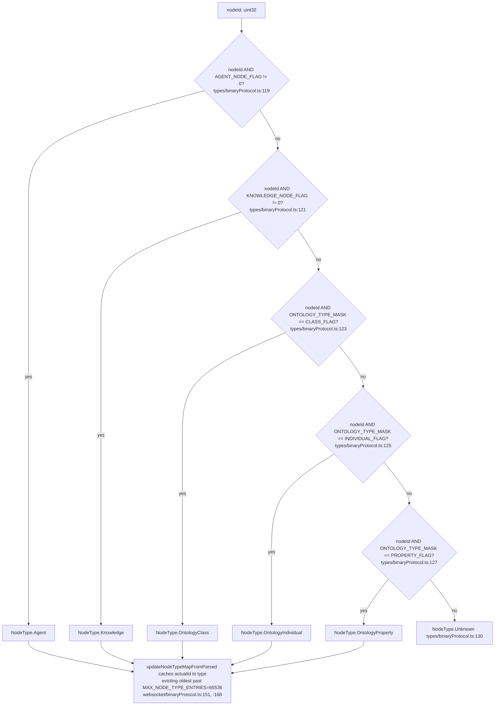
## VC-32.8 Live position frame processing: parse, analytics ingest, apply, then acknowledge the chunk
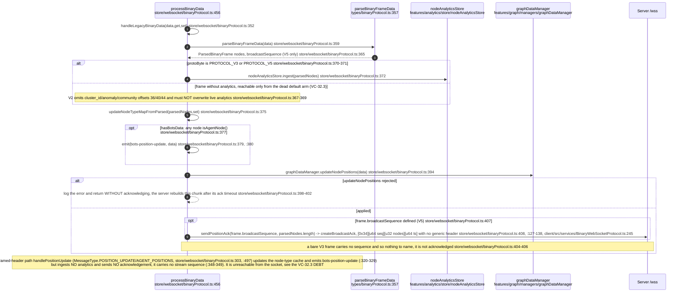
## VC-32.9 Position stream start (no subscribe message), de-duplicated filter sync, REST-aware shrink-guard
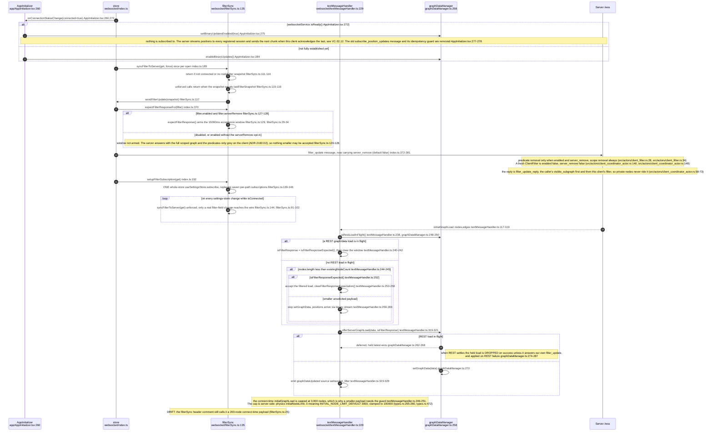
## VC-32.10 Drag send path: a drag is a server-side hold over JSON control frames (ADR-2169)
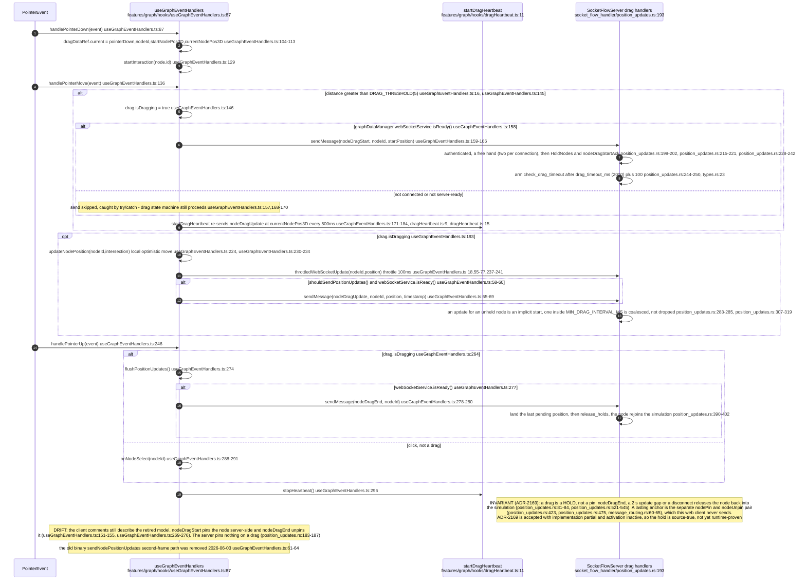
## VC-32.11 Agent frame 0x23 (AGENT_ACTION): decode, state-frame split, beam and registry dispatch
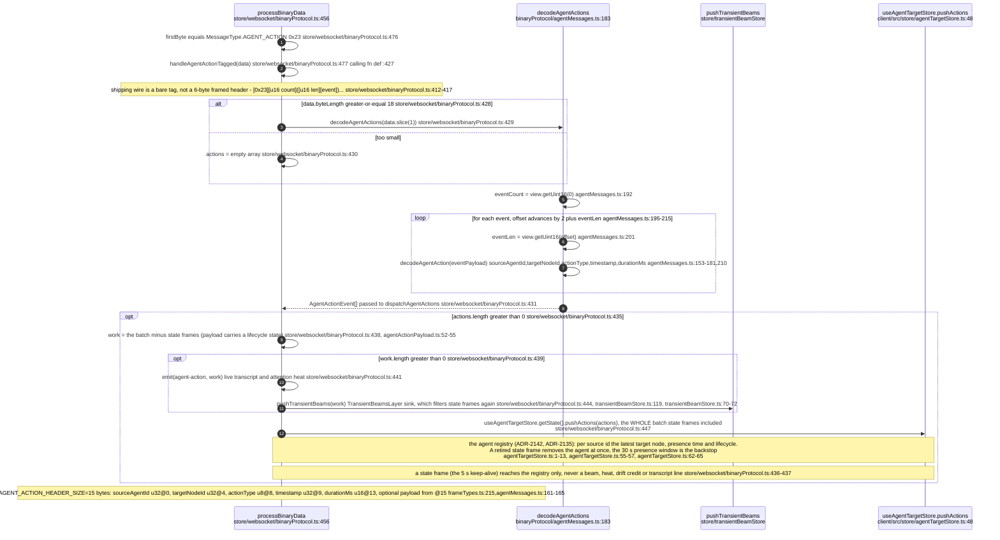
## VC-32.12 Acknowledged chunk stream (ADR-2141): server pump, client apply, ack
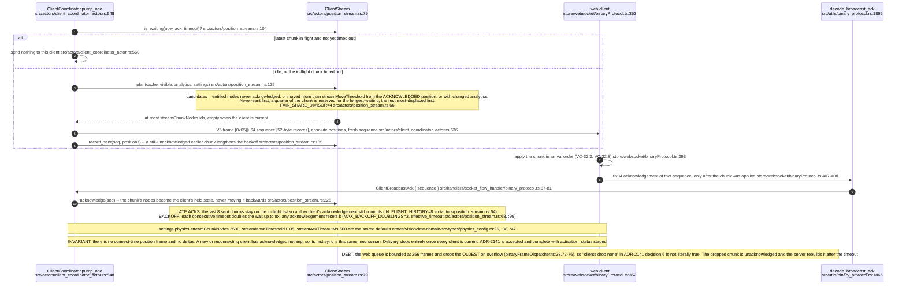

## VC-32.15 JSON control-frame catalogue
```mermaid
classDiagram
    class ClientToServer {
      authenticate  token/pubkey/ephemeral in dev mode only, the event form is unreachable from the client since the signed subprotocol (VC-32.1)  connectionManager.ts:332-343
      filter_update  enabled,quality_threshold,authority_threshold,filter_by_quality,filter_by_authority,filter_mode,include_linked_pages  index.ts:360-383
      BroadcastAck (binary 0x34, not JSON)  [0x34][u64 sequence][u32 nodes][u64 timestamp_ms], sent after a chunk is applied  BinaryWebSocketProtocol.ts:245, store/websocket/binaryProtocol.ts:408
      REMOVED ADR-2141  subscribe_position_updates and request_full_snapshot have no sender or handler, message_routing.rs:15-16 states there is no position request message
      nodeDragStart  nodeId,position  useGraphEventHandlers.ts:159-166
      nodeDragUpdate  nodeId,position,timestamp  useGraphEventHandlers.ts:65-69
      nodeDragEnd  nodeId  useGraphEventHandlers.ts:278-280
      ping  raw string, not JSON, answered by a raw pong  connectionManager.ts:250, message_routing.rs:20-23
    }
    class ServerToClient {
      connection_established  sets isServerReady  textMessageHandler.ts:91-95
      error  category:validation|server|protocol|auth|rate_limit, code, retryable, retryAfter  types.ts:14-23,store/websocket/binaryProtocol.ts:207, dispatched textMessageHandler.ts:98-105
      filter_update_success  data.visible_nodes,data.total_nodes  textMessageHandler.ts:107-115
      initialGraphLoad  nodes,edges  textMessageHandler.ts:117-119,229-331
      memory_flash  data forwarded to memoryFlash event  textMessageHandler.ts:122-124
      graphUpdated  revision,reason, debounced 750ms refetch  textMessageHandler.ts:27-60,129-133
      pong  raw string, not JSON  binaryFrameDispatcher.ts:127-130
      settingsUpdated  category,updatedBy,timestamp,settings? textMessageHandler.ts:139-141,155-192
    }
    ClientToServer --> ServerToClient : request/response over one socket
    note for ClientToServer "sent via store websocket/index.ts sendMessage(type,data) JSON.stringify(type,data)<br/>index.ts:301-330. Queued to messageQueue (MAX_QUEUE_SIZE=100) when not connected,<br/>connectionManager.ts:27,149-168."
    note for ServerToClient "dispatched by handleTextMessage after JSON.parse and validateMessage(type is<br/>nonempty string, length less-or-equal 100)<br/>websocket/binaryFrameDispatcher.ts:86-94,textMessageHandler.ts:81-144."
    note for ServerToClient "RESOLVED ADR-2080 settingsUpdated now HAS a consumer. The server emitted<br/>it from src/settings/api/settings_routes.rs:455,1148 while the only client knowledge was<br/>validation.ts:274 case settings_update (snake_case, different shape) - every broadcast fell<br/>through to the default arm and did nothing, so two viewers saw different physics until one<br/>reloaded. nodeFilter applies the supplied settings directly. other categories re-read via<br/>getSectionPaths plus getSettingsByPaths. own-write echo and stale timestamps are dropped.<br/>Contract fixed by vc-core ADR-2047. settings_update is dead on the wire and left in place.<br/>The visual bucket now broadcasts too (settings_routes.rs:1546), and the client re-reads<br/>every visualisation.* path outside rendering and physics plus<br/>VISUAL_ONLY_SECTION_PATHS (settingsHelpers.ts:254-262), cache invalidated first (VC-32.17)"
    note for ServerToClient "GRAPH_UPDATED shrink-guard: a smaller initialGraphLoad is discarded unless<br/>isFilterResponseExpected() is true within the 15000ms window, armed only for an<br/>enabled filter that opted in to serverRemove, and a REST load in flight defers<br/>the whole payload - see VC-32.9. textMessageHandler.ts:235-270,filterSync.ts:29-42,127-131"
```
## VC-32.16 solidWebSocket: JSS resource-notification boundary
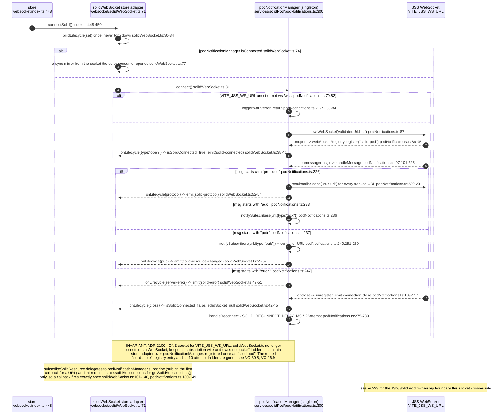
## VC-32.17 Settings broadcast: the shared emitter, the nodeFilter payload, and the peer re-read
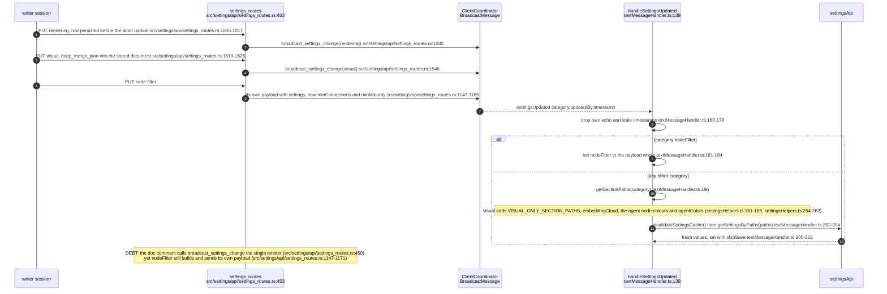
**Debt (loose end):** `PUT /api/settings/visual` only deep-merges (`src/settings/api/settings_routes.rs:1426-1437`, called at `src/settings/api/settings_routes.rs:1525`), so a key can be added or overwritten but never removed; retired visual keys stay in the stored document for good.

**Open:** `filter_update` carries no `minConnections` or `minMaturity` (`client/src/store/websocket/index.ts:372-381`) and `ClientFilter` has no such fields (`src/actors/client_coordinator_actor.rs:111-125`), so the degree and maturity floors only grey on the client even when `serverRemove` is on; is that intended?
