## VC-32.1 Connect: signed-subprotocol upgrade, dev-mode authenticate message
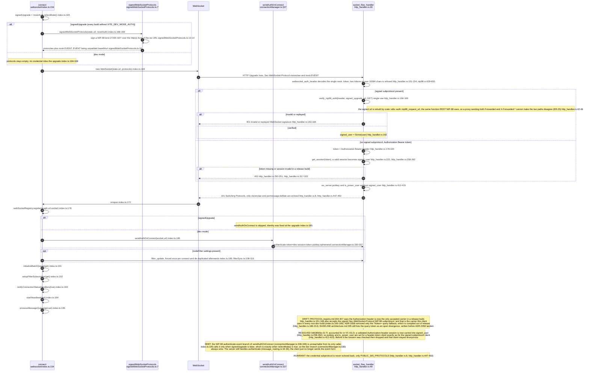
## VC-32.2 Reconnect backoff and ping/pong heartbeat (binary silence is not a failure signal)
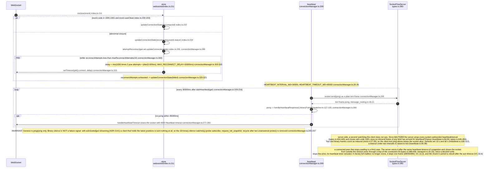
## VC-32.3 Binary frame demux: onmessage tag dispatch and the ordered frame queue
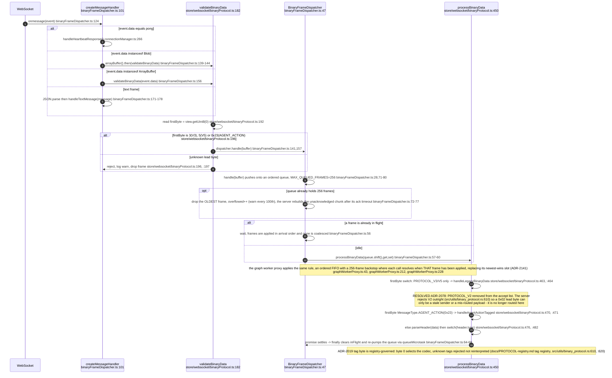
## VC-32.4 Outbound framed-message header (client-originated only)
```mermaid
classDiagram
    class FramedMessageHeader {
      +uint8 type  offset0
      +uint8 version  offset1
      +uint32 payloadLength  offset2 littleEndian
      +uint8 graphTypeFlag  offset6 GRAPH_UPDATE only
    }
    class MessageType {
      GRAPH_UPDATE 0x01
      VOICE_DATA 0x02
      POSITION_UPDATE 0x10
      AGENT_POSITIONS 0x11
      AGENT_STATE_FULL 0x20
      AGENT_ACTION 0x23
      CONTROL_BITS 0x30
      SSSP_DATA 0x31
      BROADCAST_ACK 0x34
      VOICE_CHUNK 0x40
      VOICE_START 0x41
      VOICE_END 0x42
      SYNC_UPDATE 0x50
      ANNOTATION_UPDATE 0x51
      SELECTION_UPDATE 0x52
      USER_POSITION 0x53
      VR_PRESENCE 0x54
      ERROR 0xFF
    }
    class GraphTypeFlag {
      KNOWLEDGE_GRAPH 0x00
      ONTOLOGY 0x01
    }
    class ControlFlags {
      PAUSE_UPDATES bit0
      HIGH_FREQUENCY bit1
      LOW_BANDWIDTH bit2
      VOICE_ENABLED bit3
      DEBUG_MODE bit4
      FORCE_FULL_UPDATE bit5
      USER_INTERACTING bit6
      BACKGROUND_MODE bit7
    }
    FramedMessageHeader --> MessageType : selects codec
    FramedMessageHeader --> GraphTypeFlag : graphTypeFlag field
    note for FramedMessageHeader "createMessage/parseHeader BinaryWebSocketProtocol.ts:73-116. Header size<br/>MESSAGE_HEADER_SIZE=6, GRAPH_UPDATE_HEADER_SIZE=7 (frameTypes.ts:225-226). Used<br/>only for client-to-server encode calls: encodePositionUpdates, encodeAgentState,<br/>encodeSSSPData, encodeControlBits, encodeVoiceChunk, createBroadcastAck,<br/>encodeAgentAction (BinaryWebSocketProtocol.ts:129-295)."
    note for MessageType "RESOLVED ADR-2078. The framed header's version byte is written from<br/>PROTOCOL_VERSION (BinaryWebSocketProtocol.ts:86), which is PROTOCOL_V3=3 (frameTypes.ts:30), and the<br/>comment above it now says so (BinaryWebSocketProtocol.ts:81-84). The old header-local PROTOCOL_V4=4 is<br/>deleted from frameTypes.ts (frameTypes.ts:33-37) so PROTOCOL_V4 now names only the delta node<br/>encoding of VC-32.5, and SUPPORTED_HEADER_VERSIONS is V3 and V5 (frameTypes.ts:39). ADR-2078 also<br/>deleted five enum members with no reference anywhere in client/src: VELOCITY_UPDATE 0x12,<br/>AGENT_STATE_DELTA 0x21, AGENT_HEALTH 0x22, HANDSHAKE 0x32 and HEARTBEAT 0x33 (frameTypes.ts:59-63)."
    note for MessageType "The enum is frameTypes.ts:65-101. The server's own MessageType has only five tags and this client decodes<br/>just AGENT_ACTION and BROADCAST_ACK from the wire, every other member is client-outbound<br/>only and no evidence the server emits it (frameTypes.ts:45-57). Live position frames are unframed and<br/>lead with a bare 0x03 or 0x05 byte, so they never carry a MessageType at all."
    note for FramedMessageHeader "DOC-DRIFT. docs/PROTOCOL-registry.md frame tag registry lists only<br/>0x03,0x05,0x23,0x43,0x44 as live server-to-client tags; this client-only outbound<br/>envelope and its MessageType space (0x01,0x02,0x10-0x54) do not appear in that<br/>registry at all."
    note for MessageType "BROADCAST_ACK 0x34 payload (encodeBroadcastAckPayload/decodeBroadcastAck<br/>backpressure.ts:18-69): BROADCAST_ACK_PAYLOAD_SIZE=20 bytes - sequenceId split<br/>low/high uint32 offset0/4, nodesReceived uint32 offset8, timestamp split<br/>low/high uint32 offset12/16, all littleEndian to avoid BigInt64<br/>(backpressure.ts:26-29,36-39). Ack cadence (ACK_BATCH_SIZE=10) is in VC-32.8."
    note for MessageType "SSSP_DATA 0x31 and VOICE_CHUNK 0x40 payloads (ssspVoice.ts:8-91).<br/>SSSPDataRecord: uint32 nodeId, float32 distance, uint32 parentId, uint16 flags<br/>= 14 bytes (SSSP_DATA_SIZE_V2 frameTypes.ts:230, layout ssspVoice.ts:8-21). VoiceChunkHeader: uint16<br/>agentId, uint16 chunkId, uint8 format, uint16 dataLength = 7 bytes<br/>(VOICE_HEADER_SIZE frameTypes.ts:237) then raw audioData (ssspVoice.ts:49-65). Voice agentId is<br/>uint16 (max 65535) - a wire format separate from the uint32 flag-bit node/agent<br/>id of VC-32.6, no alignment issue (ssspVoice.ts:54-56,82-84)."
```
## VC-32.5 Server-to-client position wire records: V3, V5 envelope (V4 delta retired, V2 declined)
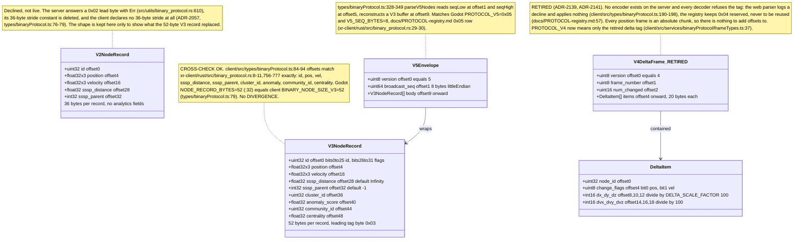
## VC-32.6 Wire node-id: type flag bits over the 26-bit id
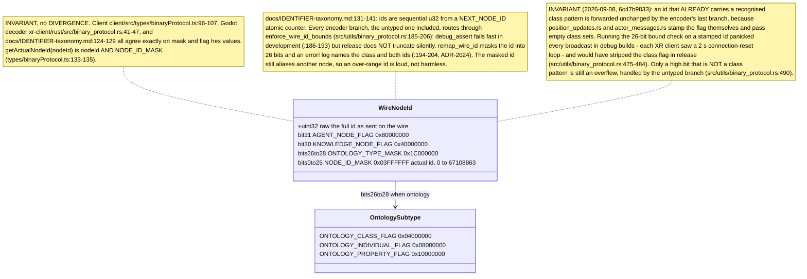
## VC-32.7 getNodeType(): flag precedence decision order
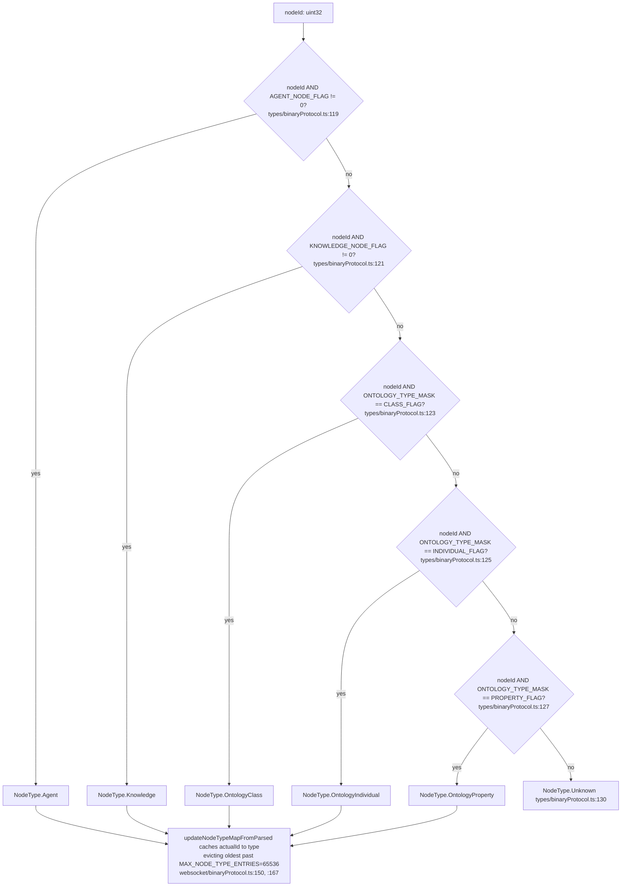
## VC-32.8 Live position frame processing: parse, analytics ingest, apply, then acknowledge the chunk
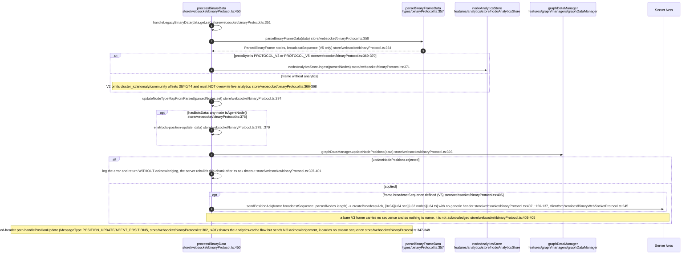
## VC-32.9 Position stream start (no subscribe message), de-duplicated filter sync, REST-aware shrink-guard
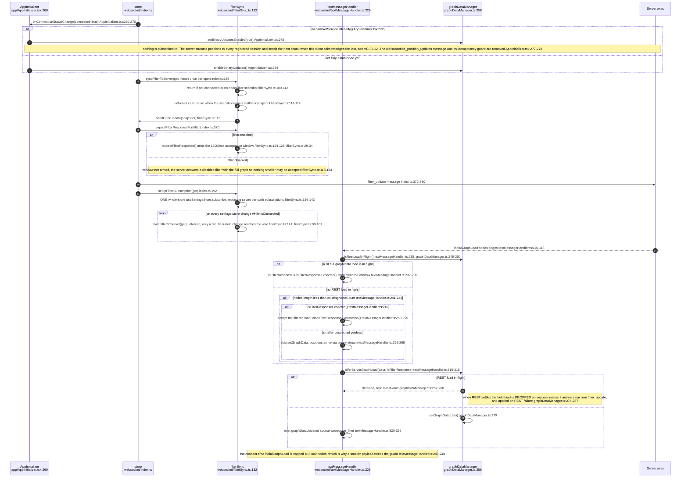
## VC-32.10 Drag / pin send path: server-authoritative pin over JSON control frames
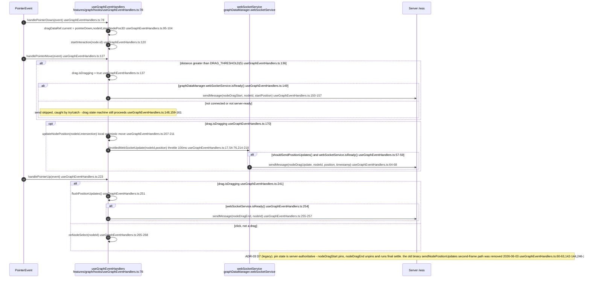
## VC-32.11 Agent frame 0x23 (AGENT_ACTION): decode and beam dispatch
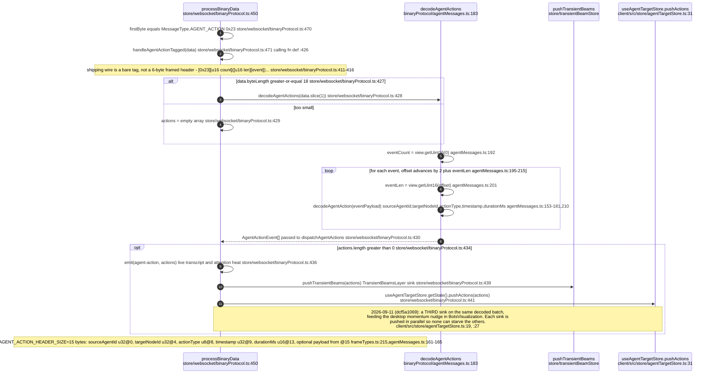
## VC-32.12 Acknowledged chunk stream (ADR-2141): server pump, client apply, ack
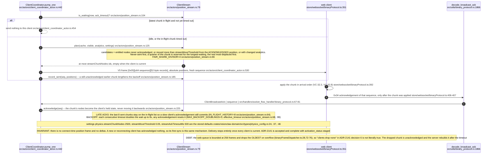

## VC-32.15 JSON control-frame catalogue
```mermaid
classDiagram
    class ClientToServer {
      authenticate  token/pubkey/ephemeral in dev mode only, the event form is unreachable from the client since the signed subprotocol (VC-32.1)  connectionManager.ts:332-343
      filter_update  enabled,quality_threshold,authority_threshold,filter_by_quality,filter_by_authority,filter_mode,include_linked_pages  index.ts:360-383
      BroadcastAck (binary 0x34, not JSON)  [0x34][u64 sequence][u32 nodes][u64 timestamp_ms], sent after a chunk is applied  BinaryWebSocketProtocol.ts:245, store/websocket/binaryProtocol.ts:407
      REMOVED ADR-2141  subscribe_position_updates and request_full_snapshot have no sender or handler, message_routing.rs:13-14 states there is no position request message
      nodeDragStart  nodeId,position  useGraphEventHandlers.ts:150-157
      nodeDragUpdate  nodeId,position,timestamp  useGraphEventHandlers.ts:64-68
      nodeDragEnd  nodeId  useGraphEventHandlers.ts:255-257
      ping  raw string, not JSON, answered by a raw pong  connectionManager.ts:250, message_routing.rs:18-21
    }
    class ServerToClient {
      connection_established  sets isServerReady  textMessageHandler.ts:90-95
      error  category:validation|server|protocol|auth|rate_limit, code, retryable, retryAfter  types.ts:14-23,store/websocket/binaryProtocol.ts:206, dispatched textMessageHandler.ts:97-104
      filter_update_success  data.visible_nodes,data.total_nodes  textMessageHandler.ts:106-114
      initialGraphLoad  nodes,edges  textMessageHandler.ts:116-118,226-330
      memory_flash  data forwarded to memoryFlash event  textMessageHandler.ts:121-123
      graphUpdated  revision,reason, debounced 750ms refetch  textMessageHandler.ts:27-60,128-132
      pong  raw string, not JSON  binaryFrameDispatcher.ts:127-130
      settingsUpdated  category,updatedBy,timestamp,settings? textMessageHandler.ts:138-140,154-191
    }
    ClientToServer --> ServerToClient : request/response over one socket
    note for ClientToServer "sent via store websocket/index.ts sendMessage(type,data) JSON.stringify(type,data)<br/>index.ts:301-330. Queued to messageQueue (MAX_QUEUE_SIZE=100) when not connected,<br/>connectionManager.ts:27,149-168."
    note for ServerToClient "dispatched by handleTextMessage after JSON.parse and validateMessage(type is<br/>nonempty string, length less-or-equal 100)<br/>websocket/binaryFrameDispatcher.ts:86-94,textMessageHandler.ts:80-143."
    note for ServerToClient "RESOLVED ADR-2080 settingsUpdated now HAS a consumer. The server emitted<br/>it from src/settings/api/settings_routes.rs:450,1003 while the only client knowledge was<br/>validation.ts:274 case settings_update (snake_case, different shape) - every broadcast fell<br/>through to the default arm and did nothing, so two viewers saw different physics until one<br/>reloaded. nodeFilter applies the supplied settings directly. other categories re-read via<br/>getSectionPaths plus getSettingsByPaths. own-write echo and stale timestamps are dropped.<br/>Contract fixed by vc-core ADR-2047. settings_update is dead on the wire and left in place"
    note for ServerToClient "GRAPH_UPDATED shrink-guard: a smaller initialGraphLoad is discarded unless<br/>isFilterResponseExpected() is true within the 15000ms window, armed only for an<br/>enabled filter, and a REST load in flight defers the whole payload - see VC-32.9.<br/>textMessageHandler.ts:232-267,filterSync.ts:29-42,124-128"
```
## VC-32.16 solidWebSocket: JSS resource-notification boundary
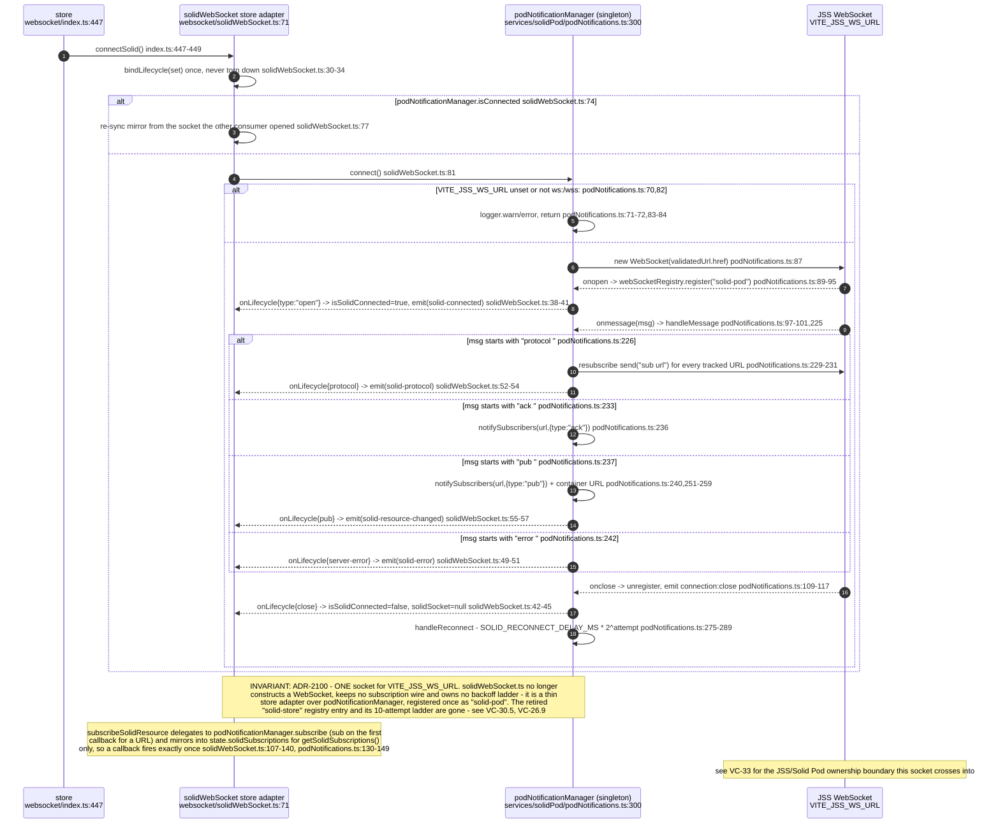
