## For developers

`client/src/features/` holds one directory per product surface, and this topic traces what each one calls on the server: REST through `unifiedApiClient`, WebSocket through `webSocketService`, and settings through the registry and autosave chain. The ec785afa9 refresh picks up the ADR-2189 control-centre rework. Every settings change from a registry row, a dock dial, the Ask box or a Jev patch now goes through one function, `applySettingWrites` (VC-34.1, VC-34.19). The registry regroups its ten source groups into seven sections, and the emitter writes a v2.0 manifest plus two `ia.json` copies (VC-34.2). The memory explorer has moved into the right drawer (VC-34.20). The analytics store's SSSP call targets the surviving `pathfinding/sssp` route (VC-34.12). The section layout, the drawer and the scope badges belong to VC-57, and the explore layer to VC-56.

**Debt (loose end):** the chat parser writes `visualisation.graphs.knowledge.nodes.opacity` (`CommandInput.tsx:313`), and no renderer reads it. Its only client touch is the server-wins merge (`coreSlice.ts:140`). ADR-2189 retired the `visionclaw` twin of this path (`retiredPaths.ts:39`) but not the knowledge one.

**Debt (parallel):** `serverBucketFor` (`manifest.ts:110`) restates the prefix routing of `updateSettingsByPaths` (`endpoints.ts:344-366`) by hand, as its own comment admits (`manifest.ts:105-108`). The scope badges and manifest `server` field depend on the copy, not on the code that routes the PUT.

**Debt (parallel):** shortest path has two client callers on two routes, `analyticsStore.ts:350` (`/api/analytics/pathfinding/sssp`) and `useSemanticService.ts:200` (`/api/semantic/shortest-path`).

## For the business

The client is a set of product surfaces: settings, ontology, governance, agents, analytics, the command bar and voice. Each one talks to the server in its own way. After this change, a setting typed into the Ask box behaves exactly like moving the slider. It is saved the same way, respects the sync switch and moves the layout when it should. "Make the edges fainter" now changes the edges. "Make it transparent" without the word edges still reports success while nothing on screen changes. The settings menu now has seven sections instead of eleven groups. The headset reads the same menu layout from a generated copy.

## VC-34.1 settings — field edit to server PUT
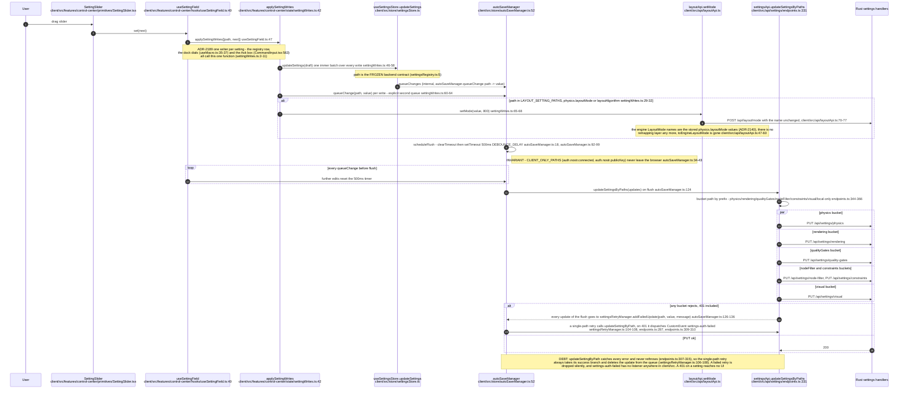
## VC-34.2 settings — type generation and QA manifest (build-time, not runtime)
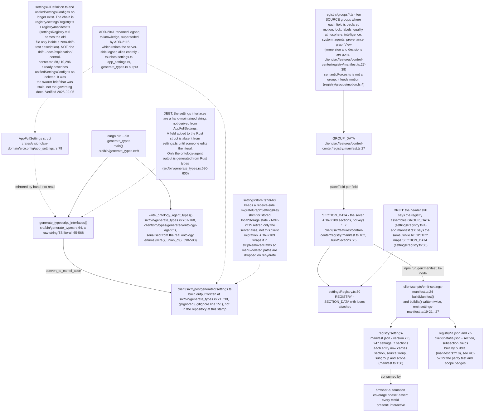
## VC-34.3 ontology — JSS fetch, PATCH and WebSocket refresh (contextLoader is the shared base)
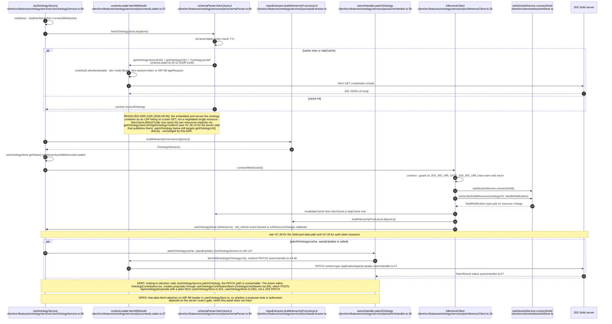
## VC-34.4 ontology — inference REST, SPARQL console and reasoning report
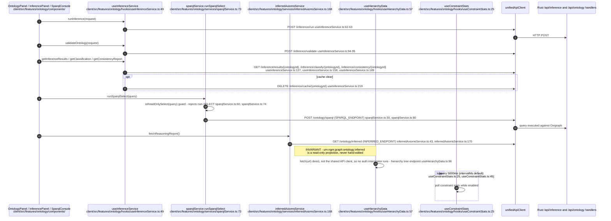
## VC-34.5 ontology — server-pushed validation over WebSocket
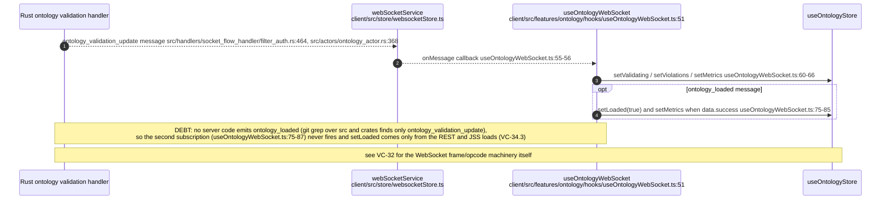
## VC-34.6 control-center — shell composition (SettingsPanel hosts Solid and Ontology panels)
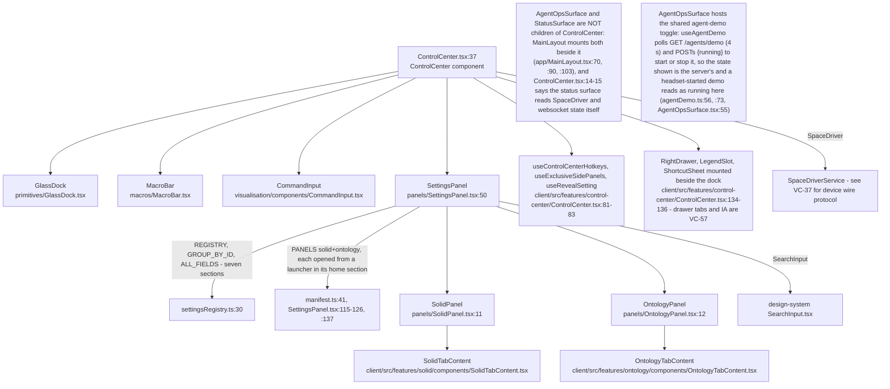
## VC-34.7 control-center — ACSP governance case queue (ADR-2006)
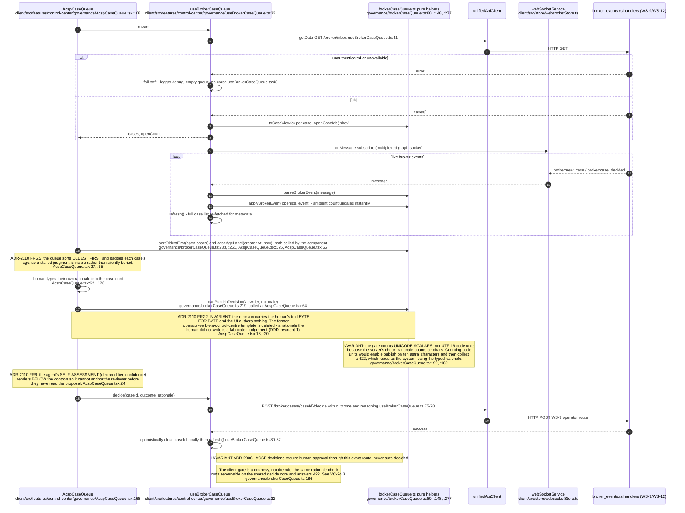
## VC-34.8 control-center — status telemetry, KPI polling and echo/macro bus
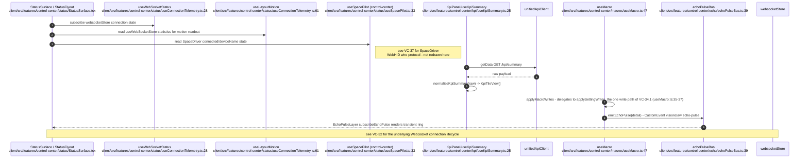
## VC-34.9 bots — adaptive REST polling of the agent population
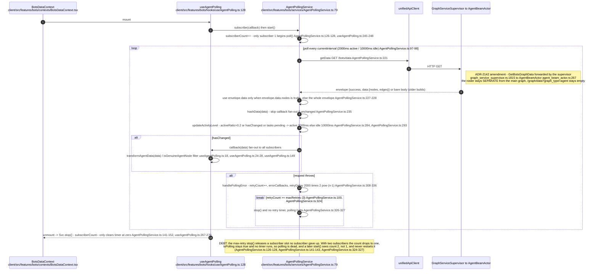
## VC-34.10 bots — WebSocket integration, action feed and interrupt
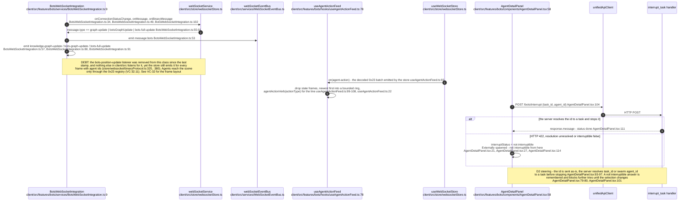
## VC-34.11 monitoring — health dashboard poll and MCP relay control
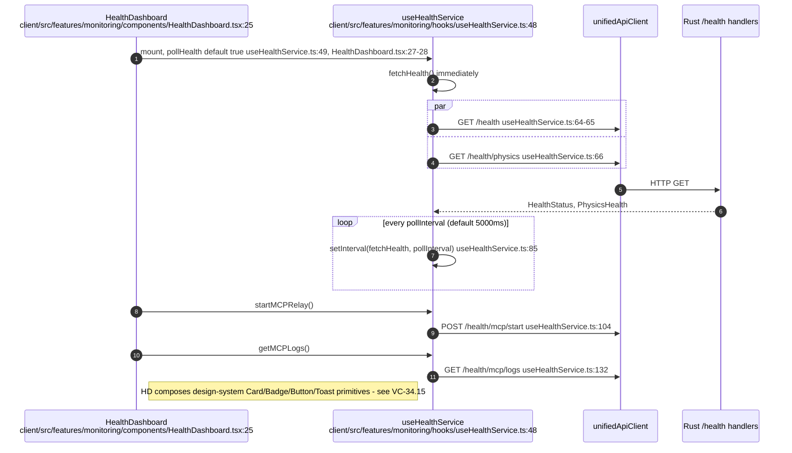
## VC-34.12 analytics — semantic service REST, SSSP store and wire-decoded per-node analytics
```mermaid
sequenceDiagram
    autonumber
    participant SPC as ShortestPathControls<br/>client/src/features/analytics/components/ShortestPathControls.tsx:38
    participant USS as useSemanticService<br/>client/src/features/analytics/hooks/useSemanticService.ts:85
    participant AS as useAnalyticsStore<br/>client/src/features/analytics/store/analyticsStore.ts:286
    participant UAC as unifiedApiClient
    participant WSBin as handleLegacyBinaryData<br/>client/src/store/websocket/binaryProtocol.ts:352
    participant NAS as nodeAnalyticsStore<br/>client/src/features/analytics/store/nodeAnalyticsStore.ts:35
    participant Gem as GemNodes / ClusterHulls<br/>client/src/features/graph/components/

    USS->>UAC: GET /api/semantic/statistics useSemanticService.ts:100
    USS->>UAC: POST /api/semantic/communities useSemanticService.ts:136
    USS->>UAC: POST /api/semantic/centrality useSemanticService.ts:168
    SPC->>USS: computeShortestPath(request)
    USS->>UAC: POST /api/semantic/shortest-path useSemanticService.ts:200
    USS->>UAC: POST /api/semantic/constraints/generate useSemanticService.ts:232
    USS->>UAC: POST /api/semantic/cache/invalidate useSemanticService.ts:262
    AS->>UAC: POST /api/analytics/pathfinding/sssp {sourceIdx}<br/>old shortest-path route gone server-side analyticsStore.ts:346-352
    AS->>AS: toDistanceMap(result.distances) accepts the whole-graph array<br/>or the gated id-keyed object, keeps finite values below 3.0e38,<br/>unreachable becomes Infinity analyticsStore.ts:83-93, analyticsStore.ts:363-368
    Note over AS,UAC: analyticsStore and useSemanticService still hit distinct endpoints<br/>for the same shortest-path feature - not unified
    Note over AS,UAC: OPEN: sourceIdx is parseInt(sourceNodeId) (analyticsStore.ts:351),<br/>so a non-numeric node id posts NaN, which JSON carries as null<br/>against the server usize sourceIdx
    Note over USS,UAC: DEBT (source-traced, not run): every path here and in analyticsStore leads with /api, and unifiedApiClient prepends<br/>its own /api base (client/src/services/api/UnifiedApiClient.ts:77, :182), so they resolve to /api/api/semantic/... and<br/>/api/api/analytics/pathfinding/sssp, the doubled prefix the repo records as a 404 for the ontology services it already fixed
    WSBin->>NAS: ingest(parsedNodes) - V3/V5 frames only, wire offsets 36/40/44/48 plus sssp_distance@28 store/websocket/binaryProtocol.ts:371-372, nodeAnalyticsStore.ts:51
    Note right of NAS: ADR-03 D7, ADR-031 D2/D6 - stride 5 buffer<br/>[clusterId, anomalyScore, communityId, centrality, ssspDistance]
    Gem->>NAS: getIndexedBuffer(nodeIdToIndexMap) on every 30th frame while an analytic colour scheme or quality gate is on (GemNodes.tsx:706-709),<br/>and every TICK_INTERVAL frames in ClusterHulls.tsx:241-245. nodeAnalyticsStore.ts:96
    Note over WSBin,Gem: see VC-32 for the binary frame layout, VC-15 for GPU-side computation,<br/>VC-31 for the graph feature's own render-pipeline internals (not redrawn here)
```
## VC-34.13 physics — live simulation control (distinct from settings persistence)
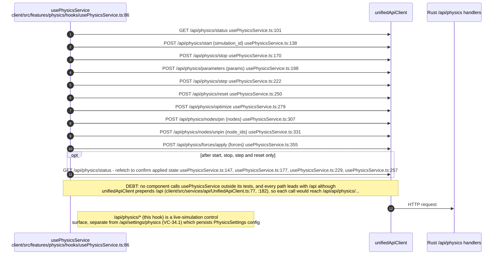
## VC-34.14 command-palette, help and onboarding — CustomEvent dispatch chain
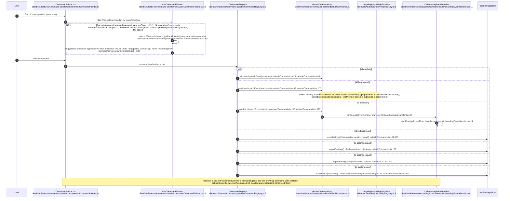
## VC-34.15 design-system — presentational primitives, no network calls of its own
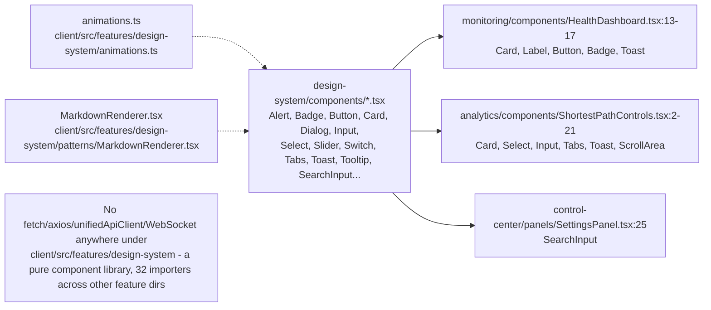
## VC-34.17 workspace — CRUD REST plus realtime WebSocket (implementation lives outside features/)
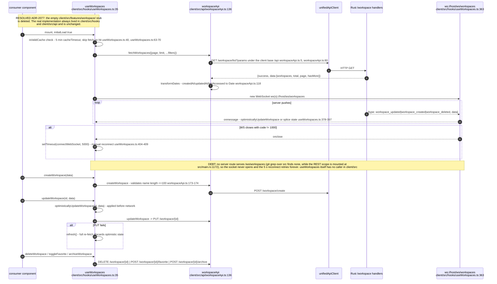
## VC-34.18 solid — feature-owned Pod UI components (own composition only)
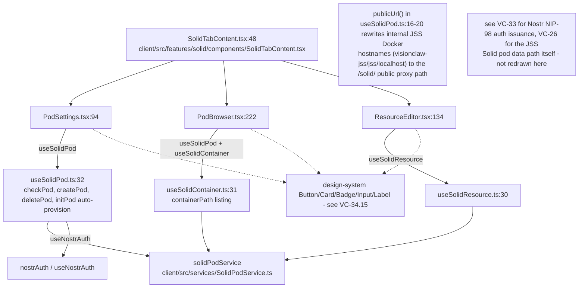
## VC-34.19 visualisation — CommandInput natural-language command bar
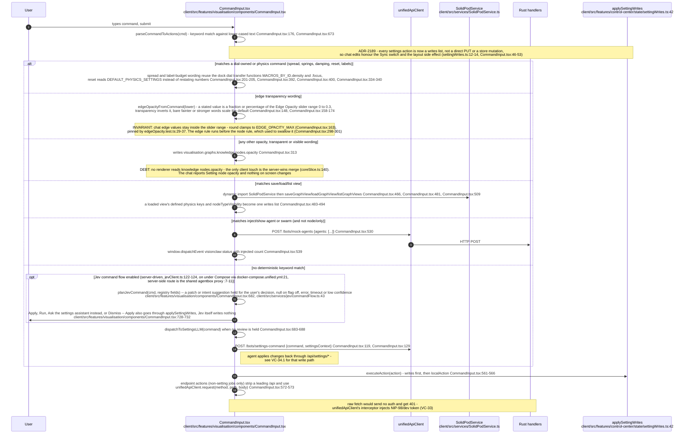
## VC-34.20 visualisation — EmbeddingCloudLayer and TransientBeamsLayer
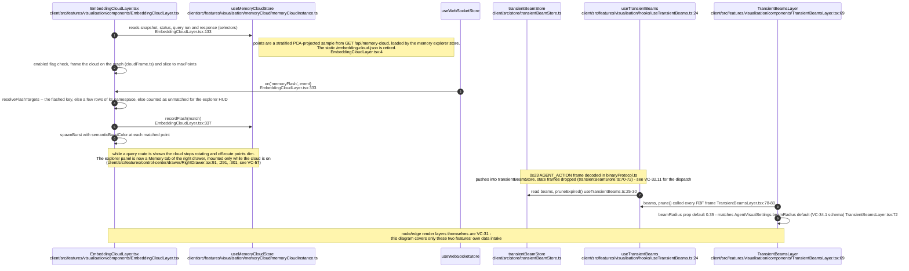

## VC-34.21 voice — push-to-talk agent binding (graph selection to governed dispatch)
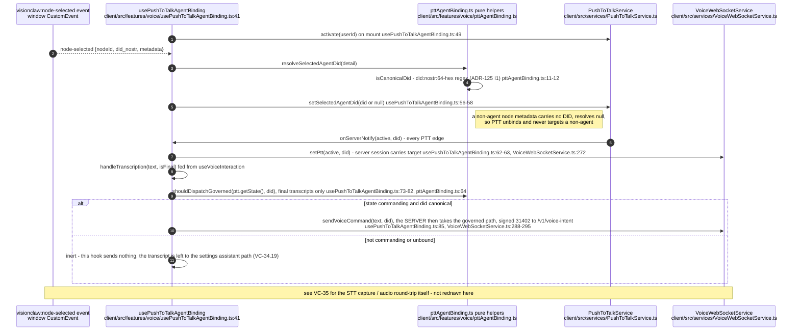
