## For developers

Voice from the push-to-talk key to the spoken reply: microphone capture, the `/ws/speech` socket, speech-to-text, the governed voice-intent path that signs a kind-31402 event (ADR-2148), streamed text-to-speech with barge-in, the voice actors, LiveKit spatial voice, and the external voice estate in agentbox (ADR-2151). Re-read at ec785afa9: the VisionClaw side moved only in generated type lines and the BASELINE activation notes; no voice mechanism changed. The agentbox and unmute stamps are unchanged.

## For the business

A user holds a key, speaks, and the selected agent hears them and answers aloud; speaking again cuts the answer off. Requests that would change the shared graph are not acted on straight from speech: they go through the same signed, reviewable path as typed decisions. Headset users do not yet get the spatial voice the browser has.

## VC-35.1 Push-to-talk state machine and the agent DID binding

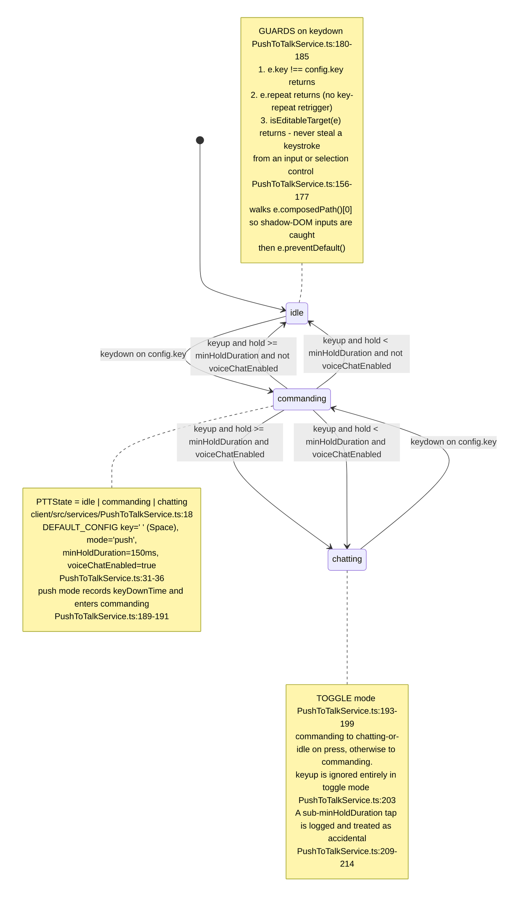

## VC-35.2 Selection to PTT binding — did:nostr threading

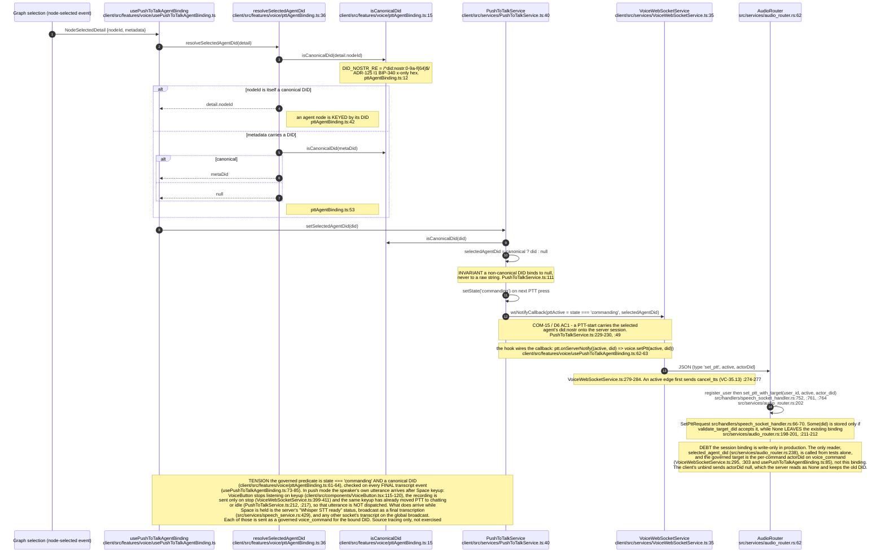

## VC-35.3 Microphone capture — AudioContext, getUserMedia, MediaRecorder

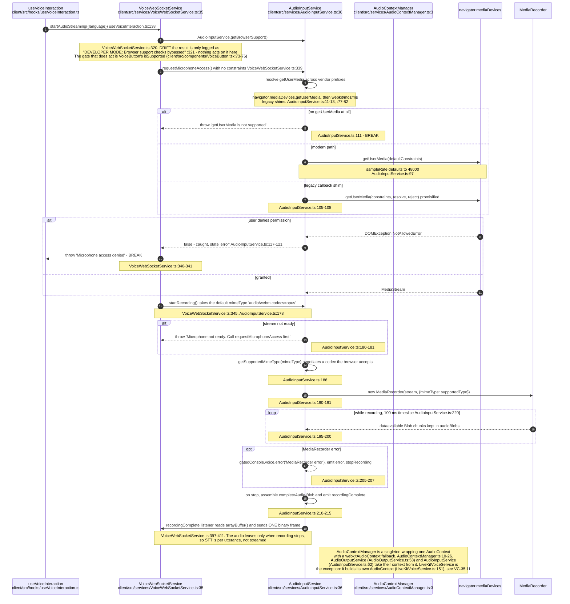

## VC-35.4 /ws/speech transport — connect, registry, message dispatch

```mermaid
sequenceDiagram
    autonumber
    participant VW as VoiceWebSocketService.connect<br/>client/src/services/VoiceWebSocketService.ts:70
    participant REG as WebSocketRegistry<br/>client/src/services/WebSocketRegistry.ts
    participant BUS as WebSocketEventBus<br/>client/src/services/WebSocketEventBus.ts
    participant SV as speech_socket_handler<br/>src/handlers/speech_socket_handler.rs:989
    participant SS as SpeechSocket actor<br/>src/handlers/speech_socket_handler.rs:82
    participant AO as AudioOutputService<br/>client/src/services/AudioOutputService.ts:15

    VW->>VW: wsUrl = baseUrl.replace(/^http/, 'ws') + '/ws/speech'
    Note over VW: VoiceWebSocketService.ts:65
    VW->>SV: WebSocket upgrade (no header, no query token)
    rect rgb(238, 244, 252)
        SV->>SV: derive connection_url from scheme, host and path_and_query
        Note over SV: speech_socket_handler.rs:1002. The HTTP-equivalent URL the<br/>client must sign as the NIP-98 u tag now comes from the shared helper<br/>nip98_request_url(&req) - same derivation the graph socket uses at<br/>socket_flow_handler/http_handler.rs:427
        SV->>SS: SpeechSocket::new(socket_id, app_state, connection_url, dev_bypass_ok)
        Note over SV,SS: speech_socket_handler.rs:1007-1014, signature :103-108. dev_bypass_ok is<br/>dev_bypass_permitted(&req) :1005, compiled only under cfg(debug_assertions or dev-auth),<br/>absent from release builds. pubkey starts None :124
        SV-->>VW: 101 Switching Protocols
        Note over SV,VW: RESOLVED ADR-2075: NO credential is checked at upgrade. The old<br/>path accepted any non-empty Bearer value OR ?token= query parameter<br/>without verifying either, and browsers cannot set WebSocket headers,<br/>so the browser client (which sent neither) was 401d outright. Query<br/>token auth is removed. The socket opens anonymous and useless
    end
    SS->>SS: ctx.run_later(AUTH_DEADLINE) speech_socket_handler.rs:486
    Note over SS: AUTH_DEADLINE = 30s speech_socket_handler.rs:22. A socket still<br/>unauthenticated at the deadline is sent an error and ctx.stop() :487-500,<br/>so it cannot hold the subscription open beyond 30 s
    Note over SS: TENSION started() subscribes this socket to the SpeechService audio and<br/>transcription broadcasts before any authenticate frame (speech_socket_handler.rs:511-541),<br/>and the forwarders write to the socket with no pubkey check (:556-558, :571-583). For up to<br/>AUTH_DEADLINE an unauthenticated peer receives every TTS chunk and transcript broadcast<br/>to all sockets. ADR-2075 guards inbound commands only
    VW->>REG: register('voice', url, socket)
    Note over VW,REG: REGISTRY_NAME = 'voice' VoiceWebSocketService.ts:14, :89
    VW->>BUS: emit('connection:open', {name 'voice', url})
    Note over VW: VoiceWebSocketService.ts:90 - see VC-30.5
    VW->>VW: sendAuthenticate(url) VoiceWebSocketService.ts:91, :133
    alt not nostrAuth.isAuthenticated()
        VW-->>VW: warn "not authenticated - /ws/speech will refuse commands" - BREAK
    else dev mode
        VW->>SS: {"type":"authenticate","token":"dev-session-token","pubkey":...}
        Note over VW,SS: VoiceWebSocketService.ts:140-149. Server accepts ONLY when<br/>dev_bypass_ok, i.e. DEV_AUTH_LOOPBACK=1 and a loopback peer<br/>speech_socket_handler.rs:179-200. Never accepted ungated
    else NIP-98
        VW->>VW: httpUrl = wsUrl with ws scheme swapped for http
        VW->>SS: {"type":"authenticate","event":"<base64 kind-27235>"}
        Note over VW,SS: VoiceWebSocketService.ts:153-155. INVARIANT the signed u tag<br/>must equal the socket's own connection_url, so the client signs<br/>exactly the http equivalent of the URL it connected to
    end
    SS->>SS: handle_authenticate speech_socket_handler.rs:155
    alt dev_full_bypass_active() and dev build
        SS-->>VW: authenticate_success pubkey dev-mode-local-admin
        Note over SS: ADR-2039 LAN-local full bypass, compiled out of release<br/>speech_socket_handler.rs:163-175
    else NIP-98 verified
        SS->>SS: verify_nip98_auth("Nostr <b64>", connection_url, "GET", None)
        Note over SS: speech_socket_handler.rs:214-225, via NostrService - single-use replay cache ADR-2002
        SS-->>VW: authenticate_success pubkey
    else verification fails
        SS-->>VW: authenticate_error "NIP-98 WebSocket authentication failed"
        Note over SS,VW: speech_socket_handler.rs:239-246. The socket stays unauthenticated and is closed at the deadline
    end
    Note over SS: RESOLVED ADR-2075: authenticate is the ONLY frame accepted while<br/>pubkey is None. reject_unauthenticated (speech_socket_handler.rs:133, applied :627-633)<br/>refuses tts, stt, voice_command, set_ptt and cancel_tts with an error frame.<br/>Ping, pong and the plain-text "ping" stay free so heartbeats work pre-auth :605-618.<br/>Binary audio frames are NOT behind the gate: the Binary arm :956-976 forwards any<br/>frame to process_audio_chunk without a pubkey check
    loop each inbound message
        SV-->>VW: MessageEvent
        alt binary (ArrayBuffer or Blob)
            VW->>VW: handleAudioData - Blob converted via arrayBuffer()
            Note over VW: VoiceWebSocketService.ts:225
            VW->>AO: enqueue for playback
        else JSON VoiceMessage
            VW->>VW: JSON.parse(event.data)
            Note over VW: VoiceMessage.type is one of<br/>tts | stt | audio_chunk | transcription | error | connected |<br/>authenticate_success | authenticate_error VoiceWebSocketService.ts:17
            alt type 'connected'
                VW-->>VW: emit voiceConnected VoiceWebSocketService.ts:181-183
            else type 'transcription'
                VW->>VW: handleTranscription(data) then transcriptionCallback
                Note over VW: VoiceWebSocketService.ts:186, :242
            else type 'error'
                VW-->>VW: message.data or message.error or 'Unknown voice service error'
                Note over VW: VoiceWebSocketService.ts:190-191
            else voice_response, voice_clarification, voice_intent_error, stt_started
                VW-->>VW: not in the VoiceMessage union, so emitted as a generic 'message'
                Note over VW: VoiceWebSocketService.ts:213-214
            end
        end
    end
    opt socket closes
        VW->>VW: attemptReconnect(url)
        Note over VW: only on a close code other than 1000. maxReconnectAttempts=5,<br/>reconnectDelay=2000ms VoiceWebSocketService.ts:44-46, :109-110
    end
```

## VC-35.6 STT — Whisper and OpenAI backends (Turbo Whisper retired)

`ProcessAudioChunkForUser`, `TextToSpeechForUser`, `TextToSpeechSpatial`, `AgentSpatialInfo` and the `TurboWhisper` provider and its `TurboWhisperSettings` were deleted (VisionClaw `cefd9d1d7`, 2026-10-18, estate register ER-24) and are gone at this stamp: `STTProvider` is `Whisper | OpenAI` and `SpeechCommand` has no user-scoped or spatial variants (`src/types/speech.rs:71-88`).

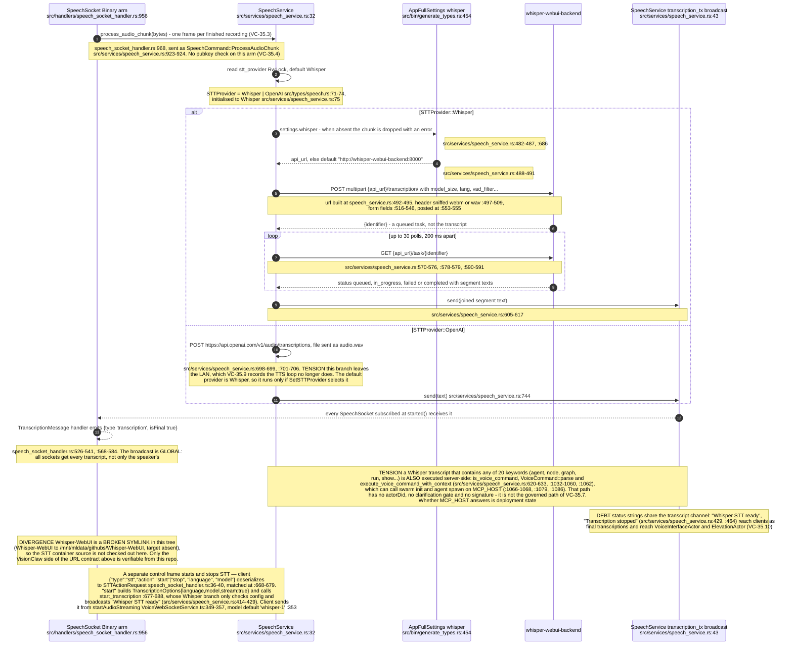

## VC-35.7 Governed voice path — clarification gate then signed kind-31402 to /v1/voice-intent

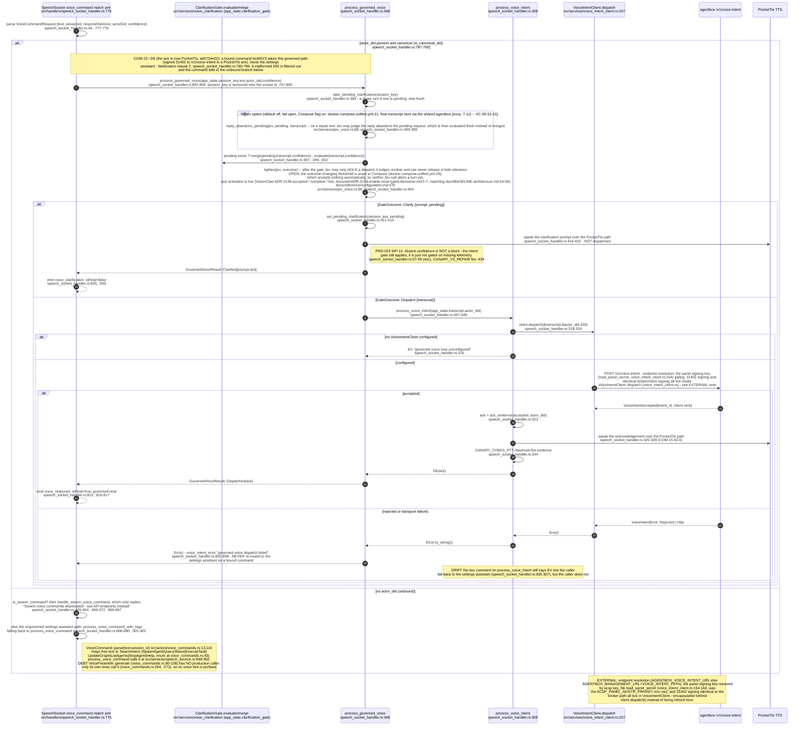

## VC-35.9 TTS over PocketTts, streamed PCM and the barge-in cancel path

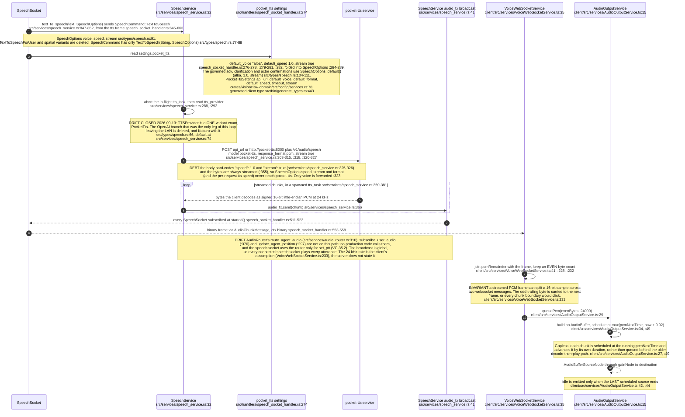

## VC-35.10 VoiceInterfaceActor and the elevation voice ledger

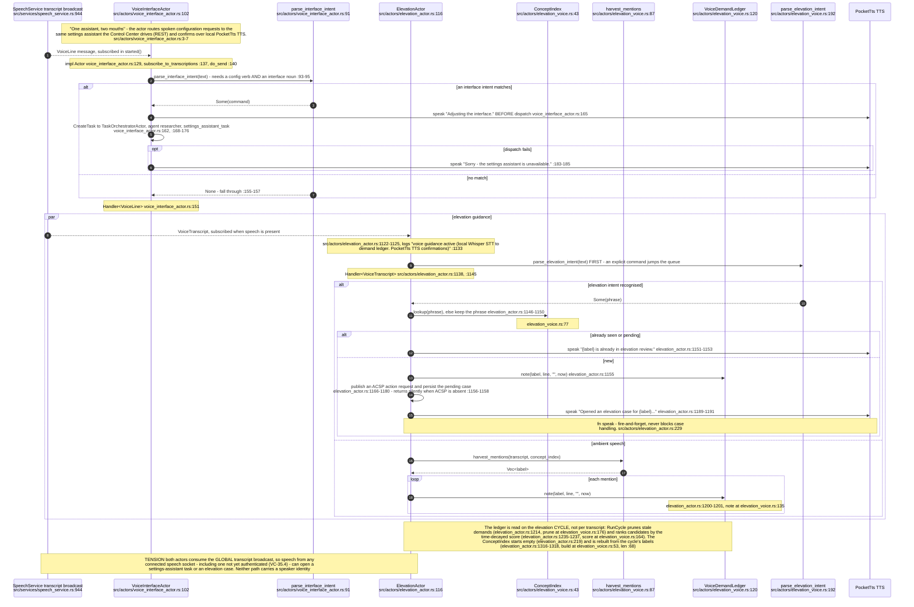

## VC-35.11 LiveKit spatial voice — browser path present, XR path absent

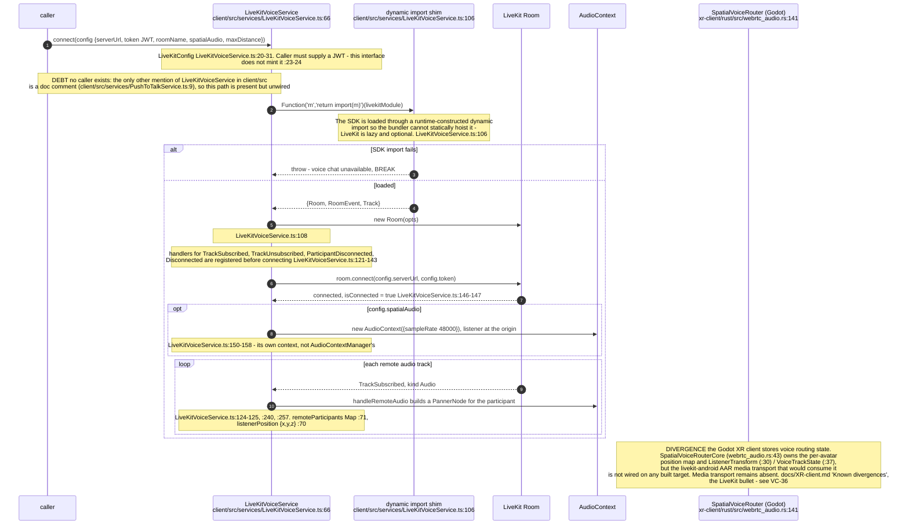

The [1 November audit](../../estate-review/2026-11-01-room-admission-and-voice.md) qualifies this historical map: state tests do not prove spatial audio, ADR-2160 explicitly defers voice, and its proposed revocation argument has an unresolved dependency-refresh path. See [VC-50](50-deferred-space-voice.md).

## VC-35.12 The external voice estate (Track A) after the 2026-09-13 re-ownership

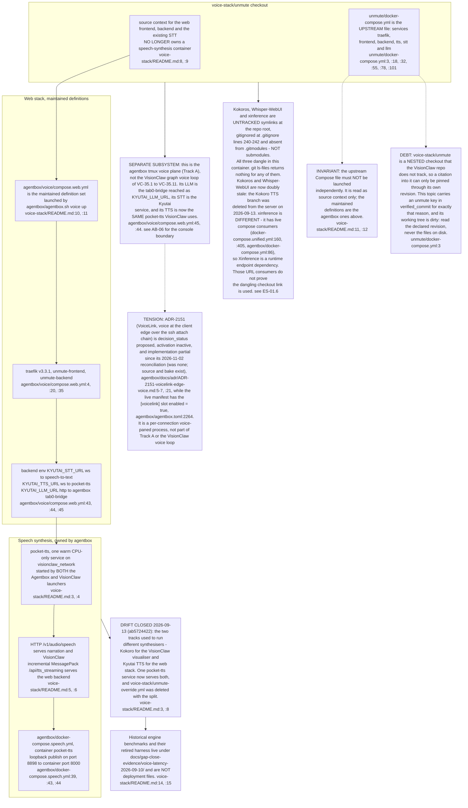

## VC-35.13 Barge-in, cancelling an utterance already in flight

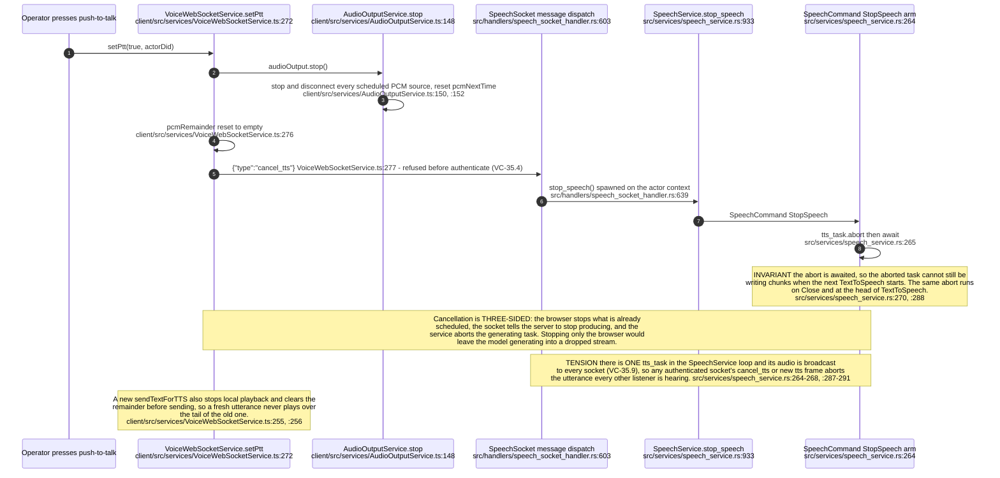

## VC-35.14 Session lifecycle — connect, heartbeat timeout, auth deadline, reconnect

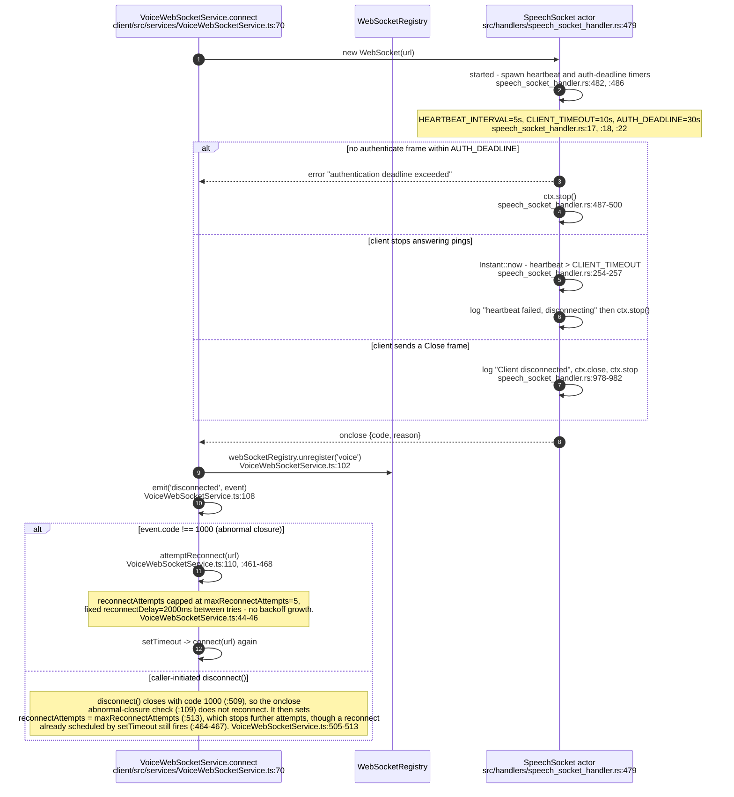
