## For developers

Restamped at 86cdd76: the 2026-10-30 note that the spatial-volume merge 772039bd1 (ADR-2158, ADR-2159, ADR-2164) had not been re-read is closed: VC-36.3, VC-36.4, VC-36.7, VC-36.19, VC-36.22 and VC-36.24 are redrawn, and VC-36.23 has its gate line corrected, against the per-source `BackendConnection`, the per-volume `ConnectionVolumeSource` packing and the edge-run choreography at this stamp. The connections, volumes, portals, grabs and link layer themselves are drawn in VC-40, VC-44, VC-45, VC-46, VC-47 and VC-53, not here.

The [visual-budget and engine-gate audit](51-xr-visual-budget-and-engine-gates.md) qualifies the later extras allowance and 4.8-beta2 target; older engine and allocator descriptions below retain their historical pins.

Restamped at a950f4d80 (2026-11-06): only docs moved. The ADR-2188 headset receipt (`docs/adr/ADR-2188-the-xr-client-adopts-the-overview-first-contract-without-bloom.md:52`, `docs/XR-client.md:8`) resolves the live-run Open, ADR-2189's amendment resolves its acceptance-boundary Drift, and the XR-client.md changelog entry moves later citations down one line.

Restamped at 809a859aa (2026-11-06): the XR client's own code did not change. VC-36.10 drops the retired "nginx does not proxy presence" note. VC-36.18 now draws the caller-view gate on the pattern query. The new VC-36.31 shows what the headset's filter and query panel receive after the server visibility sweep, and why the ontology deny-list never reaches it. The `filter_auth.rs`, `force_compute_actor.rs`, `ia.json` and BASELINE citations moved with their symbols.

Restamped at ec785afa9 (2026-11-06): VC-36.3 is redrawn for the signed WebSocket upgrade of `6b811f7a1`, VC-36.8 for the ADR-2189 seven-section HUD, and VC-36.29 and VC-36.30 are new for the ADR-2188 label budget and the headset preferences with Fit. The ADR-2188 overview tier, edge limit and highlight mask are drawn in [VC-51](51-xr-visual-budget-and-engine-gates.md). Evidence at this stamp is headless GUT and Rust units; shader compilation and headset legibility were not checked from the container.

## For the business

The headset is a second way into the same knowledge graph: a person in a VIVE or Quest sees the graph, the memory cloud and the agents at room scale, and can grab and pin nodes when the server lets them write. Since 6 November its menu uses the same seven sections as the desktop, labels go to the most important nearby nodes, and its own settings survive a restart. What is still unproven is the experience in the headset itself: legibility, comfort and the 90 fps floor are measured by a person wearing it, not by the tests here.

## VC-36.1 Boot — OpenXR init, capability probe, deferred scene swap (ADR-2036)

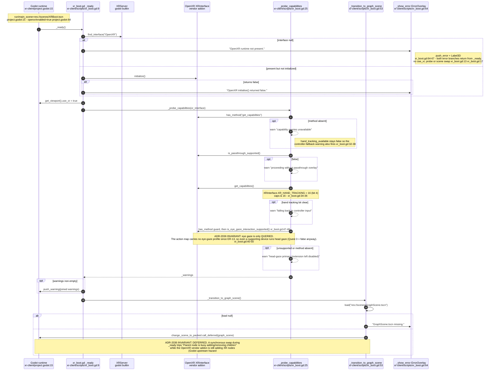

## VC-36.2 Renderer and XR project configuration (ADR-2032, forced Compatibility)

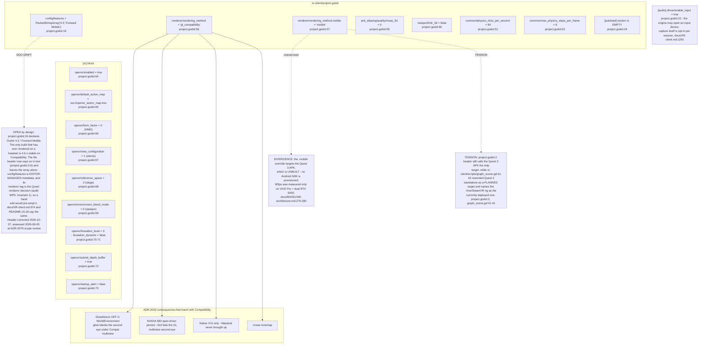

## VC-36.3 Transport — signed /wss upgrade, topology request, position acknowledgements

```mermaid
sequenceDiagram
    autonumber
    participant GS as _connect_from_env<br/>xr-client/scripts/graph_scene.gd:2941
    participant CT as connect_to_server<br/>xr-client/scripts/graph_scene.gd:2978
    participant BC as BackendConnection, one per source<br/>xr-client/scripts/backend_connection.gd:59
    participant BP as BinaryProtocolClient (gdext)<br/>xr-client/rust/src/binary_protocol.rs:1191
    participant TR as spawn_graph_stream<br/>xr-client/rust/src/transport.rs:121
    participant SG as NostrSigner<br/>xr-client/rust/src/signer.rs:26
    participant SV as VisionClaw server /wss

    Note over GS,BC: _ready builds TWO connections, visionclaw with XR_NOSTR_SECRET and codescape with<br/>no secret, each with its own BinaryProtocolClient graph_scene.gd:1406-1416 (ADR-2159).<br/>GRAPH_STREAM_PATH="/wss" graph_scene.gd:88, PRESENCE_PATH="/ws/presence" graph_scene.gd:89
    GS->>GS: _vc_base() = XR_BACKEND_WS (default ws://localhost:4000), trailing "/" stripped graph_scene.gd:2958-2959
    GS->>CT: connect_to_server(base+"/wss", base+"/ws/presence", XR_ROOM_URN, XR_DISPLAY_NAME, XR_NOSTR_SECRET)
    Note over GS,CT: graph_scene.gd:2942-2949. The graph URL argument is only logged now: each<br/>connection owns its own URL (graph_scene.gd:2985-2987, backend_connection.gd:99-100).<br/>RESOLVED ADR-2076: no token argument - NIP-98 is the only graph-socket credential.<br/>RESOLVED ADR-2058 (see VC-32.1): the server's ?token= fallback is compiled out of release.<br/>DRIFT BASELINE-architecture.md still lists it as open (docs/BASELINE-architecture.md:406)
    CT->>BC: _connect_graph opens every connection graph_scene.gd:3009-3014
    BC->>BC: open() resets this connection's backoff, then _dial backend_connection.gd:108-112
    BC->>BP: close() then connect_to_url(graph_ws_url, secret), generation += 1<br/>backend_connection.gd:350-357
    BP->>BP: clear the store, swap in a fresh inbox, re-arm the freshness gate<br/>binary_protocol.rs:1315-1333
    BP->>TR: spawn_graph_stream(url, nostr_secret_hex, inbox) binary_protocol.rs:1334-1338
    TR->>TR: graph_upgrade_request builds the HTTP upgrade: same-authority Origin,<br/>Sec-WebSocket-Protocol "visionclaw" alone, or plus a signed NIP-98 "nostr." carrier when a secret is set<br/>transport.rs:49, transport.rs:68-70, transport.rs:71-82, transport.rs:84-87
    opt nostr_secret_hex non-empty (the codescape connection never has one)
        TR->>SG: nip98_http_authorization(signed URL, "GET") signer.rs:138
        SG-->>TR: Nostr header, re-encoded URL-safe as the carrier transport.rs:75-81
    end
    alt upgrade request cannot be built (bad scheme or malformed key)
        TR-->>BP: Disconnected, no connect attempted transport.rs:139-143
    end
    TR->>SV: connect_async_with_config(request, ws_config(), false) transport.rs:147
    Note over TR,SV: the server verifies the carrier before upgrading and answers 401 to a bad or replayed signature,<br/>then echoes the visionclaw subprotocol<br/>src/handlers/socket_flow_handler/http_handler.rs:151-153, src/handlers/socket_flow_handler/http_handler.rs:161-167, src/handlers/socket_flow_handler/http_handler.rs:448
    alt connect fails, including a refused signature
        TR-->>BP: Disconnected pushed into the inbox transport.rs:184 transport.rs:186
        Note right of BP: reconnect scheduled by the connection - see VC-36.4
    else connected
        TR->>SV: Text {"type":"requestInitialData"}
        Note over TR: GRAPH_REQUEST_INITIAL transport.rs:46
        Note over TR,SV: there is no position subscription, the server streams positions to every registered session and waits for the acknowledgements of this client (ADR-2141), the old GRAPH_SUBSCRIBE text frame is removed
        Note over TR: a failed send logs and falls through to Disconnected,<br/>Connected is never pushed transport.rs:155 transport.rs:186
        TR->>BP: Connected pushed only after the topology request is sent transport.rs:161
        BP-->>BC: poll emits connection_changed true binary_protocol.rs:1365-1367
        BC-->>GS: connected_changed(conn_id, true), backoff reset backend_connection.gd:378-383
        opt server selected NO subprotocol and a secret is set (the older first-message contract)
            TR->>SG: nip98_authenticate_json(url, "GET") signer.rs:126
            TR->>SV: Text authenticate transport.rs:165-171
            Note over TR,SV: never taken against VisionClaw, which always echoes visionclaw,<br/>and never by the codescape connection, which has no secret graph_scene.gd:1409
        end
        loop select over the socket and the outbound channel
            SV-->>TR: Binary becomes Frame transport.rs:199
            SV-->>TR: Text classified, frames of 64 KiB or more on the blocking pool<br/>transport.rs:204, transport.rs:239, transport.rs:249-253
            SV-->>TR: Ping answered with Pong transport.rs:207
            BP-->>TR: Outbound::Text (drag, pin, topology refetch) or Outbound::Binary (the 0x34 position acknowledgement) from the outbound channel transport.rs:91-98, transport.rs:217-223
            TR->>BP: push into inbox VecDeque transport.rs:266
        end
    end
    loop every physics tick
        GS->>BC: conn.poll(delta) for each connection, which calls client.poll() graph_scene.gd:3063-3064
        Note over BC: backend_connection.gd:134-136 - drain inbox, decode, emit signals
    end
```

**Invariant:** `Connected` reaches GDScript only after the topology request is on the wire, so a half-open socket never counts as live (`xr-client/rust/src/transport.rs:157-161`, `xr-client/scripts/graph_scene.gd:4632-4633`).
**Invariant:** wire ids are valid within one connection generation only; `_dial`, `close` and every topology load bump it (`xr-client/scripts/backend_connection.gd:17-19`, `xr-client/scripts/backend_connection.gd:360-362`), and the client swaps its inbox on reconnect so nothing from the old socket surfaces (`xr-client/rust/src/binary_protocol.rs:1321-1328`).
**Open (risk):** a refused upgrade signature (`src/handlers/socket_flow_handler/http_handler.rs:161-167`) reaches the headset only as a logged connect failure (`xr-client/rust/src/transport.rs:184`) followed by backoff retries, with no HUD notice naming the credential, unlike the REST write path of VC-36.15.
**Debt (loose end):** the first-message `authenticate` fallback (`xr-client/rust/src/transport.rs:162-180`) is justified by Codescape, but the Codescape connection is always built with an empty secret (`xr-client/scripts/graph_scene.gd:1409`) and VisionClaw always selects a subprotocol (`src/handlers/socket_flow_handler/http_handler.rs:10`), so no current connection takes it.

## VC-36.4 Per-socket independent reconnect backoff

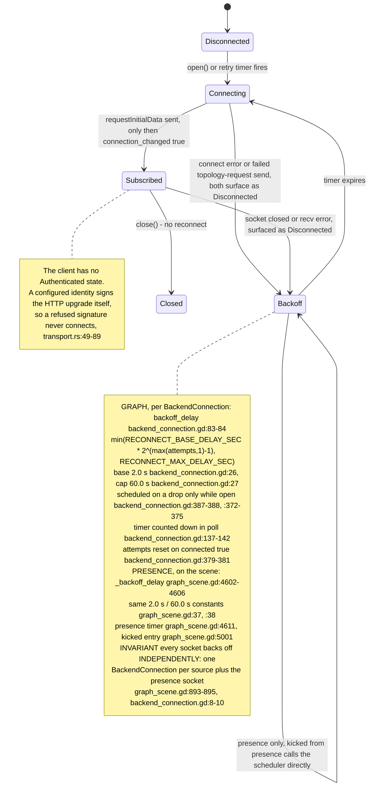

**Debt:** the presence socket keeps its own copy of the backoff (`xr-client/scripts/graph_scene.gd:4602-4613`) beside `BackendConnection.backoff_delay` (`xr-client/scripts/backend_connection.gd:83-84`). The two formulas differ only at `attempts` 0, which the presence path never passes.
**Drift:** the comment in `_on_client_connection_changed` says a drag-end pin persists across a reconnect (`xr-client/scripts/backend_connection.gd:385-386`), but a drag end records no pin since ADR-2172 F3 (`xr-client/scripts/backend_connection.gd:305-307`).

## VC-36.5 V3 / V5 wire records decoded by the gdext crate

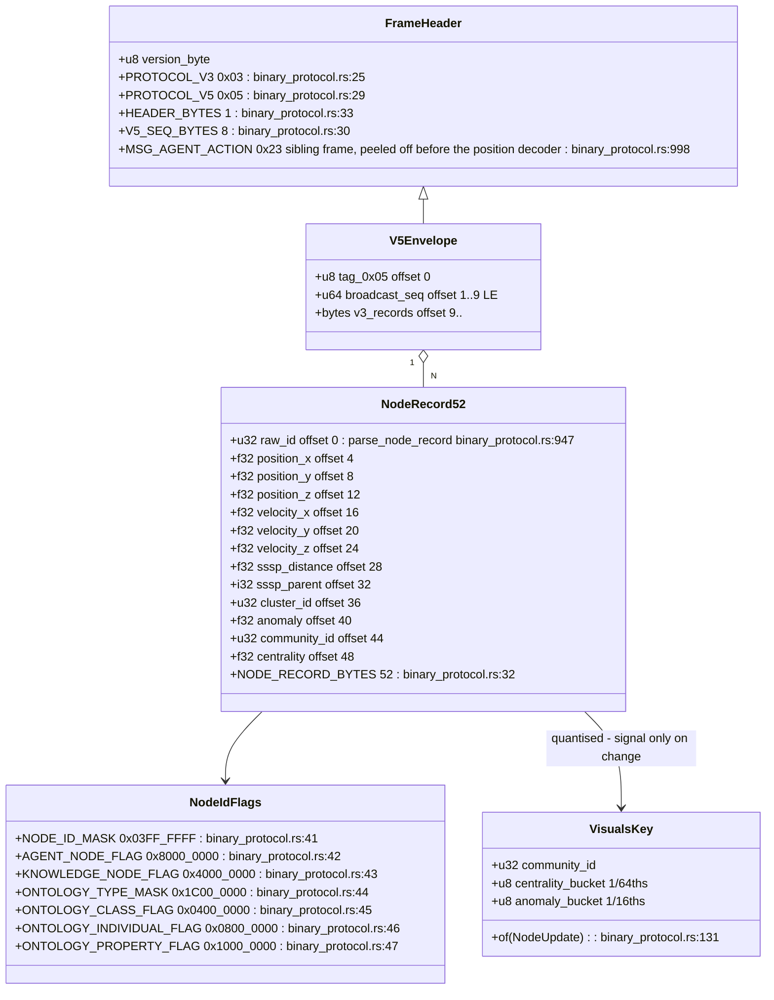

**Debt (loose end):** VisionClaw now writes only the defaults `(INFINITY, -1)` into slot 28 (`docs/BASELINE-architecture.md:252-255`). The headset decodes that slot (`xr-client/rust/src/binary_protocol.rs:962`), sanitises +Inf to 0.0 (`xr-client/rust/src/binary_protocol.rs:931-932`), and no other module reads it, so on the VisionClaw volume the eight SSSP bytes per record carry nothing.

## VC-36.6 Frame ingest — drain, version dispatch, decode and sanitise, then freshness admission

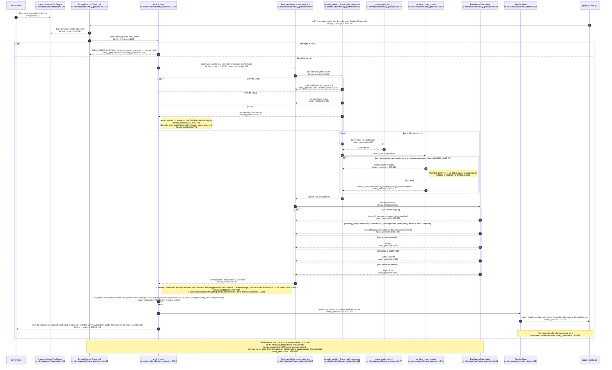

**Debt:** `ingest_frame` is a second decode-and-sink path with a quiet `BadVersion` arm that production never calls, only tests (`xr-client/rust/src/binary_protocol.rs:976`, `xr-client/rust/src/binary_protocol.rs:3250`). The live path is `emit_frame` (`xr-client/rust/src/binary_protocol.rs:2707`).
**Invariant:** a frame is fully decoded and sanitised before the freshness gate judges it, so a stale frame costs a full decode and is then dropped (`xr-client/rust/src/binary_protocol.rs:880-881`).

## VC-36.7 RenderStore instance packing and the stride-16 invariant (ADR-2034)

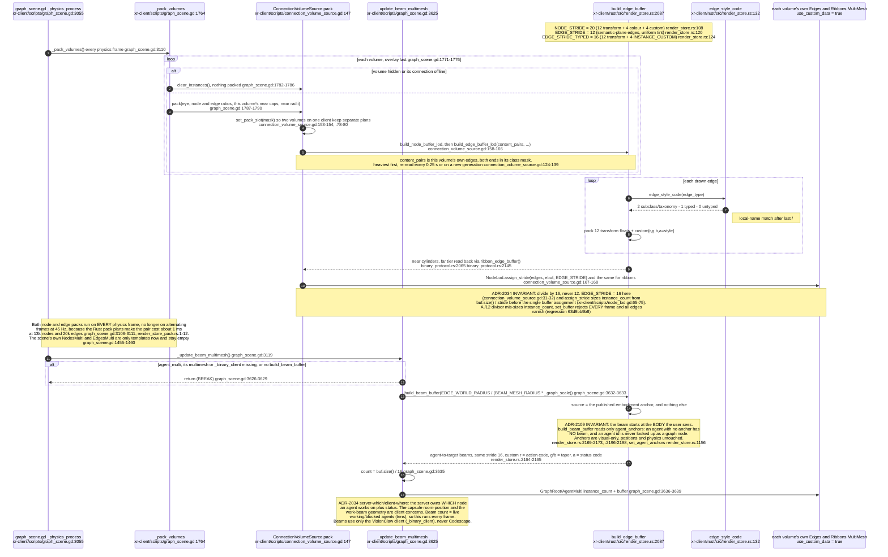

## VC-36.8 HUD, shared instrument theme, the seven ADR-2189 sections with a rail, and press-mode controls

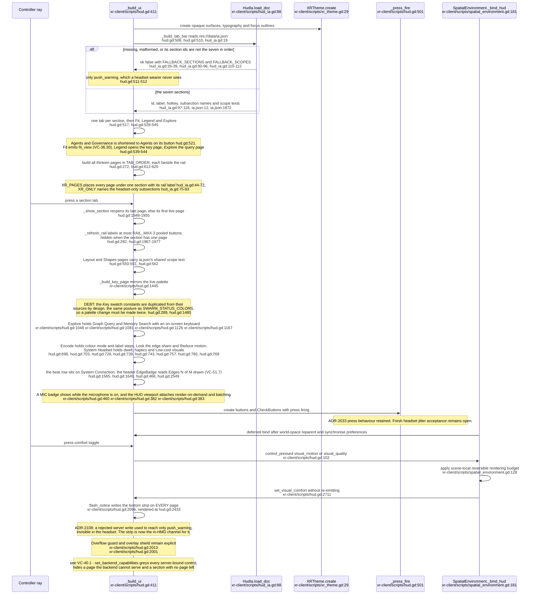

**What it shows.** Since 2026-11-06 the tab bar is the desktop's seven sections from `xr-client/data/ia.json` plus Fit, Legend and Explore, and a rail picks a section's pages, so every control is two levels deep. **Why it is this way.** ADR-2189 gives desktop and headset one information architecture, two levels deep (`docs/adr/ADR-2189-desktop-and-xr-menus-share-one-seven-section-information-architecture.md:39`, `docs/adr/ADR-2189-desktop-and-xr-menus-share-one-seven-section-information-architecture.md:108-109`); the headset takes the vocabulary from the generated file and places its own pages under it (`xr-client/scripts/hud_ia.gd:3-17`), with `test_hud_ia.gd` checking every name (`xr-client/tests/unit/test_hud_ia.gd:68`).
**Debt (parallel):** the built-in seven sections and scope texts (`xr-client/scripts/hud_ia.gd:26-39`) duplicate the committed `xr-client/data/ia.json`, itself a byte copy of `client/src/features/control-center/registry/ia.json` (`xr-client/scripts/hud_ia.gd:6-8`); `xr-client/tests/unit/test_hud_ia.gd:38` pins the fallback to the file.
**Open (risk):** a malformed or six-section `ia.json` silently drops the headset to the built-in menu: the only signal is `push_warning` (`xr-client/scripts/hud.gd:511-512`), the channel ADR-2108 already found invisible in a headset, not the notice strip (`xr-client/scripts/hud.gd:2096`).
Resolved at a950f4d80: ADR-2189's acceptance boundary now says the XR HUD is built and reads `xr-client/data/ia.json` (`docs/adr/ADR-2189-desktop-and-xr-menus-share-one-seven-section-information-architecture.md:18`), and its 2026-11-06 amendment withdraws the earlier "not built" text (`docs/adr/ADR-2189-desktop-and-xr-menus-share-one-seven-section-information-architecture.md:361`), matching the tab bar, rail and header buttons (`xr-client/scripts/hud.gd:506-545`).
**Tension (ADR-2189 vs code):** ADR-2189 gives XR "the same five dials as ± steppers on Layout and Look" (`docs/adr/ADR-2189-desktop-and-xr-menus-share-one-seven-section-information-architecture.md:148`), but the headset has only Spread and the label budget, with no Motion, Glow or Atmosphere stepper (`docs/XR-client.md:1125-1127`).
**Debt (loose end):** the rail is a pool of `RAIL_MAX` 3 buttons (`xr-client/scripts/hud.gd:282`) and `_refresh_rail` labels only that many (`xr-client/scripts/hud.gd:1969-1970`); Layout and System already fill it (`xr-client/scripts/hud_ia.gd:56-60`, `xr-client/scripts/hud_ia.gd:67-71`), so a fourth page in either would be unreachable from the rail without any error.

## VC-36.9 Agent co-presence and the 0x23 work-beam data plane

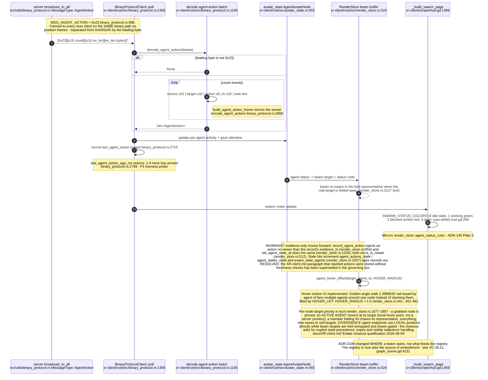

## VC-36.10 Presence socket — challenge/auth/joined handshake and 0x43 pose traffic

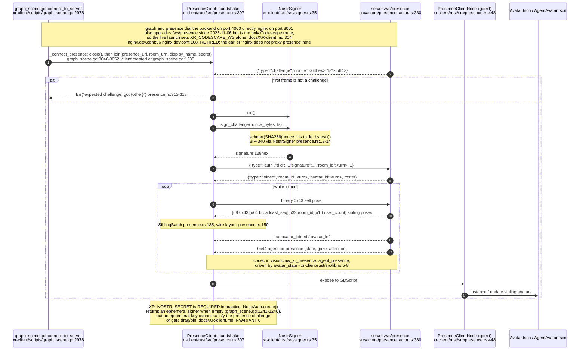

## VC-36.11 HTTP writes — NIP-98 per-request header and the dev-bearer fallback

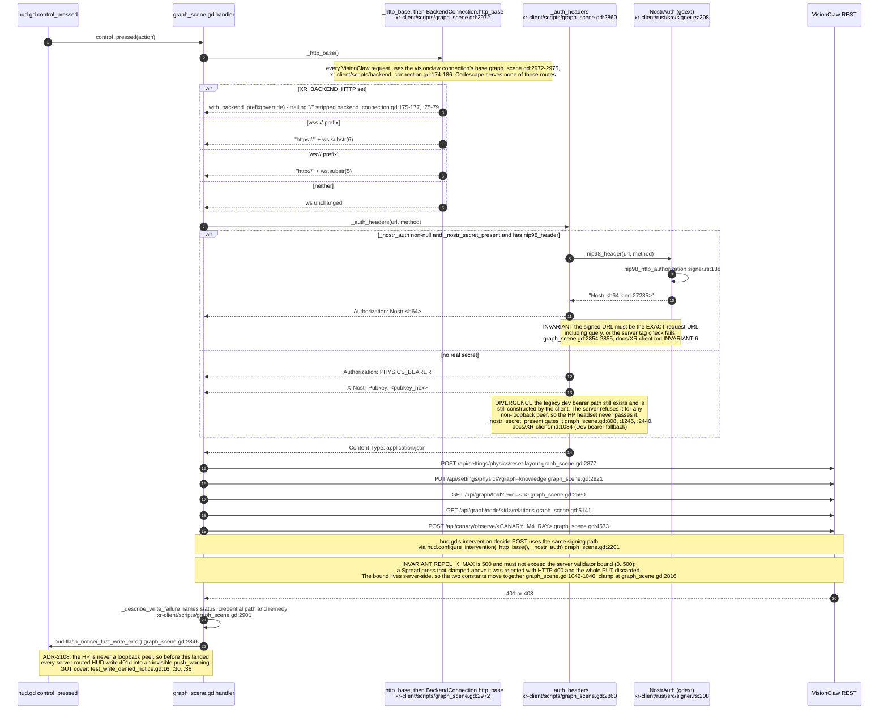

## VC-36.12 Constrained layouts and the DAG-rank label accept (ADR-2035)

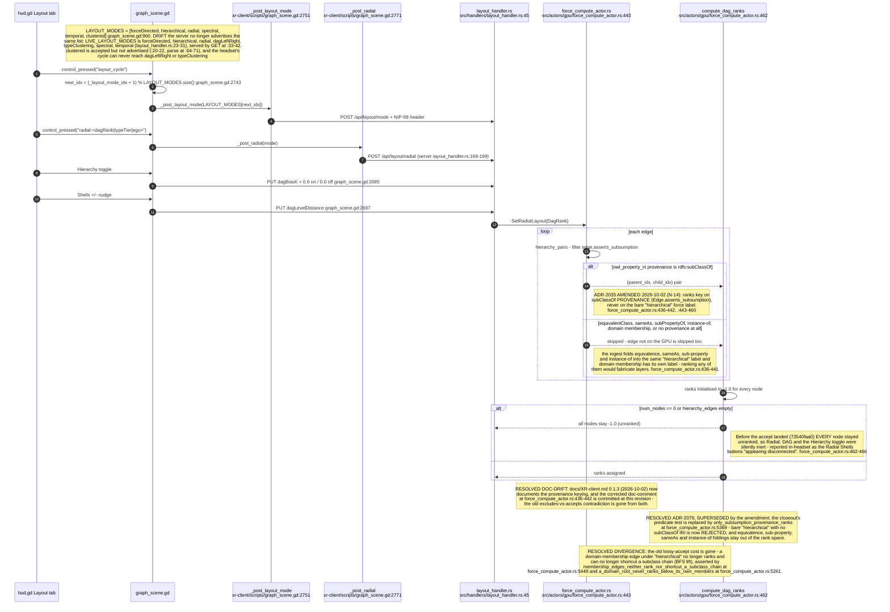

## VC-36.13 gdext class surface (GDScript composes, Rust owns the wire)

```mermaid
classDiagram
    class VisionclawXrExtension {
        <<gdextension>>
        on_level_init(InitLevel) : xr-client/rust/src/lib.rs:72
        init_tracing at InitLevel::Scene : xr-client/rust/src/lib.rs:82
    }
    class BinaryProtocolClient {
        base RefCounted : binary_protocol.rs:1191
        poll()
        build_edge_buffer(pairs, radius)
        build_beam_buffer(radius)
        last_agent_action_age_ms() : binary_protocol.rs:1797
    }
    class PresenceClientNode {
        base RefCounted : presence.rs:448
        handshake challenge-auth-joined
        0x43 pose - 0x44 agent co-presence
    }
    class NostrAuth {
        base RefCounted : signer.rs:208
        from_secret_hex(hex) : signer.rs:35
        generate() ephemeral : signer.rs:55
        nip98_authenticate_json(url, method) : signer.rs:126
        nip98_http_authorization(url, method) : signer.rs:138
    }
    class XrInteraction {
        base RefCounted : interaction.rs:122
        hand ray cast + pinch detection
        HandRay, TargetCandidate, RaycastHit : interaction.rs:28
    }
    class GazeTracker {
        base RefCounted : gaze.rs:215
        GazeResolver, OneEuroFilter : gaze.rs:115
        degrades eye-gaze to head when unsupported
    }
    class SelectionArbiterNode {
        base RefCounted : selection.rs:436
        three-resolver arbiter selection.rs:240
        DwellCharger, SelectionConfig : selection.rs:125
    }
    class ProxemicsSolver {
        base RefCounted : proxemics.rs:203
        Hall's-zones arc solver
    }
    class AgentAvatarNode {
        base RefCounted : avatar_state.rs:455
        per-agent activity + gaze attention
    }
    class LodPolicy {
        base RefCounted : lod.rs:379
        distance-bucket LOD
    }
    class SpatialVoiceRouter {
        base RefCounted : webrtc_audio.rs:141
        SpatialVoiceRouterCore : webrtc_audio.rs:43
        ListenerTransform, VoiceTrackState : webrtc_audio.rs:30
    }
    class RenderStore {
        plain struct : render_store.rs:524
        NODE_STRIDE 20 - EDGE_STRIDE 12 - EDGE_STRIDE_TYPED 16
    }
    VisionclawXrExtension --> BinaryProtocolClient
    VisionclawXrExtension --> PresenceClientNode
    VisionclawXrExtension --> NostrAuth
    VisionclawXrExtension --> XrInteraction
    VisionclawXrExtension --> GazeTracker
    VisionclawXrExtension --> SelectionArbiterNode
    VisionclawXrExtension --> ProxemicsSolver
    VisionclawXrExtension --> AgentAvatarNode
    VisionclawXrExtension --> LodPolicy
    VisionclawXrExtension --> SpatialVoiceRouter
    BinaryProtocolClient --> RenderStore
    PresenceClientNode --> NostrAuth
    SpatialVoiceRouter --> AgentAvatarNode
```

## VC-36.14 OpenXR action map and input bindings

```mermaid
flowchart LR
    subgraph acts["Actions - openxr_action_map.tres"]
        A1["trigger / trigger_click / trigger_touch<br/>openxr_action_map.tres:4,9,15 - /user/hand/left + right"]
        A2["grip / grip_click / grip_force<br/>openxr_action_map.tres:21,26,32"]
        A3["primary + primary_click + primary_touch<br/>openxr_action_map.tres:37,43,49"]
        A4["secondary + secondary_click + secondary_touch<br/>openxr_action_map.tres:55,61,67"]
        A5["menu_button openxr_action_map.tres:73 - select_button openxr_action_map.tres:79"]
        A6["ax_button + ax_touch + by_button + by_touch (A/X and B/Y)<br/>openxr_action_map.tres:85,91,97,103"]
        A7["poses: default_pose, aim, grip_pose, palm_pose openxr_action_map.tres:109,115,121,127 - haptic openxr_action_map.tres:133<br/>23 actions in all, sub-resources at openxr_action_map.tres:3-132"]
    end
    subgraph prof["Interaction profiles bound in the map"]
        P1["khr/simple_controller openxr_action_map.tres:200"]
        P2["htc/vive_controller openxr_action_map.tres:316 - the validated device"]
        P3["microsoft/motion_controller openxr_action_map.tres:440"]
        P4["oculus/touch_controller openxr_action_map.tres:588"]
        P5["bytedance/pico4_controller openxr_action_map.tres:740"]
        P6["valve/index_controller openxr_action_map.tres:920"]
        P7["hp/mixed_reality_controller openxr_action_map.tres:1036"]
        P8["samsung/odyssey_controller openxr_action_map.tres:1160"]
        P9["htc/vive_cosmos_controller openxr_action_map.tres:1284"]
        P10["htc/vive_focus3_controller openxr_action_map.tres:1424"]
        P11["huawei/controller openxr_action_map.tres:1516"]
        P12["htc/vive_tracker_htcx openxr_action_map.tres:1648"]
        P14["ext/hand_interaction_ext openxr_action_map.tres:1732"]
    end
    acts --> prof
    prof -.-> P13X
    prof --> XI["project.godot:65<br/>openxr/default_action_map"]
    P13X["REMOVED (ER-13, VisionClaw 2bf892c3f): the ext/eye_gaze_interaction profile, its gaze-pose binding and /user/eyes_ext in the default pose top-level paths are gone from the map.<br/>Eye gaze is now unbound on every headset and the gaze source always falls back to head gaze, because an interaction profile cannot be added to a live action map after the session starts.<br/>docs/adr/ADR-2036-defensive-openxr-boot.md:101-107, xr_boot.gd:40-50, gaze.rs:138"]
    XI --> CTL["XRController3D left and right read the actions<br/>xr-client/scripts/graph_scene.gd:1197 xr-client/scripts/graph_scene.gd:1198"]
    CTL -. "GDScript pushes values, no action-map read in Rust" .-> XR["XrInteraction (RefCounted) hand ray + pinch<br/>xr-client/rust/src/interaction.rs:122 xr-client/scripts/graph_scene.gd:1234"]
    CTL -.-> GZ["GazeTracker (RefCounted) head/eye ray<br/>xr-client/rust/src/gaze.rs:215 xr-client/scripts/graph_scene.gd:1239"]
    CTL -.-> SA["SelectionArbiterNode (RefCounted)<br/>xr-client/rust/src/selection.rs:436 xr-client/scripts/graph_scene.gd:1238"]
```

## VC-36.15 VISIONCLAW_DEV_MODE LAN bypass from the headset's perspective (ADR-2039, ADR-2108)

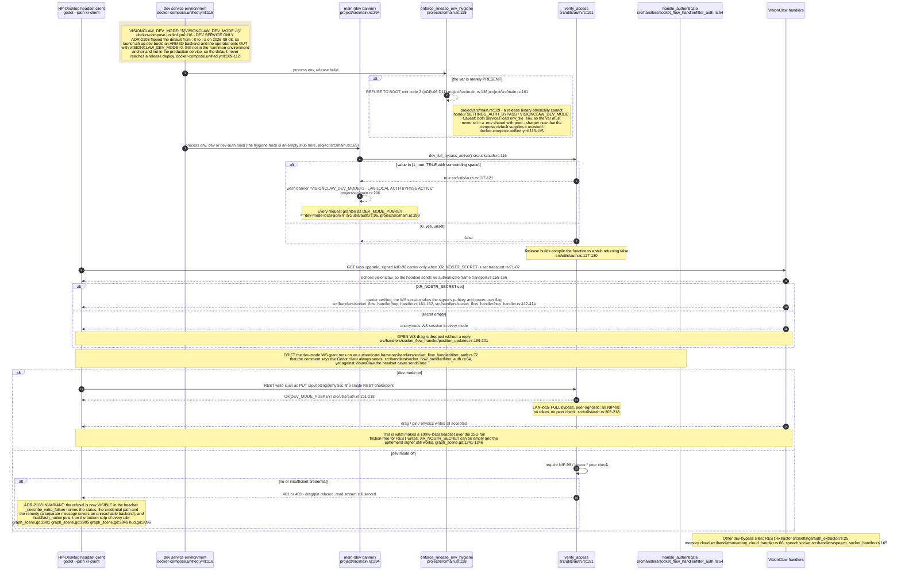

**Open (risk):** with dev mode on and `XR_NOSTR_SECRET` empty, the headset's REST writes pass the bypass (`src/utils/auth.rs:211-218`) but its graph socket stays anonymous (`xr-client/rust/src/transport.rs:71-72`, `xr-client/rust/src/transport.rs:165-166`), so every node drag is dropped server-side without a reply (`src/handlers/socket_flow_handler/position_updates.rs:199-201`) and the headset shows nothing; the secret condition predates `6b811f7a1`, so this is not new.

## VC-36.16 Deploy ceremony and the perf-regression gate

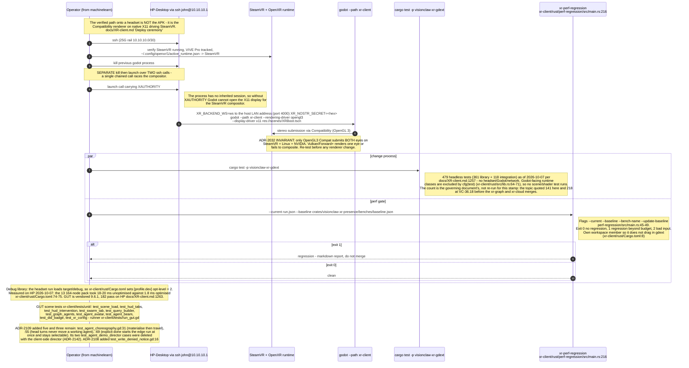

## VC-36.18 Query builder execute path — implemented, acceptance open

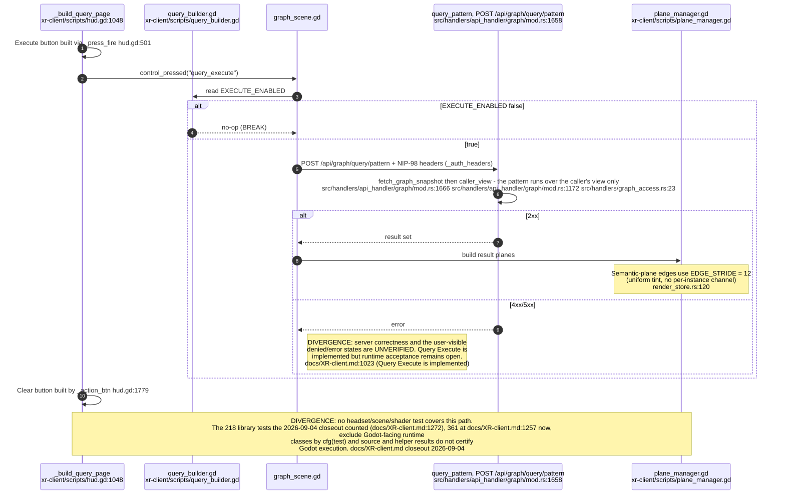

## VC-36.19 Co-proximate label fade — second MultiMesh, not a transparent gem.tres

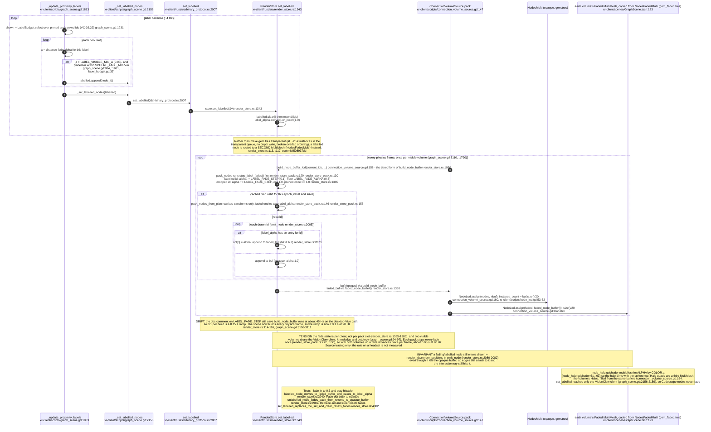

## VC-36.20 Spatial visual experience and its validation boundary (ADR-2107)

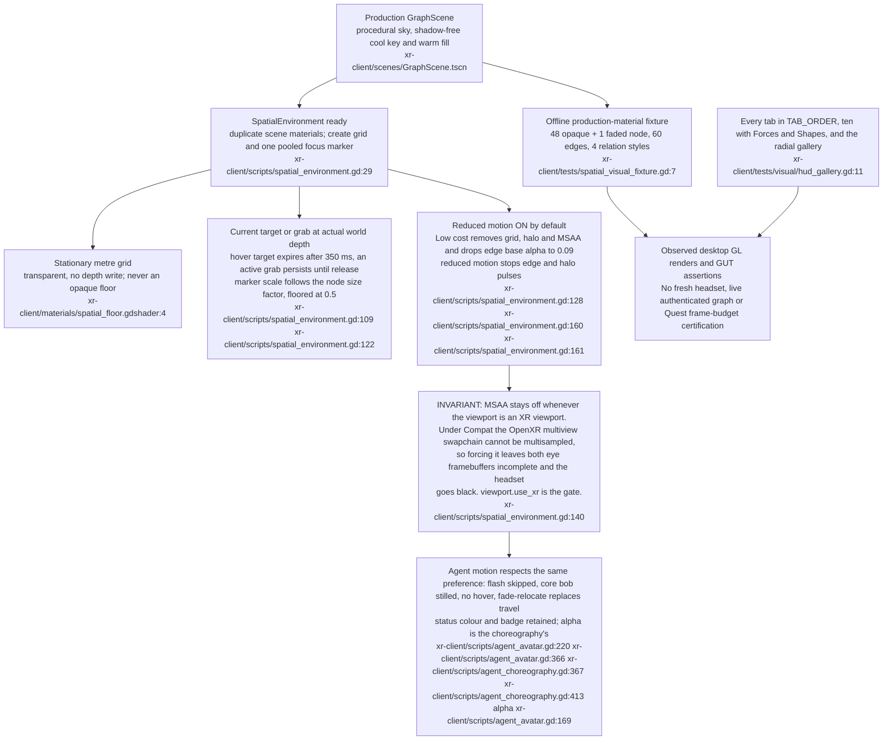

## VC-36.21 Registry to embodiment, the ~4 Hz reconcile (ADR-2109)

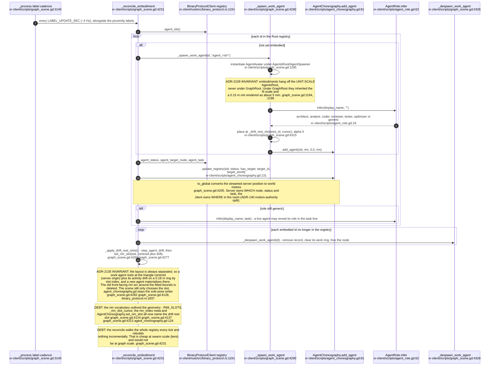

## VC-36.22 The single pose owner, one embodiment's phase machine

```mermaid
stateDiagram-v2
    [*] --> Materialise
    Materialise --> Edge: settled and status already done
    Materialise --> Travel: settled and live with a target
    Materialise --> Rest: settled but idle or no target
    Travel --> Arrive: move finished, arrive event
    Arrive --> Work: ARRIVE_SEC elapsed
    Work --> Travel: registry target changed, hand-off
    Work --> Edge: status becomes done
    Arrive --> Edge: status becomes done
    Travel --> Edge: done transition from the registry
    Rest --> Edge: done transition from the registry
    Work --> Rest: target lost or status idle
    Arrive --> Rest: target lost or status idle
    Edge --> Travel: named again, live with a target
    Edge --> Rest: no longer done and not live
    Rest --> Travel: live again with a target
    note right of Work
        agent_choreography.gd is the SOLE writer of a work-layer
        embodiment's position and alpha. tick agent_choreography.gd:149
        pose agent_choreography.gd:155, applied graph_scene.gd:4403
        phases PH_MATERIALISE to PH_REST agent_choreography.gd:30-35
        transitions _after_settled :232-238, _check_work_transitions :246-255,
        done from update_registry :144-145, edge run exit :307-313, rest exit :258-261
        INVARIANT the proxemics arc places CONVERSATION-layer avatars only
        graph_scene.gd:4077, graph_scene.gd:4375
        INVARIANT nudge targets, idle radial drift and random graph points
        are deleted and must not return, ADR-2109 Consequences
        ADR-2135 activity drift moves only the REST SLOT, never a pose:
        graph_scene.gd:4277, Invariant 8 docs/XR-client.md:1244
    end note
    note left of Edge
        DONE RULE shared with the desktop (ADR-2135, ADR-2109):
        r0 + (edge - r0) * easeOutCubic(elapsed / 30 s) from the centre
        EDGE_SECONDS 30.0 agent_choreography.gd:50, run :306-323
        stops at the scene edge or the head-exclusion sphere, whichever is nearer :318
        holds when the edge is unknown agent_choreography.gd:314-316
        TRAVEL_SPEED 0.32 m per second agent_choreography.gd:45
        SLOT_DISTANCE 0.32 m off the node agent_choreography.gd:56
        HEAD_EXCLUSION 1.0 m agent_choreography.gd:59
        ALPHA_FADED 0.3 for Edge and Rest, agents stay selectable
        agent_choreography.gd:60, :296, :346
        Rest relaxes onto the drift rest slot :352-358
        Reduced motion replaces travel with fade, relocate, fade
        agent_choreography.gd:63, :382-396
        The 30 s evidence TTL is the other exit from working
        render_store.rs:1057
    end note
```

**Drift:** the earlier Complete and Park phases, `COMPLETE_SEC`, `ALPHA_PARKED` and the `park` event are gone at this stamp. A done agent now runs to the scene edge (`xr-client/scripts/agent_choreography.gd:282-298`) and a lapsed one rests on its slot (`xr-client/scripts/agent_choreography.gd:342-347`). The cross-client constant is pinned by `tests/unit/test_agent_edge_run.gd`, per the header at `xr-client/scripts/agent_choreography.gd:20-28`.

## VC-36.23 Demo mode is one server-side producer of 0x23 frames that the headset only controls and mirrors (ADR-2109 D5, ADR-2142)

```mermaid
sequenceDiagram
    autonumber
    participant HD as Swarm tab Start Agent Demo<br/>xr-client/scripts/hud.gd:1375
    participant GP as GraphParity<br/>xr-client/scripts/graph_parity.gd:134
    participant GS as _post_demo<br/>xr-client/scripts/graph_scene.gd:5681
    participant SV as server agents demo<br/>POST and GET /api/agents/demo
    participant BP as BinaryProtocolClient<br/>xr-client/rust/src/binary_protocol.rs:1918
    participant ST as RenderStore agent registry<br/>xr-client/rust/src/render_store.rs:939

    HD->>GP: control_pressed("toggle_demo") graph_parity.gd:134
    GP->>GS: _post_demo(not _demo_running) graph_parity.gd:137-138
    GS->>GS: _gate_for_volume(_focused_volume, BackendCaps.DEMO) refuses it on a backend without the<br/>route graph_scene.gd:5684, gate at graph_scene.gd:2246
    GS->>SV: POST {running: bool} with a NIP-98 header graph_scene.gd:5689
    Note over SV: the demo is produced ONCE, on the server: six agents on the<br/>reserved ids 0x80000000 | 0xD001..0xD006 send ordinary 0x23<br/>frames to EVERY client,<br/>so the headset and the browser see the same agents working<br/>the same nodes. The former client-side AgentDemoDirector<br/>GDScript and its tests are deleted.<br/>docs/adr/ADR-2109-xr-agent-embodiment-single-pose-owner-and-demo-via-ingest.md:146-153
    SV-->>BP: 0x23 frames over /wss, ingested like any agent action (the<br/>SAME door a live swarm uses)
    BP->>ST: record_agent_action
    GS->>GP: _on_demo_completed, apply_demo_body(body) on a 2xx graph_scene.gd:5697
    alt server refused or unreachable
        GS-->>HD: flash_notice with the server error, for example an empty<br/>graph graph_scene.gd:5703-5709
    end
    loop every DEMO_POLL_SEC 4.0
        GP->>SV: GET /api/agents/demo graph_parity.gd:404, graph_parity.gd:421
        SV-->>GP: running true or false, parse_demo_status graph_parity.gd:366
        GP->>GP: apply_demo_body adopts the SERVER state, so a demo started<br/>from the browser reads as running here graph_parity.gd:386
    end
    opt the demo has just STOPPED, from either client
        GP->>BP: retire_agents(DEMO_AGENT_IDS) for exactly the six reserved<br/>ids graph_parity.gd:393-397, binary_protocol.rs:1918
        BP->>ST: remove record and anchor outright render_store.rs:1215
        GP->>GS: _reconcile_embodiment() at once, real agents untouched graph_parity.gd:398-399
    end
    Note over GS,ST: ADR-2109 INVARIANT: no fake position frames, no demo branch<br/>in rendering or protocol. The scene only names the six<br/>agents through demo_role_name (graph_scene.gd:4184)<br/>and the synthetic agents carry NO demo marker in frames,<br/>roster rows or payloads, provenance is the reserved id range<br/>alone.<br/>A demo regression is therefore a production regression.
    Note over BP: server_clock_ms is no longer a producer dependency on the<br/>headset because timestamps come from the server, it is still<br/>exposed binary_protocol.rs:1935
```

**What it shows.** The headset holds only the HUD button and a mirror of the server's demo state. The producer, the six reserved agent ids and the timestamps all live on the server, so both clients see one demo.

**Why it is this way.** The demo used to exist once per client and each copy fed only its own screen. ADR-2142 made it one server-side producer and the 2026-10-19 amendment to ADR-2109 records that D5 ("demo via ingest" from a client director) no longer matches the code while D1-D4 and D6 hold.

## VC-36.24 What an embodied agent is made of, and the effects that follow it

```mermaid
flowchart TB
    subgraph body["Body - one AgentAvatar under AgentsRoot"]
        CORE["Faceted core, CORE_RADIUS 0.14 m<br/>xr-client/scripts/agent_avatar.gd:52"]
        FRAME["Procedural role frame, six shapes plus generic hoop<br/>frame_mesh caches per role<br/>xr-client/scripts/agent_role.gd:80"]
        PTR["Pointer cone, POINTER_LENGTH 0.09 m, aimed at the target<br/>xr-client/scripts/agent_avatar.gd:53, set_aim agent_avatar.gd:267"]
        BADGE["World-size badge, two-letter role code plus name<br/>set_work_identity xr-client/scripts/agent_avatar.gd:240"]
        CAP["Task caption, shown only while announcing or selected<br/>set_caption_visible xr-client/scripts/agent_avatar.gd:227"]
    end
    subgraph fx["Work cues - AgentEffects under AgentEffectsRoot"]
        RING["Pulsing ring on the node being worked<br/>set_ring xr-client/scripts/agent_effects.gd:104"]
        BEADS["Hand-off packet beads on a straight line between the previous and the new target node<br/>send_packets xr-client/scripts/agent_effects.gd:86 xr-client/scripts/agent_choreography.gd:268-271"]
        FLASH["600 ms arrival flash on the body<br/>flash xr-client/scripts/agent_avatar.gd:219"]
        BURST["Completion burst<br/>burst xr-client/scripts/agent_effects.gd:118"]
        BEAM["Work beam on GraphRoot/AgentMulti, origin at the anchor, built each frame from the registry<br/>working or blocked agents only, and only when the target is in the drawn set<br/>xr-client/rust/src/render_store.rs:2177 xr-client/rust/src/render_store.rs:2189-2192 xr-client/rust/src/render_store.rs:2196-2198"]
        POSE["Per-frame pose from the single pose owner: ring only while working with a target<br/>xr-client/scripts/graph_scene.gd:4418-4421"]
    end
    EV["_choreo.take_events drains depart, arrive, handoff and complete - there is no park event now<br/>xr-client/scripts/agent_choreography.gd:174 emitted at xr-client/scripts/agent_choreography.gd:298 xr-client/scripts/agent_choreography.gd:269 xr-client/scripts/agent_choreography.gd:279 xr-client/scripts/agent_choreography.gd:408<br/>the scene consumes only complete, handoff and arrive, depart is ignored<br/>xr-client/scripts/graph_scene.gd:4435-4449"]
    RM["Reduced motion default ON: beads, flash and hover suppressed<br/>xr-client/scripts/graph_scene.gd:4345"]
    TOG["Agents layer toggle hides AgentsRoot, AgentEffectsRoot and the Rust agent-type MultiMesh via set_type_visible 2,<br/>then forces a draw-list rebuild, which also drops beams to hidden targets<br/>choreography, registry, handles and physics keep running<br/>xr-client/scripts/graph_scene.gd:2483 xr-client/scripts/graph_scene.gd:2490 xr-client/scripts/graph_scene.gd:2493"]
    CORE --> FRAME --> PTR --> BADGE --> CAP
    CAP --> EV
    EV -->|"handoff"| BEADS
    EV -->|"arrive"| FLASH
    EV -->|"complete"| BURST
    CAP --> POSE --> RING
    CAP --> BEAM
    BURST --> RM
    RING --> RM
    BEAM --> RM --> TOG
    TOG --> INV["INVARIANT: anchors are visual only. set_agent_anchors never<br/>touches node positions or physics. An agent with no anchor has NO beam:<br/>the old fallback to a streamed node position is removed, and an agent id is never read as a node id.<br/>xr-client/rust/src/render_store.rs:1156 xr-client/rust/src/render_store.rs:2169-2173 xr-client/rust/src/render_store.rs:2196-2198"]
```

**Drift:** the comments at `xr-client/scripts/graph_scene.gd:4440` ("travels the real edge") and `xr-client/scripts/agent_effects.gd:84` ("along a real edge") describe an edge route, but the hand-off event carries only two world points (`xr-client/scripts/agent_choreography.gd:268-271`) and `send_packets` interpolates between them (`xr-client/scripts/agent_effects.gd:93-97`).

## VC-36.25 Desktop-parity layers added after the af3dff3 stamp (WP1-WP8, ADR-2047, ADR-2133, ADR-2134)

```mermaid
flowchart TB
    LIB["gdext crate grows by fourteen modules: attention, beat, cloud_frame, domain_palette, frame_budget,<br/>hulls, memory_cloud, memory_query, memory_route, perf_fixture, semantic, settings_sync, thread_cpu,<br/>and pulse (cfg not test) xr-client/rust/src/lib.rs:27-60.<br/>Since that count, link_index and link_packer joined for the ADR-2164 link layer (xr-client/rust/src/lib.rs:38-39, see VC-45)"]
    WIRE["INVARIANT: no new wire version. Records stay V3 0x03 and V5 0x05, 52 bytes<br/>binary_protocol.rs:25 binary_protocol.rs:29 binary_protocol.rs:32.<br/>The new data arrives as /wss TEXT frames and as REST reads"]

    subgraph text["Text frames routed in _on_graph_text"]
        T1["settingsUpdated, filter_update_success, graphUpdated<br/>graph_parity.gd:24, routed at graph_scene.gd:4553"]
        T2["beatClock, pong, memory_flash<br/>beat_pulse.gd:95, routed at graph_scene.gd:4557"]
        T3["memoryRoute, relayed per session<br/>memory_cloud_layer.gd:473, routed at graph_scene.gd:4567"]
    end

    subgraph rust["Rust side behind BinaryProtocolClient"]
        S1["handle_settings_text applies a nodeFilter to the store, ADR-2047 receive rules<br/>binary_protocol.rs:1579 settings_sync.rs:242; never writes back to the server"]
        S2["graphUpdated coalesced into requestInitialData by RefetchGate<br/>binary_protocol.rs:1621 settings_sync.rs:310"]
        S3["domain colour mode and cluster hulls<br/>binary_protocol.rs:1537 binary_protocol.rs:1712 hulls.rs:461"]
        S4["memory_flash credits the memory vertex of the agent drift field<br/>binary_protocol.rs:1819"]
    end

    subgraph pack["Per-frame pack, one pass shared by every layer"]
        P1["pack plans: transforms only while the visual epoch, id list and sizes hold<br/>render_store_pack.rs:129 render_store_pack.rs:146"]
        P2["tiers: NEAR_CAP gem nodes within NEAR_RADIUS_M, the rest 2-triangle impostors<br/>node_lod.gd:26 node_lod.gd:28 render_store_pack.rs:262 lod.rs:266"]
        P3["edges: NEAR_EDGE_CAP cylinders, the rest far ribbons<br/>node_lod.gd:15 node_lod.gd:17 render_store_pack.rs:363"]
        P4["FrameBudget turns drawn instance counts and the measured frame total into caps<br/>graph_scene.gd:3578 frame_budget_pass.gd:111, now also taking the per-volume demand frame_budget.rs:341"]
    end

    subgraph scene["Scene wiring in _ready"]
        W1["MemoryCloudLayer and MemorySearch under GraphRoot<br/>graph_scene.gd:1316 memory_cloud_layer.gd:42 memory_search.gd:21"]
        W2["GraphParity: colour, filter, hulls<br/>graph_scene.gd:1382 graph_parity.gd:170"]
        W3["impostor and ribbon MultiMeshes, then BeatPulse<br/>graph_scene.gd:1392 graph_scene.gd:1394 graph_scene.gd:1399"]
    end

    LIB --> WIRE
    WIRE --> T1 & T2 & T3
    T1 --> S1 --> S2
    T1 --> S3
    T2 --> S4
    S3 --> P1 --> P2 --> P3 --> P4
    P4 -->|"caps"| W2
    T3 --> W1
    T2 --> W3

    N1["INVARIANT: microphone capture is opt-in per session, shown by the MIC badge, analysed in memory only<br/>and never recorded or transmitted docs/XR-client.md:1250. The beat clock pings every 2 s beat_pulse.gd:32"]
    N2["OPEN: the memory cloud, its relayed route and the beat-clock relay have been exercised by GUT and desktop<br/>screenshots, not in a headset - stereo agreement, sprite legibility and route brightness are unmeasured<br/>docs/XR-client.md:1052"]
    N3["This topic catalogues the seams only. The internals of memory_cloud.rs, memory_route.rs, memory_query.rs,<br/>cloud_frame.rs, beat.rs and semantic.rs, about 9 300 lines at this stamp, are drawn in VC-38<br/>xr-client/rust/src/memory_route.rs:1575 xr-client/rust/src/memory_cloud.rs:883"]
    P4 --> N1
    S4 --> N2
    LIB --> N3
```

**What it shows.** The client's second life since af3dff3: a desktop-parity layer
(domain colour, ADR-2047 settings and filter sync, cluster hulls), a memory
cloud with a relayed query route, a beat clock with memory bursts, and a node
and edge LOD that keeps the triangle budget. None of it changes the graph wire.

**Why it is this way.** The benchmark scene failed its triangle budget at
baseline, 576 000 triangles for 1 000 gem nodes and 1.04 million at 13k nodes
once edges were drawn, so halo quads and node and edge LOD were added; every
benchmark run now stays under 100 000 triangles with at most six draw calls
(`docs/XR-client.md:983`, design at `docs/XR-client.md:669`).

## VC-36.26 The separated triangle, from the server projection to an agent's rest slot (ADR-2135)

```mermaid
flowchart TB
    TRI["visionclaw-tri-layout is the single definition of the geometry:<br/>knowledge, ontology and memory on the vertices of a ground-plane triangle, agents at the centroid<br/>crates/visionclaw-tri-layout/src/lib.rs:1 crates/visionclaw-tri-layout/src/lib.rs:106 (SEPARATION)"]
    SRV["server display projection, always on since the operator decision of 2026-10-08<br/>src/actors/gpu/display_projection.rs:110 src/actors/gpu/display_projection.rs:190"]
    FCA["ForceComputeActor calls project_display on every broadcast<br/>src/actors/gpu/force_compute_actor.rs:23 src/actors/gpu/force_compute_actor.rs:2419"]
    DRIFT["each action credits the vertex of the body it touched, credit halves over time and the agent falls back<br/>to the centroid, the offset recomputed from the current frame<br/>crates/visionclaw-tri-layout/src/drift.rs:1 crates/visionclaw-tri-layout/src/drift.rs:66 crates/visionclaw-tri-layout/src/drift.rs:133"]
    CLI["xr-client links the same crate<br/>xr-client/rust/Cargo.toml:24"]
    BPC["BinaryProtocolClient.agent_drift_offset, fed by applied 0x23 actions and memory flashes<br/>xr-client/rust/src/binary_protocol.rs:1837"]
    SLOT["_apply_drift_rest_slots moves the slot, _drift_rest_slot adds the ring spread<br/>xr-client/scripts/graph_scene.gd:4269 xr-client/scripts/graph_scene.gd:4282"]
    CH["AgentChoreography.set_rim_slot, still the only pose writer<br/>xr-client/scripts/agent_choreography.gd:124"]

    TRI --> SRV --> FCA
    TRI --> DRIFT
    TRI --> CLI --> BPC
    DRIFT --> BPC --> SLOT --> CH

    N1["Replaces the dual-disc projection that lived in force_compute_actor.rs: GraphPopulation, the centroid helper, the<br/>per-node projection and DISC_RIM_RADIUS moved to display_projection.rs, and dual-disc is now an option on top of the<br/>triangle, adding the rim clamp src/actors/gpu/display_projection.rs:30 src/actors/gpu/display_projection.rs:70"]
    N2["INVARIANT: ADR-2109 deleted the idle radial drift as a pose writer and ADR-2135 reintroduces a drift only as the rest slot<br/>a pose parks at. ADR-2109 records that its decision holds because the choreography still writes every pose<br/>docs/adr/ADR-2109-xr-agent-embodiment-single-pose-owner-and-demo-via-ingest.md:33 docs/adr/ADR-2109-xr-agent-embodiment-single-pose-owner-and-demo-via-ingest.md:136"]
    CH --> N2
    SRV --> N1
```

**What it shows.** One geometry crate feeds the server's display projection and
the headset's agent rest positions, so the room and the desktop agree where the
knowledge graph, the ontology and the memory cloud sit.

**Why it is this way.** The operator fixed the layout as always separated on
2026-10-08 (`src/actors/gpu/force_compute_actor.rs:2261-2266`, ADR-2135), so the
earlier front-arc rim slots lost their reason to exist.

## VC-36.27 gdext classes added after the af3dff3 stamp

```mermaid
classDiagram
    class BeatPulse {
        base RefCounted : pulse.rs:41
        beat clock, memory bursts, attention heat glue
    }
    class MemoryFlashCodec {
        base RefCounted : pulse.rs:208
    }
    class MemoryCloud {
        base RefCounted : memory_cloud.rs:883
    }
    class MemoryRoute {
        base RefCounted : memory_route.rs:1575
    }
    class MemoryQuery {
        base RefCounted : memory_query.rs:466
    }
    class CloudFrame {
        base RefCounted : cloud_frame.rs:276
    }
    class FrameBudget {
        base RefCounted : frame_budget.rs:754
        allocate : frame_budget.rs:341
    }
    FrameBudget ..> MemoryCloud : takes the sprite cap and triangle constants
    FrameBudget ..> MemoryRoute : takes the route ring cap
    CloudFrame ..> MemoryCloud : takes the desktop sprite constants
```

**What it shows.** The seven Godot-facing classes the crate gained since the stamp,
each a plain RefCounted handle that GDScript composes; the wire and the render store
stay the single owners of state, as in VC-36.13. The three dependencies between them
are the shared constants drawn below; the ownership, data flow and wire formats behind
each class are VC-38.1 to VC-38.19.

**Why it is this way.** The crate's own header names `semantic`, `attention` and `beat` as
ports of the desktop logic and `pulse` as their Godot glue
(`xr-client/rust/src/lib.rs:17-18`); `pulse` is the module `cargo test` excludes by
`cfg(not(test))` (`xr-client/rust/src/lib.rs:48-49`).


## VC-36.28 Server-state HUD layers added after the a053adc stamp (Forces, Shapes and cycles, physics readout, agent offsets, chase time)

```mermaid
flowchart TB
    HUD["HUD pages built in TAB_ORDER, reached through the seven sections (VC-36.8)<br/>xr-client/scripts/hud.gd:272"]
    GP["GraphParity polls and writes against the server<br/>xr-client/scripts/graph_parity.gd:63"]
    HUD --> F["Forces page (Layout, Semantic forces): one group of semantic-force rows at a time, prev / next / toggle<br/>hud.gd:921, hud.gd:973, graph_parity.gd:140-150"]
    HUD --> S["Shapes page (Layout, Shape) and Cycles toggle<br/>hud.gd:994, hud.gd:2158"]
    HUD --> AO["Agent offsets switch (per viewer, default on)<br/>hud.gd:2698, binary_protocol.rs:1557, render_store.rs:717"]
    F --> PUT["writes through the shared field document to the physics PUT, via _put_physics_body, gated by BackendCaps.PHYSICS_WRITE<br/>graph_parity.gd:352-358"]
    S --> CY["GET /api/analytics/cycles, committed only on a 2xx<br/>graph_scene.gd:2622, graph_scene.gd:2640"]
    CY --> OV["set_cycle_overlay(ids): cycle members glow, every other node dims to 0.22<br/>binary_protocol.rs:2550, render_store.rs:705, render_store.rs:708, render_store.rs:1323"]
    GP --> ST["GET /api/graph/settlement: settling, settled, paused, GPU not reporting or unavailable<br/>graph_parity.gd:59-63"]
    ST --> HUD
    CH["Chase time constant CHASE_MS 120: a node covers 63 percent of the way to its server target in that time at any frame rate<br/>graph_scene.gd:3567, graph_scene.gd:3571"]
    CH -. "pinned equal to the desktop responseMs by a cross-client test" .-> DESK["desktop tweening.responseMs<br/>client/src/features/settings/config/settings.ts"]
    ACK["Why 120: the acknowledged stream (ADR-2141) updates a node about 16 times a second, so the old fixed per-frame ease was slower than it looked"]
    ACK -.-> CH
    CAP["after ADR-2143 A6 every server-bound control above is greyed or hidden when the backend is Codescape: see VC-40"]
    HUD -.-> CAP
```

**What it shows.** The HUD gained three server-driven surfaces since the stamp: a Forces tab that edits the semantic-force parameters, a Shapes tab with a directed-cycle overlay from the server's analysis, and a physics-state readout. Two client-only switches sit beside them, the agent-offsets toggle and the chase time.

**Why it is this way.** The server owns every number the HUD shows. GraphParity reads the physics settings back at boot so the HUD never displays values the GPU is not running (`xr-client/scripts/graph_scene.gd` comments at the physics seed), and the cycle overlay is committed only on a successful response so the button never claims a state the renderer is not showing.

## VC-36.29 Labels are a priority-ranked budget of 8 plus 4 pinned, sized by draw calls (ADR-2188 D5, ADR-2186)

```mermaid
flowchart TD
    POOL["pool of 12 anchors built once, Title plus Detail Label3D each<br/>graph_scene.gd:1850,1851; label_budget.gd:23,24,25"] --> TICK
    TICK["_update_proximity_labels at LABEL_UPDATE_SEC 0.25 s<br/>graph_scene.gd:875,1883"] --> NEAR["nodes_near the eye within 1.5 m of world reach, at most 64<br/>graph_scene.gd:1900,1901; label_budget.gd:27,29"]
    NEAR --> KEEP["keep only overlay-volume nodes in front of the eye and give each a grid cell<br/>graph_scene.gd:1902,1910,1912,1915"]
    KEEP --> PIN["pinned: held, selected, hovered within 250 ms<br/>graph_scene.gd:1918,1920,1922; highlight_writer.gd:25,102"]
    KEEP --> RANK["query-marked ids first, then Rust rank_labels<br/>graph_scene.gd:1925,1927,1928"]
    RANK --> RUST["rank_label_candidates drops unlabelled and greyed nodes,<br/>sorts by centrality, degree, then id<br/>binary_protocol.rs:2490; render_store.rs:1533,1543,1546,1551"]
    PIN --> SEL["select: up to 4 pinned, then ranked until the budget,<br/>skipping a taken grid cell<br/>label_budget.gd:45,51,61,67"]
    RUST --> SEL
    SEL --> DRAW["pinned labels get the detail line, ranked ones a title only<br/>graph_scene.gd:1964,1965,1971"]
    DRAW --> FADE["unpinned labels fade from 1.0 m to 1.5 m<br/>graph_scene.gd:1974,1975; label_budget.gd:117,118"]
    STEP["Encode Labels steps the budget by 2 within 0 to 8, persisted<br/>graph_scene.gd:1995,1996,1997; label_budget.gd:90,94,95"] --> SEL
    WHY["draw calls: every visible Label3D is one call, the scene uses 31 to 34 of 50,<br/>so 8 titles plus 4 pinned titles with details is 16, down from 24<br/>label_budget.gd:16,17,18,19"] -.-> POOL
```

**What it shows.** Labels go to the most central nearby nodes rather than the nearest, with the held, selected and hovered nodes always labelled, and a coarse angular grid stops two titles sharing a cell. **Why it is this way.** ADR-2186 replaced proximity labels with a ranked budget on the desktop; ADR-2188 D5 set the headset default at 8 plus 4 (`docs/adr/ADR-2188-the-xr-client-adopts-the-overview-first-contract-without-bloom.md:35-36`) so that labels stay inside about 16 of PRD-008's 50 draw calls (`xr-client/scripts/label_budget.gd:12-21`), pinned by `xr-client/tests/unit/test_label_budget.gd:11-31` and `xr-client/tests/unit/test_label_budget.gd:107-114`.
**Open:** labels are taken only from the overlay (knowledge) volume, because the anchors sit in GraphRoot's frame (`xr-client/scripts/graph_scene.gd:1902-1911`, `xr-client/scripts/graph_scene.gd:102`), so the ontology and Codescape volumes carry no ranked labels at all; neither ADR-2188 D5 nor the doc says whether that is intended.

## VC-36.30 Headset preferences in xr_prefs.cfg, and Fit undoing the two-hand turn and scale (ADR-2189)

```mermaid
flowchart TD
    FILE["user://xr_prefs.cfg, section xr; a GUT run writes a test file instead<br/>xr_prefs.gd:17,19,20,44,45,47"] --> KEYS
    KEYS["view keys: label budget and text scale, dwell, haptics,<br/>reduced motion, low-cost visuals, VisionClaw colour mode<br/>xr_prefs.gd:156,157,159,160,163,164,165"]
    KEYS --> LIVE["inert under GUT unless a test sets path_override<br/>xr_prefs.gd:171,172,177,185"]
    BOOT["_ready applies the stored choices<br/>graph_scene.gd:1379,2062,2063,2064,2065,2066"] --> KEYS
    ENV["comfort: stored flag, overridden by XR_REDUCED_MOTION or XR_VISUAL_QUALITY<br/>spatial_environment.gd:79,80,81,84,85"] --> KEYS
    PRESS["HUD press: steps write back at once<br/>graph_scene.gd:1991,1997,2000,2004,2007"] --> KEYS
    COL["colour mode stored only while the focused volume is VisionClaw<br/>graph_scene.gd:2075,2076,2080,2082"] --> KEYS
    FIT["Fit header button emits fit_view<br/>hud.gd:528,540"] --> FV["fit_focused_volume<br/>graph_scene.gd:1993,1994,2033"]
    FV --> UNDO["clear the manual and two-hand state, arrangement back to its home transform<br/>graph_scene.gd:2034,2035,2036,2038,1427"]
    UNDO --> REFIT["refit the focused volume, else the knowledge volume; physics untouched<br/>graph_scene.gd:2039,2041,2043; spatial_volume.gd:156,157"]
    NOT["INVARIANT: layout mode is never persisted, because it POSTs<br/>the shared /api/layout/mode and a boot replay would move every viewer<br/>XR-client.md:1129,1130,1131"]
    RS["render scale left unwired until measured on a headset<br/>XR-client.md:1134,1135,1136"]
```

**What it shows.** Every headset-local control the ADR-2189 audit added survives a restart in one per-device file, while Fit is a pure view reset: the arrangement returns home and the focused volume refits, and the physics layout is not touched. **Why it is this way.** These are viewer settings, not shared state, so they belong to the headset (`docs/XR-client.md:1107-1120`); layout mode is shared through `/api/layout/mode`, so re-applying it at boot would move every viewer's graph (`docs/XR-client.md:1129-1132`).
**Open:** Fit resets the arrangement to its home transform without consulting the portal state (`xr-client/scripts/graph_scene.gd:2033-2043`), while entering a space snapshots and locks that arrangement (`xr-client/scripts/space_portals.gd:399`, `xr-client/scripts/space_portals.gd:411`); the Fit test covers only the ring view (`xr-client/tests/unit/test_hud_ia.gd:257`).
**Debt (loose end):** render scale, one of the desktop's five `xr.*` settings the headset never read, is deliberately left unwired because it acts on the 90 fps budget (`docs/XR-client.md:1133-1136`); no control or preference key exists for it (`xr-client/scripts/xr_prefs.gd:155-165`).

## VC-36.31 What the headset's filter and query panel receive from the server at 809a859aa

```mermaid
flowchart TB
    subgraph query["HUD Explore query panel"]
        Q1["preview and Execute both POST /api/graph/query/pattern with NIP-98 headers<br/>xr-client/scripts/graph_scene.gd:5564 xr-client/scripts/graph_scene.gd:5631"]
        Q2["query_pattern takes the caller as OptionalAuth<br/>src/handlers/api_handler/graph/mod.rs:1658-1661"]
        Q3["fetch_graph_view applies caller_view before matching<br/>src/handlers/api_handler/graph/mod.rs:1155 src/handlers/api_handler/graph/mod.rs:1172"]
        Q4["caller_view is visible_subgraph for the caller's pubkey, anonymous sees public only<br/>src/handlers/graph_access.rs:23 src/handlers/graph_access.rs:36-38"]
        Q1 --> Q2 --> Q3 --> Q4
    end
    subgraph onto["Ontology deny-list, not on the headset's path"]
        O1["every ontology read surface scrubs the caller's HiddenClasses<br/>src/services/ontology_visibility.rs:4-8"]
        O2["the headset calls graph, layout, settings, memory-cloud, analytics, agents, splats,<br/>canary and broker-decide routes, never /api/ontology - so O1 never runs for it<br/>xr-client/scripts/backend_caps.gd:30"]
        O1 -.-> O2
    end
    subgraph filt["Node filter: three default copies, one fixture"]
        F1["server NodeFilterSettings default<br/>src/settings/models.rs:192-208"]
        F2["filter_update_from_wire: an omitted key takes that default<br/>src/handlers/socket_flow_handler/filter_auth.rs:12 src/handlers/socket_flow_handler/filter_auth.rs:17"]
        F3["the reply goes through visible_subgraph for the sender, then its own filter<br/>src/actors/client_coordinator_actor.rs:58 src/actors/client_coordinator_actor.rs:1747"]
        F4["XR NodeFilter default, a third hand copy<br/>xr-client/rust/src/settings_sync.rs:44"]
        F7["INVARIANT: the XR default is asserted equal to the fixture default case<br/>xr-client/rust/src/settings_sync.rs:653-654"]
        F5["desktop NODE_FILTER_DEFAULTS<br/>client/src/features/graph/explore/nodeFilter.ts:57"]
        F6["INVARIANT: server wire defaults pinned to the fixture's shipped-default case<br/>src/handlers/socket_flow_handler/filter_auth.rs:588"]
        F1 --> F2 --> F3
        F2 --> F6
        F4 --> F5
        F4 --> F7
    end
    subgraph ack["filter_update_success on the headset"]
        A1["parsed as FilterAck and surfaced as filter_ack<br/>xr-client/rust/src/settings_sync.rs:251 xr-client/rust/src/binary_protocol.rs:1597"]
        A2["DEBT: the headset never sends filter_update, so the server only<br/>ever sends this ack to the sender and the branch is unreachable<br/>src/handlers/socket_flow_handler/filter_auth.rs:324"]
        A1 --> A2
    end
    query --> onto
    filt --> ack
```

**What it shows.** Every server read the headset's Explore panel makes now runs over the caller's own view. The ontology per-caller deny-list never applies, because no headset script calls an ontology route. The node-filter defaults live in three hand copies, all pinned by one fixture. **Why it is this way.** The 2026-11-06 visibility sweep (`ab05ee9d6`) gave every graph read one caller gate. `923feef34` and `f86704227` put the filter reply through the same gate and gave the frame's omitted keys the shipped defaults.
**Debt (parallel):** the node-filter defaults are written by hand three times: server (`src/settings/models.rs:192-208`), desktop (`client/src/features/graph/explore/nodeFilter.ts:57-68`) and headset (`xr-client/rust/src/settings_sync.rs:44-56`). The copies agree, and the shared fixture's default case pins the server wire copy (`src/handlers/socket_flow_handler/filter_auth.rs:588-591`) and the XR copy (`xr-client/rust/src/settings_sync.rs:653-654`). A new filter key still has to be added in three places.
**Debt (loose end):** `filter_update_success` is in the headset's handled set (`xr-client/scripts/graph_parity.gd:24`), but the server sends it to a `/wss` client after its own recompute, on its `filter_update` and on each graph change (`refresh_all_filters`, `src/actors/client_coordinator_actor.rs:134`) (`src/actors/client_coordinator_actor.rs:113-121`, `:1759-1766`; `src/handlers/socket_flow_handler/filter_auth.rs:410-413`), and the headset never sends one.
**Open (risk):** the pattern query sees the public nodes plus those owned by the signing pubkey (`src/handlers/graph_access.rs:36-41`), and power-user status plays no part. A headset with an ephemeral signer, or one granted `DEV_MODE_PUBKEY` under dev mode (`src/settings/auth_extractor.rs:25-30`), therefore counts over the public graph only. A desktop signed in as the owner counts over more, and the query page does not say which view answered.
Resolved at a950f4d80: the headset receipt is now on record. On 2026-11-06, on the HP at main 809a859aa, the OpenXR session was focused and ran at 88-90 fps with all three volumes (knowledge 84 nodes, ontology 9,604, Codescape 4,817), with zero script, parse, shader, heartbeat or reconnect errors over 15 minutes (`docs/adr/ADR-2188-the-xr-client-adopts-the-overview-first-contract-without-bloom.md:52`, `docs/XR-client.md:8`). ADR-2188 activation is now live (`docs/adr/ADR-2188-the-xr-client-adopts-the-overview-first-contract-without-bloom.md:7`).

**Open:** the receipt measures frame rate and errors only. Visual legibility of the rail and pages in the headset is still a human check (`docs/adr/ADR-2188-the-xr-client-adopts-the-overview-first-contract-without-bloom.md:52`).
