Re-stamped at `86cdd7635` (2026-11-02, estate audit wave 3, [report](../../estate-review/2026-11-02-w3-vc-k.md)). The re-read found that two modules this topic drew as live are imported by nothing at this pin: the platform store with its WebXR capability probe, and the `useSpacePilot` hook with `SpacePilotController`. The mounted SpaceMouse path is `SpacePilotSimpleIntegration`, and the agent overlay that read the shared node positions is retired. VC-37.1 to VC-37.10 are redrawn to match. VC-37.11 adds the desktop drag-hold heartbeat (ADR-2169). The whole hold lifecycle across the server is [VC-52.6](52-drag-holds-and-observation-gates.md).

## VC-37.1 Browser XR capability probe — what platformManager would do, and that nothing calls it

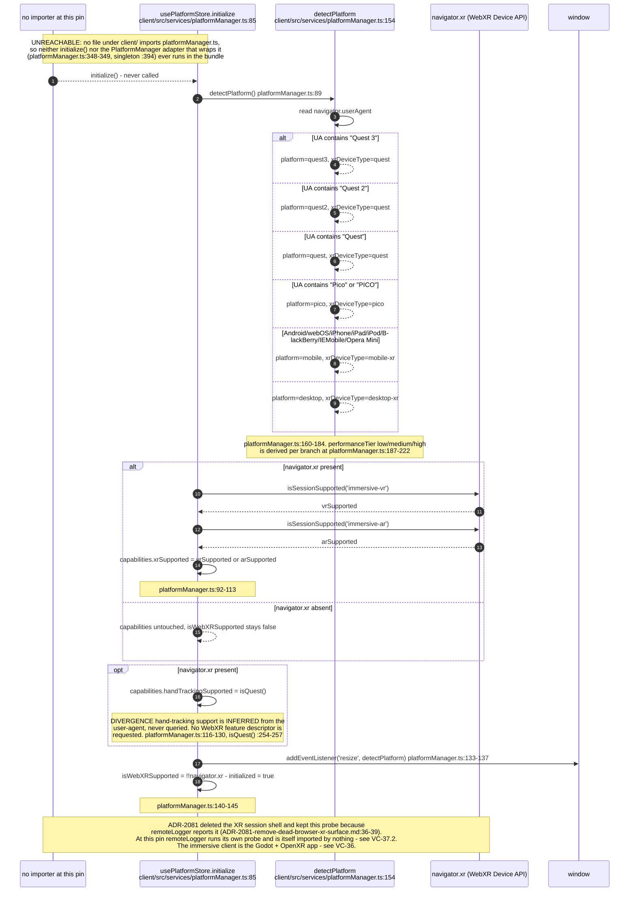

**What it shows.** The probe's logic, which is unchanged, and the fact that matters more: the module that holds it has no importer, so in the running browser client none of this executes. **Why it is this way.** ADR-2081 removed the XR session state and kept the capability probe as telemetry input; the code that fed telemetry was never wired to this store.

**Drift:** ADR-2081 keeps the probe "because `remoteLogger` reports those as telemetry" (docs/adr/ADR-2081-remove-dead-browser-xr-surface.md:36-39), but `remoteLogger` computes `webXRSupported` from `navigator` itself (client/src/services/remoteLogger.ts:273) and calls `isSessionSupported` on its own (client/src/services/remoteLogger.ts:281-290); it never reads the platform store. No file under `client/` imports `platformManager.ts`, so the retained probe is unreachable at this pin.

**Debt:** the whole platform store, its compatibility adapter and its singleton (client/src/services/platformManager.ts:348-349, client/src/services/platformManager.ts:394) are dead code by import graph; deleting them, or wiring them where telemetry actually reads, would settle the ADR-2081 rationale.

## VC-37.2 The XR-mode surface is gone, and the retained probe is unreachable

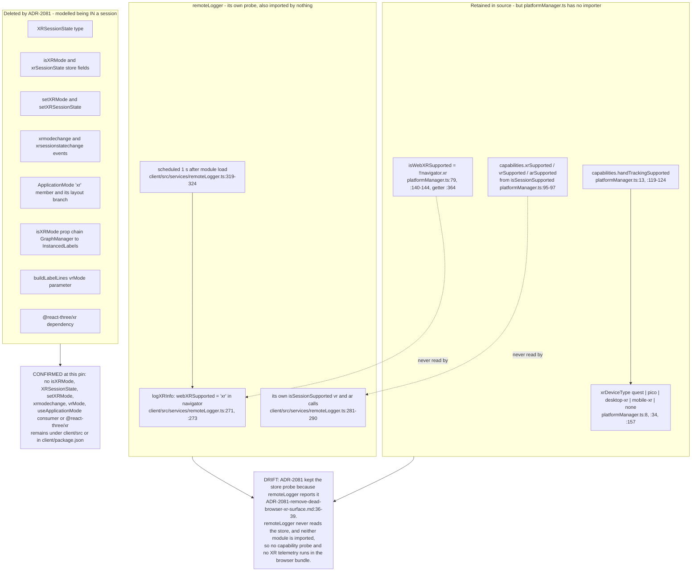

**What it shows.** The deleted session surface stays deleted. The retained half is not wired: the store and the telemetry module are two separate probes, the edge between them that ADR-2081 assumed does not exist (the dotted never-read edges), and nothing imports either module. **Why it is this way.** The deletion was checked by grepping for the removed names; nobody checked that the kept module had a caller.

**Debt:** `remoteLogger.ts` schedules `logXRInfo` at module load (client/src/services/remoteLogger.ts:319-324), but no file under `client/` imports it, so the XR telemetry it describes is never sent from this build. Whether that is intended is not recorded.

## VC-37.3 ApplicationMode transitions and the mobile guard

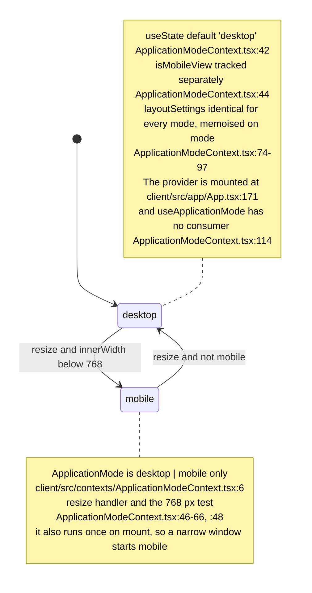

**What it shows.** Two states and a width test. **Why it is this way.** ADR-2081 removed the `'xr'` member; what remains is a responsive-width switch.

**Debt:** the provider is mounted (client/src/app/App.tsx:171) but `useApplicationMode` (client/src/contexts/ApplicationModeContext.tsx:114) has no consumer at this pin, and every branch of `getLayoutSettings` returns the same three `true` flags (client/src/contexts/ApplicationModeContext.tsx:74-95), so the mode and its layout settings are computed on every resize and read by nothing.

## VC-37.4 SpaceMouse / SpacePilot — WebHID acquisition and secure-context gate

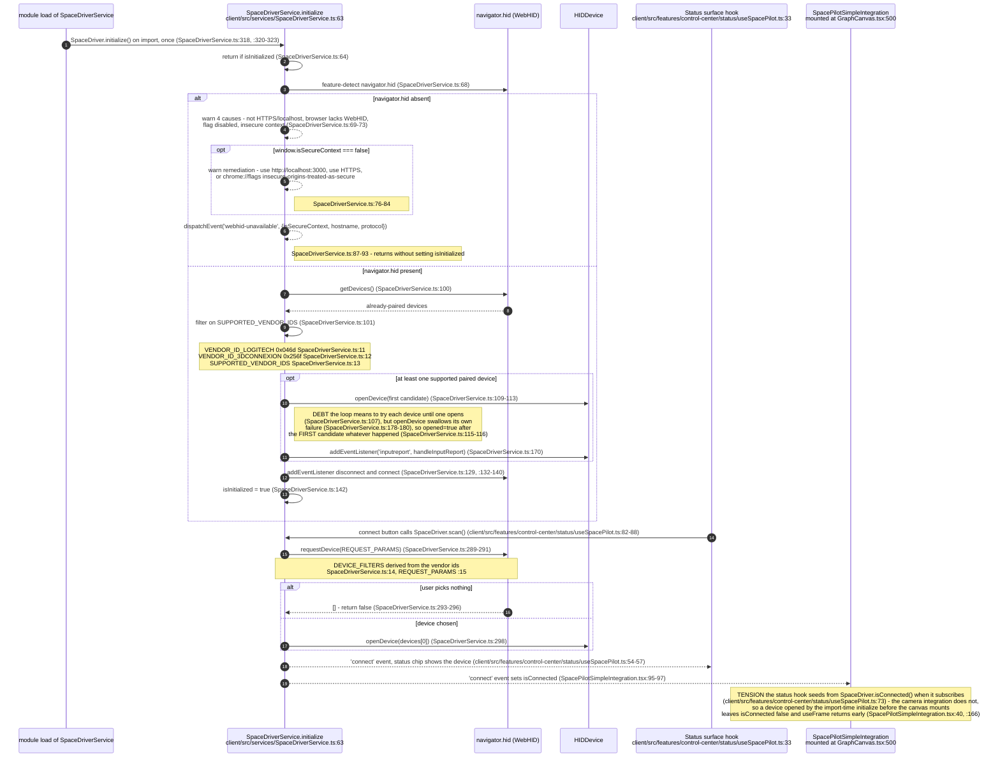

**What it shows.** Who actually acquires the device at this pin: the service initialises itself when first imported, the Status surface's hook offers the pairing button, and the camera integration mounted in `GraphCanvas` only listens. **Why it is this way.** WebHID needs a secure context and a user gesture for `requestDevice`; already-paired devices can be opened silently through `getDevices`.

**Debt:** the "try each paired device until one opens" loop stops at the first candidate, because `openDevice` catches and logs its own error instead of rethrowing (client/src/services/SpaceDriverService.ts:107-120, client/src/services/SpaceDriverService.ts:178-180); with two paired devices and the first unplugged, the second is never tried.

**Tension:** the Status hook seeds its state from `SpaceDriver.isConnected()` (client/src/features/control-center/status/useSpacePilot.ts:73) but `SpacePilotSimpleIntegration` starts with `isConnected` false and only flips it on a later `connect` event (client/src/features/visualisation/components/SpacePilotSimpleIntegration.tsx:40, client/src/features/visualisation/components/SpacePilotSimpleIntegration.tsx:95-97). Whether the import-time open beats the canvas mount is a runtime race this source trace cannot settle.

## VC-37.5 SpacePilot HID report decode and the mounted camera drive

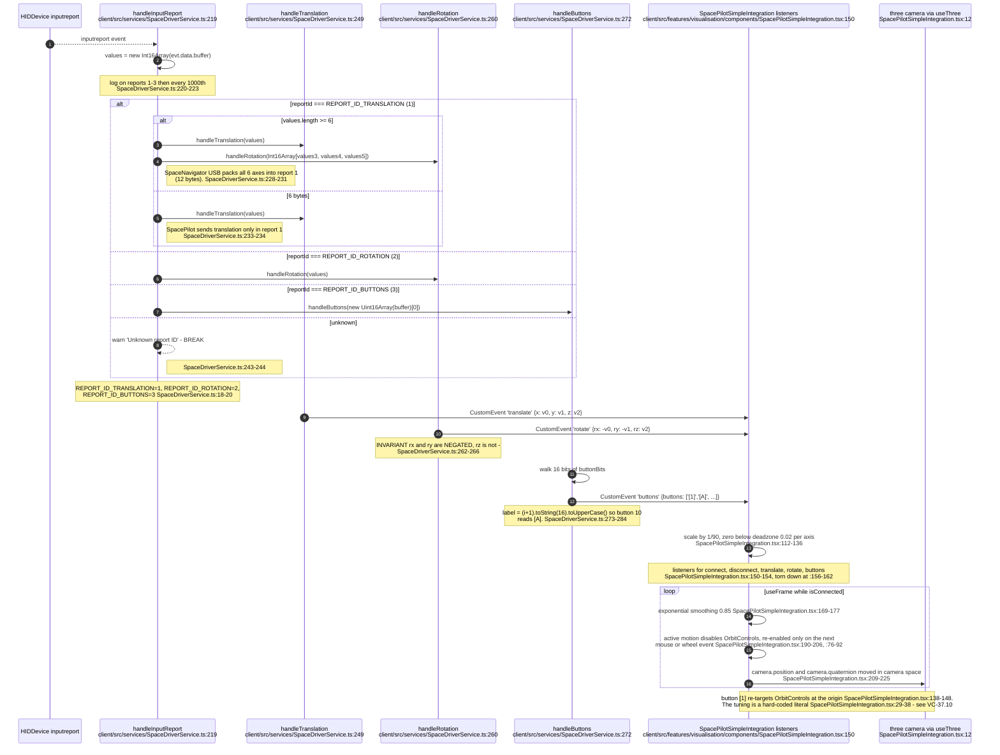

**What it shows.** The HID decode is unchanged and sound; what consumes it at this pin is `SpacePilotSimpleIntegration`, mounted inside the canvas (client/src/features/graph/components/GraphCanvas.tsx:500), which drives the camera directly with fixed tuning. **Why it is this way.** The integration hands off with OrbitControls lazily so releasing the puck does not snap the view level (client/src/features/visualisation/components/SpacePilotSimpleIntegration.tsx:61-71).

**Debt:** `client/src/features/visualisation/hooks/useSpacePilot.ts` (the hook with camera, object and navigation modes, client/src/features/visualisation/hooks/useSpacePilot.ts:39) has no importer at this pin, and `SpacePilotController` is imported only by that hook (client/src/features/visualisation/hooks/useSpacePilot.ts:4), so the controller has no production importer. The earlier drawing of this panel routed every event through them.

## VC-37.6 Head-tracked parallax — MediaPipe face landmarks to camera frustum

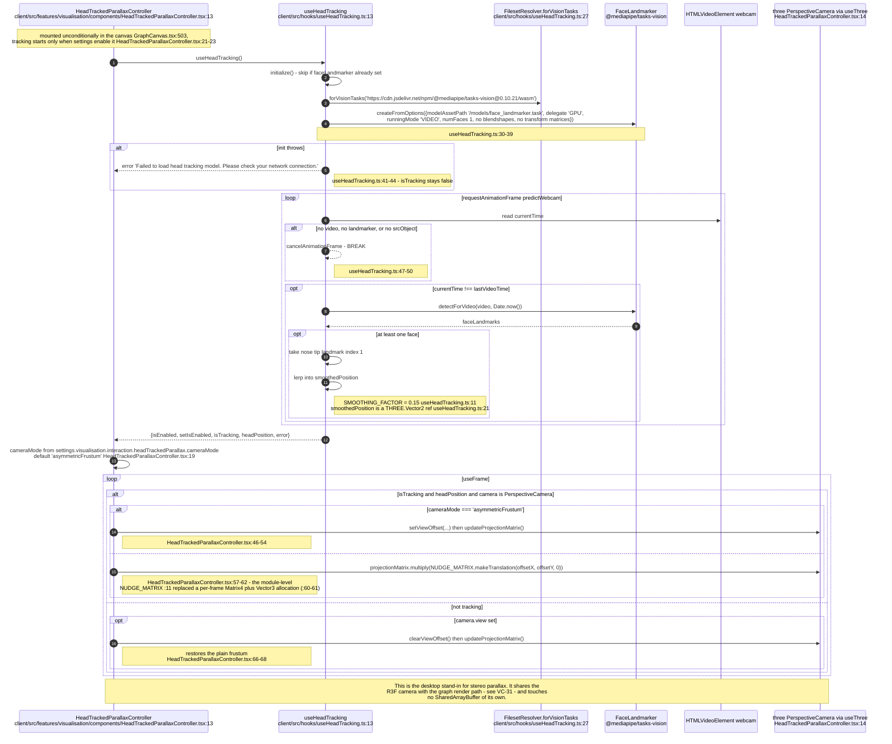

**What it shows.** The webcam path, unchanged since the previous stamp. **Why it is this way.** An off-axis frustum gives a window-like parallax on a flat screen without stereo hardware.

**Tension:** the non-frustum mode multiplies a translation into `camera.projectionMatrix` on every tracked frame without first rebuilding it (client/src/features/visualisation/components/HeadTrackedParallaxController.tsx:62); the only other client callers of `updateProjectionMatrix` run when the canvas size changes (client/src/features/graph/components/GraphCanvas.tsx:181-191) and on an event-driven camera fit, once on first data, on an explicit request or when the memory cloud changes (client/src/features/graph/hooks/useCameraAutoFit.ts:66, client/src/features/graph/hooks/useCameraAutoFit.ts:146-160), so between those events the offsets would compound frame on frame, and stopping tracking in that mode does not restore the matrix because the reset branch runs only when `camera.view` is set (client/src/features/visualisation/components/HeadTrackedParallaxController.tsx:66-68). Not observed at runtime.

## VC-37.7 How the desktop spatial inputs share state with the R3F path

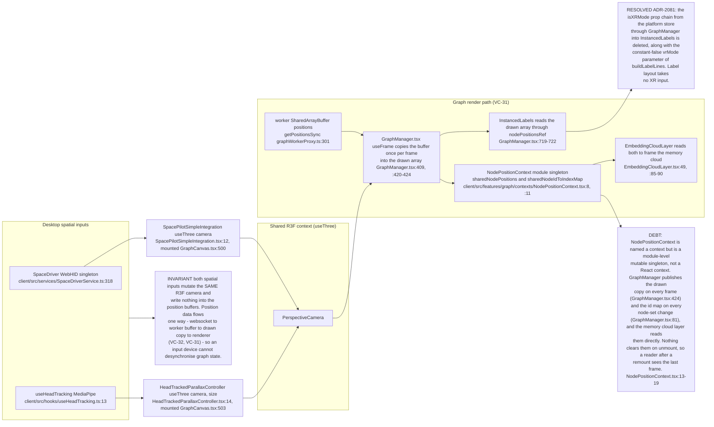

**What it shows.** Who writes the camera and who shares the node positions at this pin. The agent overlay that used to read the singleton (`BotsVisualization.tsx`) was retired in VisionClaw `923f9ae83`; its one reader now is the memory cloud layer, which takes the graph's bounds from it. **Why it is this way.** The drawn array is a per-frame copy so drag and layout transitions write the copy, never the buffer the worker rewrites (client/src/features/graph/components/GraphManager.tsx:420-421).

## VC-37.8 Browser path versus the shipped Godot path

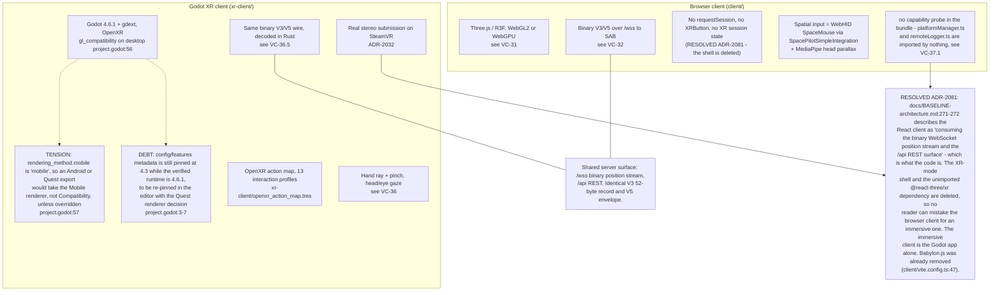

**What it shows.** The two clients side by side: the browser one draws and accepts desktop spatial input, the Godot one is the only immersive client. **Why it is this way.** ADR-2032 put immersive XR in Godot; ADR-2081 removed the browser's unreachable XR shell.

**Tension:** the project forces `gl_compatibility` (xr-client/project.godot:56) but sets `rendering_method.mobile="mobile"` beside it (xr-client/project.godot:57), so the Quest renderer is not the one the desktop runtime verified; the header defers that decision to the editor re-pin (xr-client/project.godot:3-7).

## VC-37.9 SpaceDriver hot-plug — disconnect and reconnect lifecycle

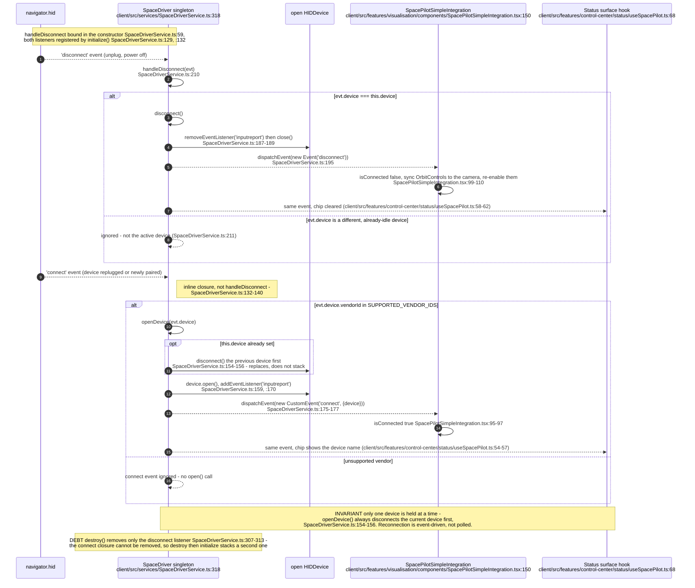

**What it shows.** Unplug and replug at this pin, with the two live listeners: the camera integration and the Status surface. **Why it is this way.** WebHID reports hot-plug on `navigator.hid`; the service keeps one device and replaces it rather than stacking.

**Debt:** the `connect` handler is an anonymous closure (client/src/services/SpaceDriverService.ts:132-140) and `destroy()` removes only the `disconnect` listener (client/src/services/SpaceDriverService.ts:307-313); nothing in the client calls `destroy()` at this pin, so this is latent.

## VC-37.10 Spatial-input settings — the SpacePilot settings reach nothing that is mounted

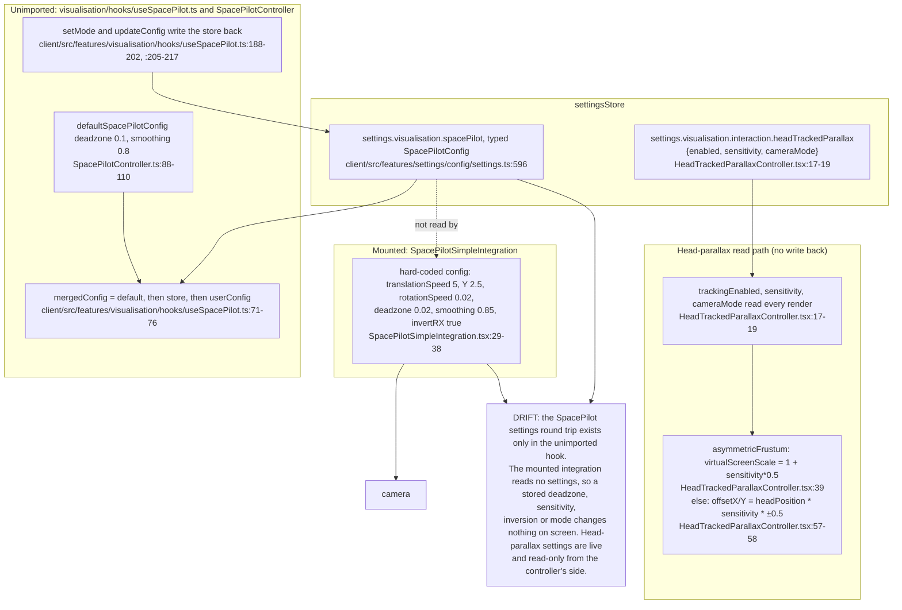

**What it shows.** Which settings reach the camera. Head-parallax settings do. SpacePilot settings are typed in the settings schema and would be read and written by the hook, but the hook is not imported, and the integration that is mounted uses literals. **Why it is this way.** The simpler integration replaced the hook-and-controller path in the canvas without the settings being re-pointed at it.

**Drift:** `settings.visualisation.spacePilot` (client/src/features/settings/config/settings.ts:596) is read and written only by `client/src/features/visualisation/hooks/useSpacePilot.ts` (client/src/features/visualisation/hooks/useSpacePilot.ts:58-59, client/src/features/visualisation/hooks/useSpacePilot.ts:211-215), which has no importer, while the mounted `SpacePilotSimpleIntegration` uses a fixed literal (client/src/features/visualisation/components/SpacePilotSimpleIntegration.tsx:29-38). The earlier drawing of this panel showed the hook's round trip as the live path.

## VC-37.11 A still desktop drag keeps its server hold alive with a heartbeat

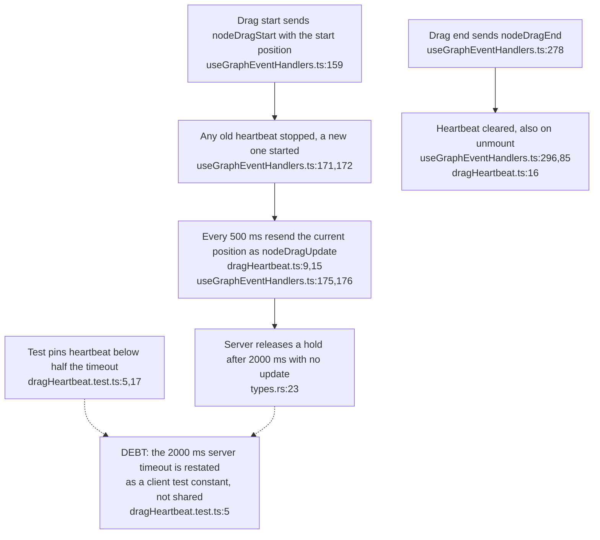

**What it shows.** The desktop only sends an update when the pointer moves, so a held-still node would be dropped without the timer. **Why it is this way.** ADR-2169 made a drag a hold with a 2 s socket timeout (2026-11-01). The heartbeat (`db1ab342d`) is the client half of that contract.
