## For developers

VC-36.25 drew the seams of the desktop-parity layers and VC-36.27 listed the gdext classes; this topic opens the six Rust modules behind them. `memory_cloud.rs`, `cloud_frame.rs`, `memory_route.rs`, `memory_query.rs`, `beat.rs` and `semantic.rs` are, except `memory_query.rs` which is a headset-side design, ports of the desktop explorer's TypeScript (`xr-client/rust/src/memory_cloud.rs:1-11`, `xr-client/rust/src/cloud_frame.rs:1-6`, `xr-client/rust/src/beat.rs:1-3`, `xr-client/rust/src/semantic.rs:1-3`), each split into a plain-Rust core that `cargo test` covers headless and a thin `RefCounted` adapter that GDScript composes. The headset never runs HNSW and never fetches the vectors blob: it draws a server-built snapshot, a route the desktop relays, and a sidecar top-k line it builds from its own query (`xr-client/rust/src/memory_query.rs:3-9`).

Threading is simpler than it looks. None of the six modules holds a `Mutex`, `Arc` or `RefCell`, and every adapter method runs on the Godot calling thread with `&mut self`. The single concurrent thing is the mic tempo worker that `pulse.rs` spawns per analysis and reads back over an `mpsc` channel (xr-client/rust/src/pulse.rs:142). Clocks are explicit parameters: wall-clock epoch milliseconds for the beat and the route's `sentAt`, per-frame `dt` for animation, and no monotonic clock anywhere in the beat path (xr-client/rust/src/pulse.rs:27).

Every number that crosses a boundary is clamped where it enters. The snapshot is bounded at 50 000 rows (xr-client/rust/src/memory_cloud.rs:47), a route at 64 path rows, 64 sidecar rows and 120 query characters (xr-client/rust/src/memory_route.rs:148), a headset query at 2 000 characters and k 50 (xr-client/rust/src/memory_query.rs:46), a `memory_flash` batch at 64 events (xr-client/rust/src/semantic.rs:341). VC-38.1 is the ownership map, VC-38.2 to VC-38.6 the cloud and its frame, VC-38.7 to VC-38.11 the relayed route, VC-38.12 and VC-38.13 the headset query, VC-38.14 to VC-38.17 the beat and VC-38.18 and VC-38.19 the burst and beam encoding.

## For the business

The memory cloud is the room-sized picture of what the estate remembers: every stored memory is a point, grouped and coloured by where it came from and how old it is. A person in the headset can ask a question in plain words and see the line of related memories light up, with the best answer ringed. The same cloud on the desktop and in the headset tell the same story because the headset reuses the desktop's colours, framing and scoring rather than inventing its own.

Two things make it feel alive. A shared beat, taken from the desktop, a tap, or the room's own music if the wearer opts in, makes the graph and the cloud pulse together. And a small burst flares on the memory touched whenever an agent stores, retrieves, searches or deletes, in a colour that says which verb it was. Nothing the microphone hears is kept or sent; it is analysed in memory and dropped.

The honest limits are in the register below: the headset has not yet been used to judge brightness, legibility or stereo agreement of these layers, and a few tuning constants are copied by hand between the headset and its server.

## VC-38.1 Ownership map - who owns state, who runs on which thread

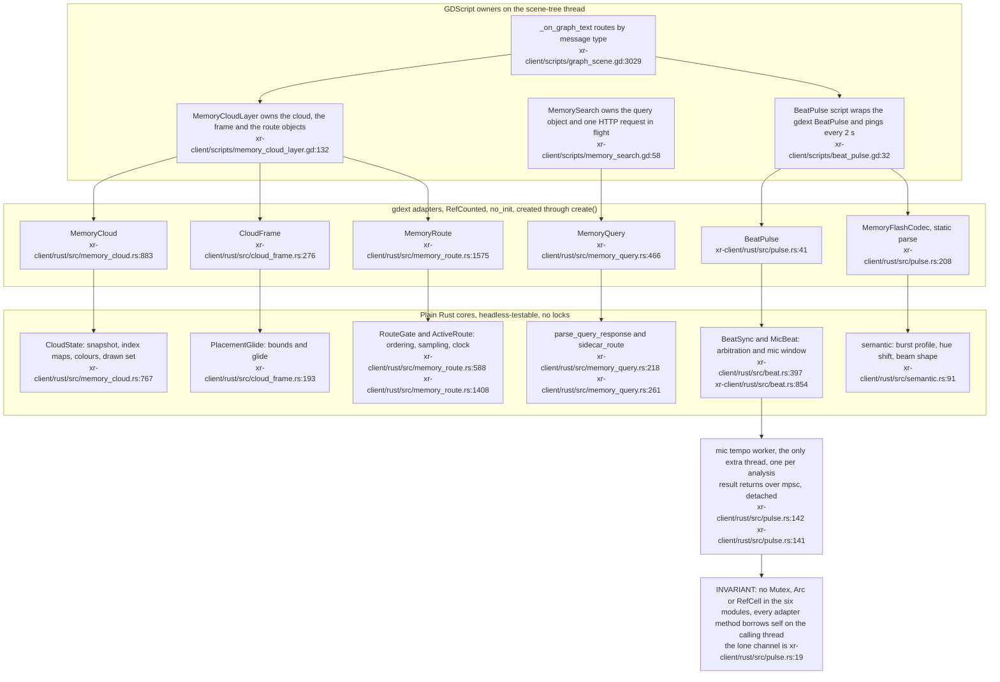

**What it shows.** Three tiers. GDScript scripts own the lifecycle and call `create()`; six gdext adapters convert Godot types; plain-Rust cores hold the decisions. The mic worker is the only thing off the main thread. **Why it is this way.** The crate header makes GDScript compose the scene and Rust own every threshold (xr-client/rust/src/lib.rs:21); `pulse.rs` states that all decision logic lives in the pure modules so it is unit-tested headless (xr-client/rust/src/pulse.rs:10). Recorded under ADR-2134 for the beat and ADR-2133 for the cloud.

## VC-38.2 Snapshot load, from HTTP completion to a MultiMesh buffer

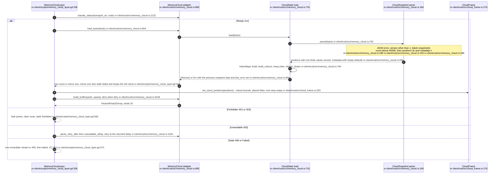

**What it shows.** One load, end to end. A failed parse never clobbers the snapshot on screen: the previous one stays and `last_error` is set. **Why it is this way.** The load policy ports `memoryCloudStore.ts` (xr-client/rust/src/memory_cloud.rs:10); the positions-only snapshot is the ADR-2133 sidecar contract.

**Invariant:** `count` is judged before the array shapes, so an oversize snapshot reports `TooLarge` rather than a shape error (xr-client/rust/src/memory_cloud.rs:193 then xr-client/rust/src/memory_cloud.rs:196).

## VC-38.3 Snapshot wire shape and the stride-20 instance buffer

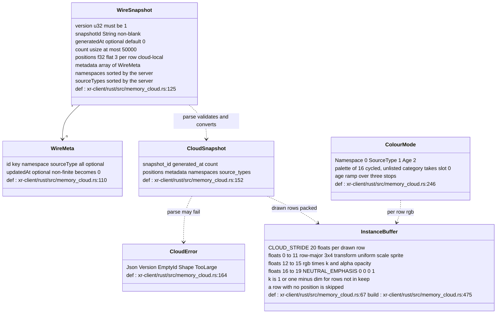

**What it shows.** The only JSON the cloud reads, and the only buffer it writes. Unknown fields such as `dim`, `strata` or `vectorsUrl` are ignored because the wire struct does not deny them. **Why it is this way.** Positions and metadata only, no vectors, because the headset never searches (xr-client/rust/src/memory_cloud.rs:5).

**Drift:** the doc comment on `build_buffer` still says "Stride-16 instance buffer" (xr-client/rust/src/memory_cloud.rs:1016) while the constant and the test are stride 20 (xr-client/rust/src/memory_cloud.rs:67).

**Drift:** `NEUTRAL_EMPHASIS` is documented as the value `memory_flash` bursts "write it per instance" (xr-client/rust/src/memory_cloud.rs:72), but Rust always writes the neutral value; the emphasis is applied in GDScript on a duplicate of the buffer (xr-client/scripts/memory_cloud_layer.gd:871).

## VC-38.4 Which rows are drawn, where a flash lands, what the pointer picks

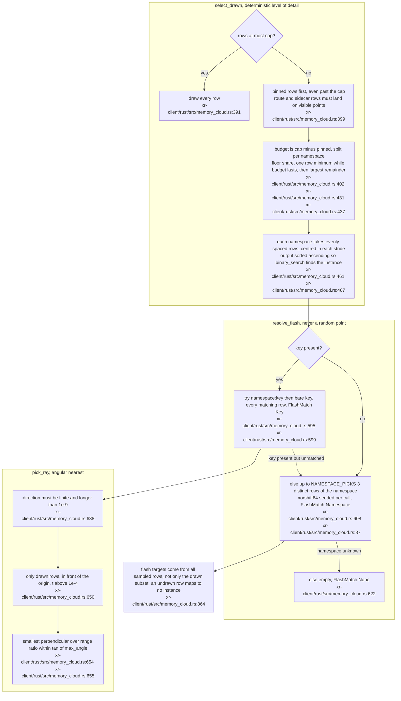

**What it shows.** The three pure functions that turn a snapshot into something on screen: which rows are sprites, which rows a burst targets, which row the wand is pointing at. **Why it is this way.** Ports of `resolveFlashTargets` and the desktop quota rules (xr-client/rust/src/memory_cloud.rs:582); deterministic selection so the same snapshot and cap always draw the same points.

**Invariant:** the drawn set is sorted ascending and unique, so `instance_of_row` can binary-search it (xr-client/rust/src/memory_cloud.rs:467, xr-client/rust/src/memory_cloud.rs:869).

## VC-38.5 Load policy, retry and the single stale reload

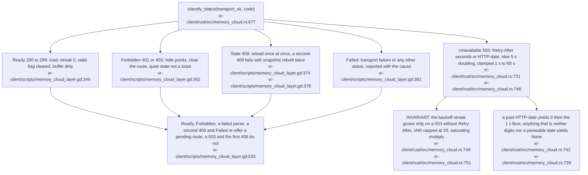

**What it shows.** The whole status policy in one place. Only a 503 retries on a timer; only a 409 retries immediately, and only once. **Why it is this way.** Ported from `memoryCloudStore.ts`: the cloud is a power-user surface, so a 401 or 403 is silence rather than an error toast (xr-client/scripts/memory_cloud_layer.gd:362).

## VC-38.6 Placing the cloud: robust bounds, the triangle's memory vertex, the glide

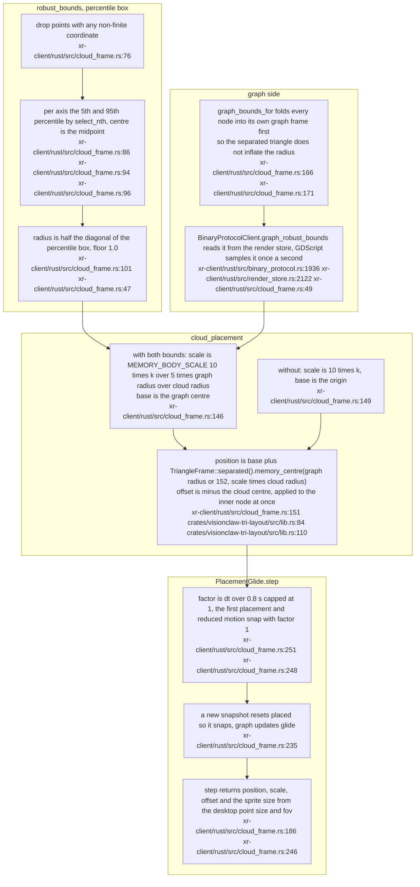

**What it shows.** How the cloud ends up one memory-body width from the graph, scaled to match its size, and how a graph that grows or shrinks moves it smoothly instead of popping. **Why it is this way.** A port of `robustBounds.ts`, `cloudFrame.ts` and the placement loop of `EmbeddingCloudLayer.tsx` (xr-client/rust/src/cloud_frame.rs:3), with the placement delegated to the shared triangle crate so the room and the desktop agree where the memory vertex is (ADR-2135, VC-36.26).

**Invariant:** the graph bounds are accepted only as exactly four finite floats with a positive radius, anything else clears them (xr-client/rust/src/cloud_frame.rs:311).

**Drift:** `CloudFrame.step` hard-wires the desktop point size and field of view for the sprite (xr-client/rust/src/cloud_frame.rs:339), and `MemoryCloud.sprite_local_size` ignores placement scale altogether and passes the desktop constant (xr-client/rust/src/memory_cloud.rs:1023); the per-frame `sprite` from `step` is what the layer applies (xr-client/scripts/memory_cloud_layer.gd:752).
## VC-38.7 The memoryRoute frame - wire shape, parsed frame, relay limits

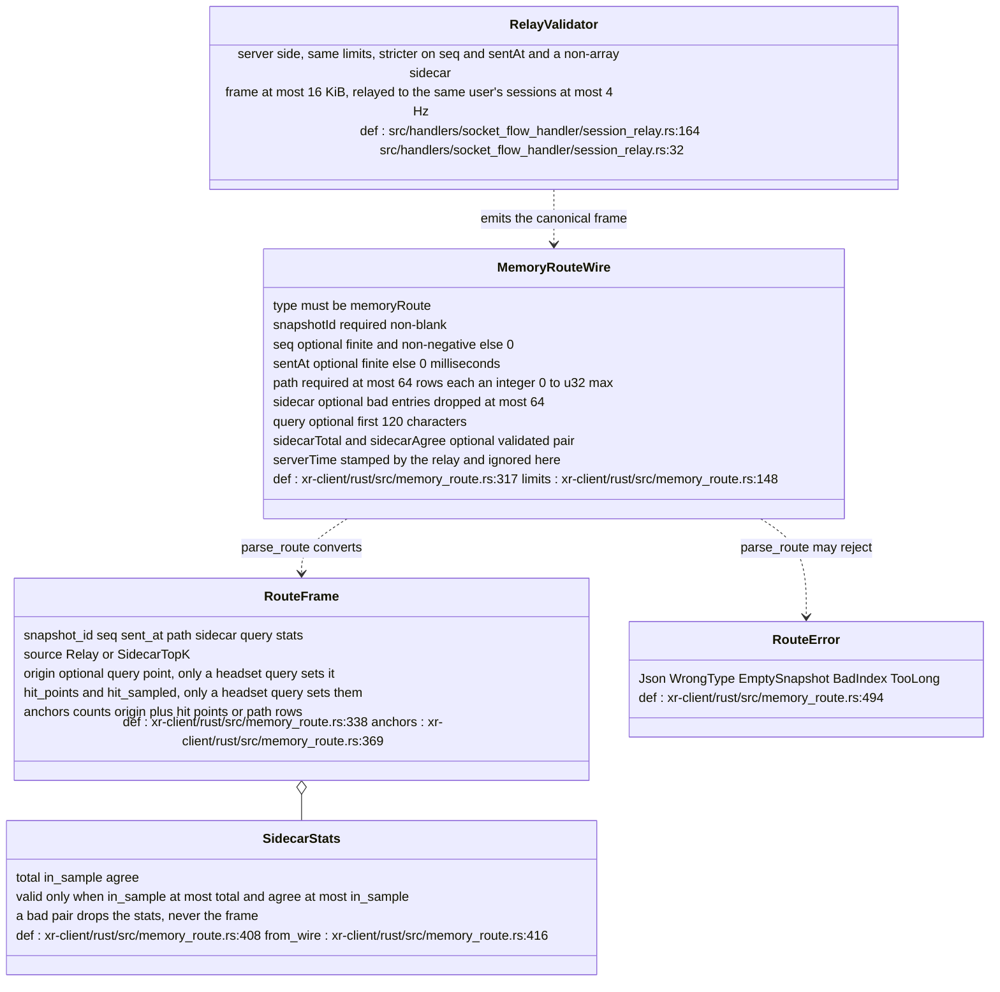

**What it shows.** What the headset accepts from the desktop's relayed frame and what it makes of it. An empty `path` is the clear signal; a bad `sidecar` entry is dropped, a bad `path` entry rejects the whole frame. **Why it is this way.** The relay and the headset parser share one set of limits, but they differ at the edges: the relay rejects a negative `seq` (src/handlers/socket_flow_handler/session_relay.rs:195) and a non-array `sidecar` (src/handlers/socket_flow_handler/session_relay.rs:188) while accepting `null`; the client defaults a bad `seq` to 0 (xr-client/rust/src/memory_route.rs:554) and rejects any non-array `sidecar`, `null` included, as a JSON error (xr-client/rust/src/memory_route.rs:325).

**Drift:** `docs/XR-client.md` describes the frame as `{type, snapshotId, seq, sentAt, path[], sidecar[], query}` (docs/XR-client.md:443) while the code reads two further fields, `sidecarTotal` and `sidecarAgree` (xr-client/rust/src/memory_route.rs:209).

## VC-38.8 RouteGate - ordering, reload and the five verdicts

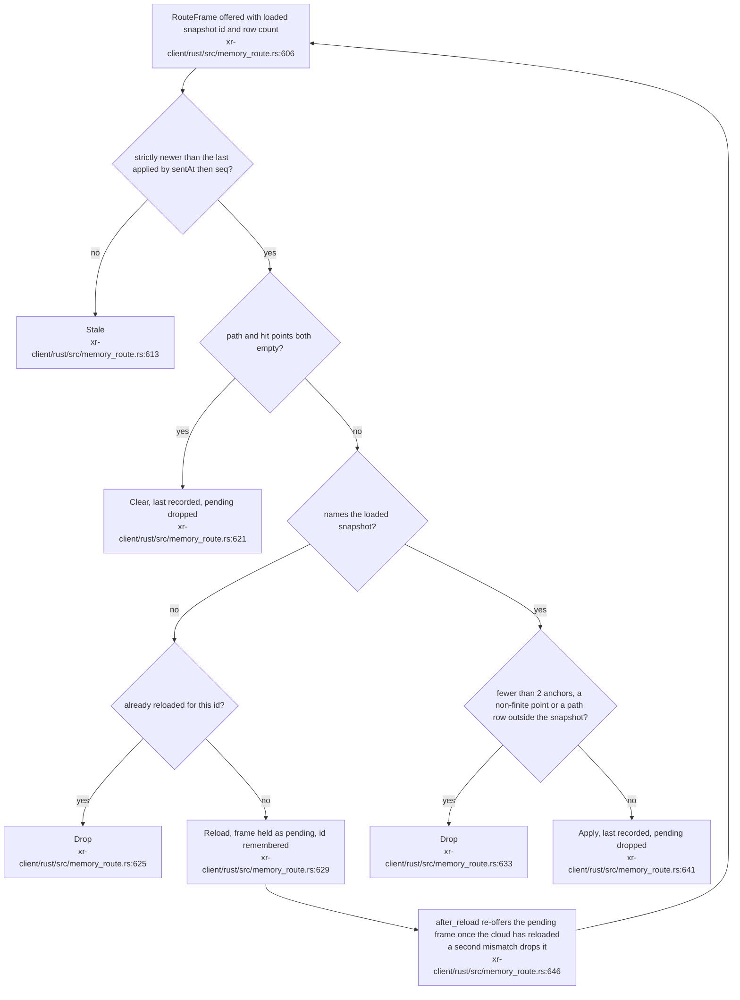

**What it shows.** The whole decision, in the order the code takes it. `last` moves only on a Clear or an Apply, never on a Drop, Reload or Stale, so a bad frame cannot lock out a good one with the same stamp. **Why it is this way.** Ordering is `(sentAt, seq)` so a desktop page reload, which restarts `seq` at 0 with a later `sentAt`, is accepted while a re-delivered older frame is not (xr-client/rust/src/memory_route.rs:585). The Reload verdict hands the cloud one chance to catch up with a snapshot the desktop already holds.

**Invariant:** `RouteFrame.path` rows are range-checked against the loaded row count before an Apply (xr-client/rust/src/memory_route.rs:633), hit points are checked only for finiteness.

`reloaded_for` is set at the first Reload and cleared on Apply and on Clear (xr-client/rust/src/memory_route.rs:620, xr-client/rust/src/memory_route.rs:640), so a later mismatch is a new episode and reloads again, while a second mismatch for the same id inside one episode is still dropped instead of reloading in a loop (VisionClaw `6ca5ff4b2`, 2026-10-18, estate register ER-26).

**Open:** `sent_at` is Unix milliseconds on both paths, the relay's `sentAt` passed through unrebased and the headset's own `Time.get_unix_time_from_system()` (xr-client/scripts/memory_cloud_layer.gd:491), so a headset clock ahead of the desktop's makes desktop frames `Stale` until the desktop catches up and a clock behind does the reverse; nothing states the unit or bounds the skew.

## VC-38.9 From a text frame to per-frame buffers

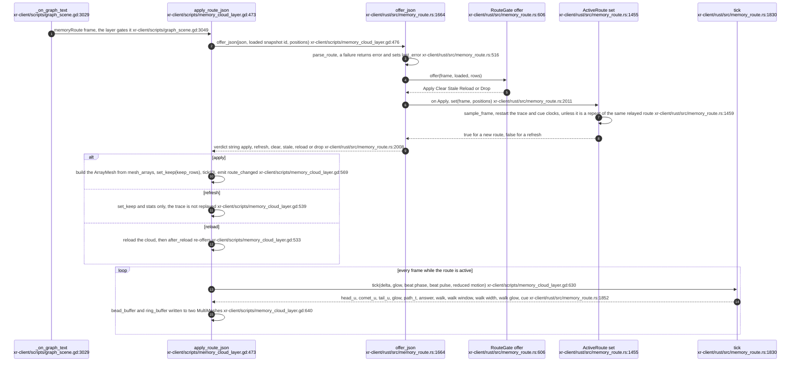

**What it shows.** The text frame's whole life: gate, sample, mesh once, then two small buffers and a handful of shader parameters per frame. Geometry is built once per route; the animation is shader parameters plus instance buffers, never a rebuilt mesh. **Why it is this way.** Glow is additive geometry only, no post-process (XR-client Invariant 2, xr-client/rust/src/memory_route.rs:20), and the mesh stores each vertex's route parameter so the shader can reveal the trace without a per-frame rebuild (xr-client/rust/src/memory_route.rs:14).

**Drift:** the doc comment on `tick` lists the Dictionary as "head_u, tail_u, glow, path_t, answer, comet (bool)" (xr-client/rust/src/memory_route.rs:1828) while the code sets `comet_u` as a float and four `walk_*` keys plus `cue` (xr-client/rust/src/memory_route.rs:1852).

**Invariant:** the headset draws the four line layers of the tube at 0.1 of the desktop thickness and brightness and the comet tail at the walk factors 1.0 and 0.5, a named divergence from the desktop (operator decision of 2026-10-08) applied on top of the desktop-look mesh and pinned by a drift test on the desktop constants (xr-client/rust/src/memory_route.rs:74, xr-client/rust/src/memory_route.rs:875, xr-client/rust/src/memory_route.rs:894).

## VC-38.10 Route animation - what animate computes from elapsed time

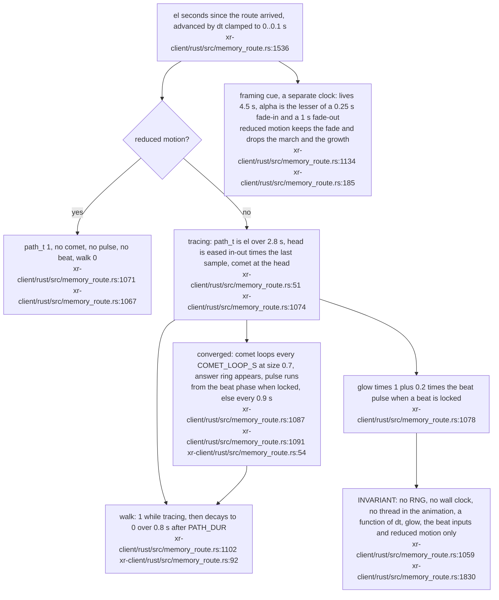

**What it shows.** Every animated quantity of the route and the clock it hangs on. A new route restarts both clocks; a repeat of the same relayed route does not, so the trace is not replayed every time the desktop re-sends for late joiners. **Why it is this way.** Reduced motion shows the converged route with no moving part at all (ADR-2107, xr-client/rust/src/memory_route.rs:1057), which is also the default in the route object, the beat script and the layer (xr-client/rust/src/memory_route.rs:1596, xr-client/scripts/beat_pulse.gd:43, xr-client/scripts/memory_cloud_layer.gd:72).

## VC-38.11 Route geometry and the triangle budget

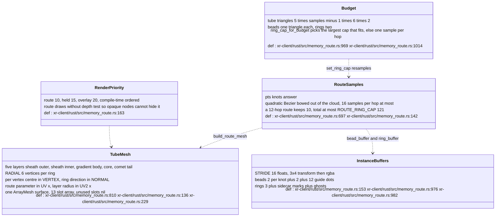

**What it shows.** What a route costs and how it is held under the frame budget. The frame-budget allocator computes `route_ring_cap` (xr-client/rust/src/frame_budget.rs:171), the layer passes it to `set_ring_cap` (xr-client/scripts/memory_cloud_layer.gd:933) and the route resamples and rebuilds its mesh when the cap changes. **Why it is this way.** Beads, halos and the comet are one-triangle camera-facing discs, the cloud sprite's shape, so a route stays cheap in stereo (xr-client/rust/src/memory_route.rs:146); the budget closure is `frame_budget`'s (xr-client/rust/src/frame_budget.rs:5).

**Debt:** `route_worst_triangles` is public with no caller outside tests (xr-client/rust/src/memory_route.rs:1024); the two `_desktop_look` functions are not dead, they are the production base layers wrapped by `build_route_mesh` and `bead_buffer` (xr-client/rust/src/memory_route.rs:876, xr-client/rust/src/memory_route.rs:1225).
## VC-38.12 Headset query - from the Memory Search page to a drawn route

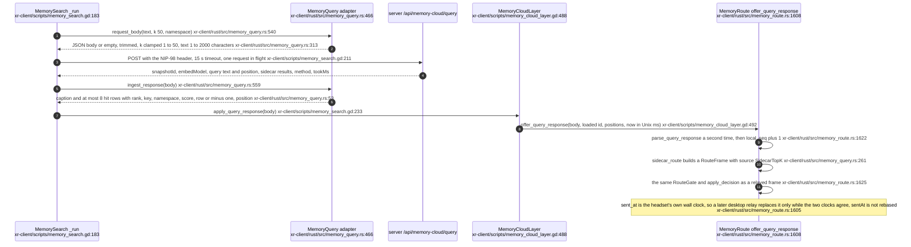

**What it shows.** The headset's own search. The same JSON is parsed twice on purpose, once for the HUD list and once for the route, so neither depends on the other's state. **Why it is this way.** The headset never runs HNSW: the sidecar answers, and what is drawn is "query point to sidecar top-k in rank order", captioned as such so it is never passed off as a search traversal (xr-client/rust/src/memory_query.rs:19), ADR-2136.

**Drift:** `K := 50` in `memory_search.gd` is a hand copy of `HEADSET_K` (xr-client/scripts/memory_search.gd:25, xr-client/rust/src/memory_query.rs:51); the script's comment names `HEADSET_K` as the value it mirrors, and nothing enforces it.

**Debt:** `MemoryQuery.answer` is stored at `ingest_response` and never read back (xr-client/rust/src/memory_query.rs:582); `last_error` is not cleared by a later success.

## VC-38.13 sidecar_route - the decision that makes a route out of ranked hits

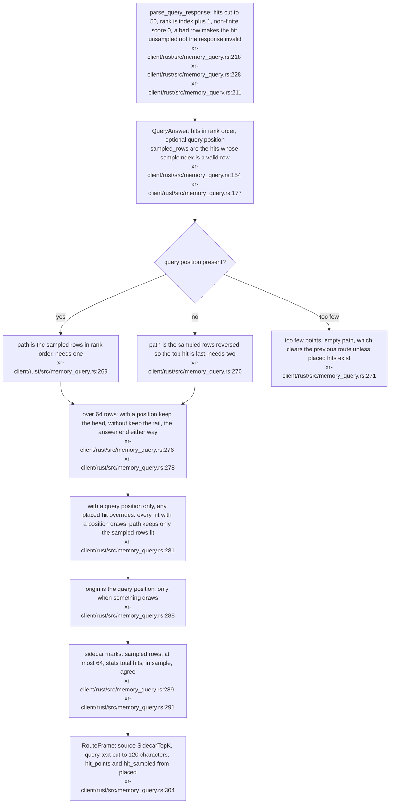

**What it shows.** How ranked hits become geometry. With the query's own point the line runs from it through the hits; without it the hits alone make a line, top hit last, so the answer ring still lands on the best match. **Why it is this way.** ADR-2136 added the query point to the response so the headset can draw from the question rather than from an arbitrary first hit (xr-client/rust/src/memory_query.rs:11).

**Invariant:** a hit's row is accepted only if it is a non-negative integer at most `u32::MAX`; an out-of-range `sampleIndex` leaves the response valid and the hit unsampled (xr-client/rust/src/memory_query.rs:211).

## VC-38.14 Beat clock frames - ping, pong and the relayed clock

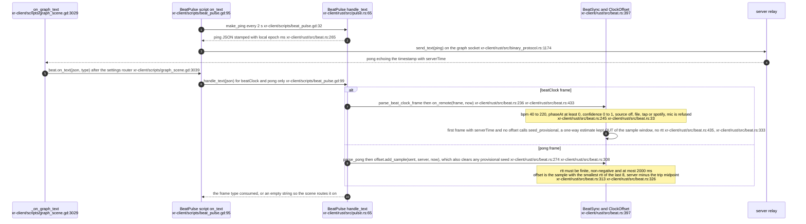

**What it shows.** Two text frames are consumed by the beat module and the rest fall through. The offset estimator is the NTP minimum-delay filter: the least-delayed of the last eight round trips alone sets the clock. **Why it is this way.** ADR-2134 relays the desktop explorer's beat clock to the same user's sessions at up to 4 Hz (src/handlers/socket_flow_handler/message_routing.rs:64); the headset keeps its own offset because its wall clock and the server's differ.

The provisional seed from the first relayed frame is a separate one-way offset, not a window sample: `seed_provisional` is refused once any round trip has landed, the first real pong discards it, and `rtt_ms` stays unset until then (xr-client/rust/src/beat.rs:333, xr-client/rust/src/beat.rs:348). Stored in the window with `rtt 0` it would have won the minimum-delay filter over every real ping for eight pongs, roughly sixteen seconds (VisionClaw `6ca5ff4b2`, estate register ER-26).

## VC-38.15 BeatSync arbitration - which clock drives the pulse

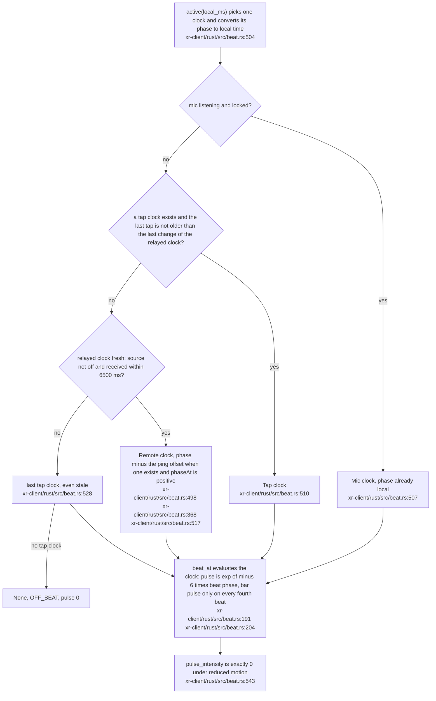

**What it shows.** The precedence: mic, then tap, then the desktop's clock, then a stale tap clock, then nothing. A tap wins until the desktop's clock actually changes (a different source, a different bpm, or a phase shifted by more than half a millisecond); a heartbeat that repeats the same clock does not count as a change. **Why it is this way.** A listening mic that has locked is the strongest evidence of what the room is playing; a tap is a person's deliberate act; the desktop is the default. A relayed clock with source `off` is stored but never fresh.

**Invariant:** a tap sequence resets after 2 500 ms, keeps nine timestamps, yields no tempo under three taps, and clamps the reading to 40..220 bpm (xr-client/rust/src/beat.rs:74, xr-client/rust/src/beat.rs:75, xr-client/rust/src/beat.rs:76).

**Open:** on the first one or two taps ever, the tap clock falls back to the default 120 bpm at confidence 0 (xr-client/rust/src/beat.rs:466); after an earlier reading it keeps that bpm and confidence with the phase reset (xr-client/rust/src/beat.rs:471), and a tap clock keeps winning arbitration until the desktop's clock changes; nothing records whether that is intended.

## VC-38.16 Mic tempo state - off, listening, searching, locked

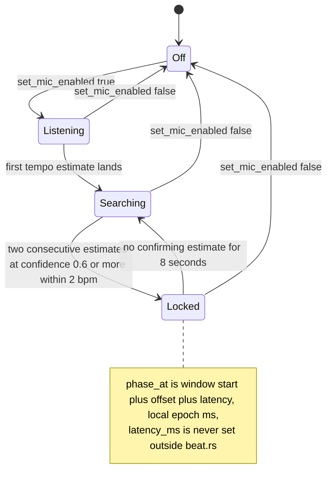

**What it shows.** The four states the HUD can report for the opt-in mic; `Locked` needs two agreeing confident estimates and lapses eight seconds after the last confirmation. **Why it is this way.** A single confident estimate could be a coincidence in a noisy room, so the lock requires the previous estimate to agree (xr-client/rust/src/beat.rs:820, xr-client/rust/src/beat.rs:975).

## VC-38.17 Mic analysis path - window, worker thread, lock

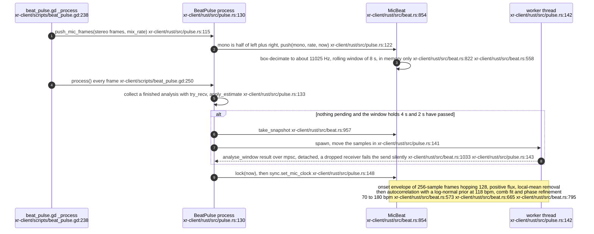

**What it shows.** The privacy-relevant half of the beat (the state machine is VC-38.16). Samples live in one rolling window of at most eight seconds and one analysis snapshot; turning the mic off clears the window, the accumulator, the estimate and the lock at once (xr-client/rust/src/beat.rs:896), and drops the pending receiver (xr-client/rust/src/pulse.rs:104). **Why it is this way.** Mic samples exist only in memory and are never written or sent (`xr-client/rust/src/pulse.rs:12-13`); analysis runs off the main thread because the autocorrelation search is the one expensive step.

**Invariant:** `MicBeat::push` is a no-op when disabled, empty, or given a NaN or non-positive rate (xr-client/rust/src/beat.rs:921).

**Debt:** the worker is detached with no handle and no cancellation, so a disabled mic costs one finished analysis before its result is discarded (xr-client/rust/src/pulse.rs:142); `decimate` is public with only test callers while `push` re-implements it inline (xr-client/rust/src/beat.rs:800, xr-client/rust/src/beat.rs:933); `last_pong_ms` is written and never read (xr-client/rust/src/pulse.rs:74).
## VC-38.18 memory_flash - from a text frame to a burst on the right point

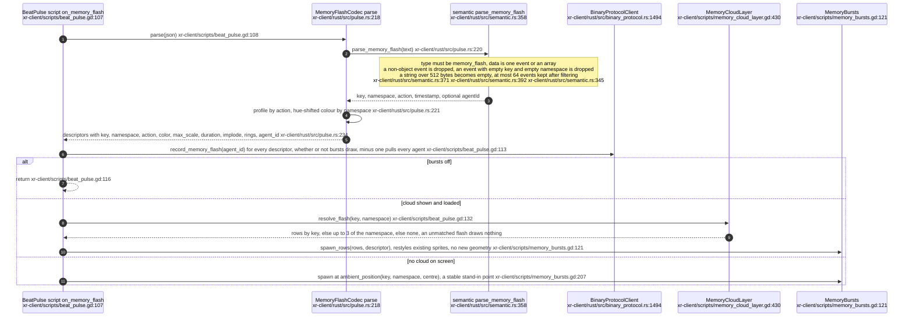

**What it shows.** One flash, end to end. The colour and size say which verb it was (store green and wide, delete red and imploding, search cyan with three rings); the position says which memory. **Why it is this way.** The tables are hand copies of the desktop's `semanticEncoding.ts`; three tests guard drift, one parsing the TypeScript source, one comparing a parity fixture and one parsing the beam shader's colour uniforms (xr-client/rust/src/semantic.rs:12).

**Invariant:** the agent drift credit is applied before the bursts-enabled check, so a muted burst layer still moves the agent toward the memory vertex of the separated layout (xr-client/scripts/beat_pulse.gd:113, ADR-2135).

**Drift:** the doc comment on `MemoryFlashCodec::parse` lists the descriptor as `{key, namespace, action, color, max_scale, duration, implode, rings}` (xr-client/rust/src/pulse.rs:216) while the code also sets `agent_id` (xr-client/rust/src/pulse.rs:234).

**Debt:** `MemoryFlash.timestamp` is parsed and carried but never read downstream (xr-client/rust/src/semantic.rs:333); the string cap measures bytes, so a long non-ASCII key is refused sooner than 512 characters (xr-client/rust/src/semantic.rs:343).

## VC-38.19 semantic encoding tables - burst profile, hue shift, beam shape

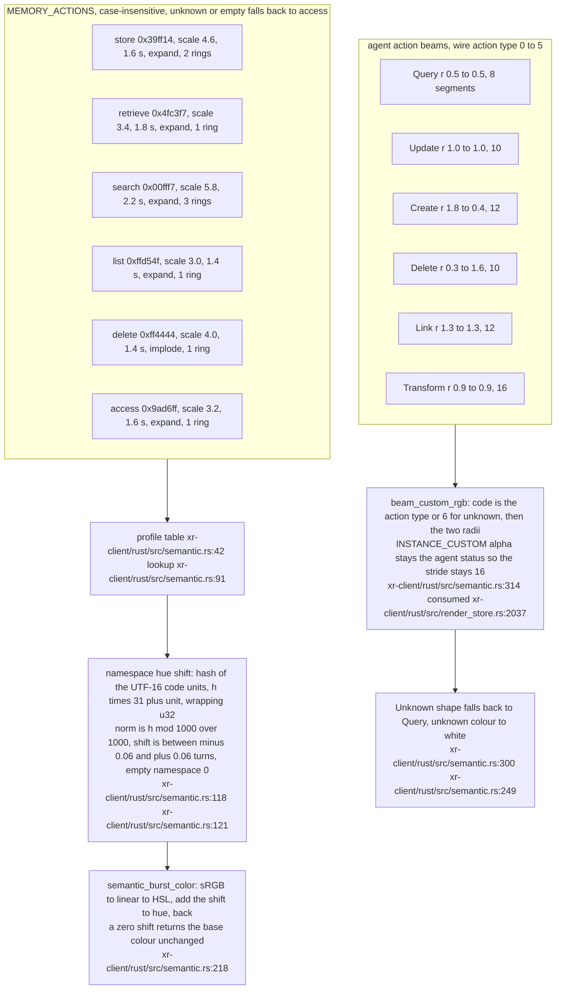

**What it shows.** Every burst constant, the beam radii and the beam colour order (blue, yellow, green, red, purple, cyan, then white for unknown, xr-client/rust/src/semantic.rs:245). The verb picks colour, size, duration, direction and ring count; the namespace nudges the hue by a deterministic amount so two namespaces doing the same verb are told apart without losing the verb's colour. **Why it is this way.** The hash is the desktop's `charCodeAt` hash, taken over UTF-16 code units so non-ASCII namespaces match the desktop bit for bit (xr-client/rust/src/semantic.rs:105).

**Debt:** `AGENT_ACTION_NAMES`, `agent_action_color` and `MEMORY_ACTIONS` outside the module have no callers; the GPU counterpart of the beam colours is the shader's uniforms, not Rust (xr-client/rust/src/semantic.rs:241, xr-client/rust/src/semantic.rs:304).
