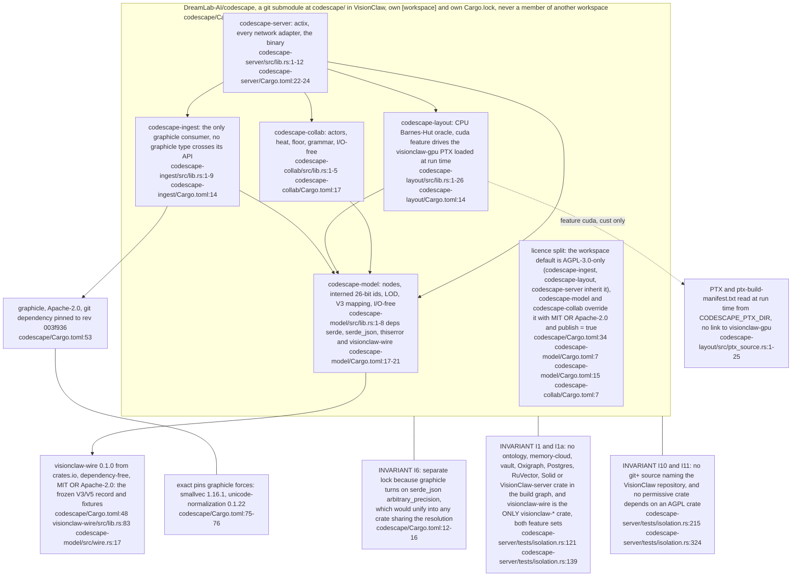
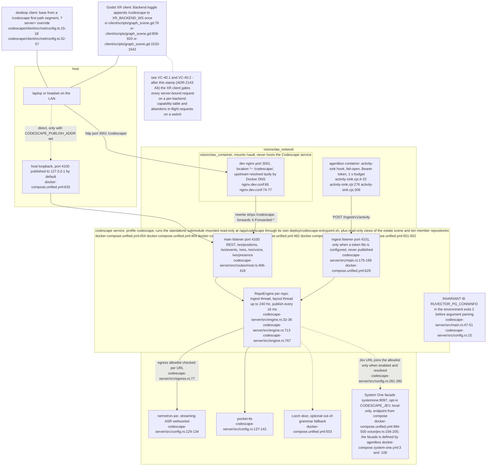
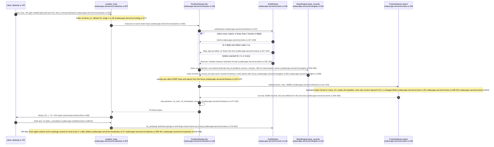
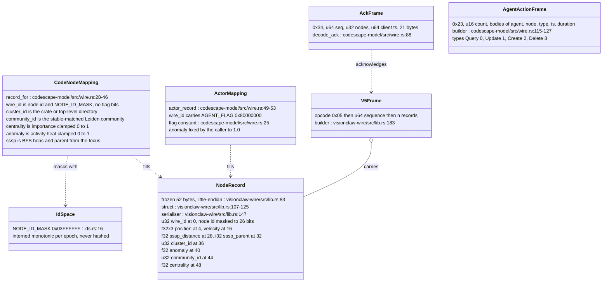
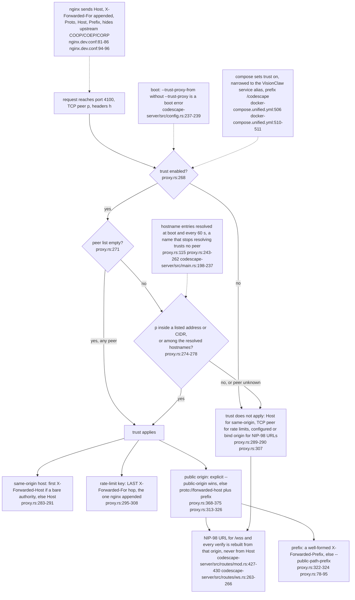
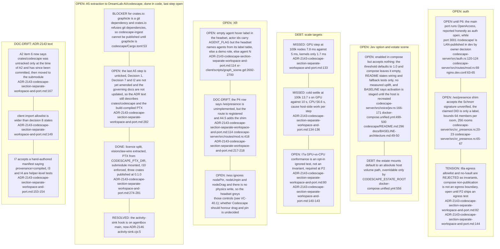

Codescape is a separate section: a near-real-time 3D view of a codebase that humans and agents share by voice, with its own Cargo workspace, its own compose service and a tested isolation boundary from the knowledge-work system (ADR-2143). It reuses the frozen V3/V5 position wire so the desktop and Godot clients render it unchanged, and it never mounts the corpus, never reaches RuVector and holds no signing key. The agentbox hook is on agentbox `main` (ADR-2146, activity-sink.cjs:5), and the standalone repository now exists: `gh repo view DreamLab-AI/codescape` resolves as a public repository on 2026-10-29. Since the previous stamp the voice path gained an opt-in System One (Jev) pick between grammar and Loom (codescape-server/src/voice/jev.rs:375) and the compose service serves the whole estate as one scene.

## VC-39.1 Crate DAG, licences and the isolation fence (Codescape is its own repository since ADR-2143 A5)

**What it shows.** Five crates cut by I/O: model, collab and the CPU layout compile with no graphicle, network or GPU; ingest alone sees graphicle; the server alone does network I/O. The two former edges into the VisionClaw monorepo, the optional `visionclaw-gpu` path dependency and the path-attribute fixture include, are gone: the wire comes from the crates.io crate `visionclaw-wire` and the PTX arrives as a run-time artefact. **Why it is this way.** ADR-2143 A5 extracted the workspace to its own repository so it is reusable outside VisionClaw without a 72 GB git history; the licence split lets the two I/O-free crates be published permissively (`codescape/Cargo.toml:34`).

## VC-39.2 Runtime topology: compose peer, shared port, clients, hook ingest and voice egress

**What it shows.** Codescape is a network peer of VisionClaw, never a co-tenant: nginx reaches it by service name and answers 502 when it is down, the hook reaches port 4101 only across the compose network, and voice egress goes only to the configured ASR, TTS and Loom URLs plus the P6 voice-intent URL and, when enabled, the Jev URL (codescape-server/src/config.rs:265-283); the compose peer now maps the estate scene and ten member repositories read-only, not just VisionClaw and agentbox (docker-compose.unified.yml:482). **Why it is this way.** `visionclaw_container` mounts `/vault` and carries the RuVector connection string, so running Codescape there would make isolation a convention (ADR-2143-codescape-section-separate-workspace-and-port.md:187-193); `/codescape/` on port 3001 is the owner's dev-only waiver of A2 gap 4 (nginx.dev.conf:63-65).

## VC-39.3 One position socket tick: admission, base records, selection, V5, ack

**What it shows.** The whole per-client frame pipeline: admission by the ack window, a base shared by every client of the tick, a per-client projection and SSSP overlay, a diff against what was actually sent, and the budget that spreads a large keyframe over several sequenced frames. **Why it is this way.** A desktop that never acks is never paced, so it cannot stall, and the XR freshness gate silently drops stale frames without acking, so the timeout must recover rather than wait (codescape-server/src/wire.rs:7-12); velocity is ignored in the diff because it changes every step (codescape-server/src/wire.rs:44).

## VC-39.4 The frozen V3 record and what each field means for a code graph

**What it shows.** Codescape claims no tag byte and no flag bit: it re-reads the five semantic slots of the shared record as code-graph meanings and marks actors with the existing agent flag, so both clients decode it with their own parsers. **Why it is this way.** A new wire format would fork three decoders, which ADR-2018 and ADR-2019 exist to prevent (ADR-2143-codescape-section-separate-workspace-and-port.md:101); ids are interned, not hashed, because 100k symbol keys hashed into 26 bits would collide (ADR-2143-codescape-section-separate-workspace-and-port.md:27, ADR-2143-codescape-section-separate-workspace-and-port.md:45).

## VC-39.5 Voice: one floor, ASR, grammar or Loom, executor, spoken answer

```mermaid
sequenceDiagram
    autonumber
    participant B as browser, push-to-talk
    participant V as voice_loop<br/>codescape-server/src/routes/voice.rs:192
    participant F as FloorGate over FloorArbiter<br/>codescape-server/src/state.rs:182
    participant A as AsrSession, nemotron<br/>codescape-server/src/voice/asr.rs:256
    participant R as run_command_inner<br/>codescape-server/src/routes/mod.rs:289
    participant G as parse_command<br/>grammar.rs:484
    participant JV as Jev pick, after_grammar<br/>codescape-server/src/voice/jev.rs:375
    participant LM as Loom ask<br/>codescape-server/src/voice/loom.rs:148
    participant T as pocket-tts speak<br/>codescape-server/src/voice/tts.rs:78
    B->>V: text type start, button down (codescape-server/src/routes/voice.rs:238-245)
    V->>F: request(actor, conn), delegating to FloorArbiter.request, broadcast floor state (codescape-server/src/state.rs:182 floor.rs:91)
    F-->>V: Held by this actor arrives on the event subscription (codescape-server/src/routes/voice.rs:298-300)
    V->>A: start, the egress allowlist checks the ASR URL first (codescape-server/src/voice/asr.rs:261)
    B->>V: binary f32 PCM at 24 kHz, buffered as preroll until the floor is held (codescape-server/src/routes/voice.rs:278-290)
    A-->>V: Partial captions, broadcast on /ws/events (codescape-server/src/routes/voice.rs:337-338)
    B->>V: text type stop, finish (codescape-server/src/routes/voice.rs:247-250)
    A-->>V: Final transcript, floor released (codescape-server/src/routes/voice.rs:340-343)
    Note over V: one command at a time per socket, a second is answered busy (codescape-server/src/routes/voice.rs:347-349)
    V->>R: run_command, text cut to 512 characters (codescape-server/src/routes/mod.rs:287)
    R->>G: parse_command(text), wrapped by after_grammar (codescape-server/src/routes/mod.rs:297)
    alt grammar match
        G-->>R: typed Command
    else no match and Jev enabled and it picks an offered argument-free command
        R->>JV: NoMatch only, never a grammar hit, empty or invalid<br/>(codescape-server/src/voice/jev.rs:380-385)
        JV-->>R: typed Command, validated, confidence at or above the threshold<br/>(codescape-server/src/voice/jev.rs:345-354)
        Note over JV: none, timeout, transport, non-2xx, malformed or low confidence<br/>all fall through to Loom (codescape-server/src/voice/jev.rs:326-351)
    else no match and Loom configured
        R->>LM: ask with LOOM_SYSTEM and command_schema (codescape-server/src/routes/mod.rs:308)
        LM-->>R: JSON, then command_from_llm validates it (llm.rs:209)
        Note over R: INVARIANT: a reply that fails validation is spoken as text, never executed (codescape-server/src/routes/mod.rs:320-334)
    else no match, no Loom
        R-->>V: error naming the normalised text (codescape-server/src/routes/mod.rs:303-306)
    end
    R->>R: execute(Command) on a blocking thread (codescape-server/src/routes/mod.rs:351-354)
    R-->>V: QueryResult and a Focus effect, view and layout burst follow (codescape-server/src/routes/voice.rs:359-366)
    V->>T: speak(answer), to the speaker only (codescape-server/src/routes/voice.rs:372)
    T-->>B: tts_start, s16le chunks, tts_end (codescape-server/src/routes/voice.rs:112-117)
    Note over F: claim per connection, hold cap 30 s, ticked every second by main (codescape-server/src/state.rs:139 floor.rs:13 codescape-server/src/main.rs:239-250)
```

**What it shows.** A single floor gates the single-stream ASR, the final transcript goes through the same executor as typed commands, Jev may pick one of ten argument-free commands only when the grammar fails (off by default, README.md:289), and the Loom is consulted only when both miss. **Why it is this way.** Every action must be a typed `Command` before it runs and LLM output that fails the schema is spoken, never executed; agent dispatch is deferred to a browser-signed kind-31402 relay in P6 because Codescape holds no signing key (ADR-2143-codescape-section-separate-workspace-and-port.md:65).

## VC-39.6 Proxy trust: whose forwarded headers are believed

**What it shows.** A sibling container on the compose network that sends the same headers as nginx is treated exactly as trust off, because trust needs both the switch and a matching peer; only the last forwarded-for hop is believed, since the leftmost entries are client-supplied. **Why it is this way.** ADR-2143 A4.4 (ADR-2143-codescape-section-separate-workspace-and-port.md:205-213); the duplicate isolation headers are hidden because two copies parse as `unsafe-none` and defeat cross-origin isolation (nginx.dev.conf:92-93).

## VC-39.7 Register: tensions, debt, drift and open questions at codescape c742770

**What it shows.** Every known gap at the stamp, each anchored to the code or the ADR line that records it; ADR-2143 is `implementation_status: partial` and `activation_status: inactive` (ADR-2143-codescape-section-separate-workspace-and-port.md:6-7), with P0 done and P2 to P6 open (ADR-2143-codescape-section-separate-workspace-and-port.md:296). **Verified.** Citations read at visionclaw `e74bcddc7`, agentbox `0b0f79189` and codescape `c742770` on 2026-10-29; the `/codescape/` prod path is untouched and prod's SPA fallback answers 200 there, not 404 (ADR-2143-codescape-section-separate-workspace-and-port.md:196-198).
