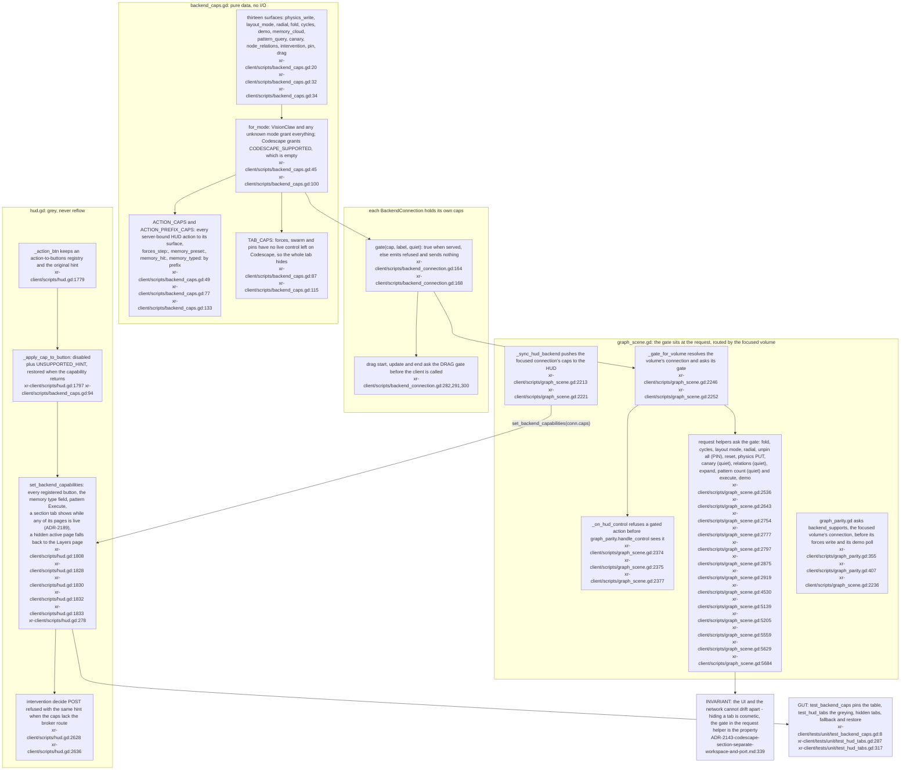
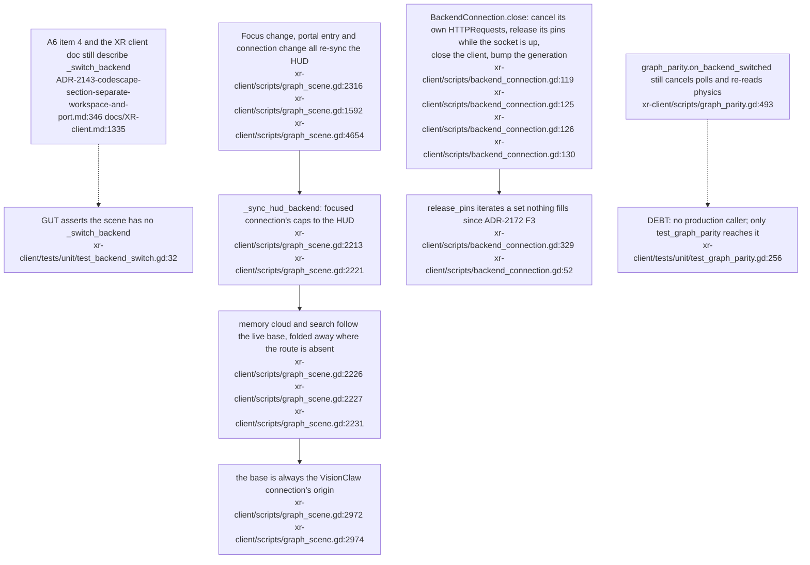
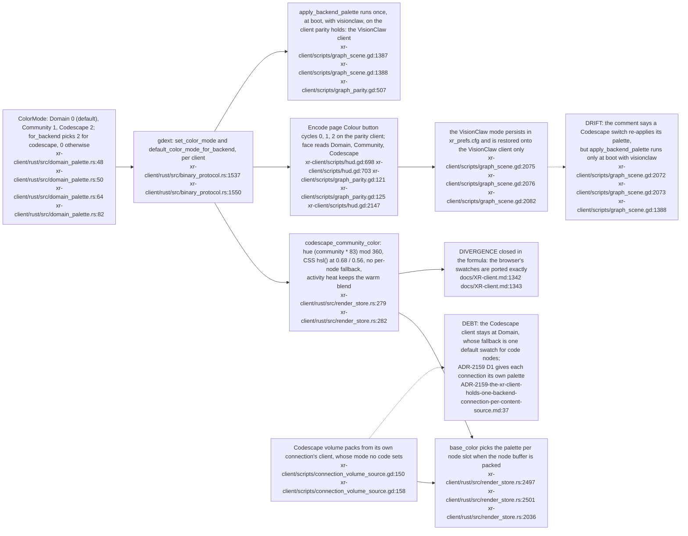

## For developers

ADR-2143 A6 (2026-10-21) introduced the capability table, the request gate, the HUD greying, an exclusive `_switch_backend` and the Codescape palette. ADR-2159 then replaced the exclusive switch with one `BackendConnection` per content source; [VC-44](44-xr-concurrent-backend-connections.md) maps that arrangement. This topic was restamped on 2026-11-02 at the VisionClaw pin and redrawn: VC-40.1 shows the table and gate as they now run per volume, VC-40.2 shows what replaced the switch's hygiene, and VC-40.3 shows the palette and a gap in how it reaches the Codescape volume. Evidence is source tracing; no headset or GUT run was made for this review.

## For the business

Knowledge and code each keep their own connection, and the headset greys out any control the focused source cannot serve rather than letting a request fail silently. The menu now follows the seven shared sections, and a whole section hides only when none of its pages applies. One gap remains visible to a viewer: the code volume does not get the code palette.

## VC-40.1 One capability table gates every server-bound request per volume and greys the matching controls

**What it shows.** Codescape serves the graph stream, presence, voice, a read-only physics view and settlement, and answers 404 (405 for the physics PUT) to every knowledge route by design. One table names each surface; each connection holds its own copy and refuses at its gate; the scene routes a request through the focused volume's connection; the HUD greys from the focused connection's table. Since the A6 text, the table has gained `drag` (ADR-2158 E9), and the drag-end pin record it listed is gone (ADR-2172 F3). **Why it is this way.** The advisor's objection to gating at the action name was that `graph_parity.handle_control` and its per-frame demo poll issue HTTP of their own, so only a gate at the point of sending covers every route out (ADR-2143-codescape-section-separate-workspace-and-port.md:333-340). ADR-2159 moved the table from a scene-wide `_caps` onto each connection.

**Drift:** ADR-2143 A6 item 2 still names `GraphScene._gate(cap, label)` and the drag-end pin record (`ADR-2143-codescape-section-separate-workspace-and-port.md:333,336`); the gate is now `_gate_for_volume` over `BackendConnection.gate` (`graph_scene.gd:2246`; `backend_connection.gd:164`).

## VC-40.2 The exclusive switch is retired; its hygiene now lives in focus sync and connection close

**What it shows.** There is no switch to abandon a server any more: both connections stay open, and each owns its requests, pins and generation. What A6 did at a switch now happens in two places: focus changes re-sync the HUD's capability table, and a connection's `close()` cancels its own requests and releases its own pins. Memory always talks to VisionClaw, so it no longer needs re-pointing for correctness. **Why it is this way.** ADR-2159 D1 gives each connection its own client, acknowledgement sequence and request state, so ids from one source can no longer be applied to another by a late reply; the epoch problem that A6 item 4 solved is now solved by per-connection generations (VC-44, VC-53.2).

**Debt:** `graph_parity.on_backend_switched` (`graph_parity.gd:493`) survives with no production caller; delete it or wire it to a connection event.

**Drift:** `docs/XR-client.md:1335` ("Switch hygiene. `_switch_backend` cancels ...") and ADR-2143 A6 item 4 (`:347`) describe a function the scene no longer has, while `docs/XR-client.md:1219` correctly says `BackendConnection` replaced it.

## VC-40.3 Colour mode 2, the Codescape web client's palette, reaches only the VisionClaw client

**What it shows.** The palette formula matches the Codescape desktop client, and the Colour button cycles all three modes, but only on the VisionClaw client that `GraphParity` holds. Under ADR-2159 the Codescape volume packs from a second `BinaryProtocolClient` (`connection_volume_source.gd:150`), and nothing calls `set_color_mode` on it, so it keeps the `Domain` default (`domain_palette.rs:50`). **Why it is this way.** A6 selected the palette at each exclusive switch, on the one client there was. When the switch was deleted, `apply_backend_palette` kept its boot call (`graph_scene.gd:1388`) and lost its per-switch call. Nobody moved the call onto connection construction. Source tracing only: no headset image was taken to confirm the colours drawn.

**Drift:** `docs/XR-client.md:1346` still says `apply_backend_palette` selects the backend's default "at boot and on every switch".
