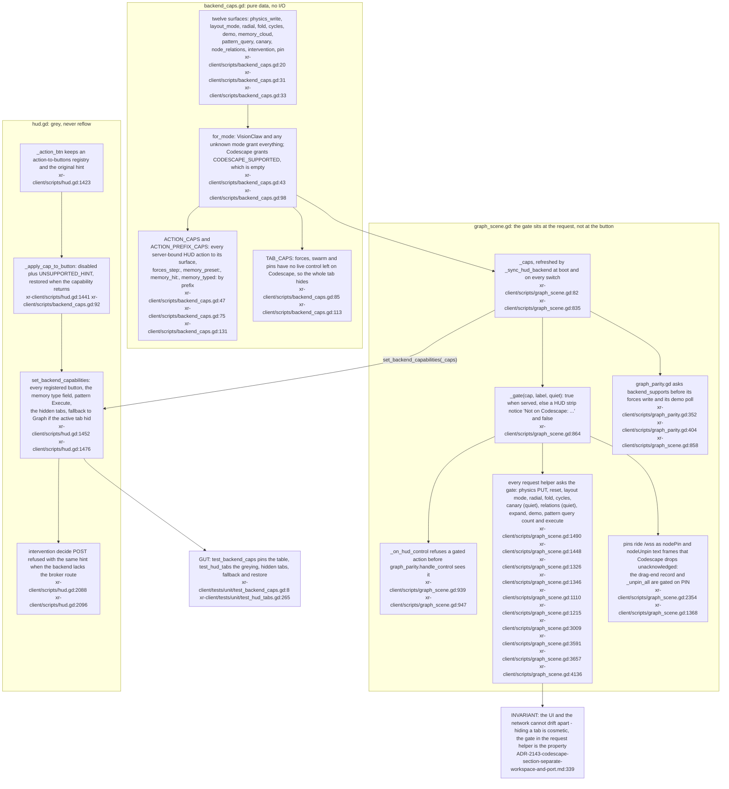
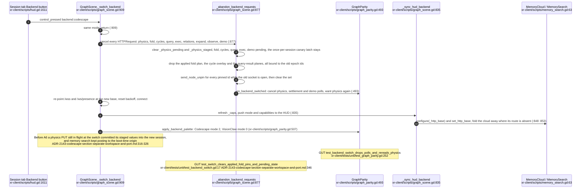
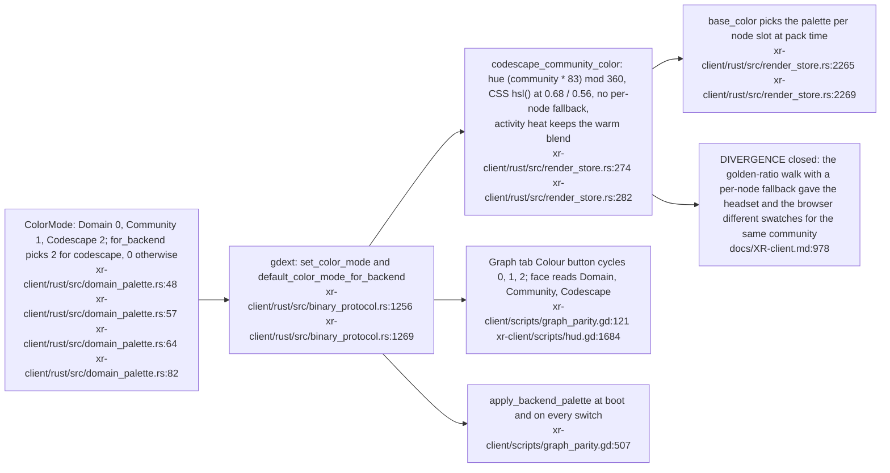

## VC-40.1 One capability table gates every server-bound request and greys the matching controls

**What it shows.** Codescape serves the graph stream, presence, voice, a read-only physics view and settlement, and answers 404 (405 for the physics PUT) to every knowledge route by design, so the client stopped asking: one table names each surface, the scene refuses at the request helper, and the HUD greys from the same table. **Why it is this way.** The advisor's objection to gating at the action name was that `graph_parity.handle_control` and its per-frame demo poll issue HTTP of their own, so only a gate at the point of sending covers every route out (ADR-2143-codescape-section-separate-workspace-and-port.md:333-340).

## VC-40.2 A backend switch abandons the old server before connecting to the new one

**What it shows.** The switch is a hygiene pass before a reconnect: every request addressed to the old server is cancelled, every "in flight" latch is reopened, and anything drawn from the old graph (cycle overlay, pins) is dropped so ids from the previous epoch are never applied to the new one. **Why it is this way.** Physics writes are commit-on-2xx (`_physics_staged` is applied only when the server accepts), so an in-flight reply arriving after the switch would have been the one path that mutated client state from the wrong server.

## VC-40.3 Colour mode 2: the Codescape web client's community palette, agreed swatch for swatch

**What it shows.** The headset now reads a Codescape community exactly as the desktop client does, so a hull or a cluster has one colour across both views. **Why it is this way.** Code nodes carry no corpus domain, so the WP1 domain palette collapses to one default swatch on Codescape, and the old community walk disagreed with the browser; porting the browser's formula (not inventing a third) is what makes voice over a shared scene usable.
