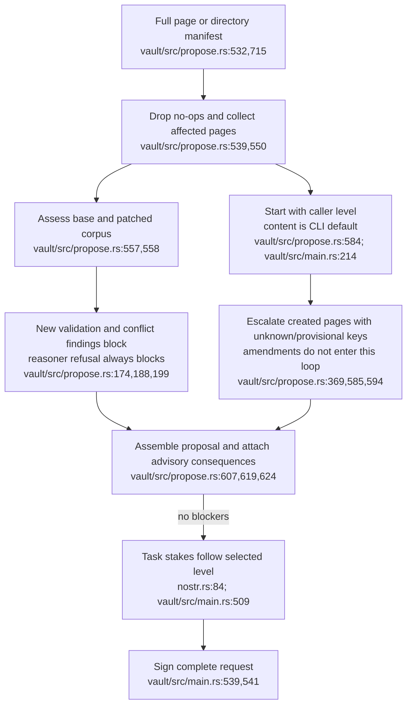
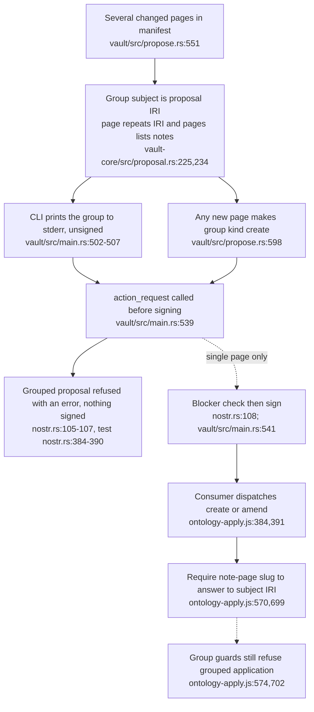
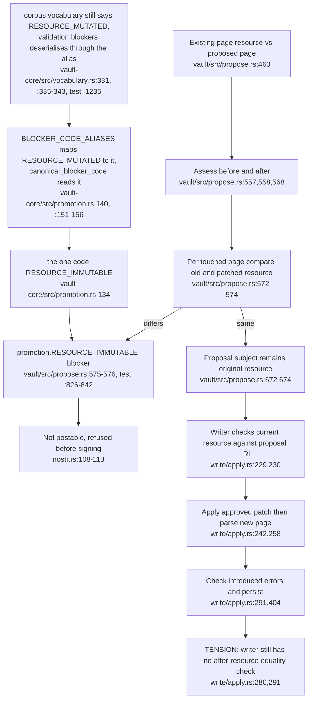

## For developers

This topic maps proposal preparation and its apply consumer at current source pins. [The audit](../../estate-review/2026-10-31-proposal-construction.md) uses real signed CLI dry-runs and passes their grouped payloads into the real adapter. Signing, case identity, assessment and successful application are separate properties. Certificate source matches the consumed published crate; independent checker activation remains outside this pass.

## For the business

A reviewer can receive a valid signed proposal that the application cannot apply as a group. Its consequence count can include version metadata while excluding the changed logical expression. Review needs to show supported scope and the evidence attached to the signed request, rather than treating a stable case number as a fixed assessment.

## VC-41.1 Preparation and declared level

**What it shows.** Both corpus states are assessed, but validation blockers are deltas on touched pages. Consequences do not automatically raise the level. The audit's taxonomy and definition amendments remain content-level.

**Why it is this way.** ADR-2147 makes the consequence delta advisory. The producer infers schema level for a narrow creation case and otherwise trusts the caller's classification.

## VC-41.2 Same case, different assessment context

**What it shows.** Changing a parent elsewhere alters consequences without changing the patch's case digest. The signed event still binds its complete body. Blank-node exclusion can coexist with a non-conservative verdict caused solely by version metadata.

**Why it is this way.** Stable patch identity and RDFS closure comparison were defined separately. The ontology header participates in the latter. Neither alone proves EL equivalence or identifies the review context by case digest.

## VC-41.3 A grouped proposal is assessed but refused before signing

<!-- 2026-11-06 restamp ec785afa9: redrawn. 6b811f7a1 makes action_request refuse a grouped proposal, so the producer no longer signs what the consumer cannot apply -->

**What it shows.** A grouped proposal is still built and assessed as one decision, but `action_request` now refuses it, so no grouped event reaches the consumer that cannot apply it.

**Why it is this way.** The producer-consumer mismatch recorded at the previous stamp is closed on the producer side (`6b811f7a1`, recorded in `docs/VAULT-corpus-format.md:100`). Grouping is kept for local assessment until the consumer applies a group atomically.

**Open:** A supported all-or-nothing group apply contract is still not established. The refusal (`crates/vault/src/nostr.rs:105-107`) postpones the question and does not answer it.

## VC-41.4 Amendment cannot remint the resource IRI (producer only)

<!-- 2026-11-06 restamp ec785afa9: redrawn. RESOURCE_IMMUTABLE blocker added in propose.rs by 6b811f7a1. The ontomark writer was not re-read (ontomark stamp unchanged) -->
<!-- 2026-11-06 restamp 809a859aa: redrawn. 9fa159971 - one blocker code, RESOURCE_IMMUTABLE in vault_core::promotion, with RESOURCE_MUTATED an accepted alias read through canonical_blocker_code -->

**What it shows.** The producer now blocks an amendment that changes a page's resource IRI. The consumer-side writer still checks only the old resource, so the guard lives in one place.

**Why it is this way.** The external audit repair (`6b811f7a1`) closed the path the previous stamp proved. Its record (`docs/VAULT-corpus-format.md:388`) credits `vault propose`, not the writer, and names `BLOCKER_CODE_ALIASES` as the one place an alias lives.

**Drift:** only the resource code has an alias. The corpus vocabulary, as the crate's test fixture reproduces it, also names `WHELK_INCONSISTENCY` in `validation.blockers` (`crates/vault-core/src/vocabulary.rs:927`, read back verbatim by the test at `:1229`), while the consistency probe emits `WHELK_INCONSISTENT` (`crates/vault-core/src/consistency.rs:43`) and `BLOCKER_CODE_ALIASES` has one entry (`crates/vault-core/src/promotion.rs:140`). Nothing gates on `validation.blockers` at this commit, so the mismatch is latent.
