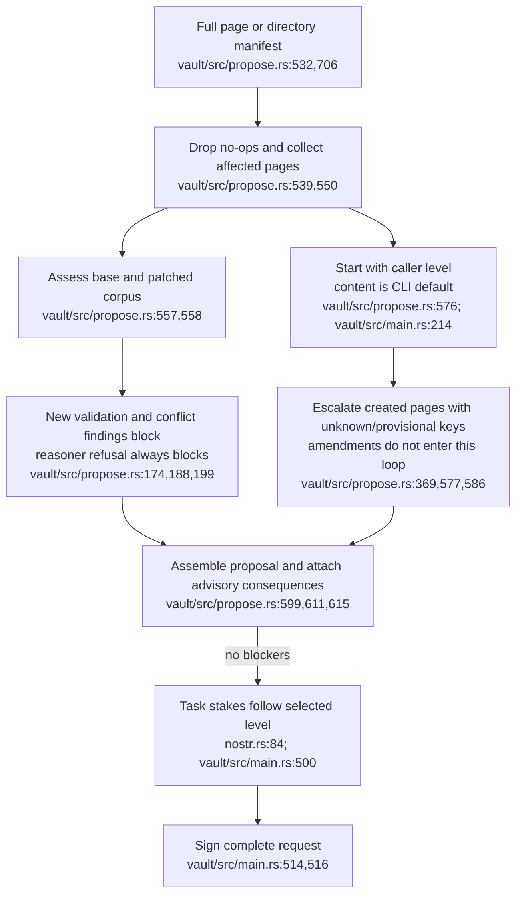
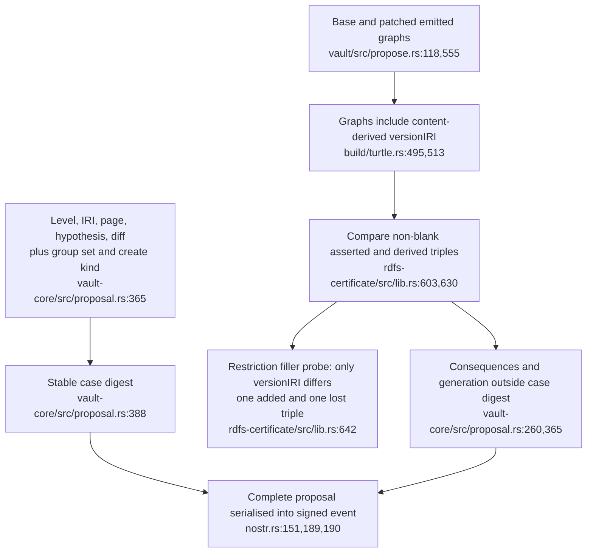
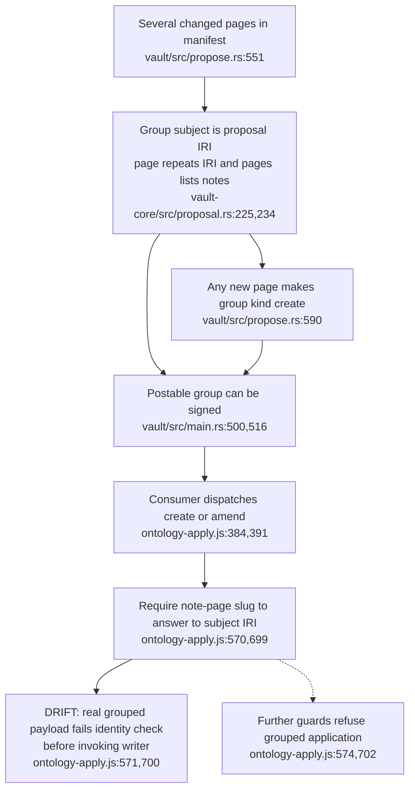
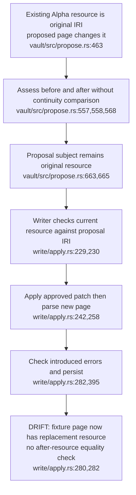

## For developers

This topic maps proposal preparation and its apply consumer at current source pins. [The audit](../../estate-review/2026-10-31-proposal-construction.md) uses real signed CLI dry-runs and passes their grouped payloads into the real adapter. Signing, case identity, assessment and successful application are separate properties. Certificate source matches the consumed published crate; independent checker activation remains outside this pass.

## For the business

A reviewer can receive a valid signed proposal that the application cannot apply as a group. Its consequence count can include version metadata while excluding the changed logical expression. Review needs to show supported scope and the evidence attached to the signed request, rather than treating a stable case number as a fixed assessment.

## VC-41.1 Preparation and declared level

**What it shows.** Both corpus states are assessed, but validation blockers are deltas on touched pages. Consequences do not automatically raise the level. The audit's taxonomy and definition amendments remain content-level.

**Why it is this way.** ADR-2147 makes the consequence delta advisory. The producer infers schema level for a narrow creation case and otherwise trusts the caller's classification.

## VC-41.2 Same case, different assessment context

**What it shows.** Changing a parent elsewhere alters consequences without changing the patch's case digest. The signed event still binds its complete body. Blank-node exclusion can coexist with a non-conservative verdict caused solely by version metadata.

**Why it is this way.** Stable patch identity and RDFS closure comparison were defined separately. The ontology header participates in the latter. Neither alone proves EL equivalence or identifies the review context by case digest.

## VC-41.3 A signed group cannot be applied by this consumer

**What it shows.** The producer's grouped subject is a decision; the consumer expects a note. Both grouped fixtures fail before CLI, Git or HTTP calls. Later group guards independently prohibit that scope.

**Why it is this way.** Grouping provides one judgement over a multi-page change, but the consumer retains one-page write/commit guards. The mismatch prevents application; it does not silently split a decision.

**Open:** A supported all-or-nothing group apply/recovery contract, or explicit pre-signing refusal, is not established. No deployed group was submitted in this audit.

## VC-41.4 Amendment changes the supposedly immutable resource

**What it shows.** A real signed producer output changes the resource through the real CLI writer. The old-resource equality check passes because the page still has its original identity before application.

**Why it is this way.** Validation compares findings in separately parsed states. The governing corpus format's immutable-resource invariant needs a before/after identity check, which the inspected amendment path lacks. This probe does not execute live approval or attestation.
