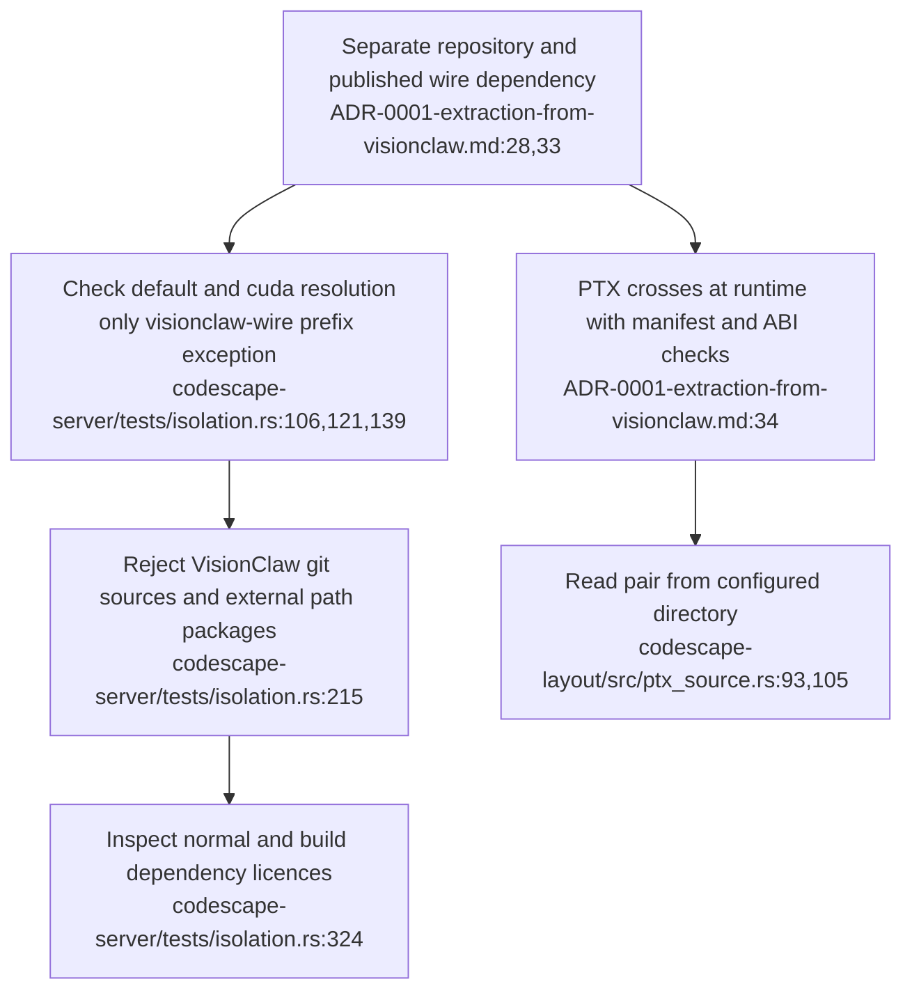
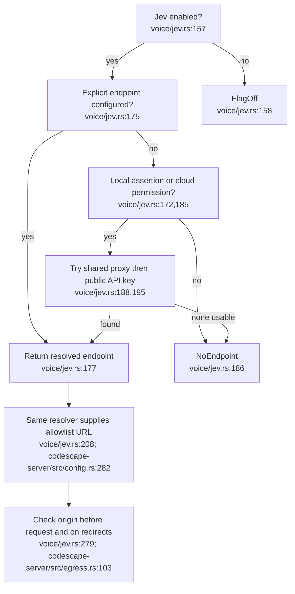
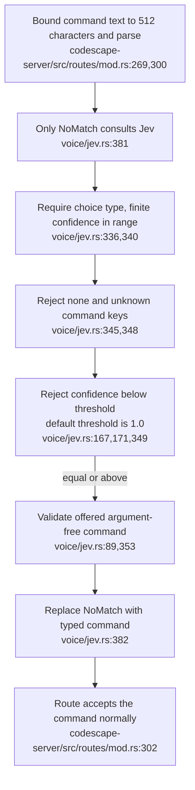
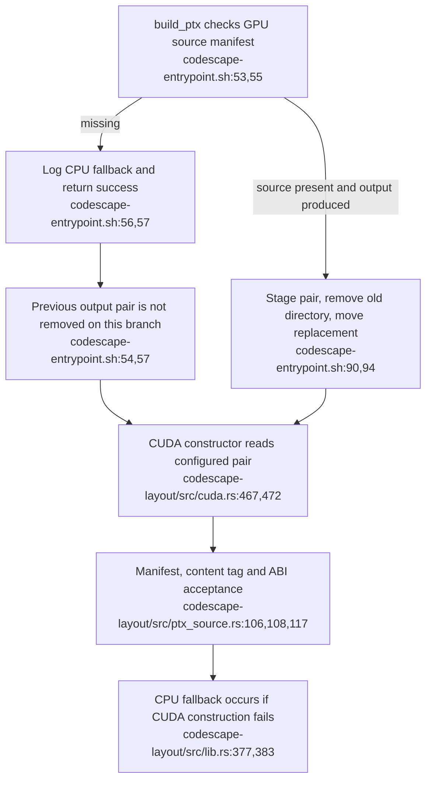

## For developers

This topic distinguishes dependency isolation, endpoint admission, model command selection and runtime artefact reuse. The [audit and executable probe](../../estate-review/2026-10-31-codescape-boundaries.md) compare standalone source with the consumed submodule. Cited at the submodule commit `e3b76f6` that VisionClaw `ec785afa9` records, not at standalone `main`, which is ahead by a formatting-only `jev.rs` change and the presence fence of VC-43. No source pin here establishes current service activation.

## For the business

An enabled model can choose a bounded view action even before anyone calibrates its confidence threshold. Endpoint settings also need a clear privacy contract. A startup message about falling back to CPU does not establish which previously built GPU artefact remains available. These distinctions matter when operators explain what a shared code-view service will do.

## VC-42.1 Extraction separates the build graph from runtime inputs

**What it shows.** Cargo isolation and runtime artefact provenance have separate enforcement paths. The audit's eight isolation tests pass, including their forbidden-package control. **Why it is this way.** ADR-0001 removes build-time coupling while retaining a shared wire contract and runtime GPU input. These checks do not establish network isolation or current deployment identity.

## VC-42.2 Explicit endpoints return before the local/cloud gate

**What it shows.** An explicit remote endpoint can resolve while every local/cloud permission flag is false. The implicit proxy branch is refused under those same permissions. The current host intentionally enables cloud routing (`docker-compose.unified.yml:505`).
**Why it is this way.** Endpoint configuration is trusted earlier than the documented locality gate. The probe establishes resolution and allowlist admission without contacting a remote service.

**Drift:** The local-only promise in `voice/jev.rs:11` and the resolver contract at `voice/jev.rs:154` do not cover the explicit-endpoint return at `voice/jev.rs:175`.

## VC-42.3 Confidence one remains an accepting value

**What it shows.** An exact-one response passes the default threshold. Lower confidence, an unknown choice or abstention preserves fallback. Grammar hits bypass the model.
**Why it is this way.** The implementation uses an inclusive acceptance threshold rather than an explicit disabled state. Host Compose enables the option and leaves the threshold empty (`docker-compose.unified.yml:504,508`).

**Tension:** Compose calls the enabled model advisory (`docker-compose.unified.yml:507`), while the selection path can return an action at confidence one (`voice/jev.rs:349,354`). This is a bounded view-command path, not an ontology writer.

## VC-42.4 A failed refresh can retain a loader-valid PTX pair

**What it shows.** Missing source files do not invalidate retained runtime artefacts. The disposable probe executes the verbatim startup function and confirms that the retained pair still passes the actual loader's non-device checks.
**Why it is this way.** Extraction made PTX a separately supplied runtime input. The diagnostic conflates failure to produce a new pair with failure to load the old one.

**Open:** The probe does not load a GPU module. The resulting engine still depends on the CUDA feature, device and artefact; current service activation and device acceptance remain separate evidence obligations.
