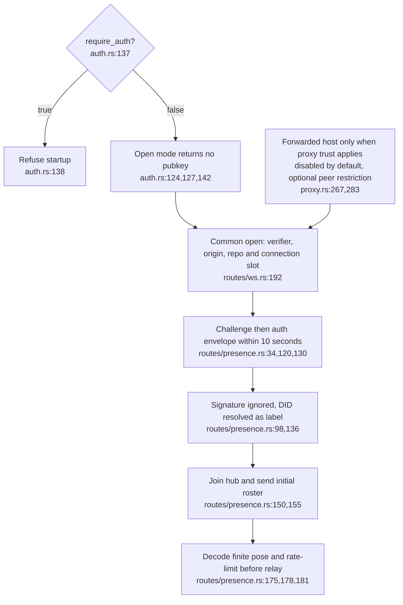
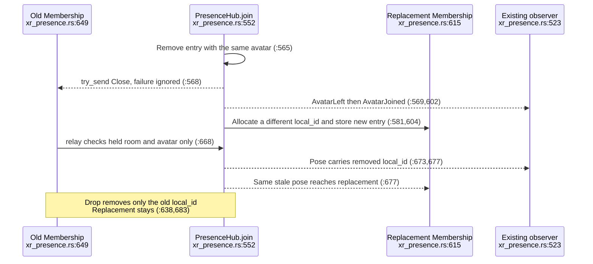
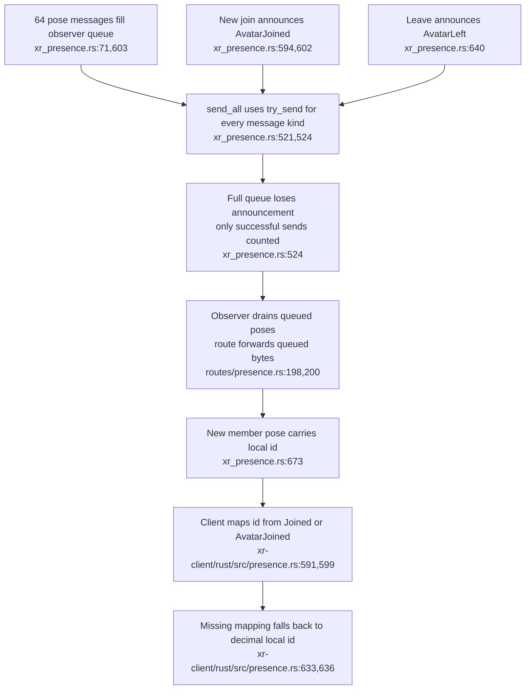

## For developers

The Codescape hub relays poses and roster events. The [production-library probes](../../estate-review/2026-10-31-codescape-presence-and-xr.md) expose stale membership and queue-loss boundaries; they do not measure a live socket race.

## For the business

An avatar label is not authenticated identity here. Reconnects and slow readers can also leave a consumer with an inconsistent roster. The default XR scene uses VisionClaw presence, not this endpoint (`graph_scene.gd:2941,2945`).

## VC-43.1 Admission has an origin filter but no identity verifier

**What it shows.** Origin filtering and proxy trust do not establish a signed principal. Missing Origin is allowed for native clients (`origin.rs:127`); the audit confirms required-auth startup refusal and the separate ingest-token guard. **Why it is this way.** ADR-2143 A4 deliberately permits open dev-LAN access pending P6. This is a documented deployment boundary, not a newly discovered signature bypass.

## VC-43.2 Replacement changes the roster before the old handle loses relay ability

**What it shows.** The probe relays from the old handle after replacement and observes the removed local id at both recipients. **Why it is this way.** `relay` does not check whether its local id remains in the room. The socket loop eventually consumes Close or channel termination (`routes/presence.rs:198`); the audit does not claim permanent survival of a replaced socket.

**Tension:** The replacement contract promises closure (`xr_presence.rs:550`), but roster removal does not revoke relay authority (`xr_presence.rs:668`).

## VC-43.3 One bounded queue drops both replaceable poses and roster transitions

**What it shows.** The probe fills a queue using poses admitted by the real rate limiter over synthetic time, loses a join announcement, then receives that member's pose. Leave and replacement-Close loss are also reproduced. **Why it is this way.** The queue has no separate reliable roster channel or resynchronisation path. The XR client's numeric-id fallback is source evidence; no headset rendering outcome was tested.

**Drift:** The baseline says presence carries no avatars (`BASELINE-codescape.md:109`), although the current hub forwards them (`xr_presence.rs:668`).

**Tension (risk):** Both defects are fixed only upstream: standalone Codescape `d2c3c3b` adds a cancel fence and a separate control queue for roster messages, but VisionClaw `ec785afa9` still pins `e3b76f6`, where `relay` checks only room and avatar (`xr_presence.rs:668`) and `send_all` uses one `try_send` queue (`xr_presence.rs:524`).
