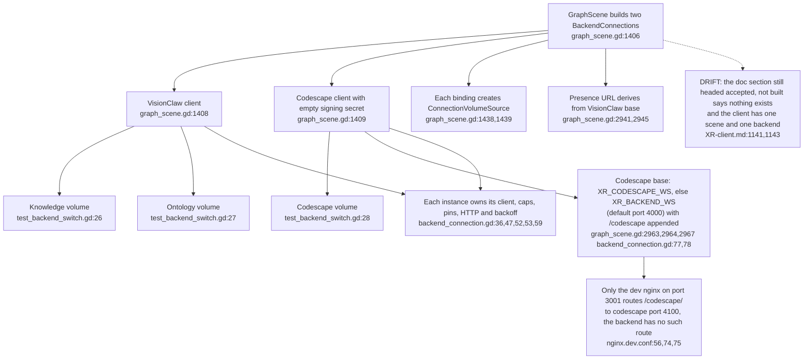
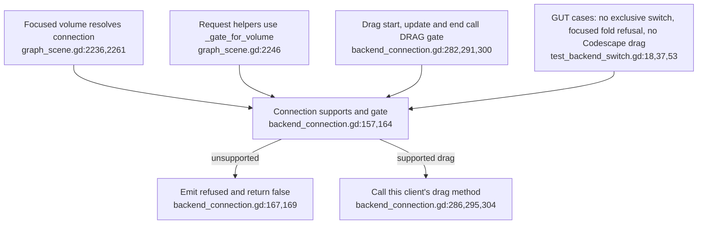
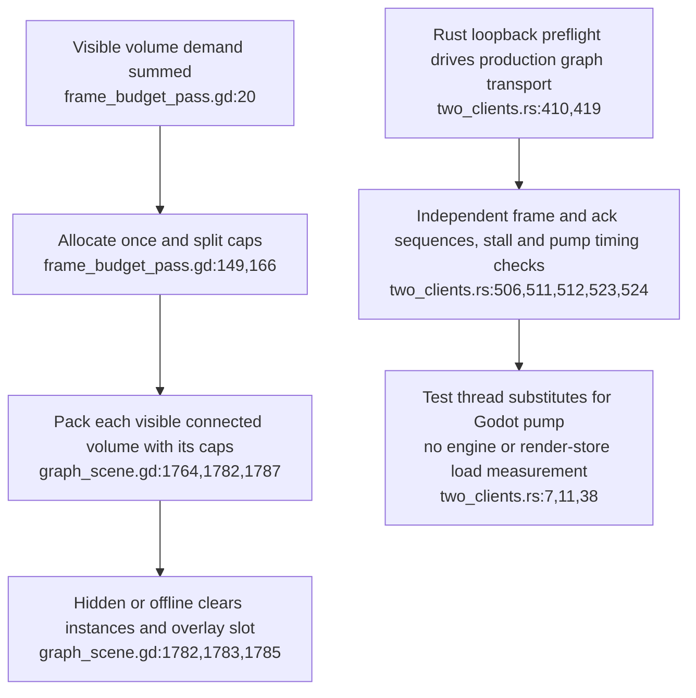

## For developers

This is the current source arrangement that replaced the exclusive switch; [VC-40](40-xr-two-backends-capability-gating.md) draws the capability table, the retired switch and the palette at the same pin. The [audit](../../estate-review/2026-10-31-codescape-presence-and-xr.md) distinguishes Rust transport evidence, inspected GDScript and unmeasured headset acceptance.

The subsequent [headless volume/link audit](46-spatial-volume-fit-and-link-budget.md) qualifies fit cadence and highlight budgets with executed Godot fixtures; transport and headset acceptance remain separate. The [federation prerequisite review](48-dataspace-federation-prerequisites.md) traces why the current native transport does not satisfy release upgrade gates and why concurrent local sources do not establish dataspace permissions.

## For the business

Knowledge, ontology and code can be fed by concurrent connections. Source separation and capability guards are implemented; their presence alone does not establish the three-volume headset frame-rate target.

## VC-44.1 Two content connections feed three volumes while presence stays separate

**What it shows.** The scene keeps both graph connections and one separately configured room-presence path; graph and presence go straight to the backend on port 4000 while Codescape is reached through nginx on port 3001 (`docs/XR-client.md:304`). **Why it is this way.** Node ids, acknowledgements and request state belong to their content connection; changing focus no longer selects an exclusive graph backend.
**Open (risk):** with `XR_CODESCAPE_WS` unset, the Codescape connection dials `XR_BACKEND_WS` plus `/codescape` (`xr-client/scripts/graph_scene.gd:2967`), which on the default port 4000 reaches a backend with no `/codescape` route; only the nginx location at `nginx.dev.conf:74` serves it, so that volume retries under backoff until the operator sets the variable.
**Drift:** `docs/XR-client.md:1305-1306` still says to point `XR_BACKEND_WS` at Codescape or press the Session tab's Backend toggle, and `docs/XR-client.md:1316` launches with `XR_BACKEND_MODE=codescape`; the toggle is retired and no client script reads that variable, while the per-source base is `xr-client/scripts/graph_scene.gd:2963-2967`.

## VC-44.2 Requests and drags gate through a volume's connection

**What it shows.** Codescape drag is now refused before sending, unlike ADR-2143 A6's historical limitation. **Why it is this way.** Capabilities follow each connection and the focused volume. These controls express client UX; they are not server authorisation for federated content.

## VC-44.3 Shared budget and transport preflight are distinct acceptance layers

**What it shows.** Budget allocation, transport fairness and headset frame time are separate claims. **Why it is this way.** The preflight exercises real transport with simulated main-thread pumping; ADR-2159 still requires E8 on the headset before activation.

**Drift:** ADR-2159's verification says no BackendConnection exists; current construction is wired into the scene (`graph_scene.gd:1406`). Its inactive status is not overturned by this source observation.
