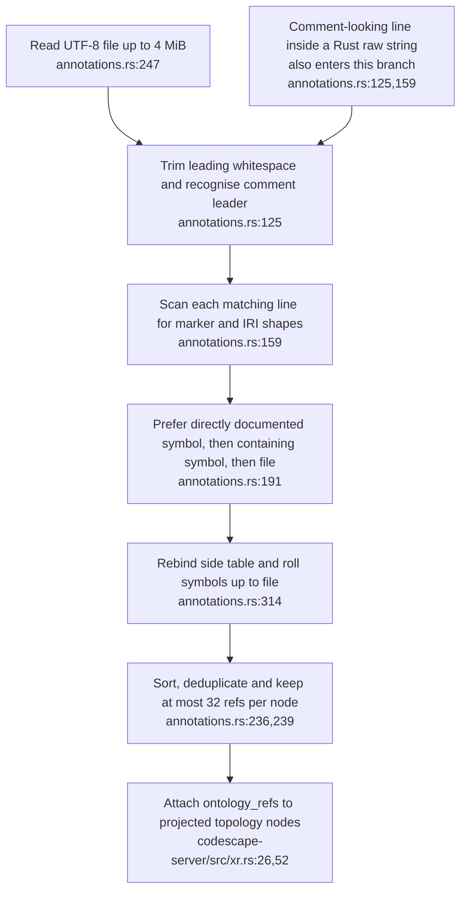
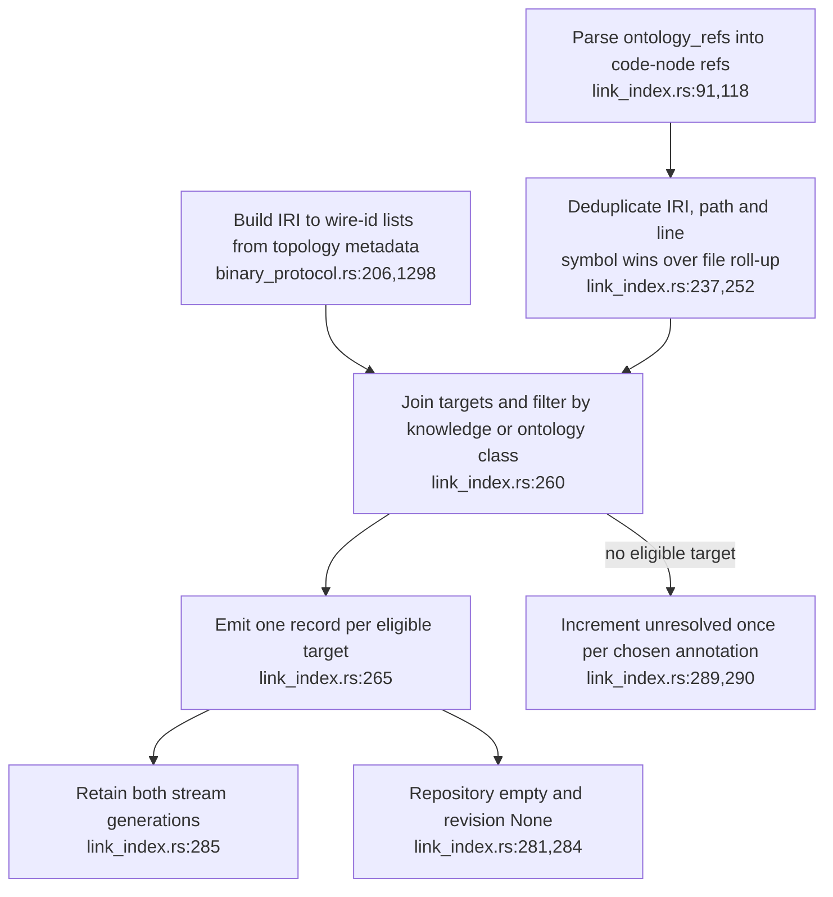

## For developers

The [executable audit](../../estate-review/2026-10-31-xr-volumes-and-code-links.md) follows real Codescape annotation scanning and topology emission into the verbatim pure XR join module. It does not exercise the gdext wrapper or live streams.

## For the business

A code-to-concept edge is an authored annotation resolved against the loaded graph. It does not prove that the code implements the concept, and current records cannot identify the repository revision that supplied the claim.

## VC-45.1 The scanner recognises line prefixes without language lexical context

**What it shows.** The probe compiles its raw-string fixture as valid Rust, then observes the example become a bound annotation and two target links. Real comments work and bare, inline and malformed tokens are refused. **Why it is this way.** Scanning is line-oriented; it does not ask the language parser whether a matching line lies inside a string.

**Tension:** The contract describes a comment annotation, while the recogniser accepts comment-shaped string content (`annotations.rs:125`).

## VC-45.2 The join preserves generation identity but leaves repository provenance empty

**What it shows.** Multiple target ids and symbol/file de-duplication work, but a snapshot labelled with repository and revision produces records with neither value. **Why it is this way.** The stream omits these provenance values and the join deliberately supplies empty defaults. Stream generations protect transient ids; they are not repository revisions.

## VC-45.3 Producer truncation and connection invalidation have different counters

**What it shows.** With 33 bound refs and every target available, the probe receives 32 refs, emits 32 links and reports zero unresolved. Generation-change cleanup is a separate mechanism. **Why it is this way.** The cap is documented, but omitted producer refs cannot be counted by a consumer that never receives them.

**Drift:** ADR-2164's “nothing built” verification predates the implemented producer, join and scene wiring. Live seed resolution remains unverified in this pass.
