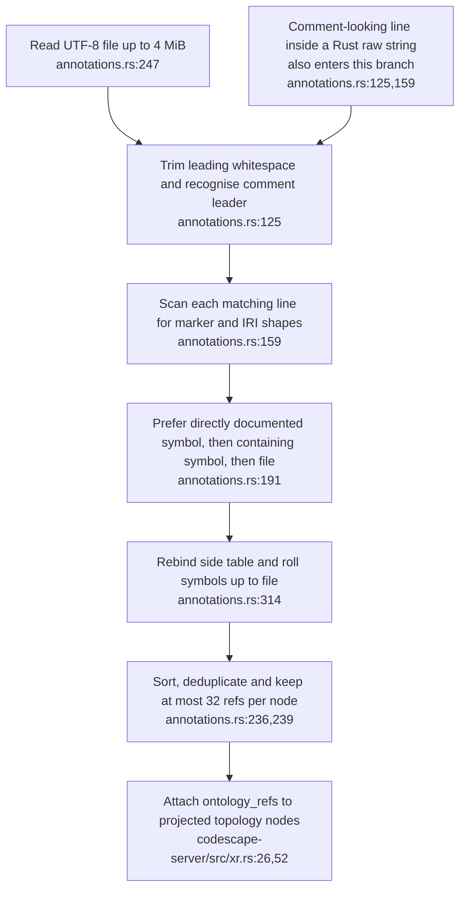
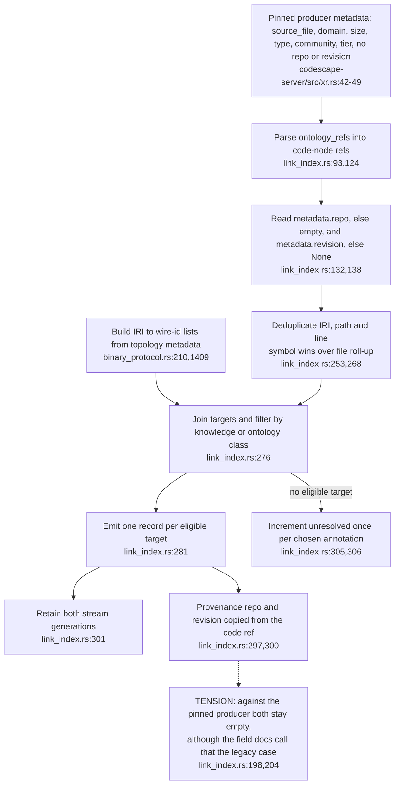
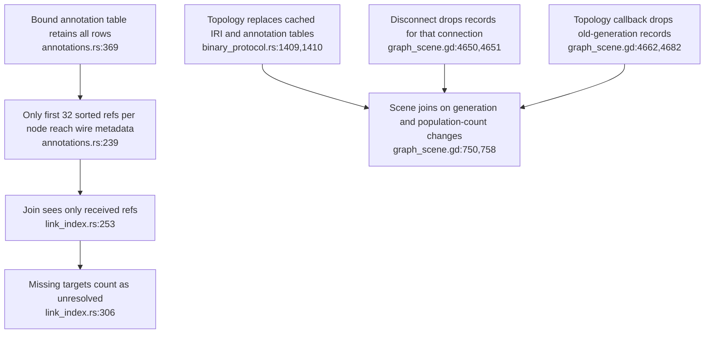

## For developers

The [executable audit](../../estate-review/2026-10-31-xr-volumes-and-code-links.md) follows real Codescape annotation scanning and topology emission into the verbatim pure XR join module. It does not exercise the gdext wrapper or live streams.

## For the business

A code-to-concept edge is an authored annotation resolved against the loaded graph. It does not prove that the code implements the concept, and current records cannot identify the repository revision that supplied the claim.

## VC-45.1 The scanner recognises line prefixes without language lexical context

**What it shows.** The probe compiles its raw-string fixture as valid Rust, then observes the example become a bound annotation and two target links. Real comments work and bare, inline and malformed tokens are refused. **Why it is this way.** Scanning is line-oriented; it does not ask the language parser whether a matching line lies inside a string.

**Tension:** The contract describes a comment annotation, while the recogniser accepts comment-shaped string content (`annotations.rs:125`).

## VC-45.2 The consumer now reads repository provenance that the pinned producer never sends

**What it shows.** VisionClaw's half of the provenance repair has landed: the join copies whatever repository and revision the code stream supplies. **Why it is this way.** The revision is a monotonic Codescape snapshot counter, not a Git commit (`link_index.rs:114`), so even when populated it does not name the source revision of a claim.
**Tension (cross-repo):** The producer half (`repo` and `revision` in `initial_graph_load` metadata) exists only on standalone Codescape after `e3b76f6`; VisionClaw `ec785afa9` pins `e3b76f6`, whose `codescape-server/src/xr.rs:42-49` emits neither, so every deployed record is the "legacy" empty case.

## VC-45.3 Producer truncation and connection invalidation have different counters

**What it shows.** With 33 bound refs and every target available, the probe receives 32 refs, emits 32 links and reports zero unresolved. Generation-change cleanup is a separate mechanism. **Why it is this way.** The cap is documented, but omitted producer refs cannot be counted by a consumer that never receives them.

**Drift:** ADR-2164 still records `implementation_status: none` (`ADR-2164-code-graph-entities-link-to-knowledge-and-ontology-nodes-resolved-at-runtime.md:6`) although producer, join and scene wiring exist, and its 2026-11-02 note says the join leaves repo empty at `link_index.rs:281-285` (same ADR, line 26), which the join no longer does (`link_index.rs:297`).
