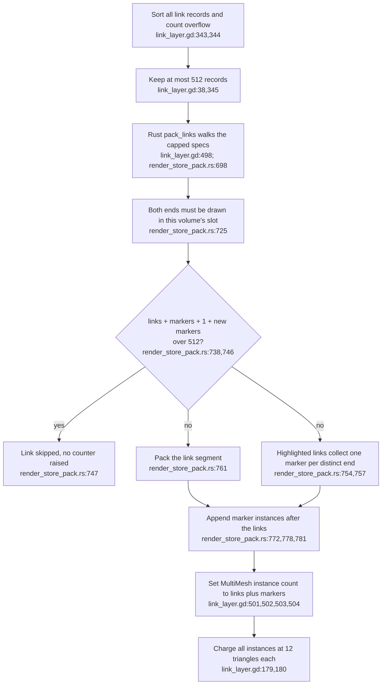
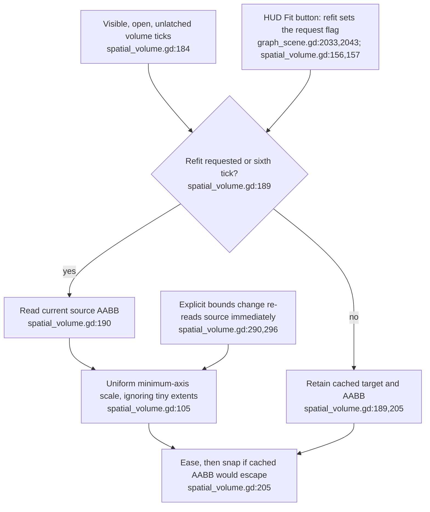

## For developers

The [headless audit](../../estate-review/2026-10-31-xr-volumes-and-code-links.md) runs unchanged production scripts on Godot 4.6.1 with isolated fixtures. It tests geometry/state behaviour without a headset, live streams or a native spatial container.

The subsequent [portal review](47-portal-entry-and-scaled-walkthrough.md) covers entered-room transitions, scale-dependent walk-through re-arming and membrane accounting; entered rooms inherit the fit boundary shown here.

## For the business

The multi-volume interface is implemented, but its budget and containment promises need narrower wording or repairs. Highlight markers now share the link cap rather than exceeding it, but links they displace vanish without a count, and a newly expanded graph extent can remain outside its fitted box for several ticks.

## VC-46.1 Links and highlight markers now share one 512-instance allowance

**What it shows.** Since `6b811f7a1` the Rust pack reserves room for a lit link's not-yet-seen end markers before it packs the link, so links plus markers never exceed 512 instances (6,144 triangles); the 2026-10-31 fixture (512 links plus 513 markers) predates this and was not re-run. **Why it is this way.** ADR-2164 D8/L5 bound instances and triangles, and the earlier record-only cap let markers ride past it; the allowance closes that gap in the packer rather than in the GDScript record cap.
**Open (risk):** a link dropped by the instance allowance is skipped without touching `unresolved` or any overflow count (`xr-client/rust/src/render_store_pack.rs:746-747`), while the only reported overflow is the record cap (`xr-client/scripts/link_layer.gd:344`), so highlighting can silently remove links from view.
**Debt (parallel):** the packer hard-codes `512` (`xr-client/rust/src/render_store_pack.rs:746`) beside the GDScript `MAX_LINKS := 512` it must agree with (`xr-client/scripts/link_layer.gd:38`); nothing ties the two.
**Drift:** ADR-2164's 2026-11-02 review note still says Rust adds deduplicated markers after the record cap (`docs/adr/ADR-2164-code-graph-entities-link-to-knowledge-and-ontology-nodes-resolved-at-runtime.md:28-29`); the next day's packer counts them inside the 512 allowance (`xr-client/rust/src/render_store_pack.rs:746`).

## VC-46.2 A cached extent can lag moving content despite a safe fit calculation

**What it shows.** After a fitted source expands, the headless fixture observes its new corner outside the box for four ticks before the sixth-tick refresh. Explicit resizing refits immediately and the anisotropic/zero-extent controls pass. **Why it is this way.** The containment check uses the cached extent. This is a transform-level counterexample; no headset image or real node-motion frequency was measured.

## VC-46.3 Native support is a guarded wrapper around the emulated arrangement

**What it shows.** Existing fake-extension tests cover fallback and arrangement fitting; real native-container support is not established by the headless run. **Why it is this way.** Every graph volume stays emulated. The optional native arm wraps the application arrangement rather than turning each graph into a separate native container.
