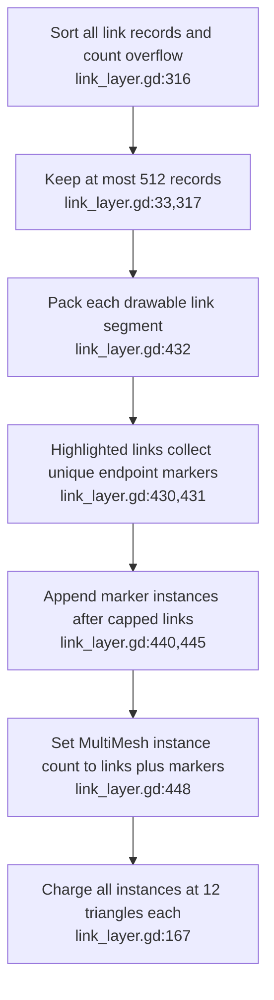
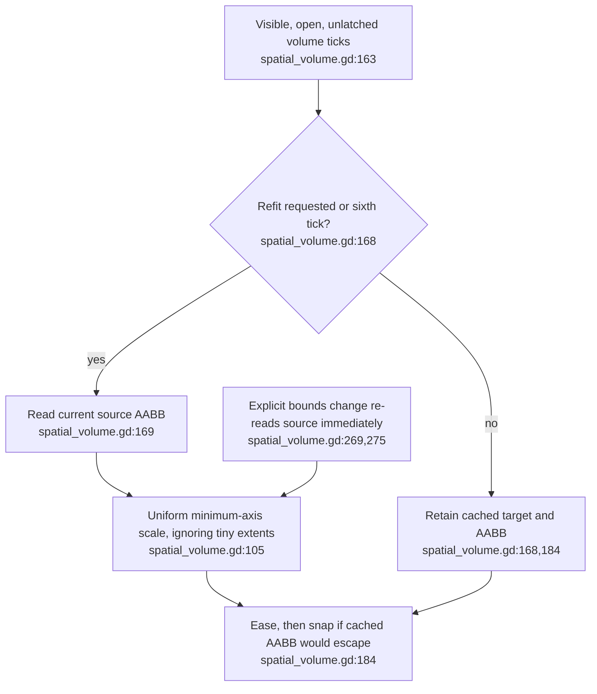
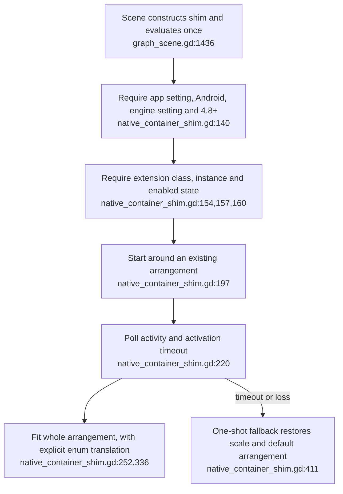

## For developers

The [headless audit](../../estate-review/2026-10-31-xr-volumes-and-code-links.md) runs unchanged production scripts on Godot 4.6.1 with isolated fixtures. It tests geometry/state behaviour without a headset, live streams or a native spatial container.

## For the business

The multi-volume interface is implemented, but its budget and containment promises need narrower wording or repairs. Highlight markers add geometry beyond the link cap, and a newly expanded graph extent can remain outside its fitted box for several ticks.

## VC-46.1 Highlight markers are added after the 512-link cap

**What it shows.** The fixture starts with 512 links and 6,144 triangles. Highlighting their common source adds 513 markers: 1,025 instances and 12,300 triangles, still one draw call and zero record overflow. **Why it is this way.** The cap applies to link records, while highlight markers are appended later. Triangle accounting includes the extra geometry; this is not an uncounted rendering cost.

**Tension:** ADR-2164 D8/L5 caps instances and total triangles, while the current highlight path exceeds both (`link_layer.gd:440,448`).

## VC-46.2 A cached extent can lag moving content despite a safe fit calculation

**What it shows.** After a fitted source expands, the headless fixture observes its new corner outside the box for four ticks before the sixth-tick refresh. Explicit resizing refits immediately and the anisotropic/zero-extent controls pass. **Why it is this way.** The containment check uses the cached extent. This is a transform-level counterexample; no headset image or real node-motion frequency was measured.

## VC-46.3 Native support is a guarded wrapper around the emulated arrangement

**What it shows.** Existing fake-extension tests cover fallback and arrangement fitting; real native-container support is not established by the headless run. **Why it is this way.** Every graph volume stays emulated. The optional native arm wraps the application arrangement rather than turning each graph into a separate native container.
