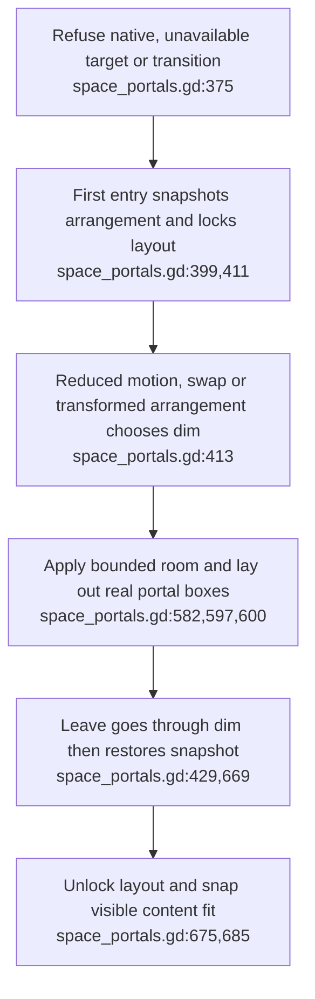
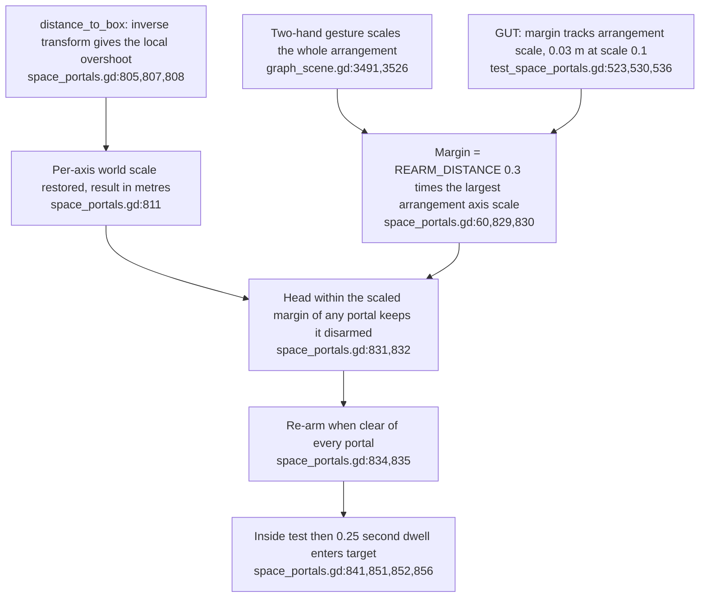
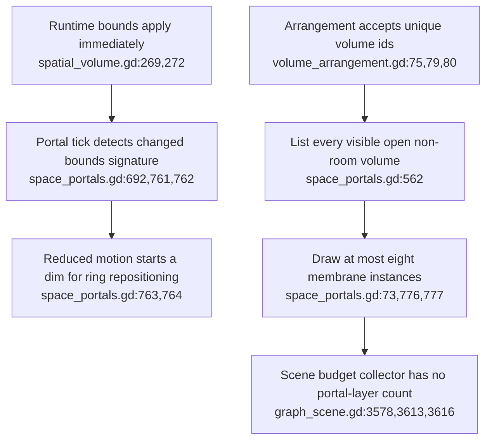

## For developers

The [portal audit](../../estate-review/2026-10-31-portals-and-federation.md) records 41 existing logic tests and seven adversarial/control cases on isolated Godot 4.6.1. Those runs remain historical. The [grab and portal refresh](../../estate-review/2026-11-01-xr-grab-boundaries.md) checks the current source delta; seven native scene tests and headset acceptance remain outside the portal fixture.

## For the business

Entering a volume changes the local viewing arrangement. It grants no remote-data permission. State restoration works in the tested cases; the walk-through hysteresis now scales with the space, and the scope of comfort promises still needs correction.

## VC-47.1 Entry snapshots the arrangement and chooses a transition

**What it shows.** Enter/swap/leave and exact restoration have passing logic tests. **Why it is this way.** The room is a bounded-volume layout state, with a saved ring arrangement; it is not a native immersive mode or a remote room admission.

## VC-47.2 Re-arm distance is measured in metres against an arrangement-scaled margin

**What it shows.** Since `6b811f7a1` the distance is in world metres and the margin scales with the arrangement, so at scale 0.1 the head re-arms beyond 0.03 m; the 2026-10-31 half- and double-scale fixture predates the change. **Why it is this way.** ADR-2166's 2026-11-05 update closes the scale-relative finding by making the hysteresis proportional to how large the user has made the space (`docs/adr/ADR-2166-spatial-volumes-can-be-entered-the-others-become-portals.md:32`).
**Invariant:** the walk-through re-arm margin is `REARM_DISTANCE` times the arrangement's largest axis scale (`xr-client/scripts/space_portals.gd:830`), pinned by `xr-client/tests/unit/test_space_portals.gd:523-536`.

## VC-47.3 Resize detection and membrane capacity have explicit boundaries

**What it shows.** The API probe changes bounds before the dim begins; nine admitted portal boxes get eight membranes. **Why it is this way.** Detection follows mutation, and the documented eight-portal capacity is enforced only for membrane instances. The present scene has three volumes; the ninth-box case tests an extension boundary.

**Debt:** Portal membranes and fade meshes are absent from the scene's explicit draw-call sum; primitive totals are measured separately (`graph_scene.gd:3613,3614`).
